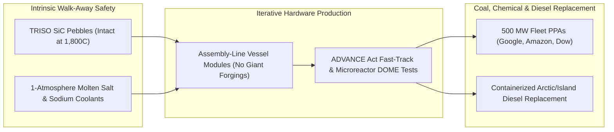

# CARBON EDITION • ABUNDANT CLEAN ENERGY
## Walk-Away-Safe Gen IV Fission & Microreactors — *Melt-Proof Ceramic Pebbles, Atmospheric Salt Loops, and Factory Microreactors Ending Diesel & Coal*

> **The Cynic's Belief:**
> *"Nuclear power means \$35-billion bespoke concrete domes that run ten years behind schedule, require high-pressure
> water pipes that risk meltdowns if backup pumps fail, and leave behind ten-thousand-year waste."*
>
> **The 2026 Breakthrough Reality:**
> Generation IV reactors replaced high-pressure water with atmospheric-pressure molten salt, liquid sodium, and
> **TRISO** silicon-carbide ceramic fuel pebbles proven melt-proof to $1,800^\circ\text{C}$—where passive laws of
> physics shut the core down without human action or electricity. Today, Kairos Power's *Hermes* reactors are rising
> in Oak Ridge, TN for Google's 500 MW fleet PPA, TerraPower's *Natrium* plant is replacing coal in Kemmerer, WY, and
> shipping-container microreactors from Radiant and Oklo are poised to retire smoky Arctic and island diesel forever.

---

## ACT I: A DELIGHTFUL NEAR FUTURE (HUMAN STORY)

In Kemmerer, Wyoming—a high-desert town of 2,600 proud coal miners and power-plant families—control-room operator
Kendra Halvorsen pours coffee inside TerraPower's *Natrium* energy island, three-quarters of a mile from the retired
Naughton coal boilers where her father worked for thirty-four winters. Outside, wind turbines whip across the snowy
Wyoming ridge; inside, an atmospheric-pressure liquid-sodium core quietly charges giant insulated tanks of molten
nitrate salt—the exact thermal storage medium used by solar-thermal plants:

* **Zero Layoffs, Peaking on Demand:**
  At 5:30 PM, when mountain sun drops and Western grid demand spikes, Kendra taps a touchscreen. Without changing
  the reactor's steady 345-megawatt thermal output by a single percent, the molten-salt storage tanks open wide,
  surging clean turbine output to **500 megawatts** for five straight hours—doing the flexible peaking job of a
  gas plant with zero carbon smoke, while keeping every Lincoln County union family employed at higher pay.
* **Ending the Arctic Diesel Barge:**
  Two thousand miles northwest in a coastal Alaskan village above the Arctic Circle, smoky, deafening diesel
  generators that once burned \$9-per-gallon fuel delivered by summer icebreaker sit silent in a museum shed. In
  their place, a single factory-sealed **Radiant** helium-cooled microreactor—delivered on a standard flatbed
  trailer—warms the school gym, powers an indoor hydroponic berry room, and cuts village electric bills by 70%.
* **Industrial Steam Without Smokestacks:**
  Down on the Texas Gulf Coast at Seadrift, four **X-energy** pebble-bed modules pipe $565^\circ\text{C}$ clean steam
  straight into Dow's chemical manufacturing complex, displacing 440,000 metric tons of $\text{CO}_2$ every year
  on a footprint smaller than a high-school campus.

---

## ACT II: SOTA BREAKTHROUGHS, REAL COMPANIES & SYNERGIES

Twentieth-century light-water reactors (LWRs) locked themselves into an expensive engineering corner: using ordinary
water as coolant meant pressurizing massive forged-steel vessels to **150 atmospheres** ($2,200\text{ psi}$) just to
keep water from flashing into steam at $315^\circ\text{C}$. Almost all of legacy nuclear's concrete mass, redundant
safety piping, and 12-year construction bloat existed solely to contain that pressurized steam!

### 1. Three Intrinsic Walk-Away Safety Breakthroughs (2023–2026)
Generation IV designs delete high-pressure water entirely, substituting intrinsic materials physics for complex valves:

* **Melt-Proof TRISO "Poppy-Seed" Ceramic Fuel ($1,800^\circ\text{C}$ Armor):**
  Tri-structural isotropic (**TRISO**) fuel seals uranium oxycarbide kernels the size of poppy seeds inside triple
  shells of pyrolytic carbon and **silicon carbide** (harder than steel, ceramic armor that stays solid past
  $1,800^\circ\text{C}$). In U.S. Department of Energy Idaho National Laboratory (INL) torture tests, operators shut
  off all active cooling on live TRISO fuel; **Doppler-broadening negative temperature reactivity** automatically
  halted fission near $1,600^\circ\text{C}$—hundreds of degrees *below* silicon carbide's failure point. Every pebble
  is its own indestructible containment building.
* **Atmospheric-Pressure Coolants (Molten Salt & Liquid Sodium):**
  Molten fluoride salt (**FLiBe**, boiling point $\sim 1,430^\circ\text{C}$) and liquid sodium (boiling point
  $883^\circ\text{C}$) run at **ordinary garden-hose atmospheric pressure**. If a pipe leaks, nothing flashes into
  explosive steam; salt simply freezes into solid rock in a catch basin while natural air convection cools the vessel.
* **Fast-Spectrum Fuel Recycling (Closing the Waste Loop):**
  Conventional LWRs extract less than **5%** of the energy in mined uranium rods before calling the rest "nuclear
  waste." Fast-neutron metallic reactors (**Oklo**, **TerraPower**) consume those exact long-lived actinides from
  existing U.S. spent-fuel casks—extracting $20\times$ more carbon-free energy while shrinking radiotoxicity
  lifetimes from 100,000 years down to ~300 years.

> *"To make nuclear affordable and abundant, we don't need miracle physics—we need rapid, iterative hardware
> engineering combined with intrinsic walk-away safety."*
> — **Mike Laufer**, Co-Founder & CEO, Kairos Power

### 2. Verified 2025–2026 Gen IV Fission & Microreactor Pioneers

| Pioneer / Reactor | Core & Coolant Architecture | Verified 2025–2026 SOTA Milestone | Commercial Fleet & Customer Offtake |
| :--- | :--- | :--- | :--- |
| **Kairos Power** | *KP-FHR* low-pressure molten FLiBe salt + TRISO pebble bed | Active NRC-permitted construction of *Hermes 1* & approved *Hermes 2* twin plant in Oak Ridge, TN; salt test loops run | Historic **500 MW fleet PPA with Google** (first unit online by 2030, full fleet by 2035) |
| **TerraPower** | *Natrium* 345 MWe sodium fast reactor + 500 MWe molten-salt storage | Site excavation/non-nuclear island built in Kemmerer, WY; NRC safety review accelerated under ADVANCE Act | Retiring coal plant repowering with PacifiCorp + multi-GW data-center & utility agreements |
| **X-energy** | *Xe-100* high-temperature helium-cooled TRISO pebble-bed (80 MWe / module) | Scaled *TRISO-X* commercial fuel fabrication facility in Oak Ridge, TN; backed by \$700M+ Amazon-led round | 4-unit industrial steam & power plant at **Dow Seadrift, TX** + **5+ GW Amazon** fleet roadmap |
| **Radiant Nuclear** | *Kaleidos* 1.2 MWe road-transportable helium/TRISO container microreactor | Selected for fueled testing at INL's **DOME** microreactor testbed (2026); \$165M+ raised | Drop-in clean replacement for remote villages, disaster hospitals, mines & defense bases |
| **Oklo & Westinghouse** | *Aurora* 15–75 MWe fast-spectrum heat-pipe powerhouse & *eVinci* microreactor | Oklo public on NYSE with >14 GW customer pipeline (Switch, Equinix) & fuel-recycling roadmap at INL | Turnkey build-own-operate clean power & heat for campuses, data hubs & off-grid communities |

---

## ACT III: REIMAGINING SOCIAL CONVENTIONS & GLOBAL PROOF

Whenever critics claim *"No democracy can build nuclear fast or cheap anymore,"* history and recent regulatory
reforms hand back three irrefutable counter-proofs:

1. **France's 15-Year Messmer Plan Miracle:**
   After the 1973 oil shock, France standardized a single reactor family and built **56 nuclear reactors in roughly
   fifteen years**—slashing national grid carbon intensity below $50\text{ g CO}_2\text{/kWh}$ (one-seventh of
   coal-heavy peers) while turning France into Europe's largest net exporter of clean electricity. Cost overruns
   only happen when nations stop building for thirty years and treat every unit as a one-off artisanal sculpture!
2. **South Korea & UAE's Barakah Proof (On-Budget Serial Learning):**
   Using standardized *APR1400* assembly discipline, South Korea built four 1,400 MWe units at **Barakah** in the
   UAE inside twelve years from first concrete to 25% of national electricity—proving serial construction learning
   curves slash per-kilowatt cost >35% from Unit 1 to Unit 4.
3. **The Bipartisan U.S. `ADVANCE Act` & Coal-Site Reuse:**
   Signed with near-unanimous Senate support (88–2), the `ADVANCE Act` directed the NRC to slash review fees, honor
   allied-nation safety approvals (Canada CNSC / UK ONR), create dedicated microreactor factory-licensing rules,
   and fast-track environmental reviews on **retired coal brownfields**—where emergency planning zones shrink to the
   plant fence line because TRISO cannot melt down.

| Trajectory Metric | 2026 Baseline | 2030 Sprint | 2035 Scaling | 2040 Maturity |
| :--- | :--- | :--- | :--- | :--- |
| **TRISO & HALEU Fuel Supply** | Centrus Piketon OH + TRISO-X Oak Ridge scaling up | Domestic multi-ton HALEU cascades + fuel recycling pilots | Automated assembly-line pebble & metallic fuel fabs | Closed-loop spent-fuel actinide recycling standard |
| **Gen IV & Microreactor Fleet** | *Hermes*, *Natrium*, *Seadrift* & INL *DOME* builds | First commercial Gen IV MWe + 25+ container microreactors | 35+ GW factory SMRs repowering US/EU/Asian coal & chem hubs | 200+ GW global fleet + diesel-free Arctic & islands |
| **Overnight Cost & Build Time** | 8–12 yr legacy LWRs (\$9,000+/kW FOAK) | 36-month site assembly; \$4,200/kW early SMR twin packs | 18-month modular drop-in; \$2,400/kW serial shipyard units | <90-day factory microreactor install; \$35–\$48/MWh LCOE |
| **Waste & Safety Footprint** | 10-mile LWR emergency zones & dry-cask storage | Fence-line emergency zones via passive $1,800^\circ\text{C}$ safety | Fast reactors begin consuming legacy spent-fuel stockpiles | Walk-away-safe heat & power accepted beside towns |

---

## ACT IV: THE SYNERGY CASCADE

High-temperature Gen IV reactors deliver two superpowers solar and wind cannot provide directly: **$550^\circ\text{C}–750^\circ\text{C}$
industrial process steam** on tiny land footprints, and multi-year energy security inside a single shipping container:

* **Decarbonizing Chemicals, Refineries & Paper:**
  Direct $600^\circ\text{C}+$ steam from pebble-bed modules plugs straight into petrochemical, fertilizer, and
  synthetic fuel plants alongside [Synthetic Sky Fuels](../synthetic-sky-fuels/REPORT.md), boosting electrolysis
  efficiency via high-temperature solid-oxide steam splitting by >25%.
* **Built-In Molten-Salt Grid Peaking:**
  Pairing steady nuclear heat with giant nitrate-salt tanks complements [100-Hour Rust, Salt & Glowing Carbon Storage](../iron-sodium-storage/REPORT.md),
  giving grids gigawatts of instant spinning inertia and evening ramping.
* **Clean Maritime Shipping:**
  Atmospheric-pressure molten-salt cores require zero bunker oil—opening a path to zero-emission container ships
  that cross oceans faster without black-carbon soot over Arctic sea ice.
* **Lifeline Water & Food in Remote Latitudes:**
  A single 1.5 MWe microreactor powers village heating, vertical berry rooms, and [Aquifer Rivers & Desalination](../aquifer-rivers-desalination/REPORT.md)
  across hundreds of island nations and Indigenous northern communities.

---

## References & Verified Sources

* **Featured Researcher / Leader:** [Mike Laufer — Co-Founder & CEO, Kairos Power](https://kairospower.com/)
* **Companies, Labs & Consortia:** [Kairos Power](https://kairospower.com/) · [TerraPower (Natrium)](https://www.terrapower.com/) · [X-energy](https://x-energy.com/) · [Radiant Nuclear](https://www.radiantnuclear.com/) · [Oklo](https://oklo.com/) · [Idaho National Laboratory (DOME)](https://inl.gov/)
* **Global & Regulatory Precedents:** [France 15-Year Messmer Plan (56 Standardized Reactors, <50g CO₂/kWh)](https://en.wikipedia.org/wiki/Nuclear_power_in_France) · [South Korea / UAE Barakah 4-Unit Serial Build (-35% Cost Curve)](https://en.wikipedia.org/wiki/Barakah_nuclear_power_plant) · [US Bipartisan ADVANCE Act (88–2 Senate Vote) Licensing Reform](https://www.nrc.gov/about-nrc/governing-laws/advance-act.html) · [INL Walk-Away Loss-of-Cooling Live Reactor Safety Demonstrations](https://inl.gov/nuclear-energy/)
* **Connected Carbon Pathways:** [100-Hour Rust, Salt & Glowing Carbon Storage](../iron-sodium-storage/REPORT.md) · [Turning Thin Air into Jet Fuel, Green Steel & Stone](../synthetic-sky-fuels/REPORT.md) · [Ending Drought Forever: Sub-Penny Desalination & Continental New Rivers](../aquifer-rivers-desalination/REPORT.md) · [The 48-Hour Digital State: Estonia X-Road, Physics Permits & 5-Minute Justice](../../04-social-norms/forty-eight-hour-governance/REPORT.md)
