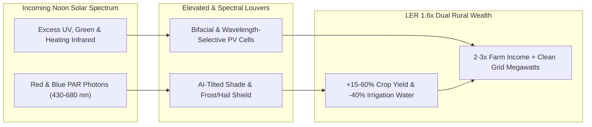

# CARBON EDITION • ABUNDANT CLEAN ENERGY
## Dual-Harvest Agrivoltaics — *Wavelength-Selective Solar Canopies That Boost Crop Yields & Save 40% Water*

> **The Cynic's Belief:**
> *"Utility-scale solar is an ecological land grab that paves prime family farmland under oceans of dead black glass,
> pits rural towns against city environmentalists, and forces humanity to choose between growing food and generating
> clean electricity."*
>
> **The 2026 Breakthrough Reality:**
> Plants don't actually want scorching 100% afternoon desert or heatwave sun—above their **light-saturation point**, leaves
> slam their stomata shut to avoid cooking, halting growth while evaporating precious water. Across 4,000+ *Solar Sharing*
> farms in Japan, NREL's *InSPIRE* network in Colorado and Arizona, and Sun'Agri's AI-tilting orchard canopies in France,
> elevated and **wavelength-selective semi-transparent solar louvers** boost tomato, berry, pepper, and forage yields by
> **15%–60%**, slash irrigation water **30%–40%**, shield harvests from hail and $42^\circ\text{C}$ heat domes, and multiply
> family-farm net income **$2\times\text{--}3\times$ per acre**.

---

## ACT I: A DELIGHTFUL NEAR FUTURE (HUMAN STORY)

On a blazing $39^\circ\text{C}$ July afternoon in Longmont, Colorado—echoed across cherry orchards in Provence, rice
paddies in Chiba Prefecture, and sheep pastures in New South Wales—fourth-generation market farmer Caleb Byron walks
comfortably in shirt-sleeves beneath 3.2-meter-high, ruby-tinted solar louvers without breaking a sweat.

Ten meters outside the canopy edge, unprotected Neighboring pasture grass has baked brittle brown under the summer heat
dome. Directly beneath Caleb's elevated solar array, soil moisture sensors read lush emerald green while heirloom tomatoes,
sweet bell peppers, and honeybee-pollinated wildflowers thrive in dappled, $6^\circ\text{C}$-cooler microclimate shade:

* **Feeding Plants Their Favorite Colors, Turning the Rest Into Power:**
  Chlorophyll absorbs blue ($430\text{--}470\text{ nm}$) and red ($640\text{--}680\text{ nm}$) photons for photosynthesis,
  mostly reflecting green and overheating under intense near-infrared. Caleb's semi-transparent organic and perovskite-tinted
  overhead modules let optimal red-blue photosynthetic light bathe the crops below while capturing green, UV, and heat-inducing
  infrared photons to stream clean megawatts into the county cooperative grid.
* **40% Less Irrigation Water & Built-In Hail Armor:**
  Cooler leaf temperatures cut evapotranspiration dramatically—saving Caleb 38% on scarce Colorado River basin water—while
  motorized Sun'Agri louvers automatically tilt flat ahead of summer hailstorms or trap ground warmth during surprise May
  frost nights, saving entire fruit harvests that used to be wiped out in ten minutes.
* **The "Solar Shepherd" & Autonomous Under-Canopy Rovers:**
  Down the lane on the pasture parcel, 200 Merino ewes nap happily in the cool panel shadows, grazing invasive weeds cleanly
  around the posts—eliminating diesel mowing crews while producing premium wool alongside clean kilowatts.
* **Saving the Family Farm From Subdivision Bulldozers:**
  Before agrivoltaics, thin vegetable margins nearly forced Caleb's family to sell eighty acres to a strip-mall developer.
  Today, stacking steady monthly power royalties atop higher-grade organic produce triples net per-acre revenue—keeping his
  adult kids farming debt-free.

---

## ACT II: SOTA BREAKTHROUGHS, REAL COMPANIES & SYNERGIES

The "food versus solar" panic rests on two false numbers. First, supplying **100% of global primary energy** with solar
would cover $<0.4\%$ of Earth's land—less than roughly **1% of current agricultural land** (and far less than the 38+
million acres in the US alone currently burned in car engines as corn ethanol at ~0.2% solar-to-wheel efficiency, versus
solar panels + EVs delivering **$80\times\text{--}100\times$ more miles per acre**). Second, sharing the *same* acre
between crops and elevated panels consistently beats separate monocultures (**Land Equivalent Ratio $\text{LER} = 1.35\text{--}1.75$**).

### 1. Three Photonic, Microclimate & Agronomic Unlocks (2024–2026)
Modern agrivoltaics evolved far beyond bolted ankle-high utility racks into precision agricultural climate control:

* **Photosynthetic Light-Saturation & Stomatal Physics:**
  Most C3 crops (berries, leafy greens, tomatoes, grapes, hops, coffee, wheat, pasture clover) saturate photosynthetically
  at **$30\%\text{--}50\%$ of peak noon sunlight** ($600\text{--}900\text{ }\mu\text{mol/m}^2/\text{s}$ PAR). Excess midday
  irradiance triggers photoinhibition and vapor-pressure-deficit stress. Elevated solar canopies hold leaf temperatures
  $4^\circ\text{C}\text{--}8^\circ\text{C}$ cooler, keeping stomata open hours longer each afternoon while **cutting soil
  water evaporation 30%–40%**.
* **Wavelength-Selective & Luminescent Solar Concentrator (LSC) Films:**
  Companies like **Voltalia / Helexia**, **UbiQD**, **Brite Solar** (nanostructured glass), and translucent perovskite/OPV
  glazings tune spectral transmission—converting UV or green photons into red $650\text{ nm}$ fluorescence (*quantum-dot
  spectral down-shifting*) that actively accelerates fruiting while generating $120\text{--}200\text{ W/m}^2$ overhead.
* **AI Plant-Guided Dynamic Louvers & Vertical East-West Bifacial Fences:**
  In French vineyards and orchards, **Sun'Agri** runs real-time sap-flow and leaf-stress algorithms that tilt elevated trackers
  *away* from the sun on cloudy mornings (giving vines 100% light) and *into* protective shade during $40^\circ\text{C}$
  heatwaves. For broad-acre wheat and hay harvested by wide combines, **Next2Sun** plants vertical bifacial panels in rows
  10–15 meters apart—generating peak electricity at 8:00 AM and 6:00 PM (when grid prices peak!) while leaving 90% of
  tractor lanes completely open.

> *"Under solar panels in arid and warming climates, plants experience less heat stress and keep growing through midday,
> while the panels themselves run cooler and produce more electricity—everybody under the canopy wins."*
> — **Prof. Greg Barron-Gafford**, Agrivoltaics Pioneer, University of Arizona & Biosphere 2

### 2. Verified 2025–2026 Agrivoltaic Pioneers & Field Benchmarks

| Farm / Technology Leader | Canopy & Crop Architecture | Verified 2025–2026 Field Benchmark | Rural & Farmer Revenue Impact |
| :--- | :--- | :--- | :--- |
| **Jack's Solar Garden & NREL *InSPIRE* (CO / AZ)** | 2.4–3.2m elevated trackers over vegetables, berries & native pollinators | Univ. of Arizona / NREL trials proved **2x–3x cherry tomato & chiltepin yields**, **-30% to -40% water**, +2–3% cooler PV output | Open-source blueprint replicated across 500+ US *InSPIRE* research & co-op sites |
| **Sun'Agri (France & Mediterranean)** | AI plant-growth-steered dynamic high-clearance louvers (4.5m height) | 30+ commercial vineyards, apple, cherry & apricot orchards; cut heatwave sunburn **>60%** and spring frost losses **40%** | Protects French AOC wine acid balance & orchard harvests under extreme climate swings |
| **Next2Sun (Germany, Austria & Ireland)** | Vertical East-West bifacial "solar fences" (10–15m tractor lanes) | Zero combine-harvester obstruction; shifts generation to high-value morning/evening grid peaks; doubles hay/clover resilience | Preserves 90%+ arable cropland while cutting wind erosion across dry plains |
| **Brite Solar & UbiQD** | Nanostructured spectral-shifting solar glass & quantum-dot films | Semi-transparent agrivoltaic greenhouses in Greece, Spain, NL & US convert UV into red PAR light + clean roof power | Net-zero-energy glasshouses producing 100%+ berry/cucumber yields year-round |
| **American Solar Grazing Assoc. & Enel** | Rotational regenerative sheep grazing + pollinator habitat under GW arrays | **100,000+ sheep** grazing >120,000 acres of US solar farms (Enel *6,000-acre* Texas grazing contracts) | Pays ranchers \$300–\$550/acre/yr grazing fees while restoring native prairie soil carbon |

---

## ACT III: REIMAGINING SOCIAL CONVENTIONS & GLOBAL PROOF

Rural county moratoriums against solar happened when outside developers leased land, scraped topsoil bare, sprayed gravel,
and mailed lease checks out of state. Smart agricultural nations rewrote zoning and farm subsidies so clean energy *requires*
thriving agriculture underneath:

1. **France's National Agrivoltaics Decree (2024–2026 Enforcement):**
   French law legally defines true agrivoltaics—mandating that installations must maintain **at least 90% of reference
   regional crop yield**, provide measurable agronomic service (frost, hail, drought, or animal welfare protection), keep
   farming as the primary income activity, and remain 100% reversible without concrete soil sealing.
2. **Japan's 4,000+ *Solar Sharing* (*Eino-gata*) Farms & Italy's €1.7B PNRR Program:**
   Pioneered by farmer Akira Nagashima in Chiba, Japan's MAFF licensed over **4,000 elevated Solar Sharing farms** growing
   shiitake mushrooms, tea, blueberries, and rice, while Italy's EU-backed €1.7B *Parco Agrisolare* & elevated agrivoltaic
   tariffs unlocked 1+ GW over olive groves and vineyards without sacrificing a hectare of food.
3. **US Massachusetts *SMART* & Corn-Ethanol Conversion Math:**
   Converting just **one-third** of low-efficiency US fuel-ethanol cornfields into dual-harvest pollinator/grazing
   agrivoltaics generates more electricity than the entire existing US power grid—while returning wildflowers, monarch
   butterflies, and clean groundwater to the Midwest.

| Trajectory Metric | 2026 Baseline | 2030 Sprint | 2035 Scaling | 2040 Maturity |
| :--- | :--- | :--- | :--- | :--- |
| **Global Installed Agrivoltaics** | ~65+ GW (China desert greening, Japan, France, Italy, US) | **250+ GW** via French/EU decrees & translucent tandems | **900+ GW** standard across arid & Mediterranean farm belts | **2.5+ TW** integrated climate armor for global specialty crops |
| **Land Equivalent Ratio (LER)** | **1.35–1.65** (65% more combined food + power per acre) | **1.60–1.85** with quantum-dot spectral-tuned perovskite glass | **1.90+** via autonomous electric under-canopy micro-tractors | Monoculture ground-scraping solar obsolete on arable soils |
| **Irrigation Water Saved** | **-25% to -40%** across Arizona, Colorado, Spain & Ningxia trials | Saves **15+ billion $\text{m}^3$/yr** in drought-stressed basins | Reverses desertified shrubland (Kubq/Ningxia goji berry model) | Permanent drought & heat-dome shield for global horticulture |
| **Family Farm Economics** | \$800–\$1,400/acre lease + preserved crop harvest | **2x–3x net farm income**; halts rural farmland loss to sprawl | Farmer-owned energy co-ops power electric tractors & cold storage | Generational rural renaissance with zero food-vs-energy conflict |

---

## ACT IV: THE SYNERGY CASCADE

Agrivoltaics unites clean energy, water conservation, robotics, and ecological rewilding on the exact same patch of dirt:

* **Tunable Perovskite Bandgaps Made for Leaves:**
  Because [35.5% Perovskite-Silicon & Tandem Solar Skins](../perovskite-tandem-solar/REPORT.md) allow chemists to dial crystal
  bandgaps across the rainbow, semi-transparent rooftop and orchard cells pass exact red/blue chlorophyll wavelengths while
  harvesting infrared at record efficiency.
* **Shaded Swarms of Weed-Zapping Micro-Bots:**
  Cool, GPS-mapped solar rows act as charging docks and guide rails for lightweight
  [Specialized Agricultural Swarm Robotics](../../02-automation-science/specialized-swarm-robotics/REPORT.md) that laser-weed
  vegetables with zero chemical herbicides.
* **Sub-Penny Drip Irrigation & Rewilded Prairies:**
  Cutting crop water demand 40% stretches clean water from [Aquifer Rivers & Desalination](../aquifer-rivers-desalination/REPORT.md)
  nearly twice as far, while pairing solar grazing with [Solar Proteins & Continental Rewilding](../../03-bioscience-regeneration/precision-fermentation-rewilding/REPORT.md)
  restores millions of hectares of native grasslands and pollinators.

---

## References & Verified Sources

* **Featured Researcher:** [Prof. Greg Barron-Gafford — Agrivoltaics Lead, University of Arizona & Biosphere 2](https://biosphere2.org/)
* **Farms, Consortia & Tech Leaders:** [NREL InSPIRE Agrivoltaics Portal](https://openei.org/wiki/InSPIRE) · [Jack's Solar Garden (Colorado)](https://www.jackssolargarden.com/) · [Sun'Agri Dynamic Agrivoltaics](https://sunagri.fr/en/) · [Next2Sun Vertical Bifacial](https://next2sun.com/en/) · [Brite Solar Nanoglass](https://www.britesolar.com/) · [American Solar Grazing Association](https://solargrazing.org/)
* **Global & Policy Precedents:** [France National Agrivoltaics Decree (90% Crop Yield Guarantee)](https://www.legifrance.gouv.fr/) · [Japan MAFF 4,000+ *Solar Sharing* Farms](https://www.maff.go.jp/e/) · [Italy €1.7B PNRR Agrivoltaic Incentive Program](https://www.mase.gov.it/) · [University of Arizona *Nature Sustainability* Dryland Agrivoltaics Study](https://www.nature.com/natsustain/)
* **Connected Carbon Pathways:** [35.5% Perovskite-Silicon Tandems & Living Solar Skins](../perovskite-tandem-solar/REPORT.md) · [Specialized Swarm Robotics](../../02-automation-science/specialized-swarm-robotics/REPORT.md) · [Ending Drought Forever: Sub-Penny Desalination](../aquifer-rivers-desalination/REPORT.md) · [Precision Fermentation & Continental Rewilding](../../03-bioscience-regeneration/precision-fermentation-rewilding/REPORT.md)
