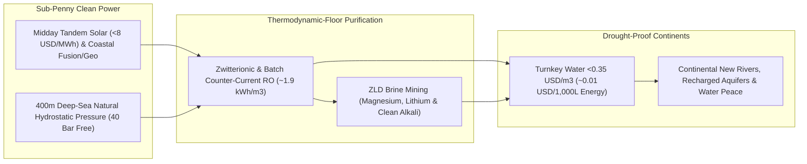

# CARBON EDITION • ABUNDANT CLEAN ENERGY
## Ending Drought Forever: Sub-Penny Desalination & Continental New Rivers — *Pairing High-Permeability Membranes and Subsea Pressure Pods with Cheap Clean Electrons to Refill Aquifers Worldwide*

> **The Cynic's Belief:**
> *"Climate change means permanent megadroughts and 'water wars' across the American West, Mediterranean, and Middle
> East—because ocean desalination guzzles fossil electricity, costs a fortune, and poisons coastal reefs with toxic salt brine."*
>
> **The 2026 Breakthrough Reality:**
> Earth doesn't have a water shortage—97% of our surface is water; we only had an *expensive-energy and dumb-brine*
> problem! Modern counter-current and **subsea reverse-osmosis pods** (**Waterise**, **OceanWell**, **IDE**) push
> desalination near its thermodynamic floor (**~1.8–2.2 kWh/m³**). Powered by \$4–\$10/MWh solar, geothermal, or
> fusion, **1,000 liters (264 gallons) of pure fresh water costs ~\$0.01 in energy**, while zero-liquid-discharge
> **brine mining** (**Lilac**, **ElectraLith**) harvests battery lithium and green-cement magnesium instead of hypersaline waste!

---

## ACT I: A DELIGHTFUL NEAR FUTURE (HUMAN STORY)

At sunrise in California's San Joaquin Valley—and three hundred miles south across the border in Hermosillo, Sonora—fourth-generation
citrus and avocado grower Sofia Alarcón kneels beside an earthen irrigation canal brimming with cool, crystal-clear,
mineral-balanced Pacific water. Ten years ago, her family watched subsiding aquifers crack valley highways by twenty
feet while neighbors fallowed heirloom orchards under emergency drought rations.

Today, Sofia dips a tin cup straight into the **New River** aqueduct and drinks:

* **264 Gallons of Pure Water for One Penny of Sunshine:**
  Sixty miles west off the coast, there is no noisy concrete eyesore blocking public beaches. Anchored silently four
  hundred meters down on the dark seafloor—where natural ocean weight supplies 40 atmospheres of free reverse-osmosis
  pressure—modular **OceanWell** and **Waterise** pods sip seawater through fish-safe ultra-low-velocity screens and
  send pure freshwater ashore powered by midday agrivoltaic solar and compact coastal baseload.
* **Refilling Ancient Aquifers & Wetlands:**
  Because wholesale afternoon electrons cost less than a cent per kilowatt-hour, coastal pods pump surplus fresh water
  every spring straight into gravel **Managed Aquifer Recharge** basins—lifting Central Valley groundwater tables back
  to 1950s levels while re-flooding 100,000 acres of seasonal Tule marshes alive with tens of thousands of Sandhill cranes.
* **Brine Turned Into Clean Battery & Building Wealth:**
  At onshore coastal hubs, concentrated salt streams no longer dump raw onto seagrass beds. Modular electrodialysis and
  ion-exchange columns (**Lilac**, **Captura**) strip out pure magnesium for zero-carbon concrete, sodium hydroxide to
  de-acidify ocean surface waters, and battery-grade lithium—turning yesterday's brine liability into a self-paying mineral harvest!

---

## ACT II: SOTA BREAKTHROUGHS, REAL COMPANIES & SYNERGIES

Few people realize how astonishingly little energy physics actually demands to turn ocean water fresh. The **Gibbs
thermodynamic minimum** to separate pure water from $35\text{ g/L}$ seawater at 50% recovery is just **$1.06\text{ kWh per cubic meter}$**
($1,000\text{ liters}$). Legacy 1970s thermal distillation boiled water using >$15\text{ kWh/m}^3$; today's membrane
and pressure-recovery breakthroughs operate within a hair's breadth of nature's floor:

### 1. Three Membrane, Subsea & Brine-Mining Unlocks (2024–2026)
Modern desalination conquered fouling, energy intensity, and marine ecology simultaneously:

* **Zwitterionic / Aquaporin Membranes & Pulse-Flow Counter-Current RO ($1.8–2.2\text{ kWh/m}^3$):**
  Biomimetic **aquaporin** protein channels and antifouling **zwitterionic / graphene-oxide** thin-film nanocomposites
  resist bacterial slime without heavy chlorine dosing— eliminating costly shutdowns. Paired with isobaric pressure
  exchangers (**Energy Recovery Inc.** *PX*, $>97\%$ mechanical efficiency) and **closed-circuit / batch counter-current
  RO** (**IDE Technologies** *Pulse Flow RO*, **Gradient**), systems match hydraulic pressure dynamically to rising
  salinity instead of over-pressurizing the entire vessel—slashing energy to **~$1.9\text{ kWh/m}^3$** (**\$0.009/m³**
  in energy at \$5/MWh solar!).
* **400-Meter Subsea Hydrostatic RO Pods (30%–40% Less Pumping Power):**
  At $400\text{ m}$ ocean depth, natural hydrostatic column pressure equals **40 bar ($580\text{ psi}$)**—the exact
  osmotic pressure hurdle needed to push pure freshwater *into* a membrane pod! **OceanWell** (testing with Las
  Virgenes Municipal Water District in California) and Norway's **Waterise** place modular RO pods on the seafloor:
  ambient ocean currents gently sweep concentrated salt away within centimeters, open-mesh intakes move slower than
  a swimming plankton larva (zero marine life entrapment!), and zero coastal beachfront land is consumed.
* **Zero-Liquid-Discharge (ZLD) Brine Mining & Ocean Alkalinity:**
  Every cubic kilometer of seawater holds **1.3 million tons of magnesium**, **180 tons of lithium**, plus potassium,
  boron, and rubidium—already dissolved at $2\times$ concentration inside RO reject brine! Direct lithium/mineral
  extraction (**ElectraLith** DLE-R, **Lilac Solutions**, **Aquatech**) plus bipolar membrane electrodialysis (**Captura**)
  extract valuable industrial minerals and mild alkali while returning neutral, diluted water to the sea.

> *"When clean energy meets high-efficiency membranes, the ocean becomes an inexhaustible freshwater reservoir
> for coastal cities and inland agriculture alike."*
> — **Prof. Menachem Elimelech**, Sterling Professor Emeritus & Membrane Desalination Pioneer

### 2. Verified 2025–2026 Next-Gen Desalination & Brine-Mining Pioneers

| Pioneer / Project | Core Water or Brine Tech | Verified 2025–2026 Milestone | Municipal, Agro & Ecological Pathway |
| :--- | :--- | :--- | :--- |
| **IDE Technologies (*Sorek 2*)** | Ultra-low-cost mega-scale RO + *Pulse Flow* high-recovery RO | Commissioned **Sorek B (200M $\text{m}^3$/yr)** in Israel at world-record low tariff (~**\$0.40/m³** total turnkey cost); Carlsbad CA expansions | Blueprint for sub-\$0.40/m³ coastal municipal & agricultural aqueducts globally |
| **OceanWell & Waterise** | $400\text{ m}$-deep subsea hydrostatic reverse-osmosis pods | OceanWell piloted modular subsea pod in CA & advancing **60 MGD California Water Farm 1** with 20+ water agencies; Waterise partnered in Gulf/Red Sea | Zero-coastal-footprint, zero-larvae-impingement freshwater with 35% lower energy use |
| **Energy Recovery Inc. & Aquaporin** | >97%-efficient *PX* isobaric pressure exchangers & biomimetic membranes | ERI *PX* units saving >5 GW globally across mega-desal plants; Aquaporin *INSIDE* hollow-fiber/RO deployed across EU, Singapore & industrial reuse | Pushing seawater RO toward $1.8\text{ kWh/m}^3$ and municipal potable water reuse below $0.7\text{ kWh/m}^3$ |
| **Desolenator & Oneka** | 100% solar-thermal-PV zero-chemical ZLD & wave-powered ocean buoys | Desolenator operating solar zero-liquid-discharge hubs in Dubai/MENA; Oneka deploying wave-driven modular desalination buoys in Chile, CA & Caribbean | Off-grid island, coastal resort & humanitarian pure water with zero grid or diesel fuels |
| **ElectraLith, Lilac & Captura** | Membrane-only DLE-R lithium/mineral brine refining & ocean $\text{CO}_2$ removal | ElectraLith backed by Rio Tinto/Chevron scaling zero-water-loss brine refining; Captura running Kona HI / CA ocean alkalinity & $\text{CO}_2$ pilots | Turning desalination brine into revenue-positive battery lithium, green Mg cement & ocean $\text{CO}_2$ drawdown |

---

## ACT III: REIMAGINING SOCIAL CONVENTIONS & GLOBAL PROOF

Whenever coastal NIMBYs or doomers claim desalination takes fifteen years to permit, wrecks marine habitats, or
can never affordably water farms, two real nations on arid coastlines have *already* proven every single objection false:

1. **Israel's Sea of Galilee Miracle & Regional Water-for-Solar Peace:**
   Twenty years ago, Israel faced existential drought as the biblical **Sea of Galilee** (Lake Kinneret) plunged toward
   ecological collapse. Today, five coastal RO plants supply **>85% of Israel's municipal drinking water**, while cities
   recycle **~87% of all wastewater** for drip-irrigated orchards (Spain ranks second in the world near ~20%!). Israel
   created such an astonishing freshwater surplus that its National Water Carrier **reversed flow—pumping desalinated
   Mediterranean water uphill *into* the Sea of Galilee** to restore wild fish habitats, while exporting **100M+ $\text{m}^3$/yr**
   of fresh water to neighboring Jordan in exchange for Jordanian desert solar power!
2. **Singapore's *NEWater* Ultra-Pure Loop (`0.6–0.8 kWh/m³`):**
   Before pumping water from the ocean at $2.0\text{ kWh/m}^3$, Singapore's *NEWater* program purifies municipal return
   flows via microfiltration, RO, and UV light at **less than half the energy of seawater desalination**—producing water
   so pure that semiconductor wafer fabs buy it over rainwater, replicated now by Orange County's **GWRS** and Los
   Angeles's *Pure Water* mega-projects.
3. **Subsea Permitting Unlock:**
   Moving desalination pods offshore to 400-meter depths eliminates coastal land condemnation, noisy beachfront pump
   houses, and open-bay fish-larvae intake fights that stalled legacy California plants for decades.

| Trajectory Metric | 2026 Baseline | 2030 Sprint | 2035 Scaling | 2040 Maturity |
| :--- | :--- | :--- | :--- | :--- |
| **Seawater RO Energy Use** | $2.4–2.9\text{ kWh/m}^3$ legacy; $1.9–2.1$ SOTA | $1.7–1.9\text{ kWh/m}^3$ subsea & batch counter-current | $1.55–1.75\text{ kWh/m}^3$ approaching $1.06$ physics limit | Near-thermodynamic-floor zero-fouling membranes |
| **Energy Cost per 1,000 L** | \$0.05–\$0.15/m³ on fossil/mixed grids | **\$0.015–\$0.025/m³** on dedicated sunny-belt solar | **<\$0.01/m³** (\$0.008 at \$4/MWh solar/fusion) | Virtually free marginal pumping & membrane energy |
| **Turnkey Water Tariff** | \$0.40/m³ (Sorek 2 benchmark) to \$1.10/m³ legacy | \$0.28–\$0.38/m³ minus brine mineral co-product credits | **\$0.15–\$0.24/m³** (competitive for orchard crops!) | Universal drought-proof municipal & valley aqueducts |
| **Brine & Aquifer Norm** | Diluted outfall diffusers; subsiding valley aquifers | Commercial Mg/Li brine mining + 90% urban reuse laws | Continental *New Rivers* recharging Ogallala, Sonora & MENA | Drought, groundwater collapse & water wars ended |

---

## ACT IV: THE SYNERGY CASCADE

Solving clean energy automatically solves global freshwater scarcity—unlocking a cascade of ecological healing,
agricultural abundance, and geopolitical peace:

* **Solar Shade + Ocean Water Double-Play:**
  Pairing [Perovskite-Silicon Tandems](../perovskite-tandem-solar/REPORT.md) agrivoltaic canopies (-35% crop water need)
  with sub-penny coastal desalination stretches every cubic meter of pumped water $50\%$ further across dry valleys.
* **Fusion & Geothermal Inland Aqueducts:**
  A single coastal [Compact Commercial Fusion](../fusion-power/REPORT.md) station or [Superhot Geothermal](../superhot-geothermal/REPORT.md)
  brine loop provides the 24/7 pumping head to push crystal-clear *New Rivers* hundreds of kilometers inland into
  recharging aquifers across the American Southwest, Northern Mexico, Chile, North Africa, and Australia.
* **Osmotic & Mineral Circularity:**
  Concentrated brine flows through [Geologic & Osmotic Harvesters](../geologic-hydrogen-harvesters/REPORT.md) to recover
  electricity or feeds magnesium straight into [Synthetic Sky Fuels](../synthetic-sky-fuels/REPORT.md) carbon-negative concrete.
* **Transboundary Peace Dividends:**
  When upstream and downstream neighbors no longer fight over shrinking snowpack in the Nile, Jordan, Indus, or
  Colorado basins, shared solar-desalination treaties turn ancient fault lines into cooperative lifelines.

---

## References & Verified Sources

* **Featured Researcher / Leader:** [Prof. Menachem Elimelech — Membrane & Desalination Pioneer, Sterling Professor Emeritus](https://en.wikipedia.org/wiki/Menachem_Elimelech)
* **Companies, Labs & Consortia:** [IDE Technologies (Sorek 2)](https://www.ide-tech.com/) · [OceanWell & Waterise](https://www.oceanwellwater.com/) · [Energy Recovery Inc. & Aquaporin](https://energyrecovery.com/) · [Desolenator & Oneka](https://www.desolenator.com/) · [ElectraLith & Lilac Solutions](https://lilacsolutions.com/) · [Captura (Ocean Alkalinity)](https://www.caltech.edu/)
* **Global & Regulatory Precedents:** [Israel 87% Wastewater Reuse + Sea of Galilee Desalinated Refill](https://en.wikipedia.org/wiki/Water_supply_and_sanitation_in_Israel) · [Sorek 2 World-Record ~\$0.40/m³ Turnkey Desalination Tariff](https://www.ide-tech.com/) · [Israel–Jordan 100M+ m³/yr Water-for-Solar Peace Accord](https://en.wikipedia.org/wiki/Water_supply_and_sanitation_in_Israel) · [Singapore NEWater <0.8 kWh/m³ Ultra-Pure Municipal Water Loop](https://www.pub.gov.sg/Public/WaterLoop/OurWaterStory/NEWater)
* **Connected Carbon Pathways:** [35.5% Perovskite-Silicon Tandems & Living Solar Skins](../perovskite-tandem-solar/REPORT.md) · [Compact Commercial Fusion](../fusion-power/REPORT.md) · [White Geologic Hydrogen, Blue Osmotic & Ambient Harvesters](../geologic-hydrogen-harvesters/REPORT.md) · [Making Conquest Obsolete: Resource Sovereignty & Asymmetric Defensive Shields](../../04-social-norms/defensive-shields-peace/REPORT.md)
