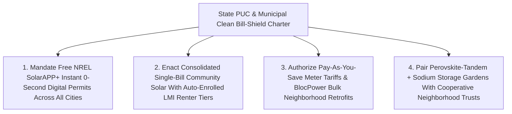

# CARBON EDITION — PILLAR 1: \$0-UPFRONT CLEAN POWER FOR RENTERS & APARTMENTS
## How Subscriber Community Solar, Meter-Attached Heat Pumps & 0-Second `SolarAPP+` Permits Heal Household Utility Bills From the Bottom Up

> **Executive Framing & Reimagining Clean Energy as a Universal Household Bill-Shield:**
> * **The Cynic's Belief:** *"Clean energy is a regressive luxury subsidy for affluent suburban homeowners with unshaded south-facing roofs, 760 credit scores, and \$25,000 in spare cash. Meanwhile, the nearly 50% of households who rent apartments, live under city tree canopies, or lack prime FICO credit get locked out completely—left behind on aging gas pipes and stuck paying higher utility rates to maintain a grid wealthy solar owners stopped funding."*
> * **The Empirical Counter-Reality:** Across **Minnesota, New York, Illinois, and Colorado**—backed by the **U.S. Department of Energy's National Community Solar Partnership (NCSP)** alongside European citizen cooperatives like Spain's **Som Energia** (85,000+ co-op members) and the UK's **Repowering London**—**Subscriber Community Solar Gardens** already let any renter or apartment household claim a share of a local solar-plus-battery array with **\$0 upfront, zero roof access, and zero FICO credit check**, delivering guaranteed **5%–20% monthly utility bill credits** that move seamlessly when a tenant changes apartments. Simultaneously, **Inclusive Utility Investment ("Pay As You Save" / Tariffed On-Bill)** and **BlocPower's** turnkey electrification in **Ithaca, New York** attach cold-climate heat pumps and weatherization to the *utility meter* rather than a personal loan so net monthly bills drop from Day 1 with **\$0 personal debt or liens**—while **NREL's free `SolarAPP+` software** replaces 4-to-8-week municipal permit backlogs (which bloated U.S. rooftop solar costs to 2–3× Australian levels) with **0-second automated code compliance**, cutting ~2 weeks off installation timelines across hundreds of jurisdictions.
> * **The Social Norm Shift:** Public utility commissions flip clean power from a homeowner luxury purchase into **automatic opt-out bill-shield infrastructure**: pairing 35%+ perovskite-tandem solar and sodium-ion storage with consolidated single-bill community solar credits, meter-attached heat-pump tariffs, and mandatory 0-second digital permitting so energy abundance heals working-class household budgets first.
> * **Anchor Voice:** *"Clean energy shouldn't require owning a suburban roof, holding \$25,000 in savings, or waiting two months at City Hall. When you pair 0-second automated permitting with \$0-upfront community solar and meter-attached heat pumps, clean electrons cut working renters' bills on Day One."* — **Donnel Baird & U.S. DOE National Community Solar Partnership**, Neighborhood Electrification & Renter Solar Access Pioneers

---

## ACT I: THE LIVED HUMAN REALITY — TUESDAY MORNING IN A THIRD-FLOOR WALKUP (2028)
### How a Renter With Zero Roof Access & Zero Debt Cuts Her Energy Bills by \$680 a Year

It is 7:15 AM on a minus-8°C January Tuesday in a 1928 six-unit brick walkup in South Minneapolis—with sister building rollouts live in Ithaca, New York, Brixton in South London, and Girona, Catalonia. Thirty-four-year-old pediatric dental hygienist **Tasha Robinson** pours oatmeal for her seven-year-old son Eli while gentle, silent 21°C warmth hums from a slim cold-climate wall heat pump and her induction kettle boils water in forty-five seconds without leaking indoor nitrogen dioxide into Eli's asthma-sensitive lungs.

Under the broken convention that still trapped millions of North American and European tenants in the early 2020s, Tasha was the textbook victim of the **"Clean-Energy Lockout"**. She rented a third-floor apartment under a landlord's flat tar roof; her credit score sat at 615 after a pandemic medical bill; and her landlord had zero financial incentive to spend **\$16,000** replacing a wheezing 1984 basement fuel-oil/gas boiler because *Tasha* paid the winter heating bills (**\$290/month** every January), whereas Tasha obviously couldn't finance HVAC equipment inside a building she didn't own. Worse, every time suburban homeowners ten miles away installed subsidized rooftop panels, utility fixed-grid charges crept slightly higher on urban renters' bills.

Watch how three intertwined institutional breakthroughs flipped Tasha's Tuesday morning ledger without costing her a single dime upfront:

1. **Consolidated-Bill Community Solar Subscription (\$0 Upfront, Zero FICO, Portable Across Moves):**
   When Tasha renewed her state childcare-assistance paperwork—mirroring automatic low-to-moderate-income (LMI) enrollment rules pioneered in New York, Illinois, and Minnesota—her electric account was automatically matched (with one-click opt-out freedom) to a 4.5-megawatt **Subscriber Community Solar + Sodium-Ion Garden** built atop a suburban warehouse roof and capped highway brownfield twelve miles away. Tasha never signed a predatory 25-year solar lease, never underwent a credit check, and never juggled two bills: on her single monthly consolidated utility statement, her share of the solar garden generates **\$85 of clean-power bill credits** for which the garden cooperative retains **\$68**, locking in an automatic **20% guaranteed net discount (\$17–\$28 saved every single month)**—and when Tasha moves across town next autumn for a bigger two-bedroom apartment, she updates her address in thirty seconds on her phone and her solar share moves right along with her!
2. **Meter-Attached "Pay As You Save" Heat Pump & Weatherization (Zero Personal Debt, Day-1 Net Savings):**
   Last September, through a citywide turnkey retrofit program modeled on **BlocPower's Ithaca, New York** partnership and **Inclusive Utility Investment (Tariffed On-Bill)** rules, a neighborhood crew blew cellulose insulation into the brick walkup's attic and replaced the roaring fossil boiler with ultra-efficient cold-climate heat pumps and induction stoves. Neither Tasha nor her landlord took out a personal loan or risked a property lien. Instead, the utility invested the capital directly into the **building meter's service location** and recovers it via a fixed monthly meter tariff strictly capped by law at **≤75%–80% of independently verified energy bill savings**. Because Tasha's old winter gas-and-electric bill dropped by **\$110/month** and the temporary meter tariff is **\$78/month**, Tasha saves **\$32/month net from Day One** while breathing clean indoor air—and if she moves out, the meter tariff simply stays attached to the apartment's meter for the next tenant who enjoys the same upgraded comfort and lower net bill.
3. **NREL `SolarAPP+` 0-Second Permitting Behind the Scenes:**
   Why could the warehouse community solar developer and neighborhood heat-pump crew build at nearly half the historical U.S. price? Because the city building department replaced its six-week paper engineering queue with **NREL's free `SolarAPP+` automated compliance engine**—verifying structural wind/snow loads, National Electrical Code wire sizing, and rapid-shutdown fire safety in **0 seconds flat**, slicing **\$3,500+ in soft-cost overhead** per residential equivalent and letting crews install within days of contract signing.

---

## ACT II: REIMAGINING THE RULES — BREAKING THE ROOFTOP MONOPOLY, SPLIT INCENTIVES & PAPER PERMITS
### Why Hardware Got 90% Cheaper While Rules Kept Half of Households Locked Out—Until Now

```mermaid
flowchart LR
    subgraph OldLockout["Legacy Clean-Energy Lockout (~50% of Households Excluded)"]
        L1["Suburban Roof + 740 FICO + 25,000 USD Cash Required for Solar"]
        L2["Landlord-Tenant Split Incentive Freezes Old Gas & Oil Boilers"]
        L3["4–8 Week Municipal Paper Permits Double U.S. Soft Costs vs Australia"]
    end
    subgraph HumaneRules["Renter Bill-Shield + Meter Tariff + Instant Permit Stack"]
        H1["Zero-Dollar Upfront Consolidated-Bill Community Solar (No FICO, Portable)"]
        H2["Pay-As-You-Save Meter-Attached Heat Pumps & BlocPower Turnkey Crews"]
        H3["NREL SolarAPP+ 0-Second Code Check + Citizen Energy Cooperatives"]
    end
    subgraph BottomUpAbundance["Verified Household & Grid Dividend"]
        D1["Guaranteed 5%–20% Monthly Utility Bill Cuts for Renters on Day 1"]
        D2["~2 Weeks Faster Installs & Soft Costs Crushed Toward 1 USD/W Floor"]
        D3["Zero Personal Debt, Zero Liens & Asthma-Safe Electrified Apartments"]
    end
    OldLockout ==> HumaneRules ==> BottomUpAbundance
```

### 1. Diagnosing the Three Invisible Bottlenecks That Made Cheap Electrons Feel Expensive
Between 2010 and 2026, solar photovoltaic module costs plunged more than **90%** and battery pack prices fell **85%+**—yet millions of working families understandably rolled their eyes whenever politicians promised "cheap clean energy." Rigorous empirical audits by the **National Renewable Energy Laboratory (NREL)** and **RMI** identified the exact three institutional bottlenecks standing between cheap factory solar cells and a renter's kitchen-table utility bill:
* **The 50% Rooftop & Credit-Score Wall:** Roughly **half of all U.S. households** (and an even higher share in dense European and Asian cities) literally *cannot* install individual rooftop solar because they rent apartments, live in multi-owner condominium buildings without roof rights, have shaded or aging roofs, or lack the high FICO scores required by commercial solar lenders. Subsidizing homeowner-only net metering without renter pathways inadvertently shifted fixed grid-maintenance costs onto lower-income apartment dwellers.
* **The Landlord–Tenant "Split Incentive" Freeze:** Across tens of millions of rental units, landlords pay for appliances and boilers while tenants pay monthly gas and electric bills. Under conventional personal-loan financing, no rational landlord takes on debt to cut a tenant's utility bill, and no tenant invests **\$12,000** into a landlord's basement—trapping low-income neighborhoods with leaky windows, noisy window A/C units, and fossil furnaces for forty years.
* **The American "Soft-Cost" Permitting Tax:** Why did a standard residential solar installation in the United States historically cost **\$2.80–\$3.30 per watt** while the *exact same panels and inverters* installed in **Australia or Germany** cost **\$0.90–\$1.35 per watt**? **RMI** and **NREL** proved that non-hardware **"soft costs"**—fragmented municipal permitting across 10,000+ local Authorities Having Jurisdiction (AHJs), multi-week paper plan reviews, manual utility interconnection queues, and the high customer-acquisition cancellations caused by 60-day delays—devoured **60% to 65% of total U.S. installed cost**!

### 2. Three Proven Real-World Engines Already Scaling Across Continents
None of the fixes require speculative physics; every single piece is already operating across hundreds of thousands of households today:
* **Subscriber Community Solar Gardens & Citizen Energy Cooperatives:** Pioneered at utility scale in **Minnesota** (the nation's first gigawatt-scale community solar market), **New York** (*NY-Sun* inclusive community solar with consolidated single-bill net crediting), **Illinois** (*Illinois Solar for All*, guaranteeing low-income subscribers pay zero upfront fees and keep ≥50% of credit value), and **Colorado**, community solar lets 100 to 1,000 households share the virtual output of a 1–5 MW neighborhood array on a warehouse roof, parking canopy, brownfield, or dual-use agrivoltaic pasture. Backed by the **U.S. DOE National Community Solar Partnership (NCSP)**—which united states, utilities, and cooperatives to power **5 million households (20 GW)** and deliver **\$1 billion+ in direct bill savings**—modern **consolidated billing** ensures subscribers see an automatic **5%–20% net credit** directly on their regular electric bill with **\$0 upfront, zero exit penalties, zero FICO checks, and full portability** if they move within the utility territory. In Europe, Spain's citizen-owned **Som Energia** (**85,000+ cooperative members** co-owning renewable plants and supplying **130,000+ households/small businesses** at transparent non-profit rates) and the UK's **Repowering London** (installing tenant-owned community solar across **Brixton Energy** and Hackney social-housing estates while paying local teenagers living wages to train as clean-energy technicians) prove community ownership builds neighborhood wealth alongside cheaper bills.
* **Inclusive Utility Investment ("Pay As You Save" / PAYS) & Turnkey City Electrification:** Developed through clean-energy finance pioneers and analyzed extensively by **RMI**, **Pay As You Save (PAYS)** treats building weatherization and cold-climate heat pumps just like transformers or smart meters: a **utility-capitalized grid asset** (efficiency as a virtual power plant) attached to the *meter*, never to an individual's credit report. Under the strict PAYS consumer-protection math used by **Roanoke Electric Cooperative** (North Carolina), **Ouachita Electric** (Arkansas), and state tariffed on-bill programs, the monthly meter recovery charge cannot exceed **80% of certified modeled energy savings** over no more than 80% of the equipment's warrantied lifespan—and if the equipment ever fails through no fault of the occupant, repairs are covered or the tariff stops immediately! Taking neighborhood aggregation even further, **Donnel Baird's BlocPower** won the landmark mandate in **Ithaca, New York** to decarbonize **all ~6,000 city buildings** as a single bulk-financed turnkey portfolio—slashing heat-pump hardware and labor costs by **25%–35%** via block-by-block bulk procurement while training local workers from formerly redlined neighborhoods.
* **NREL `SolarAPP+` 0-Second Automated Permitting:** Built by the **National Renewable Energy Laboratory** in collaboration with code officials (ICC, NFPA, UL) and clean-energy engineers, **`SolarAPP+`** is a **100% free web platform** for local governments that runs dozens of automated structural, electrical, and fire-code checks on residential solar and solar-plus-storage designs in **0 seconds**—issuing an instant building permit 24/7. Audited NREL field data across hundreds of adopting U.S. cities and counties shows `SolarAPP+` cuts total project Permit-to-Inspection timelines by **~12 to 15 business days (~2 weeks)**, saves municipal staff thousands of hours of repetitive plan checking, and achieves equal or higher first-time field inspection pass rates!

### 3. How Exponential Clean Hardware + Humane Tariff Rules Multiply Each Other
Here is the core *Carbon Edition* synthesis: **hardware breakthroughs lower the floor, while humane institutional rules open the door**. As **[`perovskite-tandem-solar`](../perovskite-tandem-solar/REPORT.md)** pushes solar cell efficiency past **34%** toward **<1.5¢/kWh** generation and iron/sodium-ion batteries drop four-hour storage below **\$50/kWh**, a solar garden paired with batteries becomes the cheapest peaking capacity on any urban feeder. When regulators combine that cheap hardware with **automatic opt-out community solar enrollment** for every household already verified in SNAP, Medicaid, LIHEAP, or housing assistance—plus **[`forty-eight-hour-governance`](../../04-social-norms/forty-eight-hour-governance/REPORT.md)** instant digital permitting and **[`bidirectional-v2g-virtual-plants`](../bidirectional-v2g-virtual-plants/REPORT.md)** neighborhood transit/carshare batteries—renters stop subsidizing the energy transition and become its very first beneficiaries.

| Energy Access Dimension | Legacy Homeowner-Only Status Quo | Carbon Renter Bill-Shield + PAYS + `SolarAPP+` Standard | Verified Empirical Shift |
| :--- | :--- | :--- | :--- |
| **Upfront Cash & Roof Requirement** | **\$18,000–\$28,000** purchase/loan + private unshaded roof | **\$0 upfront**, zero roof access needed, zero exit penalty | Unlocks **~50% of households** (renters & condos) |
| **Credit Gatekeeping & Debt Risk** | **680–740+ FICO score** & personal loan or property tax lien | **Zero FICO check**; meter-attached PAYS tariff & consolidated bill | **\$0 personal debt**; guaranteed Day-1 net bill cut |
| **Monthly Household Utility Impact** | Renters pay rising gas & fixed grid fees; 0% solar discount | **5%–20% guaranteed solar credit** + **20%+ PAYS net heat savings** | **\$350–\$900/yr** saved per working renter household |
| **Municipal Permitting & Soft Costs** | **4–8 week** manual city review; **>\$1.80/W** soft-cost bloat | **0-second NREL `SolarAPP+`** automated code check | **~2 weeks faster** installs; soft costs cut toward **<\$0.60/W** |
| **Portability & Tenant Mobility** | Fixed permanently to one single-family house | **30-second digital portability** across apartments in territory | Renters keep solar discounts & PAYS stays with meter |

---

## ACT III: GLOBAL ADAPTATION & PHASED ROLLOUT ROADMAP (2026–2032)
### Scaling From State Pioneers to Universal Opt-Out Clean Bill-Shields

For a visual storytelling companion showing how cities, tenant unions, and utilities bring this model to life block by block, see the **[Community Solar & Bill-Shields Storyboard (`./STORYBOARD.md`)](./STORYBOARD.md)**.

| Implementation Horizon | Regulatory & Utility Unlock | Technical & Community Deployment | Audited Household & Grid Outcome |
| :--- | :--- | :--- | :--- |
| **Phase 1 (Months 1–9): Instant Permits & Single-Bill Solar** | State legislatures & PUCs mandate **NREL `SolarAPP+`** (as California SB 379 pioneered) and require utilities to offer **consolidated single-bill net crediting** for community solar gardens. | Deploy automated 0-second residential solar/storage/heat-pump permitting; convert brownfields, schools, and warehouse roofs into **1–5 MW subscriber gardens**. | Permit backlogs drop to **0 seconds**; install timelines shrink **~2 weeks**; renters sign up in 2 minutes with **zero second bill** or FICO check. |
| **Phase 2 (Years 1–3): Opt-Out LMI Bill-Shields & PAYS Tariffs** | PUCs authorize **automatic opt-out community solar enrollment** for LIHEAP/Medicaid/SNAP households and approve **Inclusive Utility Investment (PAYS)** tariffs with the 80% savings cap. | Launch Ithaca-style **BlocPower** bulk neighborhood heat-pump + induction + attic-insulation sprints; charter tenant co-ops modeled on **Som Energia** & **Repowering London**. | **10%–20% automatic electric bill reductions** for low-income renters; landlord-tenant split incentive solved across multi-family apartments with **\$0 debt**. |
| **Phase 3 (Years 3–6): Perovskite + V2G Neighborhood Commons** | Grid tariffs reward urban community solar + battery gardens for peak feeder congestion relief, eliminating distribution substation upgrades. | Upgrade arrays with **[`perovskite-tandem-solar`](../perovskite-tandem-solar/REPORT.md)**, sodium-ion batteries, **[`bidirectional-v2g-virtual-plants`](../bidirectional-v2g-virtual-plants/REPORT.md)**, and **[`cooperative-broadband-energy-trusts`](../../04-social-norms/cooperative-broadband-energy-trusts/REPORT.md)**. | Installed U.S. soft costs converge on **Australia's ~\$1/W benchmark**; energy burden (>6% of income on utilities) virtually eliminated for urban renters. |

---

## ACT IV: ANSWERING THE SKEPTIC & THE HUMANE HORIZON
### Protecting Renters, Landlords & Grid Reliability Without Predatory Fine Print

### Addressing the Top 3 Institutional Objections
1. **"Didn't some third-party solar companies trap low-income families in predatory 25-year door-to-door leases with escalating rates?"**
   * *Empirical Answer:* Yes—and that is *precisely* why regulated **Consolidated-Bill Community Solar** and **Pay As You Save (PAYS)** are designed as the structural antidote to predatory loans! In state-chartered consolidated-bill community solar (such as New York's net-crediting model and *Illinois Solar for All*), there is **no loan, no lien, no escalator above utility rates, and zero cancellation fee**: the utility itself applies a mathematically guaranteed percentage discount (e.g., 10%–20% off every solar credit dollar) straight onto the customer's normal monthly bill. If the array underperforms in a cloudy month, the subscriber simply pays nothing extra; they *only* ever receive a net discount.
2. **"Under Pay-As-You-Save meter tariffs, what happens if a heat pump breaks in Year 5 or an apartment sits vacant between tenants?"**
   * *Empirical Answer:* Two decades of PAYS tariff field data across rural electric cooperatives and municipal utilities established ironclad rules: first, **verified performance assurance** requires that if the upgraded heat pump ever stops working through no fault of the occupant, the utility/program operator must repair it promptly or **pause the meter tariff immediately**—never leaving a renter paying for broken gear. Second, during brief vacancies between leases, the modest meter charge pauses or rests lightly with the vacant meter account just like standard base service, and prospective tenants actively prefer apartments certified with audited lower winter utility bills and central heat-pump cooling!
3. **"Don't community solar credits shift grid maintenance costs onto non-participating ratepayers?"**
   * *Empirical Answer:* Unlike 1990s retail-rate rooftop net metering on wealthy cul-de-sacs, modern **Value of Distributed Energy Resources (VDER)** tariffs (pioneered in New York and Minnesota's updated value-stack) site 1–5 MW community solar **paired with 4-hour battery storage** directly on congested urban distribution feeders—shaving 4:00–8:00 PM summer air-conditioning and winter heating peaks, deferring multi-million-dollar substation upgrades, and reserving ≥50% of every array's capacity specifically for low- and moderate-income renters!

### Fast-Track Municipal & Utility Commission Activation Checklist

| Sprint Reform Step | Proven Real-World Precedent | Months to Launch | Consumer & Grid Guardrail |
| :--- | :--- | :--- | :--- |
| **1. Adopt Free NREL `SolarAPP+`** | Hundreds of U.S. Cities / CA SB 379 | **2 Months** | Free NREL tool; mandatory random field inspection audit preserves safety |
| **2. Single-Bill Net Crediting Rule** | NY-Sun / Illinois / Minnesota | **6 Months** | Guaranteed 5%–20% net bill cut; \$0 upfront, \$0 exit fee, zero FICO check |
| **3. Opt-Out LMI Auto-Enrollment** | DOE NCSP / State LIHEAP Bridges | **6 Months** | Automatic bill-shield for low-income renters with effortless SMS opt-out |
| **4. PAYS Meter-Tariff Charter** | Roanoke Electric / RMI / BlocPower | **9 Months** | Monthly meter recovery strictly ≤80% of certified energy savings; \$0 lien |
| **5. Tenant Co-op Revenue Share** | Som Energia & Repowering London | **6 Months** | Reserves roof/brownfield equity & paid youth apprenticeships for host blocks |

### Why Both Fiscal Pragmatists and Tenant Unions Cheer This Exact Model
* **Why Renters, Environmental Justice Groups & Unions Love It:** Cuts monthly utility bills **5%–20%+ immediately** with **\$0 upfront and zero debt**, replaces asthma-inducing indoor gas/oil combustion with whisper-quiet heat pumps, and creates local union/cooperative installation careers.
* **Why Deregulators, Builders & Grid Engineers Love It:** Vaporizes 6-week municipal permit red tape into **0 seconds** via `SolarAPP+`, unlocks private/cooperative capital without taxpayer giveaways, and turns neighborhood apartments into dispatchable peak-shaving grid shields.

### Cross-Pillar Synergies & The Bottom Line
Woven together with **[`perovskite-tandem-solar`](../perovskite-tandem-solar/REPORT.md)**, **[`bidirectional-v2g-virtual-plants`](../bidirectional-v2g-virtual-plants/REPORT.md)**, **[`cooperative-broadband-energy-trusts`](../../04-social-norms/cooperative-broadband-energy-trusts/REPORT.md)**, and **[`forty-eight-hour-governance`](../../04-social-norms/forty-eight-hour-governance/REPORT.md)**, **Subscriber Community Solar + PAYS Heat Pumps + `SolarAPP+`** proves that clean-energy abundance does not have to trickle down from suburban cul-de-sacs twenty years late. When permits take zero seconds and clean electrons attach to utility bills as a debt-free shield, **every third-floor renter shares the sun on Day One**.

---

## References & Verified Sources

* **Federal Community Solar & Automated Permitting Platforms:** [U.S. Department of Energy — *National Community Solar Partnership (NCSP)*](https://www.energy.gov/communitysolar/community-solar) · [National Renewable Energy Laboratory (NREL) — *SolarAPP+ Automated Instant Solar & Storage Permitting*](https://solarapp.nrel.gov/)
* **Turnkey Electrification & Inclusive Utility Investment Research:** [BlocPower — *Turnkey Neighborhood Building Electrification & Ithaca Citywide Decarbonization*](https://www.blocpower.io/) · [RMI — *Residential Solar Soft-Cost Reduction & Inclusive Utility Investment (Pay As You Save) Analysis*](https://www.rmi.org/)
* **Citizen & Tenant Renewable Energy Cooperatives:** [Som Energia — *Spain's 85,000+ Member Citizen Renewable Energy Cooperative*](https://www.somenergia.coop/en/) · [Repowering London — *Community-Owned Urban Social-Housing Solar & Youth Training*](https://www.repowering.org.uk/)
* **Connected Carbon Pathways:** [Perovskite-Silicon Tandem Solar & Terawatt Photovoltaics](../perovskite-tandem-solar/REPORT.md) · [Bidirectional V2G & Neighborhood Virtual Power Plants](../bidirectional-v2g-virtual-plants/REPORT.md) · [Member-Owned Cooperative Broadband & Energy Trusts](../../04-social-norms/cooperative-broadband-energy-trusts/REPORT.md) · [48-Hour Governance: Instant Permits & Parametric Civic Speed](../../04-social-norms/forty-eight-hour-governance/REPORT.md)
