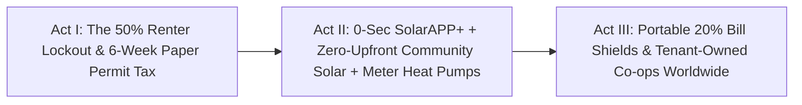

# STORYBOARD & CREATIVE PRODUCTION GUIDE: \$0-UPFRONT CLEAN POWER FOR RENTERS ([`community-solar-gardens-bill-shields`](./REPORT.md))
## *"No Roof, No Loan, Zero-Second Permits — How Renters & Walkup Apartments Claim the Clean-Energy Dividend on Day One"*

> **Production Purpose:** This grounded, kinetic documentary storyboard equips filmmakers, public utility commissioners, tenant organizers, and mayors to dismantle the myth that solar panels and heat pumps are luxury toys for affluent homeowners—showing how **Subscriber Community Solar**, **Pay-As-You-Save / BlocPower meter upgrades**, and **NREL's 0-second `SolarAPP+` software** cut working renters' bills immediately with **\$0 upfront and zero debt**.

---

## PART 1: THREE ALTERNATIVE NARRATIVE OPENINGS (DIRECTOR'S OPTIONS)

### Option A: "Two January Utility Envelopes on the Same Street" *(Intimate Household Contrast)*
* **Visual Hook:** Split-screen at 7:30 AM in -8°C January snow. Left (`Old Clean-Energy Lockout`): A renter in a drafty third-floor walkup tapes plastic wrap over frosted windows while opening a **\$295 winter gas-and-electric bill**, staring across the avenue at a \$900,000 house with gleaming rooftop solar. Right (`Carbon Renter Bill-Shield`): **Tasha Robinson** warms oatmeal on an induction stove beside a whisper-quiet heat pump and opens her single consolidated electric bill showing a **-\$24.60 Community Solar Bill Credit** and **\$32 net winter heating savings**—having paid **\$0 upfront** with **zero credit check**.
* **Voiceover Core:** *"Half of America doesn't own a roof—and for twenty years, we told renters clean energy wasn't built for them. Then states from Minnesota to New York flipped a single utility rule, cutting renters' bills up to twenty percent without a roof, a loan, or a credit check."*
* **Best For:** Mainstream audiences, cost-of-living broadcasts, and tenant-equity documentaries.

### Option B: "Six Weeks at City Hall vs. Zero Seconds on `SolarAPP+`" *(Bureaucracy-Buster Reveal)*
* **Visual Hook:** Side-by-side split comparison: an Australian solar crew finishes wiring a home in Sydney for **\$1.05/watt** while an American installer sits in a fluorescent municipal hallway holding a 44-page paper binder stamped **`WEEK 6 — PENDING PLAN REVIEW`**. Suddenly an engineer clicks **`SUBMIT`** on **NREL's free `SolarAPP+` screen**: thirty code checks flash green and an official permit prints in **0.4 seconds**.
* **Voiceover Core:** *"Solar panels cost the same in Phoenix and Perth. Why did Americans pay more than double? Paperwork—until a free national laboratory algorithm turned six weeks of red tape into zero seconds."*
* **Best For:** Civic reformers, mayors, YIMBY/abundance audiences, and local building officials.

### Option C: "Ithaca, Brixton & Girona: When Whole Blocks Own the Sun Together" *(Global Cooperative Momentum)*
* **Visual Hook:** Sweeping drone montage connecting **BlocPower** crews hoisting cold-climate heat pumps into century-old brick apartments in **Ithaca, NY**, **Repowering London** teen apprentices bolting tenant-owned solar onto **Brixton** council estates, and **Som Energia** cooperative members cheering at a community solar array in **Catalonia**.
* **Voiceover Core:** *"When neighbors buy heat pumps by the thousand and share solar gardens across zip codes, clean power stops being a suburban status symbol and becomes a neighborhood shield."*
* **Best For:** International climate summits, labor unions, and municipal green-bank leaders.

---

## PART 2: MODULAR 3-ACT STORYBOARD TABLE (12 SCENES) & VISUAL FLOW

| Act / Beat | Visual & Camera Concept | Data & Metric Callout Overlay | Sample Narration / Voiceover Script |
| :--- | :--- | :--- | :--- |
| **ACT I — Beat 1:** The 50% Rooftop Wall | Aerial zoom over a dense city grid: half of all homes glow amber (`Renters, Walkups & Shaded Roofs — Locked Out of Rooftop Solar`). | **~50% of U.S. Households** Cannot Host Private Rooftop Solar | "Look closely at any city from above: half of all families rent apartments or live under shaded roofs—completely locked out of rooftop solar." |
| **ACT I — Beat 2:** The Split-Incentive Boiler | Basement handheld shot of a roaring, soot-stained 1984 fuel-oil boiler while upstairs a young boy uses an asthma inhaler beside a hot radiator. | **Landlord Owns Boiler:** Renter Pays **\$290/Mo** Winter Utility Bill | "Tasha's landlord won't spend sixteen thousand dollars to cut Tasha's gas bill—and Tasha can't remodel a basement she doesn't own." |
| **ACT I — Beat 3:** The American Soft-Cost Tax | Animated stacked bar comparing **Australia (\$1.05/W)** vs. **Legacy U.S. (\$3.05/W)**, highlighting red blocks of paper permits and delays. | **>60% of U.S. Solar Cost** = Non-Hardware "Soft Costs" | "Even worse, ten thousand local permitting mazes bloated American clean-energy soft costs to nearly triple Australia's." |
| **ACT II — Beat 4:** NREL `SolarAPP+` Hits 0 Seconds | Screen-capture inside a city building department: `SolarAPP+` checks NEC wire gauge, snow load, and rapid-shutdown safety instantaneously. | **NREL `SolarAPP+`:** **0-Second** Instant Permit \| **~2 Weeks** Saved/Install | "At the National Renewable Energy Lab, engineers built SolarAPP+—free software that checks every fire and electrical code in zero seconds." |
| **ACT II — Beat 5:** Warehouse & Brownfield Solar Gardens | Sunlit drone shot over a 4.5 MW solar-plus-battery array gleaming atop a logistics warehouse roof and former landfill twelve miles from downtown. | **DOE NCSP Target:** **5 Million** Households & **\$1B+** in Bill Savings | "Now pair instant permits with Subscriber Community Solar: megawatt gardens built on warehouse roofs and brownfields across Minnesota, New York, and Illinois." |
| **ACT II — Beat 6:** Tasha's Single Consolidated Bill | Over-the-shoulder shot at Tasha's kitchen table: no credit check, no loan—just one line item cutting her monthly electric bill by **20%**. | **\$0 Upfront \| Zero FICO Check** \| Guaranteed **5%–20%** Bill Credit | "Tasha subscribes with zero dollars down and zero credit check. Every month, her regular electric bill automatically drops up to twenty percent." |
| **ACT II — Beat 7:** Moving Day Portability | Tasha packs a moving box labeled `ELI'S ROOM`, taps `Update Apartment Address` on her phone in 20 seconds, and keeps her solar share across town. | **100% Portable Subscription** Within Utility Territory \| **\$0 Exit Fee** | "And when a renter moves apartments next year? Thirty seconds on a phone brings her solar discount right along to the new address." |
| **ACT II — Beat 8:** BlocPower & PAYS Meter Upgrade | **BlocPower** technicians in **Ithaca, NY** swap a basement fossil furnace for a cold-climate heat pump wired to a smart utility meter tariff badge. | **Pay As You Save (PAYS):** Tariff Capped **≤80%** of Verified Savings | "To fix winter heating, Pay-As-You-Save and BlocPower attach heat pumps to the utility meter itself—so net bills drop from Day One with zero personal debt." |
| **ACT III — Beat 9:** Citizen Co-ops in Brixton & Spain | Joyful documentary portraits at **Repowering London's** Brixton council estate solar array and **Som Energia's** 85,000-member assembly in Girona. | **Som Energia:** **85,000+** Citizen Co-op Members \| Paid Youth Apprentices | "In Spain and South London, tenants don't just save on bills—eighty-five thousand citizens co-own the power plants and pay local teens to wire them." |
| **ACT III — Beat 10:** Perovskite + Battery Feeder Shield | Animated evening peak curve (4–8 PM): **[`perovskite-tandem-solar`](../perovskite-tandem-solar/REPORT.md)** + sodium batteries shave urban substation peaks. | **34%+ Perovskite Tandems** + 4-Hr Storage Defer Grid Upgrades | "As perovskite tandems and sodium batteries drive clean electrons toward pennies, neighborhood solar gardens shield congested city grids at sunset." |
| **ACT III — Beat 11:** Opt-Out Bill Shields at Scale | State Public Utility Commission vote flipping low-income energy assistance into **automatic opt-out community solar enrollment** statewide. | **Automatic Opt-Out LMI Enrollment:** Instant Relief Without Red Tape | "When utility commissions automatically enroll every energy-burdened renter into community solar bill shields, nobody falls through paperwork cracks." |
| **ACT III — Beat 12:** Closing Bookend — Warm Kitchen Window | Dusk exterior looking up into Tasha's glowing third-floor brick apartment window as snow falls silently outside; inside, Eli laughs over warm dinner. | **Clean Energy Abundance** Starts on the Third Floor — With **\$0 Debt** | "You shouldn't need a suburban roof or twenty-five thousand dollars to own a piece of the sun. Change the meter rules, and every home comes into the warmth." |

---

## PART 3: VISUAL METAPHOR BANK & CINEMATIC SIGNATURES

### 1. "The Virtual Sunbeam Travelling Through the Grid"
* **Visual Concept:** A golden ribbon of light rises off a warehouse solar array outside town, travels gracefully along neighborhood utility wires, bypasses shaded street trees, and lands directly inside a third-floor apartment electric meter—spinning the digital bill counter backward by **-\$24.60**.
* **Camera / Animation Cue:** Warm subtle light-trail graphic tracked smoothly from drone altitude right to Tasha's hallway meter.
* **Emotional Takeaway:** Makes "virtual consolidated-bill net crediting" intuitively clear to any viewer in five seconds.

### 2. "The Meter Badge vs. The Ball-and-Chain Loan"
* **Visual Concept:** Heavy iron paperwork stamped `25-YEAR PERSONAL LIEN / 740 FICO` dissolves into a clean green snap-on collar resting gently on the apartment's exterior utility meter (`PAYS METER UPGRADE — NET BILL DROPS DAY 1`), staying calmly on the wall when one happy tenant hands keys to the next.
* **Camera / Animation Cue:** Tactile tabletop/exterior macro lens transition.
* **Emotional Takeaway:** Visually solves the 100-year landlord-tenant split incentive without jargon.

---

## PART 4: SOUND DESIGN, COLOR ARC & INTERACTIVE RENTER BILL CALCULATOR

* **Color & Lighting Progression:**
  * *Act I (The Renter Lockout):* Cold slate winter blues, flickering basement boiler shadows, sterile municipal fluorescent waiting rooms.
  * *Acts II–III (Community Gardens & Electrified Walkups):* Crisp golden solar array reflections, warm terracotta brick walkups, vibrant induction-kitchen amber light.
* **Casting & Documentary Voices:**
  * Feature apartment renters in Minneapolis & Brooklyn, **BlocPower** installers in Ithaca, **NREL `SolarAPP+`** municipal building inspectors, and **Repowering London / Som Energia** cooperative members.
* **Musical & Foley Architecture:**
  * Transitions from clanking steam pipes, wheezing oil burners, and heavy rubber stamps to silent heat-pump airflow, crisp digital `SolarAPP+` chime, socket wrenches on solar racking, and acoustic guitar warmth.
* **Interactive Documentary Companion ("Plug In Your Zip Code & Renters' Utility Bill"):**

| Household Upgrade Layer | Upfront Cash & Credit Needed | Permit & Install Speed | Net Monthly Household Impact |
| :--- | :--- | :--- | :--- |
| **Legacy Walkup Status Quo** | Locked out (No roof / <680 FICO) | 6–8 week municipal permit queue | **\$260/mo winter bill** \| Volatile fossil spikes |
| **+ Consolidated Community Solar** | **\$0 upfront** \| Zero FICO check | Instant digital enrollment; portable | **-10% to -20% electric bill** (\~\$18–\$28/mo saved) |
| **+ PAYS Heat Pump + `SolarAPP+`** | **\$0 personal debt** (Meter tariff) | **0-sec permit** \| ~2 weeks faster | **-\$30 to -\$45/mo net Day-1 cut** + asthma-free air |

* **Director's Closing Frame On-Screen Text:**
  > *"Hardware made clean electrons cheap. Zero-second permits, \$0-upfront community solar, and meter-attached heat pumps make them belong to everyone."*
