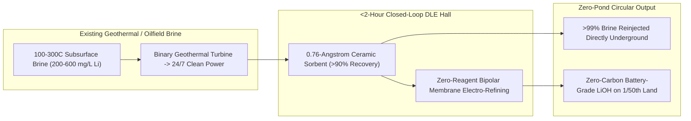

# CARBON EDITION • ABUNDANT CLEAN ENERGY
## Zero-Pond Direct Lithium Extraction — *Closed-Loop Brine Sieves Without Scarring Desert Salt Flats*

> **The Cynic's Belief:**
> *"Trading oil wells for electric cars just swaps one ecological disaster for another—draining fragile Andean desert
> aquifers into sprawling, neon-turquoise evaporation ponds that take eighteen months to bake in the sun and leave
> indigenous ecosystems parched."*
>
> **The 2026 Breakthrough Reality:**
> Sun-baked evaporation ponds are going the way of whale oil. Commercial **Direct Lithium Extraction (DLE)** plants in
> Germany's Upper Rhine Valley, California's Salton Sea, Arkansas's Smackover oilfields, and Argentina's Centenario-Ratones
> basin now pull lithium ions selectively out of underground brines in **under two hours** inside compact, closed-loop
> columns—boosting lithium recovery from **~45% to >90%**, using **98% less land**, evaporating zero ancient aquifer
> brine, **reinjecting >99% of de-lithiated water straight back underground**, and co-generating 24/7 carbon-free
> geothermal electricity in the exact same pipe loop.

---

## ACT I: A DELIGHTFUL NEAR FUTURE (HUMAN STORY)

Beside a sun-dappled Riesling vineyard outside Landau in Germany's Upper Rhine Valley—and echoed on reclaimed oil pads in
El Dorado, Arkansas and beside California's Salton Sea—chemical process technician Lukas Weber checks a row of gleaming
stainless-steel adsorption columns tucked inside a quiet, barn-sized hall that takes up less land than a neighborhood
soccer pitch.

Nothing smells like sulfur, no open pit scars the hillside, and not a single evaporation pond touches the valley floor:

* **Two Hours Instead of Eighteen Months—With 99% Brine Returned:**
  Deep pipes bring naturally hot $165^\circ\text{C}$ geothermal brine up from $3.5\text{ kilometers}$ underground. First,
  heat exchangers spin a binary turbine to power **25,000 local German homes** and warm Landau's municipal district-heating
  pipes. Seconds later, the still-warm brine flows through porous ceramic beads with lithium-sized crystal pockets that
  catch $\text{Li}^+$ ions like a molecular lock-and-key while letting sodium, calcium, and magnesium pass untouched—before
  pumping **99.5% of the water right back into the deep reservoir** within two hours.
* **Negative-Carbon Battery Metal:**
  Because the geothermal brine brings up *more* renewable heat and electricity than the DLE plant consumes to run its
  pumps and electrochemical polishers, every ton of battery-grade lithium hydroxide ($\text{LiOH}\cdot\text{H}_2\text{O}$)
  loaded onto electric railcars bound for European EV factories carries a **net-zero (and grid-carbon-negative) footprint**.
* **Reviving Old Oil Towns in Arkansas & Texas:**
  Across the Atlantic in southern Arkansas, retired bromine and oilfield roughnecks operate Standard Lithium and Equinor's
  Smackover DLE columns—extracting high-grade $450+\text{ mg/L}$ lithium from century-old oilfield brines that used to be
  treated as waste, funding new county libraries and roads without disturbing a single pine tree.
* **Protecting High-Altitude Flamingo Lagoons:**
  Down in South America's Salar de Hombre Muerto and Jujuy, replacing open evaporation lagoons with Lilac and Eramet
  closed-loop ion-exchange skids doubles lithium yield per liter pumped while preserving subsurface pressure under fragile
  Andean flamingo wetlands.

---

## ACT II: SOTA BREAKTHROUGHS, REAL COMPANIES & SYNERGIES

Legacy South American brine mining pumps millions of cubic meters of salty groundwater into giant shallow ponds covering
$30\text{--}50\text{ km}^2$, waiting 12 to 24 months for desert winds to evaporate 95% of the water while losing more than
half the lithium to co-precipitated salt crusts ($\text{40\%--50\%}$ recovery) and consuming massive truckloads of soda ash
and slaked lime. Meanwhile, Australian hard-rock spodumene mining blasts open pits and ships rock to China for $1,050^\circ\text{C}$
coal-kiln roasting (~$15\text{ tons }\text{CO}_2$ per ton LCE).

### 1. Three Molecular Sieve & Electrochemical Unlocks (2024–2026)
Modern DLE replaces square miles of solar evaporation with atomic-scale crystal selectivity and membrane electrochemistry:

* **Spinel Ceramic Ion-Exchange ($\text{H}_2\text{TiO}_3$ / $\text{LiMn}_2\text{O}_4$) & Layered Aluminate Sorbents:**
  **Lilac Solutions** (4th-Gen ceramic ion-exchange beads) and **Arcadium / Eramet / Vulcan** engineered rugged solid
  sorbents whose crystal-lattice cavities measure ~$0.76\text{ \AA}$—the exact ionic radius of $\text{Li}^+$. Even when
  brine contains $500\times$ more sodium ($\text{Na}^+$) or divalent magnesium ($\text{Mg}^{2+}$) than lithium, the beads
  capture **90%–95% of $\text{Li}^+$** in minutes and survive thousands of elution cycles with minimal acid or freshwater
  wash.
* **Direct Electrochemical Intercalation & Bipolar Membrane Electrodialysis (BMED):**
  Instead of using acid or soda-ash reagents to strip lithium and convert chloride to battery-grade hydroxide, next-gen
  electrochemical cells (**ElectraLith**, **Mangrove Lithium**, **Lithios**) apply a clean low-voltage solar electric field
  across lithium-selective ceramic/NASICON membranes (*DLE-R*)—converting dilute $\text{LiCl}$ eluate directly into
  $99.9\%$ pure $\text{LiOH}\cdot\text{H}_2\text{O}$ while recycling their own internal water and acid in a **100% closed
  zero-reagent loop**.
* **Geothermal & Oilfield Produced-Water Co-Production:**
  Earth's largest untapped lithium reservoirs aren't pristine mountain parks—they are California's **Salton Sea** (~18
  million tons LCE, enough for **375+ million EVs**), the US Gulf Coast **Smackover formation** (USGS estimated 5–19 million
  tons LCE), Germany's **Upper Rhine Graben**, and oilfield produced-water streams in Alberta and the Permian Basin where
  wells and pipelines already exist.

> *"Evaporation ponds belong to the nineteenth century. With closed-loop ion exchange, we double lithium recovery in hours
> instead of years, return the brine underground, and build a clean battery supply chain communities actually welcome."*
> — **Dave Snydacker**, Founder & CTO, Lilac Solutions

### 2. Verified 2025–2026 Commercial DLE & Geothermal-Lithium Leaders

| Pioneer / Project | Core DLE Modality | Verified 2025–2026 SOTA Milestone | Annual Output & Ecological Footprint |
| :--- | :--- | :--- | :--- |
| **Eramet & Tsingshan (*Centenario*, Argentina)** | Commercial aluminate adsorption DLE + nanofiltration + RO water loop | Commissioned Phase 1 (**24,000 tpa LCE**) commercial zero-pond DLE plant in Salta, achieving **~90% Li recovery** in <24 hrs | Cuts desert land footprint >95% vs. adjacent legacy evaporation pond operations |
| **Vulcan Energy Resources (*Lionheart*, Germany)** | Geothermal heat/power + adsorption DLE (**A-DLE**) + electrolysis | Producing battery-grade $\text{LiOH}$ at Frankfurt-Höchst (*CLEOP*); fully financed €2B Phase 1 (**24,000 tpa**, ~500k EVs/yr) | Binding offtakes with Stellantis, VW, Renault & Umicore; **0 kg $\text{CO}_2$/kg Li** + Landau city heat |
| **Lilac Solutions (Great Salt Lake & Jujuy)** | Gen-4 rugged ceramic ion-exchange beads ($>90\%$ recovery, $10\times$ cycle life) | Validated commercial-module field campaigns in Utah, Argentina & Salton Sea; zero evaporation ponds | Unlocks low-grade ($70\text{--}200\text{ mg/L}$) brines while protecting Great Salt Lake water levels |
| **Standard Lithium & Equinor (Smackover, AR)** | *LiSTR* selective adsorption DLE on $450\text{--}597\text{ mg/L}$ oilfield brines | Commercial demonstration column operating continuously at El Dorado, AR; \$225M US DOE grant for South West Arkansas plant | Re-uses century-old bromine/oilfield infrastructure; 22,500–45,000 tpa battery-grade output |
| **EnergySource Minerals & Controlled Thermal (CA)** | Salton Sea *Project ATLiS* (*ILiAD* DLE) & *Hell's Kitchen* geothermal + Li | Integrating 20,000+ tpa DLE directly onto live Imperial Valley geothermal plants alongside 50–500 MWe clean baseload | Turns Salton Sea geothermal brine into North America's clean domestic lithium heartland |

---

## ACT III: REIMAGINING SOCIAL CONVENTIONS & GLOBAL PROOF

Resource-nationalism wars and anti-mining lawsuits rested on the assumption that clean tech requires tearing open untouched
mountains or draining indigenous salt flats. Closed-loop DLE + urban battery recycling permanently ends the extraction
treadmill:

1. **Chile's National Lithium Strategy & Mandatory DLE Transition:**
   Chile made closed-loop Direct Lithium Extraction and aquifer brine-reinjection a binding condition for contract renewals
   and new *Salar* partnerships in the Atacama—protecting indigenous Lickanantay water tables while expanding conserved
   national-park wetlands across 30%+ of salt-flat ecosystems.
2. **Imperial Valley "Lithium Valley" Community Tax Dividend (California AB 205):**
   California enacted a dedicated per-ton lithium extraction excise tax in Imperial County—guaranteeing **80% of local
   revenues stay directly in Salton Sea communities** (among California's lowest-income zip codes) to fund Salton Sea dust
   remediation, public health clinics, and union plant apprenticeships.
3. **Closing the Loop Forever by 2040 (>95% Hydrometallurgical Recycling):**
   Unlike petroleum—which burns into smoke the first day you drive on it and must be drilled anew every week—a lithium atom
   never wears out. Once DLE cleanly builds out the global fleet, closed-loop hydrometallurgical recyclers (Redwood Materials,
   Ascend Elements, Northvolt/Hydrovolt) recover **>95% of lithium** endlessly from retired packs.

| Trajectory Metric | 2026 Baseline | 2030 Sprint | 2035 Scaling | 2040 Maturity |
| :--- | :--- | :--- | :--- | :--- |
| **Residence Time & Recovery** | **2–12 hours** DLE (**85%–92%** recovery) vs. 18-mo ponds (45%) | **<90 minutes** zero-reagent electrochemical DLE-R (>94% yield) | Modular skid-mounted units on 1,000+ oil/geothermal pads | Legacy open-air evaporation ponds fully phased out |
| **Land & Carbon Intensity** | **<0.5 $\text{km}^2$** & **0–3 t $\text{CO}_2$/t LCE** (vs. 15 t spodumene) | Net carbon-negative via co-produced geothermal electricity | 100% closed-loop zero-freshwater-draw membrane recycling | >60% of global battery demand met by urban pack recycling |
| **Production Cost (\$/t LCE)** | \$4,200–\$6,500/t LCE (undercuts hard-rock spodumene) | **\$3,000–\$4,200/t LCE** via geothermal electricity credits | **\$2,400–\$3,200/t LCE** commodity abundant mineral | Permanent end to battery-mineral price spikes & bottlenecks |
| **Global DLE Market Share** | ~12%–15% of global lithium supply (China Qinghai, AR, EU, US) | **35%–45%** of global supply (Smackover, Rhine, Salton, Atacama) | **70%+** of primary lithium extraction worldwide | Scar-free circular mineral economy |

---

## ACT IV: THE SYNERGY CASCADE

Direct Lithium Extraction turns subsurface energy, clean water, and next-generation storage into one seamless closed loop:

* **Paid-For Geothermal Drilling:**
  Co-harvesting \$80M+/year of battery lithium from hot brines slashes payback times in half for
  [Enhanced & Superhot Rock Geothermal](../superhot-geothermal/REPORT.md) and
  [Millimeter-Wave Deep Drilling](../millimeter-wave-deep-drilling/REPORT.md).
* **Desalination Brine Valorization:**
  Running concentrated ocean reject streams from [Aquifer Rivers & Sub-Penny Desalination](../aquifer-rivers-desalination/REPORT.md)
  through ElectraLith electrochemical sieves mines pure lithium while co-generating power via
  [Nanofluidic Osmotic Membranes](../osmotic-tidal-estuary-baseload/REPORT.md).
* **Feeding Solid-State & Sodium Storage Together:**
  Clean domestic DLE supplies high-purity lithium for lightweight [1-Atmosphere Solid-State EV & Aviation Cells](../solid-state-low-pressure-cells/REPORT.md),
  while abundant sodium and iron handle stationary grids in [100-Hour Iron-Air & Sodium Storage](../iron-sodium-storage/REPORT.md).

---

## References & Verified Sources

* **Featured Technologist:** [Dr. Dave Snydacker — Founder & CTO, Lilac Solutions (Ceramic Ion-Exchange DLE)](https://lilacsolutions.com/)
* **Companies & Commercial Plants:** [Vulcan Energy Resources (*Zero Carbon Lithium*)](https://v-er.eu/) · [Lilac Solutions](https://lilacsolutions.com/) · [Eramet (*Centenario* DLE Argentina)](https://www.eramet.com/en/) · [Standard Lithium & Equinor (Smackover)](https://www.standardlithium.com/) · [EnergySource Minerals (*Project ATLiS*)](https://www.esminerals.com/) · [ElectraLith (*DLE-R*)](https://www.electralith.tech/)
* **Global & Regulatory Precedents:** [US DOE Lawrence Berkeley Lab Salton Sea 18M-Ton Lithium Report](https://eesa.lbl.gov/) · [USGS Arkansas Smackover 5–19M Ton AI Brine Resource Assessment](https://www.usgs.gov/) · [Chile National Lithium Strategy Mandatory DLE & Wetland Protection](https://www.gob.cl/en/news/national-lithium-strategy/) · [California Lithium Valley Community Excise Tax (AB 205)](https://www.energy.ca.gov/data-reports/california-power-generation-and-power-sources/lithium-valley)
* **Connected Carbon Pathways:** [1-Atmosphere Solid-State Batteries](../solid-state-low-pressure-cells/REPORT.md) · [Everywhere Baseload: Enhanced & Superhot Rock Geothermal](../superhot-geothermal/REPORT.md) · [Ending Drought Forever: Sub-Penny Desalination](../aquifer-rivers-desalination/REPORT.md) · [Rust & Table Salt: 100-Hour Iron-Air & Sodium Grid Storage](../iron-sodium-storage/REPORT.md)
