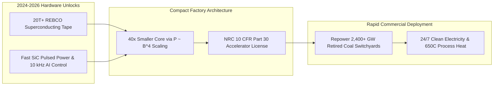

# CARBON EDITION • ABUNDANT CLEAN ENERGY
## Compact Commercial Fusion — *Bottling High-Field Starlight in Retire-Ready Coal Switchyards*

> **The Cynic's Belief:**
> *"Fusion is thirty years away and always will be—a multi-billion-dollar government science project trapped
> in cathedral-sized tokamaks that burn taxpayer cash faster than deuterium."*
>
> **The 2026 Breakthrough Reality:**
> High-temperature superconducting (HTS) magnets and solid-state pulsed power shattered the size and cost barrier.
> By late 2026, Commonwealth Fusion Systems (*SPARC* 85%+ assembled in Devens, MA; ~\$4B total raised after its \$1B
> mid-2026 round) is closing in on net energy ($Q > 1$) for 2027 with a 400 MWe *ARC* plant contracted to Google in
> Virginia, while Helion's *Orion* station in Malaga, Washington holds the world's first commercial fusion license for
> a 2028 Microsoft delivery—regulated like a particle accelerator rather than a fission plant.

---

## ACT I: A DELIGHTFUL NEAR FUTURE (HUMAN STORY)

On a crisp November morning in Chesterfield County, Virginia, third-generation high-voltage lineman Mateo Vance
unclips his thermos beside the James River public kayak docks where a six-story mountain of gray coal ash once
dominated the shoreline. Across a restored meadow of native switchgrass stands the Chesterfield *ARC* fusion
station—not a looming concrete cooling-tower fortress, but a sunlit, cedar-louvered industrial hall no larger
than a regional grocery distribution warehouse.

Inside its brushed-steel cryostat, a ribbon-wound magnetic bottle twenty times stronger than a hospital MRI holds
a shimmering ring of hydrogen isotopes at $100\text{ million }^\circ\text{C}$, silent behind borated shielding and
flowing molten salt:

* **Zero Transmission Wars, Same Hometown Pride:**
  Mateo taps his diagnostic tablet. The 400-megawatt-electric bay feeds the exact same 500-kilovolt switchyard
  his grandfather wired in 1974 for the old Chesterfield coal units. No ten-year eminent-domain lawsuit had to
  carve new towers through Shenandoah valleys; the heavy copper corridors were already waiting.
* **Flat-Rate Subscription Abundance:**
  On the Vance family's kitchen display in Southside Richmond, electricity is no longer metered by anxious
  kilowatt-hour spikes during August heat domes or January polar vortices. Households pay a calm, flat `$14/month`
  grid membership—just like home fiber internet—while induction stoves, heat pumps, and two commuter EVs run
  without guilt or winter bill shock.
* **Winter Citrus & Clean Lungs:**
  Surplus $650^\circ\text{C}$ thermal energy from the fusion blanket circulates through insulated municipal
  district-heat pipes, keeping neighborhood glasshouses lush with Meyer lemons and sweet basil in mid-winter.
  Best of all, Mateo's seven-year-old daughter Lucia has never needed the albuterol asthma inhaler Mateo carried
  in his elementary backpack when unit coal trains idled along the riverfront.
* **Open-Glass Civic Wonder:**
  Every Friday afternoon, local eighth-grade classes walk right up to the fusion hall's acoustic observation
  gallery, watching live magnetometry ribbons dance across wall-sized screens—witnessing energy transformed
  from something dug up and burned into a clean, manufacturable craft.

---

## ACT II: SOTA BREAKTHROUGHS, REAL COMPANIES & SYNERGIES

For half a century, magnetic fusion was trapped behind a brutal materials ceiling: low-temperature copper or
niobium-tin ($\text{Nb}_3\text{Sn}$) superconductors quenched above ~12 Tesla, forcing machines like international
ITER to balloon into 23,000-ton, $840\text{ m}^3$ cathedrals just to keep superheated plasma from escaping.

### 1. Three Physics & Engineering Unlocks (2021–2026)
Between 2021 and late 2026, three independent hardware curves converged to shrink fusion from bespoke megaprojects
into truck-shippable factory modules:

* **The $B^4$ Magnetic Scaling Law (20-Tesla+ REBCO Tape):**
  Volumetric fusion power density in magnetic confinement scales with the fourth power of magnetic field strength
  ($P_{\text{fusion}} \propto \beta^2 B^4$). Industrializing rare-earth barium copper oxide (**REBCO**) superconducting
  tape on thousand-kilometer spools pushed coil fields past $20\text{ T}$ at $20\text{ K}$—boosting power density
  $16\times$ to $39\times$ and shrinking plasma chamber volume more than $40\times$.
* **Direct Inductive & Pulsed-Magnetic Recovery:**
  Silicon-carbide (SiC) solid-state switches fire megampere pulses with sub-microsecond precision. In Helion's
  field-reversed configuration (FRC), colliding $\text{D}\text{--}^3\text{He}$ plasmas expand directly against
  magnetic coils, inducing grid electricity via Faraday's Law at $\eta > 80\%$ without steam turbines. Meanwhile,
  Pacific Fusion's impedance-matched Marx generators compress centimeter-scale liners toward high-gain inertial fusion.
* **Liquid FLiBe Blankets & 10 kHz AI Plasma Sculpting:**
  Surrounding tokamak or stellarator plasmas with molten **FLiBe** ($2\text{LiF}\text{--}\text{BeF}_2$) salt absorbs
  $14.1\text{ MeV}$ neutrons without solid-wall crystal embrittlement, extracts $650^\circ\text{C}$ Brayton-cycle heat,
  and breeds tritium fuel in-situ ($^6\text{Li} + n \rightarrow \,^4\text{He} + \text{T}$) in a closed milligram
  inventory—while deep reinforcement learning controllers calm plasma tearing modes $>10,000$ times per second.

> *"Every energy source in human history is a form of hunting and gathering... If you know how to build a fusion
> plant, you can build one wherever it's needed. That turns energy into a technology, and technologies face far
> fewer limits on how fast they spread or who gets access."*
> — **Dr. Bob Mumgaard**, Co-Founder & CEO, Commonwealth Fusion Systems

### 2. Verified 2025–2026 Commercial Fusion Leaders

| Pioneer / Lab | Core Architecture | Verified 2025–2026 SOTA Milestone | Commercial Offtake & Repowering Pathway |
| :--- | :--- | :--- | :--- |
| **Commonwealth Fusion Systems (CFS)** | High-field 20T REBCO tokamak (*SPARC* / *ARC*) + liquid FLiBe blanket | Closed \$1B round in mid-2026 (~\$4B total raised); *SPARC* 85%+ assembled in Devens, MA targeting $Q > 1$ in 2027 | 400 MWe *ARC* commercial station in Chesterfield, VA; landmark 200 MW Google PPA |
| **Helion Energy** | Pulsed magneto-inertial FRC with direct inductive magnetic recovery | *Polaris* hit $150\text{M }^\circ\text{C}$ & D-T fusion; *Orion* in Malaga, WA licensed as world's first commercial fusion plant | Binding 2028 commercial power delivery to Microsoft + 500 MWe Nucor green steel agreement |
| **Proxima Fusion** | Quasi-isodynamic HTS stellarator (Max Planck *Wendelstein 7-X* lineage) | Surpassed €411M+ in funding backed by RWE & Google; released peer-reviewed *Stellaris* steady-state plant design | *Alpha* demonstrator (2031) & repowering retired Gundremmingen nuclear grid hub in Bavaria |
| **Pacific Fusion** | High-gain pulsed magnetic inertial fusion (impedance-matched pulser) | Raised >\$1B Series A; broke ground on Mesa del Sol R&D and net-facility-gain campus in Albuquerque, NM | Targeting net facility gain ($Q_{\text{facility}} > 1$) by 2030 and modular coal-switchyard retrofits |
| **Type One Energy & Tokamak Energy** | 3D-shaped HTS modular stellarators & spherical HTS tokamaks | Type One partnered with TVA at retired Bull Run coal plant (TN); Tokamak Energy advancing *Demo4* 20T magnet array | Turnkey utility repowering blueprints across U.S. Appalachian and UK *STEP* West Burton coal hubs |

---

## ACT III: REIMAGINING SOCIAL CONVENTIONS & GLOBAL PROOF

Cynics insist that even after net plasma energy is demonstrated, nuclear regulators, slow utilities, and local
zoning lawsuits will freeze fusion in courtrooms until 2060. Real-world law and industrial geography have already
flipped that assumption upside down:

1. **U.S. NRC `10 CFR Part 30` Accelerator Rule:**
   Because a fusion chamber holds less than one gram of ionized gas at any moment—any vacuum leak or magnet fault
   extinguishes the plasma in milliseconds like a candle flame, with zero chain reaction and zero long-lived spent
   fuel rods—the U.S. Nuclear Regulatory Commission voted unanimously (codified into statute by the bipartisan
   ADVANCE Act) to regulate fusion under `10 CFR Part 30`, the agile framework governing hospital proton-therapy
   accelerators. Washington State used this exact pathway to license Helion's *Orion* plant in months.
2. **UK & Japanese Proportionate Fast-Tracks:**
   Britain's *Fusion Futures* Statutory Instrument permanently excluded fusion facilities from bulky fission nuclear
   site licensing at the retired West Burton coal station, while Japan's Cabinet Office *Fusion Innovation Strategy*
   aligned 80+ industrial manufacturers (Kyoto Fusioneering, Fujikura, Mitsubishi) behind standardized HTS tape
   and balance-of-plant export codes.
3. **The 2,400+ GW Coal-to-Fusion Switchyard Shortcut:**
   Worldwide, over 2,400 gigawatts of coal plants sit atop pre-permitted gigawatt substations, heavy rail spurs,
   cooling water intakes, and proud boilermaker/lineman workforces. Dropping factory-built fusion cores straight
   onto retiring coal turbine islands slashes capital cost ~35%, skips 8-year transmission queues, and turns
   fossil-fuel towns into clean-energy champions.

| Trajectory Metric | 2026 Baseline | 2030 Sprint | 2035 Scaling | 2040 Maturity |
| :--- | :--- | :--- | :--- | :--- |
| **Global REBCO Tape Supply** | ~6,000 km/yr across US, Japan & EU lines | 60,000 km/yr; tape price drops 65% via wide-web coating | 350,000 km/yr feeding automated coil-winding factories | Commodity superconductor (<\$8/kA-m) |
| **Grid Fleet Deployment** | *SPARC* 85%+ built; *Orion* licensed & under construction | First commercial MWe delivered (WA & VA); 6+ pilot plants live | 45+ GW contracted across US, EU & Asian coal switchyards | 250+ GW firm global fleet via shipyard serial assembly |
| **Levelized Cost (LCOE)** | FOAK bilateral PPAs at \$85–\$110/MWh | \$55–\$70/MWh on brownfield coal switchyard retrofits | \$30–\$42/MWh via standardized 400 MWe twin packs | \$16–\$24/MWh firm 24/7 power + district heat revenue |
| **Civic & Utility Model** | Scarcity kWh metering & data-center queue anxiety | Hyperscaler PPAs pay down first-of-a-kind factory tooling | Coal counties co-own repowered municipal fusion tax bases | Flat-rate residential abundance & zero-smoke riverfronts |

---

## ACT IV: THE SYNERGY CASCADE

Compact fusion is the ultimate high-density teammate to ultra-cheap solar: while tandem photovoltaics flood sunny
afternoons with sub-penny electrons, fusion anchors cloudy northern winters, dense megacities, steelmaking valleys,
and 24/7 compute campuses on less than 1% of the land footprint of wind or bioenergy.

* **Thin Air to Jet Fuel & Green Steel:**
  Pairing $650^\circ\text{C}$ fusion process heat and off-peak electricity with [Synthetic Sky Fuels](../synthetic-sky-fuels/REPORT.md)
  synthesizes drop-in aviation fuel and molten-oxide green steel with zero fossil feedstocks.
* **Shared Superconducting Supply Chains:**
  Every doubling of REBCO tape output for fusion magnets directly drives down cable costs for
  [Superconducting Grids](../superconducting-grids/REPORT.md), pumping lossless gigawatts into city centers
  through narrow rail corridors.
* **Continental Drought Eradication:**
  Co-locating a 400 MWe fusion unit beside [Aquifer Rivers & Desalination](../aquifer-rivers-desalination/REPORT.md)
  pods produces over 1.5 billion liters of pure freshwater daily for coastal cities and inland orchards.
* **Peace Through Manufactured Fuel:**
  Because one gallon of ordinary surface water holds the deuterium fusion equivalent of 300 gallons of gasoline,
  resource wars over oil straits and gas pipelines permanently lose their geopolitical fuse.

---

## References & Verified Sources

* **Featured Researcher / Leader:** [Dr. Bob Mumgaard — Co-Founder & CEO, Commonwealth Fusion Systems](https://cfs.energy/)
* **Companies, Labs & Consortia:** [Commonwealth Fusion Systems (CFS)](https://cfs.energy/) · [Helion Energy](https://www.helionenergy.com/) · [Proxima Fusion](https://www.proximafusion.com/) · [Pacific Fusion](https://www.pacificfusion.com/) · [Type One Energy](https://typeoneenergy.com/) · [MIT PSFC & Max Planck IPP](https://www.psfc.mit.edu/)
* **Global & Regulatory Precedents:** [US NRC Unanimous 10 CFR Part 30 Accelerator Rule](https://www.nrc.gov/materials/fusion-energy-systems.html) · [Washington State Orion Commercial Fusion License](https://www.helionenergy.com/) · [UK Fusion Futures STEP Coal Repowering (West Burton)](https://ccfe.ukaea.uk/) · [Bavaria Gundremmingen Stellarator Repowering Plan](https://www.proximafusion.com/)
* **Connected Carbon Pathways:** [Lossless HTS Superhighways & Autonomous Microgrids](../superconducting-grids/REPORT.md) · [Turning Thin Air into Jet Fuel, Green Steel & Stone](../synthetic-sky-fuels/REPORT.md) · [Ending Drought Forever: Sub-Penny Desalination & Continental New Rivers](../aquifer-rivers-desalination/REPORT.md) · [Designing Matter Backwards: AI Super-Materials Without Rare-Earth Scars](../../02-automation-science/inverse-materials-design/REPORT.md)
