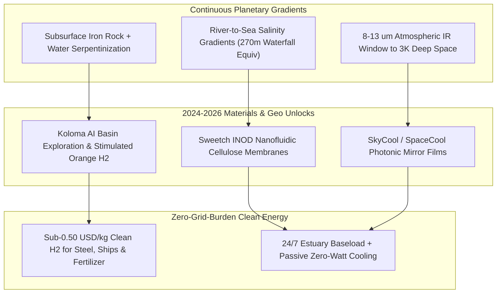

# CARBON EDITION • ABUNDANT CLEAN ENERGY
## White Geologic Hydrogen, Blue Osmotic & Ambient Harvesters — *Tapping Earth's Natural Subsurface Hydrogen Wells, River-Mouth Salt Gradients, and Deep-Space Sky Cooling*

> **The Cynic's Belief:**
> *"Clean hydrogen is an energy-losing thermodynamic trap that wastes mountains of renewable electricity in expensive
> electrolyzers—and 'ambient energy harvesting' is a gimmick barely strong enough to run a pocket calculator."*
>
> **The 2026 Breakthrough Reality:**
> Earth's iron-rich crust is already manufacturing millions of tons of carbon-free **"white" geologic hydrogen** for
> us—proven for over a decade in Bourakebougou, Mali and now drilled across France, Australia, and mid-continent America
> by **Koloma** (\$245M+ raised) and **Eden GeoPower** toward **<\$0.50/kg**. Alongside **Sweetch Energy's** nanoporous
> river-mouth osmotic power on France's Rhône delta and **SkyCool** radiative panels beaming building heat straight to
> outer space at noon, planetary thermodynamics has become a free 24/7 workhorse.

---

## ACT I: A DELIGHTFUL NEAR FUTURE (HUMAN STORY)

In the lively market town of **Bourakebougou, Mali**, agro-processing technician Amadou Diallo checks the pressure
gauge on a gleaming white wellhead originally drilled in search of drinking water—a well that instead tapped a
98%-pure natural subterranean hydrogen reservoir. For more than a decade, Bourakebougou has hummed with clean lights,
cold mango storage, grain mills, and clean water pumps without burning imported diesel or emitting a gram of soot.

Today, Amadou welcomes visiting drilling apprentices from Lorraine, France and central Nebraska—because what once
looked like a West African geological fluke turned out to be a planet-wide treasure map:

* **Zero-Carbon Ammonia Right Under the Corn Belt:**
  In rural Nebraska, a cooperative well pad smaller than a tennis court taps stimulated **serpentinization** deep
  inside iron-rich Midcontinent Rift basalt—pulling up clean hydrogen at **\$0.48 per kilogram** to synthesize
  local nitrogen fertilizer right beside the farms that use it, cutting farmers' fertilizer bills in half and ending
  dependence on volatile overseas natural gas.
* **The River Mouth That Never Stops Flowing:**
  Four thousand kilometers north at Port-Saint-Louis-du-Rhône in southern France, marine ecologist Chloé Moreau kayaks
  past a quiet coastal building where fresh Rhône River water meets salty Mediterranean seawater across **Sweetch Energy's**
  bionic nanoporous cellulose membranes—generating steady 24/7 "blue" electricity rain or shine, with zero dams blocking
  migrating eels and zero visual clutter on the marsh.
* **Cold Grocery Roofs Under a Blazing Desert Sun:**
  Meanwhile in Phoenix, Arizona, a neighborhood produce market slashes its summer air-conditioning load by 35% using
  mirror-smooth **radiative sky-cooling** roof panels that beam heat straight through Earth's atmosphere into the
  $-270^\circ\text{C}$ cold of outer space—chilling water loops $7^\circ\text{C}$ *below* shade air temperature at high noon
  using zero electricity at all!

---

## ACT II: SOTA BREAKTHROUGHS, REAL COMPANIES & SYNERGIES

For a century, petroleum geologists literally threw away hydrogen readings because old gas chromatographs used
hydrogen as their carrier gas—blinding science to natural subsurface $\text{H}_2$! Once modern sensors looked again,
the U.S. Geological Survey (USGS) estimated Earth's crust holds **hundreds of billions to trillions of tons** of
geologic hydrogen—where recovering just **2%** would supply clean global fuel demand for two hundred years.

### 1. Three Planetary Thermodynamic Harvesters (2024–2026)
Rather than building costly machines to fight entropy from scratch, these three technologies tap massive natural
chemical and radiative gradients Earth runs continuously:

* **White & Stimulated "Orange" Geologic Hydrogen (<\$0.50–\$0.75/kg):**
  Deep underground ($1–5\text{ km}$), hot water reacts continuously with iron-rich ultramafic rocks (olivine and
  peridotite) via **serpentinization**: $3\text{FeO} + \text{H}_2\text{O} \rightarrow \text{Fe}_3\text{O}_4\text{ (magnetite)} + \text{H}_2$,
  supplemented by natural radiolysis of water. Not only can drillers tap accumulated **white hydrogen** traps (like
  Mali and Moselle, France), startups like **Eden GeoPower** and MIT/Colorado School of Mines researchers inject
  warm, $\text{CO}_2$-enriched water + low-cost catalysts into ubiquitous iron-rich basalts—**permanently mineralizing
  $\text{CO}_2$ into solid carbonate rock while harvesting clean "orange" hydrogen** out the production well!
* **Ionic Nanoporous Osmotic Power (*Blue Energy*, 24/7 Estuary Baseload):**
  Whenever $1\text{ m}^3$ of fresh river water mixes with seawater, entropy releases **$\sim 0.8\text{ kWh}$** of Gibbs
  free energy—equivalent to a **270-meter waterfall** at every river mouth on Earth! Previous reverse-electrodialysis
  membranes cost \$500/m² and fouled quickly. **Sweetch Energy** combined nanofluidic boron-nitride/cellulose ion-selective
  channels (**INOD**) derived from wood pulp to boost power density $10\times$ at a fraction of polymer membrane cost.
* **Photonic Radiative Sky Cooling ($8–13\ \mu\text{m}$ Space Window):**
  Earth's atmosphere has a transparent infrared window between **8 and 13 microns**. Multi-layer nanophotonic hafnium/silicon-oxide
  and polymer films (**SkyCool Systems**, **SpaceCool**) reflect >97% of incoming sunlight while emitting thermal photons
  strictly at $8–13\ \mu\text{m}$—using deep space ($3\text{ K}$) as a passive, zero-power heat sink day and night.

> *"There is a vast amount of natural hydrogen in the Earth's crust—even recovering a small fraction of it could
> supply clean fuel for centuries."*
> — **Dr. Geoffrey Ellis**, Research Geochemist & Geologic Hydrogen Lead, U.S. Geological Survey (USGS)

### 2. Verified 2025–2026 Geologic, Osmotic & Radiative Pioneers

| Pioneer / Project | Natural Gradient & Tech | Verified 2025–2026 Milestone | Commercial Pathway & Scale |
| :--- | :--- | :--- | :--- |
| **Hydroma (Mali) & FDE (France)** | Natural **White Hydrogen** production & coalbed/basement discovery | Bourakebougou (Mali) >12 yrs zero-carbon power; Française de l'Énergie confirmed multi-million-ton **Moselle** $\text{H}_2$ play | Expanding West African multi-well clean grids & European industrial pipeline hydrogen |
| **Koloma** | AI-guided geologic hydrogen basin exploration & low-carbon production | Raised **>\$245M** (Breakthrough Energy, Amazon, United Airlines); active exploration drilling across U.S. Midcontinent Rift | Supplying <\$1/kg domestic clean hydrogen for aviation SAF, ammonia & Midwest heavy industry |
| **Gold Hydrogen & HyTerra** | Dedicated regulated white $\text{H}_2$ & helium exploration wells | Gold Hydrogen tested up to **86%–95.8% purity natural $\text{H}_2$** + valuable helium at Ramsay Project (South Australia); HyTerra drilling KS | Co-producing high-margin industrial helium (for MRI/cryogenics!) alongside ultra-cheap clean $\text{H}_2$ |
| **Eden GeoPower & ARPA-E** | Stimulated subsurface **serpentinization** (*Orange Hydrogen* + $\text{CO}_2$ lock) | Backed by \$20M+ U.S. DOE ARPA-E geologic $\text{H}_2$ grants & pulsed electric permeability stimulation | Carbon-negative hydrogen generation inside widespread coastal & continental iron-rich basalts |
| **Sweetch Energy & SkyCool** | Nanofluidic osmotic **INOD** estuary stacks & $8–13\ \mu\text{m}$ sky-cooling panels | Sweetch operating **Barcarin osmotic pilot on Rhône delta** with CNR; SkyCool & SpaceCool deployed across grocery & telecom hubs | Gigawatt-scale river-delta baseload + 20%–40% HVAC/data-center cooling electricity reduction |

---

## ACT III: REIMAGINING SOCIAL CONVENTIONS & GLOBAL PROOF

Two outdated conventions delayed geologic and osmotic harvesters: mining codes didn't even have a legal checkbox for
"natural hydrogen," and green-hydrogen subsidies initially assumed all clean hydrogen *had* to come from expensive
water electrolyzers. Between 2024 and 2026, lawmakers around the world rewrote the rulebook:

1. **South Australia, France & U.S. Geologic Hydrogen Mining Laws:**
   South Australia pioneered the world's first dedicated `Regulated Substance` exploration framework for natural
   hydrogen in its `Petroleum and Geothermal Energy Act`—triggering an immediate exploration boom covering hundreds
   of thousands of square kilometers. France swiftly modernized its *Code Minier* to grant exclusive white-hydrogen
   exploration permits in Lorraine and the Pyrénées, followed by U.S. federal USGS resource mapping.
2. **Bourakebougou's Decade-Long Off-Grid Proof:**
   While Western pundits debated hydrogen colors on whiteboards, Malian entrepreneur Aliou Diallo's **Hydroma** wells
   quietly delivered emission-free rural electrification in Bourakebougou for more than ten years—proving African and
   Global South nations sitting atop Precambrian cratons can leapfrog directly to local fertilizer and clean power.
3. **Brine-to-Power Desalination Symbiosis:**
   Instead of dumping concentrated desalination brine back into the ocean unused, mixing coastal desalination brine
   with municipal treated wastewater across **Sweetch** osmotic stacks multiplies salinity-gradient voltage $3\times$—generating
   clean electricity *while* diluting brine safely back to ambient seawater salinity!

| Trajectory Metric | 2026 Baseline | 2030 Sprint | 2035 Scaling | 2040 Maturity |
| :--- | :--- | :--- | :--- | :--- |
| **Delivered Clean $\text{H}_2$ Cost** | \$3.50–\$6.00/kg green electrolysis; Mali pilot live | \$0.75–\$1.20/kg early commercial white $\text{H}_2$ wells | **\$0.40–\$0.65/kg** white & stimulated orange $\text{H}_2$ | <\$0.40/kg abundant clean feedstock (+ helium credit) |
| **Geologic $\text{H}_2$ Output** | Exploration & appraisal wells across US, FR, AU, ML | 2–5 Mt/yr commercial basin production beside ammonia plants | 35+ Mt/yr displacing gray natural-gas steam reforming | 150+ Mt/yr carbon-free/carbon-negative global fuel |
| **Osmotic Blue Power** | Rhône delta pilot (Sweetch + CNR) & desalination skids | 500+ MW river-mouth & brine-mixing modules operating | 15+ GW silent 24/7 estuary & wastewater baseload | 100+ GW global coastal & industrial osmotic harvesters |
| **Radiative Sky Cooling** | Cold-storage, telecom shelter & grocery roof rollouts | Integrated into standard data-center & warehouse roofs | Coating films cut tropical peak AC grid loads by 20%+ | Standard passive zero-watt cooling skin on sunny buildings |

---

## ACT IV: THE SYNERGY CASCADE

Tapping Earth's built-in chemical and radiative engines frees thousands of terawatt-hours of solar and fusion
electricity from having to do heavy chemical lifting from scratch:

* **Slashing E-Jet Fuel & Green Steel Costs in Half:**
  Hydrogen is the single biggest cost input in [Synthetic Sky Fuels](../synthetic-sky-fuels/REPORT.md). Feeding \$0.45/kg
  white or carbon-negative orange hydrogen straight into Fischer-Tropsch aviation reactors and direct-reduced iron
  shafts makes green jet fuel and green steel *cheaper than fossil equivalents* years ahead of schedule.
* **Desalination Brine Turns into an Energy Asset:**
  Pairing Sweetch osmotic stacks with [Aquifer Rivers & Desalination](../aquifer-rivers-desalination/REPORT.md) recovers
  15%–25% of pumping energy from concentrated brine before discharge.
* **Oilfield & Geothermal Rig Synergy:**
  White and stimulated hydrogen wells use the exact same directional rigs and fiber-optic completions perfected in
  [Superhot Rock Geothermal](../superhot-geothermal/REPORT.md).
* **Passive Heat Relief for Warming Cities:**
  Radiative sky-cooling films keep tropical clinics, schools, and grain silos cool even during grid outages—saving lives
  without burning a single watt.

---

## References & Verified Sources

* **Featured Researcher / Leader:** [Dr. Geoffrey Ellis — Research Geochemist & Geologic Hydrogen Lead, U.S. Geological Survey](https://www.usgs.gov/centers/central-energy-resources-science-center/science/geologic-hydrogen)
* **Companies, Labs & Consortia:** [Koloma](https://koloma.com/) · [Hydroma (Mali) & FDE (Moselle)](https://en.wikipedia.org/wiki/Natural_hydrogen) · [Gold Hydrogen & Eden GeoPower](https://www.goldhydrogen.com.au/) · [Sweetch Energy & CNR](https://www.sweetch.energy/) · [SkyCool Systems & SpaceCool](https://www.skycoolsystems.com/) · [USGS & US DOE ARPA-E](https://www.usgs.gov/centers/central-energy-resources-science-center/science/geologic-hydrogen)
* **Global & Regulatory Precedents:** [Bourakebougou Mali 12+ Years 98%-Pure White Hydrogen Village Grid](https://en.wikipedia.org/wiki/Natural_hydrogen) · [South Australia World-First Natural Hydrogen Regulated Licensing](https://www.energymining.sa.gov.au/) · [Moselle France Multi-Million-Ton White Hydrogen Discovery](https://en.wikipedia.org/wiki/Natural_hydrogen) · [Rhône Delta Barcarin Nanoporous Osmotic Power Pilot (France)](https://www.sweetch.energy/)
* **Connected Carbon Pathways:** [Turning Thin Air into Jet Fuel, Green Steel & Stone](../synthetic-sky-fuels/REPORT.md) · [Everywhere Baseload: Enhanced & Superhot Rock Geothermal](../superhot-geothermal/REPORT.md) · [Ending Drought Forever: Sub-Penny Desalination & Continental New Rivers](../aquifer-rivers-desalination/REPORT.md) · [The Billion-Hectare Rewilding: Solar Proteins, Vertical Orchards & Returning Half the Earth to Wild Nature](../../03-bioscience-regeneration/precision-fermentation-rewilding/REPORT.md)
