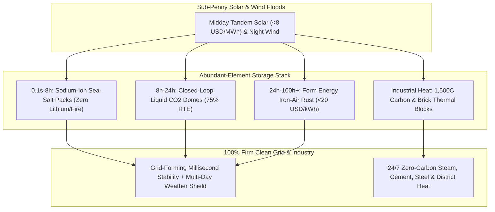

# CARBON EDITION • ABUNDANT CLEAN ENERGY
## 100-Hour Rust, Salt & Glowing Carbon Storage — *Turning Earth's Dirt-Cheap Iron, Sea Salt, and White-Hot Bricks into Unbreakable Clean Baseload*

> **The Cynic's Belief:**
> *"Solar and wind hit a brick wall the moment a cloudy winter calm lasts four days: lithium-ion batteries fade
> after four hours, catch fire, and would bankrupt the planet trying to mine enough cobalt and lithium for a week of backup."*
>
> **The 2026 Breakthrough Reality:**
> Engineers stopped forcing four-hour EV batteries to do hundred-hour grid jobs—switching instead to Earth's dirt-cheap
> abundant elements. Form Energy's Weirton, West Virginia factory is shipping **100-hour iron-air batteries** (<\$20/kWh
> via reversible rusting), CATL and Natron scale non-flammable **sodium-ion** packs made from sea salt, and Antora plus
> Rondo store cheap noon electrons in **$1,500^\circ\text{C}$ glowing carbon and firebrick**—turning intermittent
> sunshine and wind into rock-solid, year-round baseload.

---

## ACT I: A DELIGHTFUL NEAR FUTURE (HUMAN STORY)

On the banks of the Ohio River in Weirton, West Virginia, third-generation steelworker Darnell Kowalski watches
a bright blue freight train roll out of **Form Factory 1**—rising proudly on the exact riverfront brownfield where
Weirton Steel's blast furnaces went cold twenty years ago. Inside those weatherproof enclosures sit no conflict
cobalt, no imported nickel, and no volatile organic electrolytes—just porous pellets of American **iron**, water-based
potassium hydroxide, and breathable outside air:

* **Breathing Oxygen In and Out for Four Straight Days:**
  Two states north in Minnesota, a polar vortex locks wind turbines in freezing fog while winter clouds dim solar
  arrays for ninety-six straight hours. Instead of firing up \$1,000/MWh gas peakers or begging families to turn down
  thermostats, utility-scale iron-air parks quietly inhale oxygen—rusting iron pellets into iron oxide while releasing
  steady megawatts for **four full days**. When sunny wind returns on Friday, cheap surplus electrons strip the oxygen
  right back out, turning rust back into fresh metallic iron for under **\$20 per kilowatt-hour** of storage capacity.
* **Sea-Salt Home Packs That Never Catch Fire:**
  Back in Darnell's basement, a compact **sodium-ion** home battery made from abundant soda ash and Prussian-blue
  pigment keeps his heat pump humming at $-25^\circ\text{C}$ with zero thermal-runaway fire risk—lowering his homeowner's
  insurance premium.
* **White-Hot Bricks Replacing Factory Gas Boilers:**
  Downriver at an Ohio Valley paper and specialty ceramics mill, natural gas smokestacks have vanished. Insulated
  boxes of **Antora** solid carbon blocks and **Rondo** refractory bricks soak up nearly free midday solar and
  midnight wind, glowing white-hot at **$1,500^\circ\text{C}$** inside steel boxes to deliver 24/7 superheated steam
  and thermophotovoltaic electricity cleaner and cheaper than fracked gas.

---

## ACT II: SOTA BREAKTHROUGHS, REAL COMPANIES & SYNERGIES

To turn solar and wind into 99.97%-reliable 24/7 power, grid modelers at MIT and Princeton proved a striking
threshold: **4-hour batteries** handle daily sunset peaks, **10-to-24-hour storage** bridges stormy days, and
**100-hour multi-day storage** priced under **\$20/kWh** permanently conquers multi-day *Dunkelflaute* wind-and-sun
lulls at lower cost than maintaining fossil peaker fleets.

### 1. Four Elemental Storage Chemistries Conquering Every Timescale (2024–2026)
By matching distinct timescales to hyper-abundant crust and ocean elements—iron, sodium, carbon, and $\text{CO}_2$—supply-chain
bottlenecks disappear completely:

* **100-Hour Reversible Rusting ($\text{Fe} + \text{O}_2$, <\$20/kWh):**
  Form Energy's aqueous iron-air cell pairs a low-cost iron anode—the most mass-produced metal on Earth—with an
  air-breathing cathode ($\text{Fe} + \frac{3}{2}\text{H}_2\text{O} + \frac{3}{4}\text{O}_2 \rightleftharpoons \text{Fe(OH)}_3$,
  $E^\circ \approx 1.28\text{ V}$). Because oxygen comes free from ambient air and iron pellets cost pennies per kilogram,
  active storage media cost **<1/10th of lithium-ion**, trading lower round-trip efficiency (~45%) for unbeatable
  100-hour multi-day economics when charged by \$8/MWh solar or wind surpluses.
* **Zero-Lithium Sodium-Ion ($\text{Na}^+$, $-40^\circ\text{C}$ All-Weather Power):**
  Sodium is **1,000× more abundant** in Earth's crust than lithium and replaces expensive copper anode current
  collectors with cheap aluminum foil (since sodium does not alloy with aluminum). CATL's *Naxtra* layered-oxide packs
  hit **175 Wh/kg** with extreme cold resilience ($>90\%$ capacity at $-30^\circ\text{C}$), while Prussian-blue
  sodium-ion cells deliver 50,000+ rapid high-power cycles for data centers and grid frequency regulation with zero fire risk.
* **$1,500^\circ\text{C}+$ Glowing Carbon & Firebrick Thermal Batteries:**
  Industrial heat accounts for ~20% of global $\text{CO}_2$. **Rondo Energy** heats ancient blast-furnace clay bricks
  with resistive wires (>98% AC-to-heat efficiency) at <\$10/kWh-thermal, while **Antora Energy** heats solid modular
  carbon blocks past $1,500^\circ\text{C}$ and shines that incandescent light onto solid-state **thermophotovoltaic (TPV)**
  wafers (>40% heat-to-electricity efficiency, zero moving turbine blades!).
* **Closed-Loop Atmospheric $\text{CO}_2$ Domes:**
  **Energy Dome** compresses gas-phase $\text{CO}_2$ from a flexible dome into ambient-temperature liquid $\text{CO}_2$
  steel vessels (saving thermal compression heat in rock beds), then expands it through off-the-shelf turbines for
  8–24 hours at ~75% round-trip efficiency using zero exotic minerals.

> *"Lithium-ion is great for four hours. The grid needs a hundred hours. Reversible rusting turns the most
> abundant metal on Earth into multi-day clean baseload."*
> — **Mateo Jaramillo**, Co-Founder & CEO, Form Energy

### 2. Verified 2025–2026 Abundant-Element Storage Leaders

| Pioneer / System | Core Chemistry / Physics | Verified 2025–2026 Milestone | Commercial Grid & Industrial Rollout |
| :--- | :--- | :--- | :--- |
| **Form Energy** | 100-hour aqueous reversible-rusting **Iron-Air** battery | Commercial production live at **Form Factory 1 (Weirton, WV)**; >\$1.2B raised; shipping utility enclosures | Multi-MW 100-hr utility parks with Great River Energy (MN), Xcel (CO/MN), Georgia Power & Dominion (VA) |
| **CATL (*Naxtra*) & HiNa** | Mass-manufactured **Sodium-Ion** ($\text{Na}^+$) grid & EV packs | CATL launched *Naxtra* 175 Wh/kg mass-production line (2025–2026) passing nail/saw fire torture tests at $-40^\circ\text{C}$ | 100+ MWh sodium-ion grid stations live in China & cold-climate microgrids worldwide |
| **Antora Energy** | $1,500^\circ\text{C}+$ solid carbon thermal blocks + >40% TPV cells | Opened gigawatt-scale TPV cell manufacturing in San Jose, CA; \$150M+ Series B led by Decarbonization Partners | Delivering 24/7 zero-carbon industrial heat + electricity for chemical, mining & manufacturing plants |
| **Rondo Energy** | $1,500^\circ\text{C}$ refractory firebrick *Heat Battery* | Commercial units operating at Calgren (CA) & European food/beverage plants; 90 GWh/yr Siam Cement factory capacity | Drop-in replacement for industrial fossil-fuel steam boilers across food, spirits, pulp & steel |
| **Energy Dome** | Closed-loop thermodynamic liquid-$\text{CO}_2$ mechanical battery | Full 20 MW / 200 MWh commercial *CO2 Battery* commissioned in Ottana, Sardinia; Alliant Energy US utility contract | 8–24 hour zero-degradation utility storage built entirely from standard steel pipes and turbines |

---

## ACT III: REIMAGINING SOCIAL CONVENTIONS & GLOBAL PROOF

For decades, utility executives claimed grids would collapse without heavy spinning coal and gas turbines providing
physical inertia, and rust-belt towns feared battery factories meant outsourcing supply chains overseas. Both myths
crumbled on contact with real grids:

1. **South Australia's Hornsdale Proof (Synthetic Inertia Beats Gas Peakers):**
   When Tesla and Neoen energized the **Hornsdale Power Reserve** in South Australia, skeptics called it a PR stunt.
   Within weeks, when a distant coal unit tripped offline, Hornsdale's **grid-forming inverters** injected stabilizing
   megawatts in **140 milliseconds**—thirty times faster than spinning steam governors—saving consumers >\$150M in
   frequency-control fees in its first two years and breaking the natural-gas peaker cartel. Today, California's
   CAISO and Texas's ERCOT routinely dispatch **10,000+ MW of batteries** every evening without a hiccup.
2. **Steel-Belt Revival Without Foreign Critical-Mineral Chokepoints:**
   Choosing West Virginia's historic Weirton Steel mill for *Form Factory 1* proved that clean storage can run 100%
   on North American iron ore from the Mesabi Range, Wyoming soda ash (trona) for sodium-ion, and domestic petroleum-pitch
   carbon blocks—employing 750+ union-grade steel-town workers while insulating grids from geopolitical mineral embargoes.
3. **Capacity Market Reform (Paying for Multi-Day Firmness):**
   State commissions in Minnesota, California, New York, and Maine created dedicated **Long-Duration Energy Storage (LDES)**
   procurements that reward 24-to-100-hour weather resilience rather than subsidizing idle fossil peakers that pollute
   low-income neighborhoods on hot summer afternoons.

| Trajectory Metric | 2026 Baseline | 2030 Sprint | 2035 Scaling | 2040 Maturity |
| :--- | :--- | :--- | :--- | :--- |
| **4–8h Sodium-Ion Pack Cost** | \$58–\$72/kWh early commercial mass lines | \$32–\$42/kWh via soda-ash & aluminum-foil scaling | \$20–\$28/kWh; standard in every home & school | <\$18/kWh eternal non-flammable stationary packs |
| **100-Hour Iron-Air Cost** | FOAK utility deployments trending toward \$20/kWh | \$15–\$19/kWh turnkey 100-hr enclosures | \$10–\$14/kWh replacing winter gas peaker fleets | <\$9/kWh multi-day weather shield worldwide |
| **Thermal Brick Storage Cost** | \$12–\$18/kWh-thermal ($1,500^\circ\text{C}$ steam/heat) | \$7–\$10/kWh-thermal; cheaper than pipeline gas boilers | \$4–\$6/kWh-thermal + 45% TPV power co-generation | Universal electrified industrial heat standard |
| **Grid Reliability Role** | 4-hr evening solar shifting (CA, TX, Australia) | 24–100 hr winter storm & *Dunkelflaute* firming | Fossil peaker plants fully retired into clean parks | 99.99% renewable + storage baseload everywhere |

---

## ACT IV: THE SYNERGY CASCADE

Cheap abundant-element storage transforms wildly fluctuating 0-cent afternoon sunshine and 2:00 AM wind gusts into
smooth, dispatchable industrial wealth:

* **Unlocking Unlimited Tandem Solar:**
  Without storage, solar value cannibalizes itself at noon; paired with [Perovskite-Silicon Tandems](../perovskite-tandem-solar/REPORT.md),
  every sunny roof and orchard canopy gains a 24/7 buyer for midday surpluses.
* **24/7 Electrolyzers & Sky-Fuel Factories:**
  Chemical reactors in [Synthetic Sky Fuels](../synthetic-sky-fuels/REPORT.md) hate turning off at sunset; sodium-ion
  and $1,500^\circ\text{C}$ thermal blocks keep green ammonia, cement, and e-fuel plants running at 95%+ capacity factor.
* **Deferring Decade-Long Grid Bottlenecks:**
  Placing non-flammable sodium and iron batteries right inside urban substations alongside [Superconducting Grids](../superconducting-grids/REPORT.md)
  absorbs congestion overnight and turns neighborhoods into islandable storm sanctuaries.
* **Zero-Diesel Desalination Buffers:**
  Coastal [Aquifer Rivers & Desalination](../aquifer-rivers-desalination/REPORT.md) plants pair solar fields with salt-and-iron
  storage to pump steady freshwater round the clock without touching fossil fuel.

---

## References & Verified Sources

* **Featured Researcher / Leader:** [Mateo Jaramillo — Co-Founder & CEO, Form Energy](https://formenergy.com/)
* **Companies, Labs & Consortia:** [Form Energy](https://formenergy.com/) · [CATL (Naxtra) & Natron Energy](https://www.catl.com/en/) · [Antora Energy](https://antora.com/) · [Rondo Energy](https://rondo.com/) · [Energy Dome](https://energydome.com/) · [MIT & Princeton LDES Grid Labs](https://energy.mit.edu/)
* **Global & Regulatory Precedents:** [South Australia Hornsdale 140ms Grid-Forming Inverter Proof](https://hornsdalepowerreserve.com.au/) · [Form Factory 1 Steel-Town Revival in Weirton, West Virginia](https://formenergy.com/) · [Sardinia 20 MW / 200 MWh Commercial Closed-Loop CO₂ Battery](https://energydome.com/) · [CAISO & ERCOT 10,000+ MW Routine Nightly Battery Dispatch](https://www.caiso.com/)
* **Connected Carbon Pathways:** [35.5% Perovskite-Silicon Tandems & Living Solar Skins](../perovskite-tandem-solar/REPORT.md) · [Lossless HTS Superhighways & Autonomous Microgrids](../superconducting-grids/REPORT.md) · [Turning Thin Air into Jet Fuel, Green Steel & Stone](../synthetic-sky-fuels/REPORT.md) · [Rescuing Displaced Workers Today: Denmark's 90% Wage-Bridge & Rapid Craft Pivots](../../04-social-norms/displaced-worker-bridge/REPORT.md)
