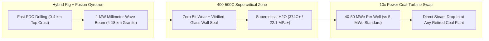

# CARBON EDITION • ABUNDANT CLEAN ENERGY
## Vaporizing Basement Granite — *Gyrotron Millimeter-Wave Beams Unlocking 15-km Supercritical Heat*

> **The Cynic's Belief:**
> *"Drilling ten miles down to reach 500°C rock everywhere on Earth is pure Jules Verne fantasy—the Kola Superdeep
> Borehole took twenty years just to get stuck in hot plasticky granite, and diamond drill bits cook and wear out
> every thirty hours."*
>
> **The 2026 Breakthrough Reality:**
> Mechanical drill bits fail at $10\text{--}20\text{ km}$ because physical contact softens metal and requires week-long
> pipe trips to swap worn heads. **Quaise Energy** (spun out of MIT's Plasma Science and Fusion Center) deleted contact
> completely—routing **1-megawatt millimeter-wave beams** from off-the-shelf fusion **gyrotrons** down standard oilfield
> drill pipe to spall, melt, and vaporize hard crystalline granite without a single moving part downhole. Paired with
> **Mazama Energy's** $330^\circ\text{C}\text{--}400^\circ\text{C}+$ Newberry superhot rock milestones in Oregon and
> Iceland's **Krafla Magma Testbed**, accessing **$400^\circ\text{C}\text{--}500^\circ\text{C}$ supercritical water**
> boosts power output **$10\times$ per borehole** (~40–50 MWe per well)—making retired coal turbines anywhere in Poland,
> India, Germany, or Ohio drop-in geothermal power stations.

---

## ACT I: A DELIGHTFUL NEAR FUTURE (HUMAN STORY)

On a frosty February morning outside Bełchatów in central Poland—once home to Europe's largest lignite-coal power station,
miles from any volcano or tectonic plate boundary—chief turbine engineer Katarzyna Nowak walks past quiet birch saplings
growing over the reclaimed coal pit toward Turbine Hall Unit 4.

Inside the hall, the exact same 370-megawatt Siemens steam turbine Katarzyna operated for fifteen years spins at a smooth
$3,000\text{ RPM}$, delivering 24/7 carbon-free electricity and municipal district heating to Łódź and Warsaw. Yet not a
single lump of brown coal burns anywhere on site:

* **Steam Straight From 14 Kilometers Under Poland:**
  Out in the switchyard courtyard, eight compact wellheads—occupying less ground than two tennis courts—tap crystalline
  basement granite $14.2\text{ kilometers}$ directly beneath the old coal boiler. At that depth anywhere under continental
  crust, Earth's natural thermal blanket sits near **$460^\circ\text{C}$**—delivering supercritical steam at the exact
  pressure and temperature the existing coal turbine blades were built for.
* **Drilled by Light, Self-Cased in Vitrified Glass:**
  To bore through the hardest basement granite on Earth in 90 days instead of twenty years, an electric Nabors rig paired
  with a container-sized fusion gyrotron beamed concentrated $95\text{ GHz}$ millimeter-wave energy down a hollow waveguide.
  Nothing touched the rock face to wear out—and as the beam vaporized granite upward in an argon purge stream, the intense
  heat melted the borehole wall into a **vitrified volcanic-glass liner** stronger than steel casing.
* **Ten Times More Power Per Well:**
  Above water's supercritical point ($374^\circ\text{C}$, $22.1\text{ MPa}$), water stops boiling into sluggish bubbles and
  turns into a dense, ultra-low-viscosity fluid carrying ~$5\times$ the enthalpy and flowing $2\times$ faster—allowing just
  eight supercritical wells to replace eighty conventional geothermal wells.
* **Zero Sovereign Fuel Imports Forever:**
  Poland no longer sends billions abroad for imported gas, oil, or coal. Every nation on Earth turns out to be sitting
  twelve kilometers above an inexhaustible domestic star core.

---

## ACT II: SOTA BREAKTHROUGHS, REAL COMPANIES & SYNERGIES

Beneath roughly $99\%$ of human cities, you don't need a volcano to find $450^\circ\text{C}$ heat—you just need depth
(continental geothermal gradients average $25^\circ\text{C}\text{--}35^\circ\text{C}$ per kilometer, hitting $400^\circ\text{C}\text{--}500^\circ\text{C}$
between **12 km and 18 km**). Over 99.9% of Earth's interior is hotter than $100^\circ\text{C}$; tapping just **$0.1\%$**
of crustal heat supplies humanity's total energy needs for **>20 million years**. Conventional rotary PDC diamond bits
conquer the top $3\text{--}5\text{ km}$ of sedimentary rock brilliantly (as Fervo proved), but deeper down, $350^\circ\text{C}+$
basement granite destroys downhole electronics, elastomers, and bearings while "tripping" 12 km of pipe takes days per
bit swap.

### 1. Three Physics & Superhot-Rock Unlocks (2024–2026)
Directed-energy plasma physics from nuclear fusion solved ultra-deep hard-rock drilling from the surface down:

* **1-Megawatt Fusion Gyrotrons & Corrugated Low-Loss Waveguides:**
  For fifty years, tokamak and stellarator labs (MIT PSFC, ITER, Kyoto Fusioneering, CPI/Thales) perfected industrial
  **gyrotron** vacuum tubes that generate continuous **1 MW beams at $30\text{--}140\text{ GHz}$** to heat fusion plasmas.
  **Quaise Energy** couples a surface gyrotron into standard steel drill pipe acting as an overmoded corrugated waveguide
  ($<2\%$ power loss per kilometer). Downhole, there are **zero bearings, zero motors, and zero electronics**—just a rugged
  metal horn shining a millimeter-wave beam onto dry granite at $>100\text{ MW/m}^2$ power density, vaporizing and
  thermally spalling rock at several meters per hour while high-pressure gas blows fine rock ash cleanly to the surface.
* **Self-Vitrifying Borehole Walls & Hybrid Rotary-Beam Rigs:**
  Conventional oilfield rotary bits drill the fast sedimentary top $3\text{--}4\text{ km}$, then the rig switches seamlessly
  to the millimeter-wave waveguide for the ultra-hard basement granite below. Intense perimeter radiant heat melts feldspar
  and quartz along the borehole wall into an impermeable **glassy ceramic vitrified skin** that seals micro-fractures
  without needing high-temperature Portland cement.
* **Supercritical Water Thermodynamics ($T > 374^\circ\text{C}$, $P > 22.1\text{ MPa}$):**
  Crossing into the **supercritical phase** doubles Carnot turbine conversion efficiency (from ~14% in legacy $170^\circ\text{C}$
  binary geothermal plants up to **38%–45%**) while slashing fluid viscosity ~$10\times$. One supercritical doublet yields
  **$40\text{--}50\text{ MWe}$**—a **$10\times$ power jump** over standard $5\text{ MWe}$ geothermal wells.

> *"The total thermal energy stored in deep basement rock dwarfs every fossil fuel deposit combined. With millimeter-wave
> drilling, geothermal stops being a geographic lottery and becomes universal clean baseload under every country's feet."*
> — **Carlos Araque**, Co-Founder & CEO, Quaise Energy (MIT PSFC Spinout)

### 2. Verified 2025–2026 Ultra-Deep & Superhot Rock Leaders

| Pioneer / Testbed | Core Deep-Rock Technology | Verified 2025–2026 SOTA Milestone | Commercial Power & Repowering Target |
| :--- | :--- | :--- | :--- |
| **Quaise Energy & Nabors Industries** | 1 MW fusion gyrotron millimeter-wave rock vaporization + hybrid oil rigs | Scaled 100 kW-to-1 MW field gyrotron drilling rigs in Texas & Marble Falls granite quarry tests ($>95\text{ GHz}$) | 50 MWe supercritical pilot wells targeting **direct coal-boiler steam replacement** by 2028–2030 |
| **Mazama Energy (Newberry Volcano, OR)** | Superhot Enhanced Geothermal Systems (SHR-EGS) high-temp zonal stimulation | Exceeded **$330^\circ\text{C}\text{--}390^\circ\text{C}+$** bottomhole milestones at Newberry OR (US DOE backed); targeting $400^\circ\text{C}+$ | First commercial US superhot rock station (15 MWe pilot scaling to 200 MWe Pacific NW hub) |
| **Krafla Magma Testbed (KMT, Iceland)** | International 38-institute scientific & engineering borehole to magma margin | Surface prep complete for world-first controlled $2.1\text{ km}$ borehole into $900^\circ\text{C}$ Krafla magma roof (2026–2027) | Tests extreme metallurgy, silica chemistry & 50+ MWe single-well supercritical valves |
| **GA Drilling (*PLASMABIT*) & Nabors** | Downhole pulsed electric-arc thermal plasma spallation milling | Backed by Nabors & Sumitomo; validated high-rate hard granite spallation & deep well plug-and-abandonment | Rapid crystalline basement penetration without mechanical cutter crushing |
| **Clean Air Task Force (CATF) SHR Initiative** | Global superhot-rock mapping, casing metallurgy & turbine repowering atlas | Published global *Superhot Rock Energy Atlas* proving >10,000 GW accessible beneath major coal grids | Coordinated EU, Japan (*JBBP*), Kenya & US DOE superhot component qualification |

---

## ACT III: REIMAGINING SOCIAL CONVENTIONS & GLOBAL PROOF

Deep supercritical geothermal achieves three geopolitical and civic miracles that no surface-sprawling energy technology
can match:

1. **Direct Steam Match for Retiring Coal Turbines (`540°C` Superheated Steam):**
   Conventional $180^\circ\text{C}$ geothermal is too lukewarm to spin a high-pressure coal steam turbine. Supercritical
   $450^\circ\text{C}+$ wells match subcritical and supercritical coal steam headers directly—saving **40%–50% of total
   power-plant CAPEX** by keeping the turbine hall, cooling condensers, grid switchyard, and local union operators intact.
2. **Ultra-Tiny Surface Footprint (~100x Denser Than Solar or Wind):**
   A 500 MWe supercritical geothermal station occupies roughly **15–20 acres** of surface pad—fitting cleanly inside an
   industrial brownfield fence in crowded Java, northern India, Ruhr Valley Germany, or Tokyo Bay without clearing a single
   hectare of forest or rice paddy.
3. **Aseismic Ductile Crustal Physics:**
   Below the **brittle-ductile transition zone** (~$380^\circ\text{C}\text{--}420^\circ\text{C}$), granite begins to behave
   plastically rather than snapping in brittle fault slips—dramatically reducing induced micro-seismicity risk while damped
   underneath 12+ kilometers of solid overburden.

| Trajectory Metric | 2026 Baseline | 2030 Sprint | 2035 Scaling | 2040 Maturity |
| :--- | :--- | :--- | :--- | :--- |
| **Max Commercial Depth / Temp** | $4\text{--}5.5\text{ km}$ rotary EGS ($220\text{--}380^\circ\text{C}$); shallow MW gyrotron field rigs | **$8\text{--}12\text{ km}$** hybrid beam wells hitting **$420^\circ\text{C}+$** supercritical | **$15\text{--}18\text{ km}$** routine continental basement access anywhere | Universal $450^\circ\text{C}\text{--}500^\circ\text{C}$ crustal tap on every continent |
| **Output Per Production Well** | 5–8 MWe (standard horizontal EGS) | **25–40 MWe** (first commercial supercritical doublets) | **45–60 MWe** per vitrified supercritical borehole | 10-well brownfield pads deliver **500 MWe** firm power |
| **Supercritical LCOE (\$/MWh)** | \$65–\$80/MWh (shallow EGS); SHR FOAK pilots | **\$38–\$50/MWh** on repowered coal turbine islands | **\$22–\$32/MWh** 24/7 dispatchable baseload everywhere | **\$15–\$24/MWh** sovereign fuel-free power + city heat |
| **Geopolitical Energy Reach** | Geothermal limited to ~8% tectonic/volcanic regions | Unlocks volcanic/rift margins + hot sedimentary basins (40% land) | Unlocks **90%+ of populated industrial coal regions** globally | Total energy independence for fuel-importing nations |

---

## ACT IV: THE SYNERGY CASCADE

Millimeter-wave deep drilling is itself a direct gift from fusion research—and returns the favor across the entire clean
industrial economy:

* **Two-Way Fusion Hardware Flywheel:**
  Every megawatt gyrotron built for [Compact Commercial Fusion](../fusion-power/REPORT.md) plasma heating shares the exact
  same vacuum-electronics supply chain as Quaise's deep-earth rigs, driving gyrotron unit costs down >60% for both sectors.
* **Two-Tier Geothermal Mastery:**
  Pairing shallow horizontal PDC rigs in [Enhanced & Superhot Rock Geothermal](../superhot-geothermal/REPORT.md) (0–5 km)
  with millimeter-wave beams below 5 km creates a complete crustal toolkit from Milford, Utah to central Europe.
* **Subsurface Hydrogen & Mineral Co-Production:**
  Deep radiative boreholes also unlock ultra-deep serpentinization zones for
  [Geologic White Hydrogen Harvesters](../geologic-hydrogen-harvesters/REPORT.md) and high-enthalpy brines for
  [Zero-Pond Direct Lithium Extraction](../electrochemical-lithium-brine/REPORT.md).

---

## References & Verified Sources

* **Featured Leader:** [Carlos Araque — Co-Founder & CEO, Quaise Energy (MIT Plasma Science & Fusion Center Spinout)](https://www.quaise.energy/)
* **Companies, Consortia & Labs:** [Quaise Energy](https://www.quaise.energy/) · [Mazama Energy (Newberry SHR)](https://mazamaenergy.com/) · [Krafla Magma Testbed (KMT Iceland)](https://www.kmt.is/) · [GA Drilling (*PLASMABIT*)](https://www.gadrilling.com/) · [Nabors Industries Energy Transition](https://www.nabors.com/) · [Clean Air Task Force Superhot Rock](https://www.catf.us/superhot-rock/)
* **Global & Scientific Precedents:** [MIT PSFC Gyrotron Millimeter-Wave Rock Vaporization Trials](https://www.psfc.mit.edu/) · [US DOE Enhanced & Superhot Geothermal Shot (\$90%+ Cost Cut Target)](https://www.energy.gov/eere/geothermal/enhanced-geothermal-shot) · [Iceland IDDP-2 & Krafla Supercritical Borehole Milestones](https://www.kmt.is/) · [CATF Global Superhot Rock Coal-Repowering Atlas](https://www.catf.us/superhot-rock/)
* **Connected Carbon Pathways:** [Everywhere Baseload: Enhanced & Superhot Rock Geothermal](../superhot-geothermal/REPORT.md) · [Compact Commercial Fusion](../fusion-power/REPORT.md) · [Drilling for Zero-Carbon Gold: Geologic Hydrogen](../geologic-hydrogen-harvesters/REPORT.md) · [Zero-Pond Direct Lithium Extraction](../electrochemical-lithium-brine/REPORT.md)
