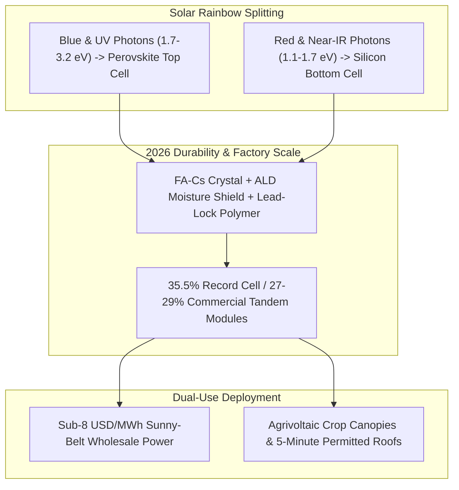

# CARBON EDITION • ABUNDANT CLEAN ENERGY
## 35.5% Perovskite-Silicon Tandems & Living Solar Skins — *Shattering the Silicon Ceiling to Turn Roofs, Farms, and Facades into Power Orchards*

> **The Cynic's Belief:**
> *"Solar panels already hit their physics limit near 23%, pave over prime farmland with black glass, degrade
> in damp heat, and still cost American families \$30,000 because of utility red tape."*
>
> **The 2026 Breakthrough Reality:**
> Stacking tunable halide perovskite crystals onto silicon shattered single-junction limits—LONGi certified a
> world-record **35.5% perovskite-silicon tandem cell** in 2026 while Oxford PV, Caelux, and Heliene ship
> 26%–28%+ commercial modules with `IEC 61215` damp-heat durability. Paired with crop-boosting agrivoltaic
> shade canopies (<\$8/MWh sunny-belt power) and Australia/`SolarAPP+` 5-minute automated permitting, sunlight
> has become humanity's cheapest electron fountain.

---

## ACT I: A DELIGHTFUL NEAR FUTURE (HUMAN STORY)

At 2:15 PM on a scorching July afternoon in California's Pajaro Valley, third-generation berry grower Elena Morales
strolls in shirtsleeves beneath ten acres of elevated, ruby-iridescent solar louvers—and feels a cool coastal breeze.
Five summers earlier, $39^\circ\text{C}$ heat domes baked her organic raspberries on the cane and forced field crews
off the rows by noon. Today, semi-transparent perovskite-silicon agrivoltaic canopies arch four meters overhead,
spectrally tuned to drink fierce blue and ultraviolet photons for electricity while letting gentle red-orange
photosynthetic light bathe the leaves below:

* **Two Harvests from Every Sunbeam:**
  Elena pops a plump, jewel-red raspberry into her mouth. Because the overhead solar louvers trim midday leaf
  temperatures by $5^\circ\text{C}$ and cut soil moisture evaporation by 35%, her summer irrigation water bill
  fell by a third while marketable berry yields jumped 22%. Her family farm harvests prize fruit at eye level
  and 4.2 megawatts of crisp clean power overhead.
* **Free Afternoon Town Power:**
  Down the road in Watsonville, midday electrons from surrounding berry canopies and warehouse roofs flood the
  local distribution grid at less than half a cent per kilowatt-hour between 10:00 AM and 4:00 PM. The city
  responded by making municipal electric buses, school-lunch cold storage, public EV fast-chargers, and library
  cooling centers completely free every sunny afternoon.
* **Four-Minute Smartphone Rooftops:**
  When Elena's brother Marco bought a bungalow in town, he didn't wait four months for utility paperwork or pay
  \$20,000 in sales commissions. Using automated `SolarAPP+` permitting and a plug-in meter collar, a two-person
  crew clipped twelve 32%-efficient tandem panels onto his garage in three hours for `$5,800` total.
* **Renters Included:**
  Even Marco's college daughter hangs two lightweight 800-watt flexible tandem awnings over her sunny apartment
  balcony railing—plugged straight into an outdoor wall outlet like a toaster, zeroing out her daytime
  air-conditioning bill without needing landlord rewiring.

---

## ACT II: SOTA BREAKTHROUGHS, REAL COMPANIES & SYNERGIES

Conventional crystalline silicon photovoltaics run headfirst into the **Shockley-Queisser single-junction limit**
($\sim 29.4\%$ theoretical ceiling, $\sim 24\%–26\%$ commercial module limit). Because silicon has a fixed $1.12\text{ eV}$
bandgap, photons below $1.12\text{ eV}$ pass straight through unabsorbed, while energetic blue and UV photons
($2.4–3.2\text{ eV}$) shed more than half their energy as crystal-heating vibrations (*thermalization loss*).

### 1. Spectral Splitting & Nano-Encapsulation (2024–2026)
Perovskite-silicon tandems conquer thermalization loss by stacking a sub-micron top layer of metal-halide perovskite
($ABX_3$ crystal structure) tuned to a wide $1.68\text{ eV}$ bandgap directly over a $1.12\text{ eV}$ silicon bottom cell:

* **Breaking the 35% Barrier:**
  High-energy blue and green light generates high-voltage current (~$1.9–2.0\text{ V}$ open-circuit voltage) in
  the perovskite top junction, while red and near-infrared light transmits cleanly into the silicon bottom
  junction—pushing two-junction theoretical limits past **45%** and LONGi's certified 2026 laboratory record to **35.5%**.
* **Ink-Speed Low-Temperature Coating:**
  Unlike silicon ingots melted at $1,450^\circ\text{C}$, perovskite precursor inks coat onto glass via slot-die
  printing or vapor deposition near $100^\circ\text{C}$, using less than **1 micron** of active material
  (<\$4/m² raw material cost) so existing gigawatt silicon factories upgrade without scrapping core lines.
* **Solved Damp-Heat & Lead-Lock Durability:**
  Early perovskites degraded under moisture and ion drift. Modern modules replace volatile methylammonium with
  thermally stable formamidinium-cesium ($\text{FA}_{1-x}\text{Cs}_x\text{PbI}_3$), passivate grain boundaries
  with dipolar self-assembled monolayers, seal cells inside atomic-layer-deposited ($\text{SnO}_2$/$\text{Al}_2\text{O}_3$)
  barriers plus polyisobutylene edge seals to pass `IEC 61215` ($85^\circ\text{C}$ / 85% RH) tests, and embed
  phosphate-chelating polymer films that chemically bind >99.9% of trace lead even if shattered by hail.

> *"For the first time in history, we can improve human wellbeing while reducing our environmental impact...
> abundance, not austerity, could define the next phase of climate progress."*
> — **Hannah Ritchie**, Lead Researcher at *Our World in Data* & Author of *Not the End of the World*

### 2. Verified 2025–2026 Tandem Solar & Agrivoltaic Pioneers

| Company / Institution | Core Tandem or Dual-Use Innovation | Verified 2025–2026 Milestone | Commercial Market & Grid Pathway |
| :--- | :--- | :--- | :--- |
| **LONGi Green Energy** | Monolithic 2-terminal crystalline silicon-perovskite tandem cell | Certified world-record **35.5%** tandem efficiency in 2026 (following 34.85% in 2025) | Upgrading back-contact gigawatt wafer lines for next-gen high-density utility modules |
| **Oxford PV** | Commercial 2-terminal perovskite-on-silicon cells (Brandenburg, Germany fab) | Shipping commercial 26.9%+ 72-cell tandem panels (~20% higher power per area) | Utility & space-constrained residential roofs across Europe and North America |
| **Caelux & Heliene** | *Caelux One* perovskite-coated active solar front glass + silicon bottom module | Commercial shipments from Baldwin Park, CA fab integrated into Heliene North American modules | Drop-in 4-terminal active glass turning any standard silicon assembly plant into a tandem fab |
| **Qcells & Swift Solar** | Large-area commercial tandem modules (GA, USA) & ultra-light all-perovskite foils | Qcells validated >28.6% full-size tandem panels; Swift demonstrated lightweight flexible tandems | Weak-roof commercial warehouses, EV canopies, telecommunication towers, and orbital arrays |
| **Next2Sun & Sun'Agri** | Dynamic louvered overhead agrivoltaics & vertical bifacial pasture arrays | Thousands of dual-use farms operating across France, Germany, Japan & California | Boosting berry, grape & vegetable heat resilience while harvesting <\$10/MWh clean power |

---

## ACT III: REIMAGINING SOCIAL CONVENTIONS & GLOBAL PROOF

When cynics complain that U.S. rooftop solar costs ~\$2.85/watt installed while factory modules cost \$0.12–\$0.18/watt,
they aren't describing an engineering barrier—they are describing **obsolete municipal paperwork**. Real-world
international models already proved how quickly society can sweep that friction aside:

1. **Australia's \$0.90/Watt Instant Rooftop Standard:**
   Over **35% of Australian homes** now sport rooftop solar at a fully installed price below **\$1.00 USD/watt**—one-third
   of U.S. prices despite high tradesperson wages. Standardized national inverter export rules and same-day digital
   permitting turned rooftop solar into an effortless weekend appliance purchase, pushing South Australia regularly
   past 100% daytime solar demand with free afternoon retail electricity tariffs.
2. **`SolarAPP+` & Meter Collars in the U.S.:**
   Co-developed with NREL and mandated across California (`SB 379`) and hundreds of U.S. municipalities by 2026,
   `SolarAPP+` automates structural and electrical code checks in under five minutes—slashing two weeks off install
   timelines. Paired with utility-approved plug-in meter collars (eliminating \$4,000 main-panel rewiring), soft
   costs collapse by half.
3. **Germany's 1.5M+ *Balkonkraftwerke* (Plug-In Balcony Solar):**
   By legalizing 800-watt supermarket solar kits that tenants hang on balcony railings and plug directly into
   standard wall sockets without landlord vetoes, Germany unlocked clean energy for apartment renters—inspiring
   Utah's bipartisan plug-in solar law and copycat bills nationwide.
4. **Japan's 4,000+ *Solar Sharing* Farms:**
   Pioneered in Chiba Prefecture, statutory agrivoltaic frameworks across Japan, France, and Italy turned farmers
   from solar opponents into proud dual-harvest stewards.

| Trajectory Metric | 2026 Baseline | 2030 Sprint | 2035 Scaling | 2040 Maturity |
| :--- | :--- | :--- | :--- | :--- |
| **Commercial Module Efficiency** | 23%–24.5% silicon; 27%–28.5% early tandems (35.5% lab) | 30%–32% mainstream tandems; 38%+ triple-junction lab cells | 34%–36% standard modules & tinted curtain-wall facades | 37%+ multi-junction skins across roofs, canopies & vehicles |
| **Sunny-Belt Utility LCOE** | \$18–\$28/MWh unsubsidized wholesale | \$10–\$14/MWh via higher W/rack & autonomous pile-driving | \$6–\$9/MWh midday wholesale; routine near-zero noon pricing | <\$5/MWh daytime electron flood feeding global electro-industry |
| **US Installed Rooftop Cost** | \$2.85/W legacy US vs. \$0.90/W Australia benchmark | \$1.25/W via universal `SolarAPP+` & plug-in meter collars | \$0.70/W factory-integrated solar roof battens & awnings | Near-zero marginal cost baked into standard roofing & glass |
| **Civic & Land Convention** | "Solar vs. agriculture" county moratorium battles | Drought-canopy agrivoltaic incentives across arid farm belts | Universal "Free Afternoon Power" tariffs for EVs & cooling | Every sunlit human structure generates net-positive clean wealth |

---

## ACT IV: THE SYNERGY CASCADE

Driven by **Wright's Law** (~24% cost reduction per cumulative manufacturing doubling), tandem cells pack 35%–45%
more power onto every aluminum frame, glass pane, shipping container, and racking post—turning daytime electricity
into a virtually free planetary feedstock:

* **Multi-Day Iron & Thermal Batteries:**
  Ultra-cheap noon solar charges [100-Hour Rust, Salt & Glowing Carbon Storage](../iron-sodium-storage/REPORT.md),
  storing summer afternoon surpluses as $1,500^\circ\text{C}$ industrial heat and multi-day grid power.
* **Solar-to-Sky-Fuel Refineries:**
  Modular electrolyzers and carbon-to-fuel reactors in [Synthetic Sky Fuels](../synthetic-sky-fuels/REPORT.md) are
  engineered specifically to drink 8-hour daytime tandem solar floods to synthesize jet fuel, methanol, and green cement.
* **Closed-Loop Crop & Ocean Water:**
  Agrivoltaics cut farm water demand by a third while sending surplus afternoon megawatts to coastal
  [Aquifer Rivers & Desalination](../aquifer-rivers-desalination/REPORT.md) plants that refill agricultural aquifers.
* **Lightweight Orbital Arrays:**
  Radiation-tolerant, ultra-thin perovskite tandems directly slash satellite mass per kilowatt for
  [Space-Based Solar Power](../space-solar-power/REPORT.md).

---

## References & Verified Sources

* **Featured Researcher / Leader:** [Hannah Ritchie — Lead Researcher, Our World in Data & Author of Not the End of the World](https://ourworldindata.org/energy)
* **Companies, Labs & Consortia:** [LONGi Green Energy](https://www.longi.com/en/) · [Oxford PV](https://www.oxfordpv.com/) · [Caelux & Heliene](https://caelux.com/) · [Qcells & Swift Solar](https://us.qcells.com/) · [Next2Sun & Sun'Agri](https://next2sun.com/en/) · [NREL (SolarAPP+)](https://www.energy.gov/eere/solar/solar-energy-technologies-office)
* **Global & Regulatory Precedents:** [Australia ~\$0.90/W Instant-Permit Rooftop Solar (35%+ Homes)](https://arena.gov.au/renewable-energy/solar-pv-rd/) · [California & US NREL SolarAPP+ 5-Minute Automated Permitting](https://www.energy.gov/eere/solar/solar-energy-technologies-office) · [Germany 1.5M+ Plug-In Balcony Solar Kits (Balkonkraftwerke)](https://en.wikipedia.org/wiki/Balcony_solar_power) · [Japan 4,000+ Dual-Harvest 'Solar Sharing' Agrivoltaic Farms](https://en.wikipedia.org/wiki/Agrivoltaics)
* **Connected Carbon Pathways:** [100-Hour Rust, Salt & Glowing Carbon Storage](../iron-sodium-storage/REPORT.md) · [Turning Thin Air into Jet Fuel, Green Steel & Stone](../synthetic-sky-fuels/REPORT.md) · [Ending Drought Forever: Sub-Penny Desalination & Continental New Rivers](../aquifer-rivers-desalination/REPORT.md) · [The 48-Hour Digital State: Estonia X-Road, Physics Permits & 5-Minute Justice](../../04-social-norms/forty-eight-hour-governance/REPORT.md)
