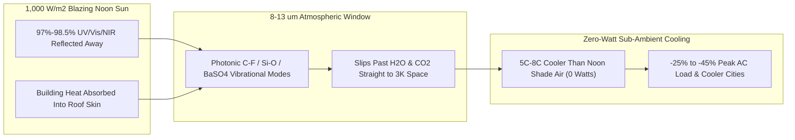

# CARBON EDITION • ABUNDANT CLEAN ENERGY
## Electricity-Free Air Conditioning — *Photonic 8–13 µm Sky-Cooling Coatings Beaming Heat Straight to Space*

> **The Cynic's Belief:**
> *"Global warming traps humanity in a vicious air-conditioning death spiral: hotter summers force billions of families
> and cold-storage warehouses to buy power-hungry AC units that overload grids at dusk, leak super-greenhouse refrigerants,
> and bake city streets even hotter with exhaust fans."*
>
> **The 2026 Breakthrough Reality:**
> Right above our heads—even at blazing noon in Phoenix, Riyadh, or Delhi—sits an infinite **$3\text{ Kelvin}$ ($-270^\circ\text{C}$)
> heat sink: deep outer space**, accessible straight through Earth's **$8\text{--}13\text{ }\mu\text{m}$ atmospheric
> infrared transparency window**. Engineered **Passive Daytime Radiative Cooling (PDRC)** photonic films, ultra-white
> barium-sulfate ($\text{BaSO}_4$) paints, and hierarchically porous polymer skins (SkyCool Systems, SpaceCool Inc.,
> Purdue Ruan Lab, Pirta) reflect **$97\%\text{--}98.5\%$ of incoming sunlight** while beaming $100\text{--}130\text{ W/m}^2$
> of thermal infrared straight out to the cosmos—dropping roof surfaces **$5^\circ\text{C}\text{--}8^\circ\text{C}$ *below*
> ambient shade air at noon with zero watts of electricity, zero moving parts, and zero refrigerant gas**.

---

## ACT I: A DELIGHTFUL NEAR FUTURE (HUMAN STORY)

At 1:30 PM on a $44^\circ\text{C}$ ($111^\circ\text{F}$) pre-monsoon May afternoon in Ahmedabad, India—and mirrored atop
grocery distribution centers in Stockton, California and telecom shelters in Osaka, Japan—pharmacist Meera Patel climbs
the external stair onto the flat concrete roof of her neighborhood maternity clinic and places her bare palm straight down
on the matte, porcelain-white roof coating.

Ten meters away on an unpainted gray concrete parapet, surface temperature sears at $68^\circ\text{C}$—hot enough to fry
an egg. Directly beneath Meera's bare hand, the photonic **radiative sky-cooling skin** feels startlingly, impossibly cool
to the touch—reading **$37.2^\circ\text{C}$, nearly seven degrees cooler than the shade air** in the alley below:

* **An Open Thermodynamic Pipeline to Deep Space:**
  Ordinary white hardware-store paint reflects ~80%–85% of sunlight, meaning the absorbed 15%–20% ($\sim 180\text{ W/m}^2$)
  still heats roofs up at noon. Meera's multi-scale $\text{BaSO}_4$ / porous fluoropolymer coating reflects **98.1% of all
  solar wavelengths** (UV, visible, and near-infrared) while simultaneously radiating thermal photons tuned precisely to
  $8\text{--}13\text{ }\mu\text{m}$—the exact infrared frequency band that slips past atmospheric water vapor and $\text{CO}_2$
  without being absorbed, dumping the clinic's indoor heat directly into the $-270^\circ\text{C}$ black sky.
* **Saving Lives When Storms Knock Out Power:**
  Downstairs in the maternity ward, indoor ceiling temperatures dropped **$6^\circ\text{C}$ passively** even with zero power,
  preventing lethal heatstroke during grid blackouts while cutting the clinic's solar-powered heat-pump AC electricity use
  by **42%**.
* **Chilled Cold-Storage Loops Without Compressors:**
  Across town at the farmers' cooperative mango and vaccine cold-storage depot, **SkyCool Systems** rooftop fluid panels
  chill closed-loop water $5^\circ\text{C}$ below ambient air 24/7—pre-cooling refrigeration condensers and slashing peak
  afternoon compressor power draw by 30%.
* **Cooling Whole Neighborhoods—Not Heating the Alley:**
  Conventional window AC units merely pump indoor heat *out* onto pedestrians on the sidewalk, worsening the **Urban Heat
  Island** by $2^\circ\text{C}\text{--}4^\circ\text{C}$. Photonic roofs beam heat *off the planet entirely*—actually cooling
  city air for everyone walking below.

---

## ACT II: SOTA BREAKTHROUGHS, REAL COMPANIES & SYNERGIES

Space cooling accounts for **~10% of all global electricity consumption today** (and up to **50%–70% of peak afternoon grid
load** during summer heat domes in Texas, the Middle East, India, and Southern Europe). For millennia, night-sky radiative
cooling allowed ancient Persian *yakhchāls* to freeze desert ice on clear nights—but **daytime** radiative cooling failed
because even 10% absorbed noon sunlight ($100\text{ W/m}^2$) overwhelmed thermal emission. In 2014, Prof. Shanhui Fan's
Stanford team proved photonic nanolayers could cool below ambient air in direct noon sun (*Nature*)—launching a ten-year
materials sprint from expensive cleanroom silicon wafers to \$2/m² roll-to-roll films and spray paints.

### 1. Three Photonic & Metamaterial Unlocks (2024–2026)
Modern PDRC materials achieve simultaneous **solar reflectance $R_{\text{solar}} > 0.97$** ($0.3\text{--}2.5\text{ }\mu\text{m}$)
and **sky-window emittance $\varepsilon_{8\text{--}13\mu\text{m}} > 0.96$** using cheap, scalable chemistry:

* **Wide-Bandgap $\text{BaSO}_4$ & Mie-Scattering Nano-Pore Hierarchies:**
  Commercial white paints use titanium dioxide ($\text{TiO}_2$), whose $3.0\text{ eV}$ electronic bandgap absorbs ~7% of
  heating UV photons. **Purdue University (Prof. Xiulin Ruan's lab)** and commercial spinouts replaced $\text{TiO}_2$ with
  high-bandgap **barium sulfate ($\text{BaSO}_4$, $>6\text{ eV}$)** or **hexagonal boron nitride ($\text{hBN}$)** paired
  with a broad particle/pore-size distribution ($200\text{ nm}$ to $2.0\text{ }\mu\text{m}$) that Mie-scatters every color
  from UV to near-infrared—achieving Guinness-record **$98.1\%$ solar reflectance** in brushable/sprayable paint at half
   legacy weight for aircraft, railcars, and roofs.
* **Selective Photonic Multilayers & SpaceCool Weather-Proof Films:**
  For humid or windy roofs, **SkyCool Systems** (Stanford spinout) and **SpaceCool Inc.** (Osaka Gas / Nippon Telegraph
  lineage in Japan) manufacture roll-to-roll silver-backed optical-oxide polymer films with selective **$8\text{--}13\text{ }\mu\text{m}$
  vibrational C–F / Si–O bond resonance**—preventing parasitic thermal absorption from hot surrounding $40^\circ\text{C}$
  air outside the sky window while passing **10–15+ year outdoor UV, dust, and hail durability**.
* **Temperature-Adaptive Janus / Thermochromic Skins (Cool in Summer, Warm in Winter):**
  Early cool roofs caused a minor "winter heating penalty" in cold climates. Late-2025/2026 **thermochromic vanadium-dioxide
  ($\text{VO}_2$) and phase-switching ferroelectric coatings** (UC Berkeley Wu Lab, UChicago Hsu Lab, UMass) automatically
  flip emissivity at **$22^\circ\text{C}$**: beaming heat to space at $\varepsilon = 0.95$ in July, then clamping infrared
  emission down to $\varepsilon = 0.20$ in January to keep winter warmth inside!

> *"Conventional air conditioners just move heat from inside your house to your neighbor's street. Radiative sky cooling
> sends that heat straight through the atmosphere into deep space—cooling buildings and our planet at the same time."*
> — **Dr. Eli Goldstein & Prof. Aaswath Raman**, Co-Founders, SkyCool Systems (Stanford Photonic Cooling Pioneers)

### 2. Verified 2025–2026 Radiative Sky-Cooling Leaders

| Pioneer / Lab | Core Photonic Form Factor | Verified 2025–2026 Commercial Milestone | Measured Energy & Thermal Impact |
| :--- | :--- | :--- | :--- |
| **SkyCool Systems (California)** | Hydronic fluid-cooled selective photonic rooftop panels | Commercial deployments across US grocery chains (Save Mart / cold storage), data centers & UAE District Cooling (Tabreed) | Cuts refrigeration & chiller electricity **15%–35%**; **77–110 $\text{W/m}^2$** net noon cooling |
| **SpaceCool Inc. (Japan & ASEAN)** | Flexible zero-energy optical radiative-cooling film & magnetic tent canvas | **1,000+ commercial installations** across Japan, Singapore, Thailand & Middle East (NTT, Toyota, Seven-Eleven, airports) | Drops outdoor telecom/EV-charger/warehouse cabinet temps **$10^\circ\text{C}\text{--}20^\circ\text{C}$** vs steel |
| **Purdue Ruan Lab & Pirta / Aero-Coatings** | Ultra-white $98.1\%$ $\text{BaSO}_4$ & thin microporous $\text{hBN}$ spray paints | Licensed commercial building, cold-truck & aviation skin formulations ($150\text{ }\mu\text{m}$ lightweight layer) | Up to **40% HVAC savings**; cools parked aircraft cabins & refrigerated trailers with engine off |
| **i2Cool (Hong Kong / Middle East / ASEAN)** | Electricity-free PDRC architectural paint, ceramic roof tiles & window glazes | Applied across **500+ buildings**, grain silos, logistics hubs & Dubai Mall / Hong Kong public estates | Validated **20%–35% chiller energy reduction** in humid subtropical & desert climates |
| **SolCold & ChillSkyn / Radi-Cool** | Scalable micro-sphere polymer metamaterial films, cold-chain wraps & shades | Deployed on grain storage silos, outdoor stadium canopies, cold-chain pallets & shaded bus stops | Preserves rural harvest & vaccine cold chains during power outages with **zero electricity** |

---

## ACT III: REIMAGINING SOCIAL CONVENTIONS & GLOBAL PROOF

For over three billion people living across South Asia, Africa, Latin America, and the Middle East, extreme wet-bulb heat
is an immediate human-health emergency long before every family buys central air conditioning. Electricity-free photonic
skins deliver instant thermal justice:

1. **Zero-Power Heatwave Survival for Tin-Roof & Informal Settlements:**
   Inspired by Ahmedabad's pioneering *Cool Roofs Action Plan* and Mahila Housing Trust's women-led rollouts across Indian
   slums, upgrading from standard limewash ($R \approx 0.75$) to durable super-white PDRC coatings ($R > 0.97$) drops indoor
   corrugated-metal ceiling temperatures by **$6^\circ\text{C}\text{--}10^\circ\text{C}$** for pennies per square foot—saving
   infants and elders during $48^\circ\text{C}$ heatwaves even when power grids fail.
2. **Shaving the Deadly 5:00 PM "Air-Conditioning Grid Cliff":**
   Building codes in California (**Title 24 Cool Roof updates**), Singapore (**Green Mark**), Dubai, and Tokyo now reward
   or mandate high solar-reflectance-index ($\text{SRI} > 115$) radiative materials—shaving gigawatts off peak utility
   loads cheaper than building *any* new power plant or battery.
3. **Direct Planetary Radiative Forcing Bonus:**
   Unlike carbon capture alone, replacing dark asphalt and $80\%$-reflective roofs with $>97\%$ sky-window radiative surfaces
   directly increases Earth's local shortwave albedo while venting longwave heat past greenhouse gases into space—creating
   an immediate local cooling offset across heat-island megacities.

| Trajectory Metric | 2026 Baseline | 2030 Sprint | 2035 Scaling | 2040 Maturity |
| :--- | :--- | :--- | :--- | :--- |
| **Solar Reflectance / $\varepsilon_{8\text{--}13}$** | **$97.0\%\text{--}98.1\%$** / $\varepsilon = 0.96$ commercial paints & films | Self-cleaning superhydrophobic **$>98.5\%$** 20-year skins | Colored/aesthetic NIR-reflective & **Janus winter-adaptive** roofs | Standard outer skin on buildings, cars, trains, planes & tents |
| **Installed Cost (\$/$\text{m}^2$)** | \$4–\$12/$\text{m}^2$ architectural paints; \$25–\$60/$\text{m}^2$ films | **\$1.80–\$4.50/$\text{m}^2$** (parity with standard exterior paint) | Factory-precoated steel roofing sheets at **<\$0.80/$\text{m}^2$ add-on** | Zero-premium commodity building & cold-chain standard |
| **Building HVAC Power Cut** | **20%–42%** summer cooling electricity saved in sunny/warm zones | **150+ TWh/yr** peak summer grid demand shaved globally | **600+ TWh/yr** avoided AC electricity + zero HFC leaks | Eliminates need for hundreds of fossil summer peaker plants |
| **Urban Heat Island Relief** | Pilots cool clinics, bus stops, silos & supermarkets | City-wide cool-roof mandates cut urban air **$1.5^\circ\text{C}\text{--}2.5^\circ\text{C}$** | Walkable shaded/radiative plazas across tropical megacities | Passive planetary sky-window shield for every community |

---

## ACT IV: THE SYNERGY CASCADE

Passive sky cooling pairs naturally with clean power, sustainable architecture, data centers, and orbital physics:

* **Slashing Data-Center & Cold-Chain Chiller Loads:**
  Lining dry coolers and rooftops at [Symbiotic Terrestrial Data Centers](../symbiotic-civic-data-centers/REPORT.md) with
  SkyCool hydronic panels provides free 24/7 sub-ambient trim cooling in summer with **zero evaporated water**.
* **Cooler Solar Panels Produce More Watts:**
  Silicon and perovskite solar cells lose ~0.3%–0.4% output for every $1^\circ\text{C}$ they overheat. Transparent photonic
  silica/polymer topcoats on [35.5% Perovskite-Silicon Tandems](../perovskite-tandem-solar/REPORT.md) dump waste panel heat
  through the $8\text{--}13\text{ }\mu\text{m}$ sky window—boosting panel output +4% and extending encapsulation life 30%.
* **Passive-First Mass-Timber Cities & Space Radiator Heritage:**
  Combining Janus radiative roofs with [Abundant Beautiful Mass-Timber Housing](../../04-social-norms/abundant-beautiful-housing/REPORT.md)
  keeps summer apartments comfortable on tiny heat pumps, using the exact same infrared physics perfected at planetary scale
  in [Zero-Water Orbital Radiative Compute](../../05-space-frontier/orbital-radiative-compute/REPORT.md).

---

## References & Verified Sources

* **Featured Pioneers:** [Prof. Aaswath Raman, Dr. Eli Goldstein & Prof. Shanhui Fan — SkyCool Systems / Stanford Daytime Radiative Cooling](https://www.skycoolsystems.com/) · [Prof. Xiulin Ruan — Purdue University Ultra-White $\text{BaSO}_4$ / $\text{hBN}$ Paint Lab](https://engineering.purdue.edu/ME)
* **Companies & Commercial Deployments:** [SkyCool Systems](https://www.skycoolsystems.com/) · [SpaceCool Inc. (Japan)](https://spacecool.jp/en/) · [i2Cool Electricity-Free Cooling](https://www.i2cool.com/) · [SolCold](https://www.solcold.com/) · [Mahila Housing Trust Cool Roofs (India)](https://www.mahilahousingtrust.org/)
* **Global & Scientific Precedents:** [Stanford *Nature* Daytime Sub-Ambient Radiative Cooling Discovery](https://www.nature.com/articles/nature13883) · [Purdue 98.1% Solar-Reflective $\text{BaSO}_4$ Guinness Record Formulation (*ACS Applied Materials*)](https://pubs.acs.org/) · [Temperature-Adaptive Janus Radiative Roofs (*Science*, Berkeley / UChicago)](https://www.science.org/) · [Ahmedabad Heat Action Plan & Cool Roofs Program](https://www.nrdc.org/)
* **Connected Carbon Pathways:** [Symbiotic Terrestrial Data Centers](../symbiotic-civic-data-centers/REPORT.md) · [35.5% Perovskite-Silicon Tandems & Living Solar Skins](../perovskite-tandem-solar/REPORT.md) · [Abundant Beautiful Mass-Timber Housing](../../04-social-norms/abundant-beautiful-housing/REPORT.md) · [Zero-Water Orbital Radiative Compute](../../05-space-frontier/orbital-radiative-compute/REPORT.md)
