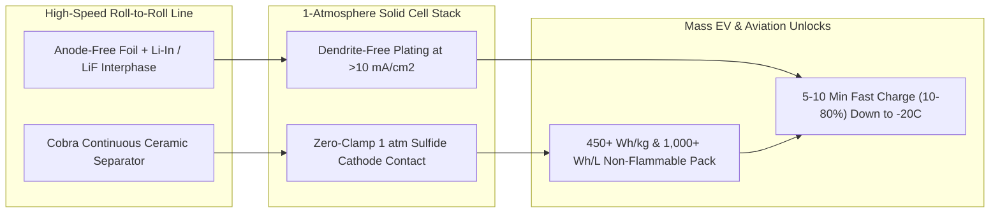

# CARBON EDITION • ABUNDANT CLEAN ENERGY
## 1-Atmosphere Solid-State Batteries — *Ceramic Separators, Dendrite-Proof Anodes & 10-Minute EVs*

> **The Cynic's Belief:**
> *"Solid-state batteries are the perpetual mirage of the auto industry—they sprout short-circuiting lithium needles
> the moment you fast-charge them, and only survive in university labs when crushed inside heavy 50-atmosphere steel
> vises that would turn an electric car into an overpriced tank."*
>
> **The 2026 Breakthrough Reality:**
> The high-pressure clamp wall just fell. In late 2026, QuantumScape's *Osprey* all-solid-state architecture—built on
> its continuous-flow *Cobra* ceramic separator line—demonstrated **1,000 full 1C cycles with ~80% capacity retention
> under just 1 atmosphere of ambient pressure**, alongside 5-to-10-minute (10–80%) fast charging and $-20^\circ\text{C}$
> cold resilience. Paired with self-healing polymer–indium-chloride ($\text{InCl}_3$) anode interphases, Factorial's
> *Solstice* dry-coated cells, Samsung SDI's $900\text{ Wh/L}$ silver-carbon packs, and Toyota–Idemitsu sulfide pilot
> lines, non-flammable $450+\text{ Wh/kg}$ batteries are moving onto standard automotive assembly lines.

---

## ACT I: A DELIGHTFUL NEAR FUTURE (HUMAN STORY)

Halfway through a snowy December drive across Colorado's I-70 Eisenhower Tunnel at $-16^\circ\text{C}$, pediatric
visiting nurse Kendra Sato pulls her compact family crossover into a mountain trailhead plaza with 11% battery remaining.
She plugs in, grabs a hot cinnamon oat latte inside the timber rest stop, and walks back out **eight minutes later** to a
cabin warm and a pack sitting at 82%—good for another 430 miles of mountain highway.

Beneath her boots sits a slim, flat skateboard pack half the thickness of 2022 lithium-ion trays, completely free of
flammable liquid carbonate solvents or bulky mechanical compression plates:

* **Gas-Pump Speed Without the Fumes:**
  Because dense solid ceramic separators and lithium-indium-fluoride ($\text{Li-In}/\text{LiF}$) "ionic traffic
  conductors" guide lithium ions onto a pure metallic anode smoothly without needle-like dendrites, Kendra's car accepts
  a 450-kilowatt charge pulse in sub-zero mountain air without pre-heating battery soup for forty minutes.
* **Zero Thermal-Runway Anxiety in Home Garages:**
  With volatile organic liquid electrolytes replaced by non-flammable ceramic and halide-sulfide solids stable past
  $300^\circ\text{C}$, apartment underground parking garages, ferries, and municipal fire codes treat EVs as calmer and
  safer than parked bicycles—cutting Kendra's annual auto insurance premium by 28%.
* **Lighter Cars, Kinder Tires, Cheaper Stickers:**
  Doubling gravimetric energy density past $450\text{ Wh/kg}$ ($1,000+\text{ Wh/L}$) shaves 380 kilograms off her
  crossover's curb weight. Lighter vehicles mean smaller brakes, 30% less tire-particulate wear, nimbler handling, and
  sub-\$24,000 long-range family EVs that cost less upfront than gasoline sedans.
* **Million-Mile Second Life:**
  After 1,000+ cycles—equivalent to **550,000+ driven miles**—Kendra's battery will still hold >80% of its original range,
  outlasting two car bodies before retiring cleanly into a neighborhood V2G solar buffer.

---

## ACT II: SOTA BREAKTHROUGHS, REAL COMPANIES & SYNERGIES

Conventional lithium-ion cells store ions inside porous graphite host cages (~$372\text{ mAh/g}$) soaked in flammable
liquid electrolyte, capping energy density near $270\text{--}300\text{ Wh/kg}$. Replacing graphite with pure lithium metal
($3,860\text{ mAh/g}$) unlocks a $10\times$ anode capacity jump—but for decades, solid-state prototypes suffered from
two fatal flaws: **lithium dendrites** cracking brittle separators during fast charge, and **void formation** during
discharge that forced engineers to bolt cells inside massive 30-to-100-atmosphere ($3\text{--}10\text{ MPa}$) steel vices.

### 1. Three Materials & Manufacturing Unlocks (2025–2026)
Late-2026 breakthroughs solved the solid-solid interface mechanically and chemically without external steel clamps:

* **1-Atmosphere Hybrid Ceramic-Sulfide Architecture (*Osprey* + *Cobra*):**
  By pairing an anode-free pure lithium-metal side against a stiff, grain-boundary-engineered **ceramic oxide separator**
  (manufactured at high speed via QuantumScape's continuous-flow *Cobra* heat-treatment process, $25\times$ more compact
  than legacy kilns) while confining soft, ultra-conductive **solid sulfide catholytes** strictly to the cathode, cells
  hit **1,000 cycles at $1\text{ atm}$ ($0.1\text{ MPa}$)**—eliminating heavy pack clamping hardware completely.
* **Polymer–Indium-Chloride ($\text{InCl}_3$) "Smart Fortress" Anode Interphases:**
  Late-2026 chemical interphase coatings react a flexible silicon-polymer backbone with **indium chloride ($\text{InCl}_3$)**
  directly atop lithium metal. This forms an elastic dual shield in situ: electronically insulating **$\text{LiF}$** blocks
  electron leakage and dendrite roots, while **$\text{Li-In}$ alloy nanoparticles** act as high-diffusivity ionic traffic
  conductors that plate lithium in mirror-smooth sheets even under high current densities ($J > 10\text{ mA/cm}^2$).
* **Anode-Free Foil & Silver-Carbon ($\text{Ag-C}$) Nanocomposites:**
  Manufacturing cells in the discharged state with **zero excess lithium foil** (forming the anode purely from cathode
  lithium on first charge, aided by ultrathin $5\text{ }\mu\text{m}$ $\text{Ag-C}$ or $\text{Li-In}$ seed layers) cuts
  material cost 20%, boosts volumetric density to $900\text{--}1,100\text{ Wh/L}$, and drops straight into existing
  pouch and prismatic gigafactory lines.

> *"Achieving a thousand cycles with a sulfide solid-state cathode at just one atmosphere of pressure removes the biggest
> engineering roadblock between solid-state chemistry and everyday passenger vehicles."*
> — **Dr. Siva Sivaram**, President & CEO, QuantumScape

### 2. Verified 2025–2026 Solid-State Battery Leaders

| Pioneer / Alliance | Core Solid-State Chemistry | Verified 2025–2026 SOTA Milestone | Automotive & Aviation Commercial Path |
| :--- | :--- | :--- | :--- |
| **QuantumScape & PowerCo (VW)** | Anode-free Li-metal + *Cobra* ceramic separator + *Osprey* sulfide cathode | *Cobra* baseline in production; *Osprey* proved **1,000 cycles (~80% cap) at 1 atm**, 5-min 10–80% fast-charge capability | PowerCo 40–80 GWh licensing deal; Ducati *V21L* live race-bike demo + VW group fleet |
| **Samsung SDI** | All-solid-state sulfide electrolyte + $5\text{ }\mu\text{m}$ Silver-Carbon ($\text{Ag-C}$) layer | Operating Suwon S-Line pilot; shipping **$900\text{ Wh/L}$** customer samples with 9-minute charge & 20-year lifespan design | Targeting 2027 mass flagship EV production with BMW, Hyundai & luxury OEMs |
| **Factorial Energy & Mercedes-Benz** | *Solstice* all-solid-state sulfide (dry cathode coating, $450\text{ Wh/kg}$) | Delivered 40 Ah *Solstice* B-samples; EQS solid-state road test car surpassed **1,200 km (749 mi)** on a single charge | Co-developed with Mercedes-Benz, Stellantis (Dodge fleet demo) & Hyundai |
| **Toyota & Idemitsu Kosan** | Flexible sulfide solid electrolyte mass-synthesis + bipolar stacks | Idemitsu building lithium-sulfide ($\text{Li}_2\text{S}$) precursor plant; Japanese METI certified GWh scale-up plan | Next-gen 1,000–1,200 km range EVs with $\le 10\text{-minute}$ highway charging |
| **CATL & BYD (China CAS Alliance)** | Condensed-matter / halide-sulfide composite all-solid cells ($500\text{ Wh/kg}$) | Multi-GWh trial lines commissioned in 2026; polymer–halide ($\text{InCl}_3$/$\text{Li}_3\text{InCl}_6$) interphases cut pressure 90% | Regional eVTOL aircraft certification + 2027–2028 premium EV rollouts |

---

## ACT III: REIMAGINING SOCIAL CONVENTIONS & GLOBAL PROOF

Range anxiety and charger-line frustration were never permanent verdicts on electric driving—they were temporary artifacts
of first-generation liquid-electrolyte cells. Three systemic shifts make solid-state mobility effortless for everyone,
especially apartment renters without home driveways:

1. **The Apartment-Renter Equality Unlock (8-Minute Corner Plazas):**
   Nearly 40% of urban families park on streets or in rental lots without personal wallboxes. When a $600\text{-mile}$
   solid-state pack adds $400\text{ miles}$ in 8 minutes at neighborhood ultra-fast hubs—just once every two weeks—street-parked
   renters enjoy faster, cleaner refueling than visiting a gas station.
2. **Dry-Room Electrode Coating Cuts Factory Energy 45%:**
   Legacy lithium-ion gigafactories burn megawatts of natural gas running 100-meter ovens to evaporate toxic NMP solvent
   slurries. Dry-coated solid-state cathodes (like Factorial's *Solstice* and PowerCo's dry lines) press powders directly
   onto foils—slashing factory floor space 35%, energy use 45%, and eliminating toxic solvent recovery towers.
3. **UN GTR & EU Battery Passport Circularity:**
   Solid ceramic and sulfide layers contain zero volatile PFAS-heavy liquid cosolvents and enable clean mechanical-hydrometallurgical
   separation at end of life, recovering >96% of lithium, silver, nickel, and indium under the EU Battery Passport mandate.

| Trajectory Metric | 2026 Baseline | 2030 Sprint | 2035 Scaling | 2040 Maturity |
| :--- | :--- | :--- | :--- | :--- |
| **Cell Energy Density** | $380\text{--}450\text{ Wh/kg}$ ($900\text{--}1,050\text{ Wh/L}$) B-samples & pilot packs | $480\text{--}520\text{ Wh/kg}$ mainstream automotive & eVTOL cells | $580+\text{ Wh/kg}$ bipolar solid stacks for regional airliners | $>650\text{ Wh/kg}$ ultralight mobility & robotics standard |
| **Required Stack Pressure** | **1 atm ($0.1\text{ MPa}$)** proven on *Osprey* & $\text{InCl}_3$-polymer interphases | Zero heavy clamping frames across all major OEM packs | Flexible pouch & structural body-panel solid batteries | Maintenance-free million-mile structural chassis cells |
| **Fast Charge (10–80%)** | 8–10 minutes on pilot fleets; 5-min lab/B-sample validation | **6–8 minutes** standard across highway 800V/1000V plazas | <5 minutes (parity with filling a compact gas tank) | Ubiquitous flash-top-up & wireless taxi-pad charging |
| **Pack Cost (\$/kWh)** | \$135–\$165/kWh pilot runs (vs. \$75/kWh LFP liquid) | **\$75–\$90/kWh** via anode-free *Cobra* & dry-coating scale | **\$48–\$60/kWh** ($35\%$ lighter vehicles need fewer kWh) | **<\$42/kWh** non-flammable universal mobility storage |

---

## ACT IV: THE SYNERGY CASCADE

Removing liquid flammability, clamping weight, and fast-charge degradation from batteries sends shockwaves far beyond
passenger cars:

* **Whisper-Quiet 3D Sky Transit & Regional Electric Flight:**
  Crossing the $450\text{--}500\text{ Wh/kg}$ non-flammable threshold doubles payload and reserve range for
  [Whisper-Quiet eVTOL 3D Sky Transit](../../02-automation-science/evtol-3d-transit/REPORT.md) and 100-seat regional
  commuter aircraft.
* **Untethered All-Day Helpful Humanoids:**
  Packing $1,000+\text{ Wh/L}$ safely inside a robot torso gives [General-Purpose Helpful Humanoids](../../02-automation-science/general-purpose-humanoids/REPORT.md)
  16-hour shift endurance with 6-minute lunch-break recharges and zero indoor fire risk.
* **Million-Mile Neighborhood Grid Buffers:**
  Because 1-atm ceramic-sulfide cells shrug off 1,000+ deep cycles without capacity cliffing, every family car becomes a
  zero-wear asset in [Bidirectional V2G Virtual Power Plants](../bidirectional-v2g-virtual-plants/REPORT.md), fed cleanly
  by [Zero-Pond Direct Lithium Extraction](../electrochemical-lithium-brine/REPORT.md).

---

## References & Verified Sources

* **Featured Leader:** [Dr. Siva Sivaram — President & CEO, QuantumScape (*Cobra* & *Osprey* 1-Atm Platform)](https://www.quantumscape.com/)
* **Companies, Labs & Alliances:** [QuantumScape & PowerCo](https://www.quantumscape.com/) · [Samsung SDI Solid-State S-Line](https://www.samsungsdi.com/) · [Factorial Energy (*Solstice*)](https://factorialenergy.com/) · [Idemitsu Kosan & Toyota Sulfide Alliance](https://www.idemitsu.com/en/) · [Mercedes-Benz Solid-State Program](https://group.mercedes-benz.com/)
* **Global & Technical Precedents:** [QuantumScape Osprey 1-Atm 1,000-Cycle Sulfide Demonstration (2026)](https://www.quantumscape.com/resources/blog/) · [Polymer–Indium-Chloride ($\text{InCl}_3$) Hybrid Li-Anode Interphase Research (2026)](https://pubs.acs.org/) · [Mercedes-Benz / Factorial 1,200+ km Single-Charge Road Test](https://factorialenergy.com/) · [EU Battery Regulation & Digital Battery Passport](https://environment.ec.europa.eu/topics/waste-and-recycling/batteries_en)
* **Connected Carbon Pathways:** [Bidirectional V2G Virtual Power Plants](../bidirectional-v2g-virtual-plants/REPORT.md) · [Zero-Pond Direct Lithium Extraction](../electrochemical-lithium-brine/REPORT.md) · [Whisper-Quiet eVTOL 3D Sky Transit](../../02-automation-science/evtol-3d-transit/REPORT.md) · [General-Purpose Helpful Humanoids](../../02-automation-science/general-purpose-humanoids/REPORT.md)
