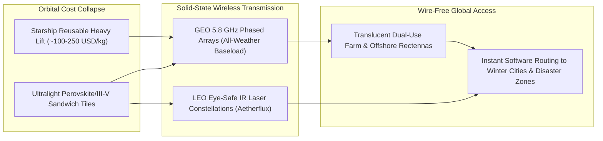

# CARBON EDITION • ABUNDANT CLEAN ENERGY
## Orbital Sunlight: 24/7 Space-Based Solar Beams — *Harvesting Unfiltered Noon Sunshine Above the Clouds and Beaming Clean Megawatts Anywhere on Earth*

> **The Cynic's Belief:**
> *"Launching gigawatts of solar panels on rockets is absurdly expensive sci-fi—and beaming energy from orbit
> sounds like a giant orbital death ray that will fry birds in midair."*
>
> **The 2026 Breakthrough Reality:**
> SpaceX Starship's reusable heavy-lift architecture is collapsing orbital launch costs $20\times–50\times$, while
> Caltech's *SSPD-1 MAPLE* satellite proved solid-state orbital power beaming in space, Baiju Bhatt's **Aetherflux**
> is deploying LEO infrared power-beaming satellites, and JAXA (*OHISAMA*) plus ESA (*SOLARIS*) validated cloud-piercing
> phased-array microwave beams capped near $240\text{ W/m}^2$—gentler than quarter-strength afternoon sunshine, harmless
> to birds and humans, and deliverable on demand to winter cities, islands, or disaster zones without wires.

---

## ACT I: A DELIGHTFUL NEAR FUTURE (HUMAN STORY)

On December 21 in Kiruna, two hundred kilometers north of the Arctic Circle in Swedish Lapland, the sun does not
rise above the horizon—not even for a minute. Outside at $-24^\circ\text{C}$, aurora ribbons shimmer green across
the polar noon sky. Yet five kilometers outside town, across a snowy reindeer-grazing meadow, an elevated lacework
mesh of lightweight dipole antennas—a dual-use **rectenna**—quietly delivers 150 megawatts of crisp, steady
electricity straight into Kiruna's zero-carbon hydrogen steel mill and municipal district-heating grid.

Municipal microgrid engineer Dr. Astrid Lindqvist sips hot lingonberry juice inside the glass control pavilion,
watching orbital handoff telemetry with a grin:

* **Ending the High-Latitude Winter Bottleneck:**
  Thirty-six thousand kilometers overhead in sunlit geostationary orbit—where night, clouds, snowstorms, and seasonal
  tilt do not exist—a modular, gossamer-thin solar array drinks brilliant unfiltered sunlight 24 hours a day and
  whispers a silent, cloud-penetrating 5.8 GHz microwave beam straight through Lapland's winter blizzard onto the
  rectenna mesh at $>85\%$ RF-to-DC conversion efficiency.
* **Gentle Warmth Where Reindeer Graze:**
  Out under the translucent antenna net, Indigenous Sámi herders guide reindeer across unfrozen lichen pasture.
  Because the beam's peak intensity is hardware-locked by physics to $245\text{ W/m}^2$—roughly a quarter of summer
  noon sunshine—a snowy owl perches right on the rectenna post without feeling anything warmer than a mild spring breeze.
* **Instant Disaster & Island Lifelines:**
  At 3:00 PM, an alert chimes from the Western Pacific: a Category 4 typhoon just severed submarine power cables to
  an island hospital network in Cebu, Philippines. With three software keystrokes, orbital phase-shifters redirect a
  spare 25-megawatt spot beam onto Cebu's foldable stadium-parking-lot receiver mat in *under two seconds*—keeping
  neonatal incubators, water purifiers, and cell towers alive before the storm clouds even clear.
* **Zero Forest Scars:**
  No thousand-kilometer high-voltage clear-cut had to slice through ancient Scandinavian taiga; clean power arrived
  wirelessly from the sky.

---

## ACT II: SOTA BREAKTHROUGHS, REAL COMPANIES & SYNERGIES

On Earth's surface, atmosphere scatters ~30% of incoming sunlight, night steals half the clock, clouds block panels,
and northern winters slash European or Canadian solar output by up to 85% in December. Above the atmosphere, solar
irradiance is a steady **$1,361\text{ W/m}^2$**—yielding **$5\times$ to $8\times$ more annual energy per square meter**
than terrestrial panels, with near-99.7% annual availability in geostationary orbit (GEO).

### 1. Three Converging Space & RF Breakthroughs (2023–2026)
For fifty years since Peter Glaser's 1968 patent, space solar failed on two counts: \$15,000/kg expendable rockets and
heavy, crane-assembled satellite trusses. Both vanished simultaneously:

* **Reusable Super-Heavy Lift ($20\times–50\times$ Launch Cost Collapse):**
  SpaceX's fully reusable **Starship** architecture—flying 100–150+ metric-ton orbital payloads in 9-meter fairings—drives
  mass-to-LEO launch prices down from Space Shuttle-era \$20,000+/kg and Falcon 9's ~\$2,000/kg toward **\$100–\$250/kg**,
  turning thousand-ton modular orbital arrays from trillion-dollar fantasies into commercial infrastructure.
* **Ultralight Sandwich Tiles & Caltech *MAPLE* Phased Arrays:**
  Caltech's Space Solar Power Demonstrator (*SSPD-1*) flew in orbit and proved that ultralight, flexible CMOS integrated
  circuits (*MAPLE*) can harvest sunlight and steer wireless microwave beams using constructive wave interference with
  **zero heavy gimbals or moving parts**—weighing just grams per watt.
* **Dual-Mode Beaming (Cloud-Piercing 5.8 GHz RF + Agile LEO Infrared Lasers):**
  Large GEO architectures (ESA *SOLARIS*, UK *Space Solar* *CASSIOPeiA*, JAXA *OHISAMA*) transmit at $2.45–5.8\text{ GHz}$
  where Earth's atmosphere and heavy rainclouds are $>95\%$ transparent, spreading beams safely over $2–4\text{ km}$
  translucent agricultural rectennas via **retrodirective pilot-beam locking** (if the ground pilot signal stops, the
  orbital array physically defocuses into harmless background static in microseconds). Complementing GEO, **Aetherflux**
  uses compact Low-Earth Orbit (LEO) spacecraft with eye-safe $1.5\ \mu\text{m}$ fiber lasers to beam tactical megawatts
  onto 5-meter portable ground photovoltaic receivers.

> *"In the same way that the internet democratized access to information, we hope that wireless energy transfer
> democratizes access to energy."*
> — **Prof. Ali Hajimiri**, Co-Director, Caltech Space Solar Power Project

### 2. Verified 2025–2026 Space-Based Solar Pioneers

| Agency / Venture | Orbital & Beaming Architecture | Verified 2025–2026 Milestone | Commercial & Humanitarian Target |
| :--- | :--- | :--- | :--- |
| **Caltech SSPP** | Ultralight roll-out structures (*DOLCE*) + solid-state CMOS RF phased array (*MAPLE*) | Completed historic in-orbit wireless power steering & space-to-Earth RF detection (*SSPD-1*) | Open architectural foundation for ultralight (<1 kg/kW) solid-state orbital tiles |
| **Aetherflux** | LEO constellation of compact solar spacecraft beaming eye-safe infrared lasers + orbital storage | Founded by Robinhood co-founder Baiju Bhatt (\$60M+ raised); launching LEO power-beaming demonstration flight | Portable 5–10m receivers for remote islands, Arctic mines, wildfire/typhoon relief & microgrids |
| **JAXA & JSS (*OHISAMA*)** | Low-Earth Orbit microwave phased-array satellite beaming to multi-element ground rectennas | Long-distance terrestrial kW microwave beaming completed; *OHISAMA* orbital-to-Suwa ground demo advancing | Energy security for resource-poor island nations & post-earthquake emergency power |
| **Space Solar (UK) & Reykjavik Energy** | Helical 360-degree sun-tracking *CASSIOPeiA* modular GEO array (no rotary slip-rings) | Partnered with Iceland's Reykjavik Energy / Transition Labs for 30 MW commercial pilot plant by ~2030 | Multi-hundred-MW firm winter baseload for UK, Nordic & European offshore wind substations |
| **ESA *SOLARIS* & Virtus Solis** | Robotic in-space assembled modular hexagonal tiles in GEO / Molniya high-elliptical orbits | ESA *SOLARIS* validated full end-to-end wireless beaming demonstrator in Munich; Virtus Solis planning Molniya demos | Plugging directly into offshore wind HVDC hubs when North Sea winds go calm (*Dunkelflaute*) |

---

## ACT III: REIMAGINING SOCIAL CONVENTIONS & GLOBAL PROOF

Two cultural anxieties always greet orbital solar: *"Won't a misaligned beam burn a city?"* and *"Who regulates
invisible power beams crossing borders?"* Physics and existing international telecommunications law already answer both:

1. **Physics-Locked Non-Weaponizability (`IEEE C95.1` Compliance):**
   A microwave phased array at $36,000\text{ km}$ is governed by diffraction limits ($D_{\text{ground}} \approx 1.22 \lambda R / D_{\text{sat}}$).
   Even if every single chip on a 1.5-kilometer satellite tried to focus as tightly as physics allows, the beam
   *cannot* concentrate tighter than a multi-kilometer spot at $240–250\text{ W/m}^2$—about one-fourth the intensity
   of ordinary midday summer sunlight! Furthermore, retrodirective phase conjugation requires an encrypted ground
   beacon inside the rectenna fence; switch off the beacon and the orbital waves lose coherence instantly.
2. **Co-Locating on Offshore Wind & Farmland:**
   Because a wire-mesh dipole rectenna blocks less than 15% of natural sunlight while capturing >85% of incoming
   5.8 GHz RF energy, sheep graze and shade crops thrive right underneath—or rectennas float between existing North
   Sea offshore wind turbines, sharing the exact same undersea HVDC cables whenever winter winds drop to zero!
3. **ITU Spectrum & The "Starlink of Clean Megawatts" Leapfrog:**
   Just as satellite internet connected remote Kenyan schools and Pacific atolls decades faster than trenching
   transoceanic fiber, ITU-allocated Industrial, Scientific, and Medical (ISM) bands allow landlocked or island
   nations to subscribe to firm gigawatts overnight—without begging neighbors for pipeline transit rights.

| Trajectory Metric | 2026 Baseline | 2030 Sprint | 2035 Scaling | 2040 Maturity |
| :--- | :--- | :--- | :--- | :--- |
| **Heavy-Lift Launch Cost** | ~\$1,500/kg Falcon 9; Starship scaling orbital flights | \$200–\$350/kg via routine reusable Starship tanker/cargo cadence | \$80–\$150/kg high-flight-rate super-heavy spaceports | <\$50/kg commodity orbital freight |
| **Orbital Array Specific Power** | ~150 W/kg heritage rigid aerospace panels | 600–1,000 W/kg flexible perovskite/III-V *MAPLE* sheets | 1,800+ W/kg roll-to-roll ultralight beam tiles | Self-assembled cislunar/orbital megawatt sails |
| **Beamed Grid Capacity** | Sub-MW orbital demos (*Aetherflux*, *OHISAMA*) | First 10–30 MW commercial island & Arctic pilots (Iceland/Japan) | 15+ GW winter *Dunkelflaute* & remote industrial beams | 150+ GW global dynamic-routed orbital energy mesh |
| **Delivered Cost (LCOE)** | High FOAK defense, island & disaster-relief value | \$75–\$110/MWh beating Arctic/island diesel (\$350+/MWh) | \$35–\$50/MWh firm 24/7 winter-peaking baseload | \$18–\$28/MWh globally steerable wire-free power |

---

## ACT IV: THE SYNERGY CASCADE

Space-based solar turns electricity into **routable software**: an orbital station feeding Tokyo's evening peak at
6:00 PM can slew its phase-shifted beam westward to Mumbai three hours later, then cover Nairobi or Stockholm without
moving a single physical wire.

* **Perovskite Tandem Mass Collapse:**
  Radiation-hardened thin-film cells from [Perovskite-Silicon Tandems](../perovskite-tandem-solar/REPORT.md) cut orbital
  blanket weight $5\times$, multiplying megawatts delivered per Starship launch.
* **Curing the European *Dunkelflaute*:**
  Sharing offshore substations with [Superconducting Grids](../superconducting-grids/REPORT.md) and [Iron-Sodium Storage](../iron-sodium-storage/REPORT.md)
  eliminates the most expensive final 10% of winter grid decarbonization across Northern Europe, Canada, and Northeast Asia.
* **Hurricane & Earthquake Resilience:**
  Drop-shipped container rectennas restore hospital power and [Aquifer Rivers & Desalination](../aquifer-rivers-desalination/REPORT.md)
  water purification within hours of any natural disaster on Earth.
* **Orbital Compute & Lunar Industry:**
  The exact megawatt solar-and-beaming buses power zero-water orbital AI data centers and beam continuous light
  into permanently shadowed lunar water-ice craters.

---

## References & Verified Sources

* **Featured Researcher / Leader:** [Prof. Ali Hajimiri — Co-Director, Caltech Space Solar Power Project](https://www.spacesolar.caltech.edu/)
* **Companies, Labs & Consortia:** [Caltech Space Solar Power Project](https://www.spacesolar.caltech.edu/) · [Aetherflux](https://www.aetherflux.com/) · [JAXA (OHISAMA)](https://global.jaxa.jp/) · [ESA SOLARIS](https://www.esa.int/) · [Space Solar (UK) & Reykjavik Energy](https://www.spacesolar.co.uk/) · [SpaceX (Starship Heavy Lift)](https://www.spacex.com/)
* **Global & Regulatory Precedents:** [Caltech SSPD-1 MAPLE In-Orbit Wireless Power Steering Demo](https://www.spacesolar.caltech.edu/) · [JAXA OHISAMA & Long-Range Terrestrial Microwave Beaming](https://global.jaxa.jp/) · [Iceland Reykjavik Energy + UK Space Solar 30 MW Pilot Pact](https://www.spacesolar.co.uk/) · [IEEE C95.1 Safe 245 W/m² Retrodirective Pilot-Beam Standard](https://standards.ieee.org/ieee/C95.1/6006/)
* **Connected Carbon Pathways:** [35.5% Perovskite-Silicon Tandems & Living Solar Skins](../perovskite-tandem-solar/REPORT.md) · [Cooling AI in the Deep Freeze of Space: Orbital Solar-Radiative Data Centers](../../05-space-frontier/orbital-radiative-compute/REPORT.md) · [Zero Dead Zones on Earth: Direct-to-Cell & Vacuum Optical Laser Backbones](../../05-space-frontier/orbital-laser-mesh/REPORT.md) · [Ending Drought Forever: Sub-Penny Desalination & Continental New Rivers](../aquifer-rivers-desalination/REPORT.md)
