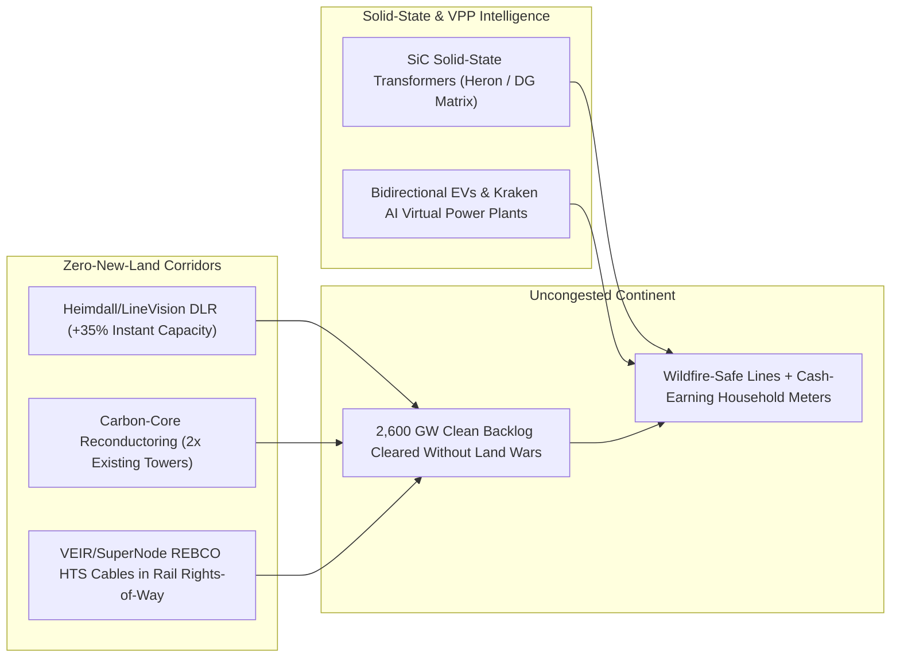

# CARBON EDITION • ABUNDANT CLEAN ENERGY
## Lossless HTS Superhighways & Autonomous Microgrids — *Threading Five-Gigawatt Superconducting Arteries Along Existing Railroads While Every Home & EV Earns Cash*

> **The Cynic's Belief:**
> *"Clean energy will choke to death in an eight-year transmission interconnection queue: rural landowners block
> ugly 160-foot high-voltage towers, copper transformers are backlogged for years, and electrifying cars and heat
> pumps will crash neighborhood wires."*
>
> **The 2026 Breakthrough Reality:**
> We stopped building 1920s grids. **VEIR** and **MetOx** thread REBCO superconducting cables along existing railroad
> and highway shoulders—carrying **$5\times–10\times$ the power** in a fraction of the width with near-zero resistive
> loss—while **Heimdall Power** and **LineVision** sensors unlock **30%–40% hidden capacity** on existing wires in
> weeks, and **Octopus Kraken** plus **Tesla Electric** pay families cash to turn parked EVs into millisecond virtual power plants.

---

## ACT I: A DELIGHTFUL NEAR FUTURE (HUMAN STORY)

At 5:45 PM on a $40^\circ\text{C}$ August evening in McAllen, Texas, bilingual third-grade teacher Maya Delgado
pulls into her shaded carport, plugs in her family's bidirectional electric crossover, and hears a cheerful chime
on her phone: **`+$68.40 Grid Hero Credit Earned`**. Between 5:45 PM and 7:15 PM, while Maya makes enchiladas on
her induction range inside a cool $22^\circ\text{C}$ living room, her car's 75-kilowatt-hour sodium-lithium pack
quietly exports 10 kilowatts back to her neighborhood transformer alongside four thousand neighboring homes on an
automated **Virtual Power Plant (VPP)** tariff—earning her family `$420` a summer while retiring the smoky gas
peaker plant that used to cough yellow haze near her elementary school:

* **Invisible Gigawatts Beside the Train Tracks:**
  At 11:00 PM, West Texas desert winds roar to life four hundred miles away. No 180-foot lattice steel towers had
  to be forced through Texas ranches or Hill Country oak groves to bring that wind east. Instead, buried inside a
  four-foot trench right inside an existing freight railroad shoulder, a wrist-thick **VEIR** high-temperature
  superconducting DC pipe cooled by harmless liquid nitrogen glides **3 gigawatts** across the state with zero
  overhead spark risk and virtually zero heat loss—recharging Maya's car to 100% by 3:00 AM for pennies.
* **Zero Wildfire Sparks in Dry Forests:**
  Out in California and Oregon mountain towns, utilities didn't spend twenty years clear-cutting canyons; they
  swapped bare aluminum wires for carbon-core cables, clipped soccer-ball-sized **Heimdall** sensors onto spans
  in afternoon helicopter hops, and buried compact superconducting feeders through high-fire-risk passes.
* **Storm-Proof Neighborhood Islands:**
  When a Gulf hurricane clips coastal feeders, solid-state silicon-carbide substation routers island Maya's
  neighborhood in two milliseconds—keeping the grocery store, clinic, and every block's AC running seamlessly
  on local rooftop tandems and parked pickups.

---

## ACT II: SOTA BREAKTHROUGHS, REAL COMPANIES & SYNERGIES

Today's global clean-energy backlog—over **2,600 gigawatts** of solar, wind, and storage projects waiting in U.S.
and European interconnection queues—was never caused by a shortage of electrons. It was caused by legacy aluminum
AC wires losing 6%–10% of power to $I^2R$ resistive heating, sagging dangerously when hot, and demanding 150-to-250-foot
rights-of-way that trigger decade-long eminent-domain lawsuits.

### 1. Four Hardware & Software Multiplier Leaps (2024–2026)
Modern grid engineering attacks transmission scarcity from both ends—multiplying existing corridor capacity $3\times–10\times$
while turning passive edge loads into active stabilizing assets:

* **REBCO Superconducting Cables ($5\times–10\times$ Corridor Density, Zero $I^2R$ Loss):**
  Riding the exact REBCO superconducting tape boom launched by commercial fusion, **VEIR** uses evaporative liquid
  nitrogen ($65–77\text{ K}$—made from 78% of ordinary air, $20\times$ higher cooling power per liter than closed-loop
  liquid $\text{LN}_2$) inside slim vacuum-insulated pipes. Because electrical resistance drops to **zero** ($R = 0$
  in DC), a single superconducting line carries **gigawatts at low-to-medium voltage**, shrinking corridor width up
  to $10\times$, eliminating giant step-up transformer yards, and fitting underground or overhead inside existing
  railroad and interstate shoulders.
* **30-Day Grid Enhancing Technologies (DLR + Carbon-Core Reconductoring):**
  Overhead line ratings used to assume worst-case hot, windless afternoons all year. **Heimdall Power** (*Neuron*
  spheres) and **LineVision** (tower-mounted LiDAR) measure real-time wind cooling and wire sag, instantly unlocking
  **30%–40% more megawatts** on existing wires for <2% the cost of a new line. Pairing DLR with composite carbon-core
  conductors (**TS Conductor**, **CTC Global**) **doubles** existing tower capacity in months without permits for new towers!
* **Solid-State Silicon-Carbide Transformers (SSTs):**
  Startups like **Heron Power** (founded by former Tesla SVP Drew Baglino) and **DG Matrix** replace 20-ton oil-filled
  1900s iron-and-copper transformers (stuck in 120-week supply-chain waits) with refrigerator-sized solid-state power
  electronics that bidirectionally route AC, DC, solar, batteries, and data centers with microsecond precision.
* **AI Virtual Power Plants (Kraken & V2G Orchestration):**
  Every million electric vehicles rolling off assembly lines carries **65–80 gigawatt-hours** of mobile storage—more
  than all stationary grid batteries in America combined! Platforms like **Octopus Energy's Kraken** and **Tesla Electric**
  aggregate millions of EVs, heat pumps, and smart thermostats into dispatchable gigawatts.

> *"Superconducting transmission lets us move gigawatts of clean power through corridors a fraction the width
> of conventional lines—without waiting a decade for new rights-of-way."*
> — **Tim Heidel**, Co-Founder & CEO, VEIR

### 2. Verified 2025–2026 Grid Superhighway & VPP Pioneers

| Pioneer / Platform | Core Grid Innovation | Verified 2025–2026 Milestone | Commercial Deployment & Impact |
| :--- | :--- | :--- | :--- |
| **VEIR & MetOx** | Evaporative $\text{LN}_2$-cooled REBCO HTS lines & domestic HTS tape manufacturing | VEIR energized full-scale overhead/buried HTS feeders & signed hyperscale data-center/utility pilots; MetOx scaling U.S. Xeus REBCO lines | Delivering 400 MW–3 GW corridors into congested cities & AI campuses via rail/highway shoulders |
| **SuperNode & Nexans** | Cryogenic polymer-cryostat superconducting HVDC & urban *AmpaCity* cables | Nexans HTS cables running live in Essen (Germany) & Chicago ComEd resiliency loop; SuperNode opened Dublin testing hub | Zero-loss offshore wind landfalls & underground urban gigawatt arteries without trenching whole streets |
| **Heimdall Power & LineVision** | Live sensor spheres (*Neurons*) & non-contact LiDAR Dynamic Line Rating | Deployed across 50+ utilities in Europe & U.S. (National Grid, Great River Energy, AES), unlocking 30%–44% extra capacity | Clearing renewable curtailment in weeks at <\$100k/mile instead of \$4M/mile new towers |
| **TS Conductor & CTC Global** | Carbon-fiber composite-core aluminum conductors (zero thermal sag) | Backed by Breakthrough Energy & NextEra; reconductoring thousands of circuit-miles across CA, TX, Midwest & EU | Doubling existing corridor megawatts & cutting line losses ~30% using existing steel towers |
| **Octopus Kraken & Heron Power** | 60+ GW AI device orchestration OS + modular SiC solid-state transformers | Kraken managing >50M accounts & >2 GW flexible VPP load globally; Heron Power raised \$50M+ scaling gigawatt SST fabs | Paying drivers \$400–\$900/yr for V2G backup while cutting substation build times from 3 years to weeks |

---

## ACT III: REIMAGINING SOCIAL CONVENTIONS & GLOBAL PROOF

Why did utilities spend decades building bloated billion-dollar tower lines instead of upgrading existing wires?
Because legacy **cost-of-service regulation** paid monopoly utilities a guaranteed 10% profit *only* on massive
capital concrete-and-steel spending—giving them zero incentive to clip cheap smart sensors onto old wires! Today,
regulatory and real-estate reforms have broken that perverse incentive:

1. **Railroad & Highway Right-of-Way Co-Location (`SOO Green` & DOT Fast-Tracks):**
   Following U.S. Department of Transportation state highway co-location guidance and projects like the **SOO Green
   HVDC Link** (burying 2,100 MW underground along Canadian Pacific rail tracks across Iowa and Illinois), routing
   slim buried HVDC and superconducting cables beneath existing rail beds and interstate medians bypasses 100% of
   private farmland condemnation battles.
2. **Germany's *AmpaCity* & Chicago's ComEd Urban HTS Proof:**
   In Essen, Germany, a 1-kilometer concentric superconducting cable replaced bulky 110-kilovolt urban lines for
   over a decade of flawless downtown service, while Chicago's ComEd energized its permanent superconducting cable
   inside existing downtown underground ducts to create a fault-tolerant microgrid ring.
3. **FERC Order 1920 & UK Performance-Based Regulation (RIIO):**
   Britain's Ofgem `RIIO` model rewards utilities financially for saving consumers money via software and sensors
   rather than pouring concrete, while U.S. `FERC Order 1920` compels regional planners to evaluate Dynamic Line
   Rating and advanced conductors *before* billing ratepayers for slow greenfield towers.

| Trajectory Metric | 2026 Baseline | 2030 Sprint | 2035 Scaling | 2040 Maturity |
| :--- | :--- | :--- | :--- | :--- |
| **Interconnection Wait Time** | 4–8 years in legacy US/EU transmission queues | <12 months via DLR, carbon reconductoring & SSTs | <90 days via pre-wired HTS rail corridors & AI twins | Plug-and-play software-defined grid ports |
| **HTS Cable Cost & Scale** | Urban/data-center high-density corridors (km scale) | 1,500+ km rail-buried gigawatt links as REBCO drops 65% | 20,000+ km continental lossless HVDC/HTS backbones | Standard underground zero-loss interties across time zones |
| **Household VPP & EV Fleet** | Early V2G/VPP tariffs in TX, UK, CA & Australia | 25+ GW bidirectional EVs & heat pumps earning monthly cash | 180+ GW autonomous home/EV fleet erasing sunset peaks | Every building & vehicle acts as a self-healing microgrid node |
| **Line Losses & Fire Risk** | 6%–9% grid losses; dry-season bare-wire shutoffs | Losses cut by a third via carbon-core & SSTs | Underground HTS/HVDC eliminates forest wildfire sparks | Near-zero backbone losses from sunny deserts to cities |

---

## ACT IV: THE SYNERGY CASCADE

When electrons glide across time zones without land wars or resistive heat losses, every clean generator on Earth
becomes dramatically cheaper and more valuable:

* **Fusion + Grid Superconductor Flywheel:**
  [Compact Commercial Fusion](../fusion-power/REPORT.md) and HTS cables share the exact same REBCO tape factories—each
  sector's purchase orders slashing costs down Wright's Law for the other.
* **East-West Sunshine Sharing:**
  Lossless rail-corridor DC superhighways let late-afternoon desert arrays in [Perovskite-Silicon Tandems](../perovskite-tandem-solar/REPORT.md)
  power 8:00 PM dinner tables two time zones east before touching a battery.
* **Zero-Delay Industrial Electrification:**
  Green steel furnaces and electro-cement kilns in [Synthetic Sky Fuels](../synthetic-sky-fuels/REPORT.md) connect
  500 MW loads via compact VEIR feeders and Heron solid-state transformers in months rather than waiting a decade.
* **Rewilding Scenic Landscapes:**
  Retiring rusted 1950s lattice towers through national parks and burying 10x-denser cables along highways restores
  unbroken skyline views and migratory bird flyways.

---

## References & Verified Sources

* **Featured Researcher / Leader:** [Tim Heidel — Co-Founder & CEO, VEIR](https://veir.com/)
* **Companies, Labs & Consortia:** [VEIR & MetOx](https://veir.com/) · [SuperNode & Nexans](https://supernode.energy/) · [Heimdall Power & LineVision](https://heimdallpower.com/) · [TS Conductor & CTC Global](https://tsconductor.com/) · [Octopus Energy (Kraken)](https://octopus.energy/) · [Heron Power & DG Matrix](https://www.heronpower.com/)
* **Global & Regulatory Precedents:** [Essen Germany (AmpaCity) 10+ Yr Urban Superconducting Cable](https://en.wikipedia.org/wiki/High-temperature_superconductivity) · [Chicago ComEd Permanent Downtown Superconducting Microgrid Loop](https://www.comed.com/) · [SOO Green & US DOT Rail/Highway Right-of-Way Co-Location](https://soogreen.com/) · [UK Ofgem RIIO & Octopus Kraken 50M-Account VPP Platform](https://kraken.tech/)
* **Connected Carbon Pathways:** [Compact Commercial Fusion](../fusion-power/REPORT.md) · [35.5% Perovskite-Silicon Tandems & Living Solar Skins](../perovskite-tandem-solar/REPORT.md) · [100-Hour Rust, Salt & Glowing Carbon Storage](../iron-sodium-storage/REPORT.md) · [The 48-Hour Digital State: Estonia X-Road, Physics Permits & 5-Minute Justice](../../04-social-norms/forty-eight-hour-governance/REPORT.md)
