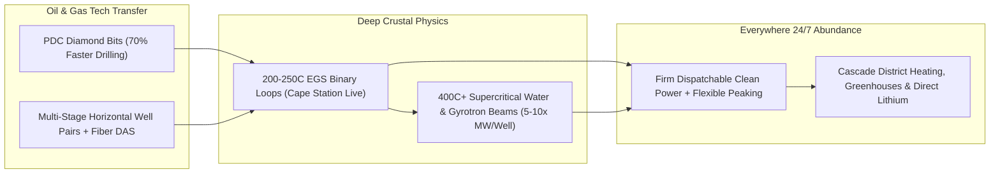

# CARBON EDITION • ABUNDANT CLEAN ENERGY
## Everywhere Baseload: Enhanced & Superhot Rock Geothermal — *Turning Oilfield Drilling Mastery into Unlimited 24/7 Earth Heat Under Every Continent*

> **The Cynic's Belief:**
> *"Geothermal only works in rare volcanic postcards like Iceland or Yellowstone; drilling miles into dry granite
> chews up drill bits in hours, triggers earthquakes, and will never compete economically with natural gas."*
>
> **The 2026 Breakthrough Reality:**
> Oilfield horizontal drilling and synthetic diamond bits cracked hard granite wide open. In 2026, Fervo Energy
> synchronized **Cape Station (Beaver County, Utah)**—the world's first commercial greenfield Enhanced Geothermal
> System (EGS)—with the grid and completed a landmark \$2.2B IPO backed by multi-hundred-MW Google and Meta PPAs,
> while Mazama Energy and Quaise Energy push past $400^\circ\text{C}$ into **superhot rock** where supercritical
> water delivers $5\times–10\times$ the power per well almost anywhere on Earth.

---

## ACT I: A DELIGHTFUL NEAR FUTURE (HUMAN STORY)

At 6:30 AM on a snowy January morning in Milford, Utah, master directional driller Wyatt Callahan walks his
golden retriever down Main Street without slipping on a single patch of ice. Just like Reykjavik, Milford now
pipes $85^\circ\text{C}$ cascade water—leftover warmth after Cape Station's binary turbines finish spinning
clean electricity—underneath town sidewalks, the high-school football turf, and forty acres of glowing glass
tomato-and-strawberry greenhouses out on the sagebrush flat.

Six years ago in Midland, Texas, Wyatt lived through his third brutal oil-price crash, watching half his rig crew
get laid off before Christmas while worrying his trade had no place in a clean-energy century. Instead, his exact
skills became the linchpin of twenty-four-hour carbon-free baseload:

* **Zero Boom-and-Bust Rig Pride:**
  Out at Cape Station, there are no flaring methane stacks, no diesel fumes, and no H2S gas alarms—just an
  all-electric top-drive rig quietly steering polycrystalline diamond bits horizontally through $220^\circ\text{C}$
  crystalline granite three kilometers underfoot, then stepping off the pad to leave behind a low-profile wellhead
  smaller than a two-car garage.
* **Load-Following Underground Battery:**
  By throttling wellhead valves guided by fiber-optic cables cemented along every lateral, Wyatt's control room
  ramps megawatts up in minutes when evening solar fades across California and Nevada, storing pressurized hot
  fluid right inside the granite fractures during sunny noon hours.
* **Desert Greenhouses & Local Prosperity:**
  Beaver County's school district rebuilt its science wing from geothermal lease royalties, and Wyatt's wife Clara
  manages an aquaculture barn raising warm-water Pacific white shrimp and heirloom basil in the middle of a Utah
  blizzard—powered and heated round the clock by the Earth's own core.
* **Clean Air, Tiny Footprint:**
  A 500-megawatt enhanced geothermal field occupies less than one-tenth the surface land of a coal strip mine or
  sprawling gas field, leaving pronghorn antelope grazing freely right between silent, closed-loop well pads.

---

## ACT II: SOTA BREAKTHROUGHS, REAL COMPANIES & SYNERGIES

Ninety-nine percent of Planet Earth sits above $1,000^\circ\text{C}$; just six to ten kilometers beneath almost
every city on every continent lies enough thermal energy in hot basement rock to power human civilization for
hundreds of thousands of years. Historically, conventional hydrothermal plants could only tap the <2% of land where
natural hot aquifers happened to bubble near the surface.

### 1. Three Drilling & Subsurface Physics Leaps (2023–2026)
Adapting shale-revolution horizontal completions and high-frequency physics turned dry basement granite into a
manufacturable, universal heat exchanger:

* **Polycrystalline Diamond Compact (PDC) Bits & Design 3.0 Laterals:**
  Synthetic diamond cutter geometries paired with automated downhole mud-cooler telemetry cut hard-granite drilling
  days by **>70%** at Fervo's Utah pads—slashing well costs from >\$13M down toward \$4.5M while multi-stage planar
  fracture networks create massive, uniform rock-to-water heat-transfer surfaces between horizontal injection and
  production pairs.
* **Fiber-Optic DAS/DTS & Traffic-Light Seismicity Control:**
  Continuous Distributed Acoustic and Temperature Sensing (DAS/DTS) fibers measure flow across every meter of rock
  in real time, preventing thermal short-circuiting and maintaining gentle micro-permeability far below human-felt
  seismic thresholds—all inside zero-emission closed binary Organic Rankine Cycle (ORC) loops that reinject 100% of water.
* **The Supercritical $400^\circ\text{C}+$ Leap ($5\times–10\times$ Power per Well):**
  Above $374^\circ\text{C}$ and $22.1\text{ MPa}$, water enters a **supercritical phase**—flowing with gas-like low
  viscosity while carrying liquid-like high enthalpy. A single superhot well yields **25–50 MWe** instead of 5 MWe!
  Mazama Energy demonstrated $>400^\circ\text{C}$ field completions in Oregon, while MIT spinout Quaise Energy uses
  megawatt **millimeter-wave gyrotrons** (borrowed directly from fusion plasma heating!) to spall and vaporize
  ultra-deep granite down to 12–20 km without mechanical bit wear.

> *"By applying drilling technology from the oil and gas industry, we have proven that we can produce 24/7
> carbon-free energy resources in new geographies across the world."*
> — **Tim Latimer**, Co-Founder & CEO, Fervo Energy

### 2. Verified 2025–2026 Next-Gen Geothermal Leaders

| Pioneer / Project | Subsurface Architecture | Verified 2025–2026 Milestone | Commercial Scale & Offtake Pathway |
| :--- | :--- | :--- | :--- |
| **Fervo Energy** | Horizontal multi-zone Enhanced Geothermal System (EGS) + fiber-optic flow control | Synchronized **Cape Station (Beaver County, UT)** to grid in 2026; landmark **\$2.2B IPO**; Design 3.0 wells | Scaling Cape Station past 500 MW toward 2 GW; multi-hundred-MW PPAs with Google, Meta & SoCal Edison |
| **Mazama Energy** | Superhot Rock ($>400^\circ\text{C}$) high-enthalpy EGS completions | Validated world-leading superhot rock well integrity and thermal tooling at Newberry Volcano, Oregon | Commercial 15–35 MWe/well superhot demonstration & Pacific Northwest utility baseload |
| **Quaise Energy** | Millimeter-wave gyrotron directed-energy rock vaporization (10–20 km depth) | Field-tested mobile 100 kW–1 MW gyrotron granite drilling rigs in Texas quarry/field campaigns | Repowering coal and gas turbine islands *anywhere on Earth* by drilling straight down on-site |
| **Eavor Technologies** | *Eavor-Loop* sealed subterranean multi-lateral closed thermosyphon radiator | Commenced commercial heat & power operations at **Geretsried, Bavaria** flagship loop (zero fracking/water loss) | Municipal district heating & baseload power across Germany, Netherlands, Japan & North America |
| **Sage Geosystems & Vulcan Energy** | Geopressured mechanical earth storage & Zero-Carbon Lithium geothermal brines | Sage contracted geopressured storage/baseload with Meta; Vulcan producing battery-grade $\text{LiOH}$ in Upper Rhine Valley | Pairing 24/7 European & U.S. clean heat/power with domestic zero-mining lithium extraction |

---

## ACT III: REIMAGINING SOCIAL CONVENTIONS & GLOBAL PROOF

Cynics often predict that geothermal will get bogged down in ten-year federal environmental reviews or face fierce
pushback from fossil-fuel states. In reality, next-generation geothermal enjoys the **broadest bipartisan coalition
in modern energy politics**—uniting roughnecks in Texas and Wyoming with climate hawks in California and Berlin:

1. **The Oilfield Workforce & Supply-Chain Bridge:**
   Over 75% of the cost of a geothermal plant is drilling rigs, steel casing, mud pumps, directional sensors, and
   subsurface geophysicists—the *exact* workforce and domestic supply chain of the oil and gas industry. Instead
   of telling roughnecks in Odessa, Oklahoma City, or Alberta to "learn to code," geothermal pays premium wages
   to drill clean wells that produce steady revenue for 40 years rather than depleting in 24 months.
2. **Iceland's 90-Year Proof & Munich's District Transformation:**
   In the 1930s, Iceland choked on imported coal smoke; today, **>90% of Icelandic homes** enjoy cheap geothermal
   space heating, snow-melted streets, year-round banana/tomato greenhouses, and thriving industrial parks.
   Following suit, Munich's municipal utility (*Stadtwerke München*) and Geretsried are drilling deep closed-loop
   and hydrothermal wells right beneath Bavarian suburbs to permanently replace Russian pipeline gas.
3. **Bipartisan Permitting Categorical Exclusions:**
   Recognizing that geothermal exploration pads disturb no more surface land than oil/gas pads—which already held
   fast-track Categorical Exclusions on federal land—the U.S. Department of the Interior and Congress streamlined
   geothermal exploration permitting from 3–5 years down to months across the American West.

| Trajectory Metric | 2026 Baseline | 2030 Sprint | 2035 Scaling | 2040 Maturity |
| :--- | :--- | :--- | :--- | :--- |
| **Average Output per Well** | 5–8 MWe (Design 3.0 horizontal EGS) | 12–18 MWe (high-temp EGS & multi-lateral loops) | 25–40 MWe (commercial $400^\circ\text{C}+$ superhot wells) | 40–60 MWe deep supercritical pads under any city |
| **Drilling Depth & Speed** | 3–4.5 km in ~16 days via PDC diamond bits | 5–7 km in <12 days via autonomous high-T mud rigs | 8–12 km hybrid PDC + gyrotron millimeter-wave spalling | 12–18 km routine anywhere-baseload crustal access |
| **Levelized Cost (LCOE)** | \$60–\$78/MWh firm 24/7 clean baseload | \$42–\$55/MWh; cheaper than combined-cycle gas turbines | \$26–\$36/MWh via superhot $5\times$ enthalpy multiplier | \$18–\$25/MWh firm power + free municipal cascade heat |
| **Global Installed Next-Gen** | ~18 GW legacy + first commercial EGS/Closed-Loop | 45+ GW operating; oilfield majors redeploying 500+ rigs | 180+ GW global baseload + 100+ heated winter cities | 600+ GW everywhere-baseload & coal boiler repowering |

---

## ACT IV: THE SYNERGY CASCADE

Because deep rock holds constant temperature day and night, summer and winter, superhot geothermal acts as both
an inexhaustible 24/7 power generator and a gigawatt-scale thermal sponge beneath our feet:

* **Zero-Mining Battery Metals from Brine:**
  Geothermal brines in California's Salton Sea and Germany's Rhine Graben pass through direct-lithium-extraction
  sorbents on their way back underground—supplying clean domestic lithium alongside [Iron, Sodium & Glowing Carbon Storage](../iron-sodium-storage/REPORT.md).
* **Direct Air Capture Powered by Cascade Heat:**
  Solid-sorbent carbon capture plants need $80^\circ\text{C}–110^\circ\text{C}$ regeneration heat—the exact leftover
  temperature exiting geothermal turbines—slashing feedstock costs for [Synthetic Sky Fuels](../synthetic-sky-fuels/REPORT.md).
* **Winter Food Sovereignty:**
  Cascade district loops warm snow-belt greenhouses and aquaculture barns from Utah to Poland, growing fresh
  Mediterranean produce in January with zero natural gas burn.
* **Inland Brackish Aquifer Renewal:**
  Deep inland geothermal heat powers thermal membrane distillation for [Aquifer Rivers & Desalination](../aquifer-rivers-desalination/REPORT.md),
  purifying salty inland groundwater across Texas, Nevada, and Australia's Outback.

---

## References & Verified Sources

* **Featured Researcher / Leader:** [Tim Latimer — Co-Founder & CEO, Fervo Energy](https://fervoenergy.com/)
* **Companies, Labs & Consortia:** [Fervo Energy](https://fervoenergy.com/) · [Mazama Energy](https://www.energy.gov/eere/geothermal/enhanced-geothermal-systems) · [Quaise Energy](https://www.quaise.energy/) · [Eavor Technologies](https://www.eavor.com/) · [Sage Geosystems](https://www.sagegeosystems.com/) · [Vulcan Energy Resources](https://en.wikipedia.org/wiki/Direct_lithium_extraction)
* **Global & Regulatory Precedents:** [Iceland 90%+ Geothermal District Heating & Greenhouses](https://en.wikipedia.org/wiki/Geothermal_power_in_Iceland) · [Cape Station Utah Commercial Greenfield EGS Grid Sync (2026)](https://fervoenergy.com/) · [Geretsried Bavaria Commercial Closed-Loop Eavor-Loop](https://www.eavor.com/) · [US Bipartisan Federal Geothermal Categorical Exclusions](https://www.energy.gov/eere/geothermal/geothermal-basics)
* **Connected Carbon Pathways:** [White Geologic Hydrogen, Blue Osmotic & Ambient Harvesters](../geologic-hydrogen-harvesters/REPORT.md) · [Turning Thin Air into Jet Fuel, Green Steel & Stone](../synthetic-sky-fuels/REPORT.md) · [Ending Drought Forever: Sub-Penny Desalination & Continental New Rivers](../aquifer-rivers-desalination/REPORT.md) · [Rescuing Displaced Workers Today: Denmark's 90% Wage-Bridge & Rapid Craft Pivots](../../04-social-norms/displaced-worker-bridge/REPORT.md)
