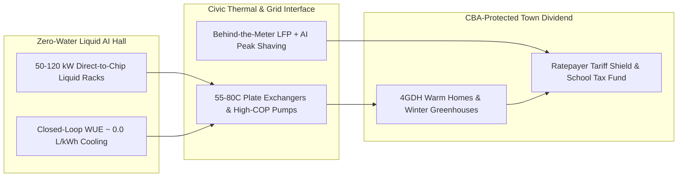

# CARBON EDITION • ABUNDANT CLEAN ENERGY
## Symbiotic Terrestrial Data Centers — *65°C District Heating, Community Benefit Agreements & Zero-Water Loops*

> **The Cynic's Belief:**
> *"AI data centers are parasitic concrete bunkers—guzzling millions of gallons of municipal drinking water, spiking
> families' electric bills to subsidize billionaire chatbots, roaring with diesel backup generators, and contributing
> almost zero permanent jobs to the towns they colonize."*
>
> **The 2026 Breakthrough Reality:**
> High-density direct-to-chip liquid cooling (30–120 kW per rack) flipped the thermodynamics of compute: instead of
> venting lukewarm $30^\circ\text{C}$ exhaust air into the sky through evaporative water towers, modern AI racks eject
> sealed dielectric or water-glycol loops at $55^\circ\text{C}\text{--}80^\circ\text{C}$—matching 4th-Generation District
> Heating (4GDH) networks directly. Paired with Microsoft and Fortum's 250,000-resident clean-heat rollout in Finland,
> the EU Energy Efficiency Directive's 2026 waste-heat mandate, and legally binding **Community Benefit Agreements
> (CBAs)** that shield residential ratepayers while turning behind-the-meter batteries into storm-proof neighborhood
> peakers, terrestrial compute campuses become civic furnaces, municipal greenhouses, and school tax windfalls.

---

## ACT I: A DELIGHTFUL NEAR FUTURE (HUMAN STORY)

At 7:15 AM on a $-14^\circ\text{C}$ January morning in Espoo, Finland—and increasingly in sister district-energy towns
from Odense, Denmark to Tallaght, Ireland and upstate New York—municipal thermal-network engineer Aino Lindqvist steps
out of her tram onto dry, snow-melted cobbles without a single coal or gas plume anywhere on the winter horizon.

Beneath the birch-lined parkway beside her, twin pre-insulated polymer mains carry $68^\circ\text{C}$ water straight from
a timber-clad, zero-evaporative-water AI compute hall half a kilometer away into 90,000 apartments, three public swimming
halls, and a glowing two-hectare municipal glasshouse bursting with winter strawberries and sweet cherry tomatoes:

* **One Kilowatt Paid Twice—Once for Brains, Once for Warmth:**
  Inside the compute hall, sealed cold plates resting directly atop 100-kilowatt GPU nodes absorb >96% of chip heat into
  a closed surgical-steel loop. Instead of boiling away local river water in misting cooling towers, plate heat exchangers
  hand that $65^\circ\text{C}\text{--}75^\circ\text{C}$ thermal stream directly to the city's public utility—eliminating
  400,000 tons of fossil $\text{CO}_2$ every winter.
* **Ironclad Residential Ratepayer Shields:**
  Under the town's legally binding **Community Benefit Agreement (CBA)** and **Heat Purchase Agreement (HPA)**, households
  never pay a cent for grid substation upgrades triggered by the campus. Better yet, revenue from wholesale compute-heat
  credits cuts Aino's winter heating bill by 38% compared to the old municipal gas boiler era.
* **The Storm-Night Neighborhood Shield:**
  When an Arctic wind lull hits the regional grid at 6:00 PM, the data center doesn't fire up soot-belching diesel engines.
  Its 150-megawatt behind-the-meter lithium-iron-phosphate (LFP) battery yard and flexible batch-training scheduler instantly
  drop grid draw by 80% and export clean stored power *back* into surrounding neighborhoods—keeping every hospital and
  kitchen lit.
* **Civic Tax Windfall & Year-Round Harvests:**
  Property-tax ringfences written into the campus charter fund debt-free robotics shops and hot organic lunches across
  every public school in the district, harvested partly from the tropical winter conservatory next door.

---

## ACT II: SOTA BREAKTHROUGHS, REAL COMPANIES & SYNERGIES

First-generation cloud warehouses (5–8 kW per rack) cooled servers with giant fans and evaporative swamp coolers—producing
low-grade $28^\circ\text{C}\text{--}35^\circ\text{C}$ warm air that was thermodynamically expensive to upgrade and thirsty
for millions of liters of potable water during summer droughts.

### 1. Three Engineering & Civic Unlocks (2024–2026)
The leap to dense AI training and inference racks inadvertently solved the waste-heat grade problem while unlocking zero-water,
grid-stabilizing architectures:

* **Direct-to-Chip $55^\circ\text{C}\text{--}80^\circ\text{C}$ Liquid Exergy ($C_p^{\text{water}} \approx 4,200\times$ Air by Volume):**
  Water carries roughly $3,500\text{--}4,200\times$ more heat per unit volume than air. Micro-channel copper cold plates
  and single-phase immersion tanks on 50–120 kW racks run chip junctions safely while returning fluid at
  $55^\circ\text{C}\text{--}80^\circ\text{C}$—hot enough to feed 4th-Generation District Heating (4GDH) and ambient
  Thermal Energy Networks (TENs) directly via passive heat exchangers, or reach $85^\circ\text{C}\text{--}95^\circ\text{C}$
  with ultra-high-COP ($\text{COP} > 5.2$) industrial heat pumps.
* **Closed-Loop Zero-Evaporative Cooling ($\text{WUE} \rightarrow 0.0\text{ L/kWh}$):**
  Replacing open evaporative cooling towers with hermetically sealed liquid-to-liquid district heat loops and dry adiabatic
  trim coolers drives operational Water Usage Effectiveness (**WUE**) from ~1.8 L/kWh down to near zero—requiring only a
  one-time closed-pipe fill equivalent to a few suburban swimming pools.
* **Grid-Interactive Load Flexing & Behind-the-Meter Storage:**
  Pairing 4-hour LFP/sodium-ion battery yards and borehole thermal storage with AI workload orchestrators (pausing
  non-urgent checkpoint training during the top 80 grid-stress hours per year, as validated by Duke University's *Load
  Flexibility* studies) unlocks gigawatts of instant headroom without waiting ten years for new transmission lines.

> *"Capturing waste heat from data centers at city scale proves digital infrastructure and climate neutralization aren't
> enemies—the same clean electron that trains a model can warm a quarter-million citizens' homes."*
> — **Markus Rauramo**, President & CEO, Fortum

### 2. Verified 2025–2026 Symbiotic Compute & District Heat Leaders

| Pioneer / Partnership | Core Architecture | Verified 2025–2026 SOTA Milestone | Civic & Community Benefit Model |
| :--- | :--- | :--- | :--- |
| **Fortum & Microsoft (Espoo / Kirkkonummi)** | Hyperscale waste-heat capture + high-COP heat pumps + thermal storage | World's largest data-center district-heat buildout; scaling to supply **40% of regional heat (~250,000 residents)** | Eliminates 400,000 t $\text{CO}_2$/yr; enables coal/gas retirement across Espoo & Kauniainen |
| **Meta & Fjernvarme Fyn (Odense, Denmark)** | Closed-loop server heat recovery into municipal district network | Recovers >100,000 MWh/yr of clean thermal energy warming **11,000+ Danish households** & public buildings | 100% renewable power match + long-term municipal heat tariff stabilization |
| **Stockholm Data Parks & Stockholm Exergi** | Open-access city heat marketplace (*Open District Heating*) | 30+ data centers contracted into Stockholm's 3,000 km pipe grid; targets 10% of total capital-city winter heat | Operators paid market rates for $65^\circ\text{C}$ heat; green-zoned urban sites include heat hookups |
| **Amazon AWS & South Dublin (Tallaght)** | Custom Energy Systems Group district-heat utility (*Heat Works*) | First Irish public-sector district heat network powered by AWS Tallaght server heat; warming university & civic halls | Zero-carbon municipal heat for library, county offices, TU Dublin & 130+ affordable apartments |
| **Deep Green / Qarnot & Octopus Energy** | Distributed "digital boilers" in public pools, social housing & greenhouses | Edge liquid-cooled compute pods heat UK public leisure pools (Exmouth) and French social-housing hot water for free | Slashes municipal pool & apartment gas bills 60%+ via paid cloud-rendering heat |

---

## ACT III: REIMAGINING SOCIAL CONVENTIONS & GLOBAL PROOF

The backlash against old-school data centers in Virginia, Ireland, and Arizona was never an unavoidable law of physics—it
was a failure of regulatory design that socialized grid and water costs while privatizing benefits. Three statutory upgrades
in 2025–2026 created a repeatable civic playbook:

1. **EU Energy Efficiency Directive (EED Article 26) Waste-Heat Mandate:**
   Entered into full reporting and enforcement across Europe in 2024–2026, requiring every data center above 500 kW to
   publicly report energy, water, and waste-heat metrics while mandating waste-heat utilization via district heating or
   industrial co-location for facilities >1 MW unless proven technically infeasible.
2. **Isolated Large-Load Tariffs & Ratepayer Shields (US FERC / State PUCs):**
   New large-load tariff classes (pioneered in Ohio AEP settlements, Nevada, and Pacific Northwest clean-transition tariffs)
   legally isolate hyperscaler interconnection, transformer, and clean-firm generation costs ($100\%$ paid by the operator
   with 10-to-15-year minimum take-or-pay guarantees) so families never subsidize stranded wires.
3. **Legally Binding Community Benefit Agreements (CBAs) & Heat Purchase Agreements (HPAs):**
   Forward-looking municipalities condition zoning fast-tracks on three non-negotiables: zero potable evaporative cooling,
   free or at-cost $60^\circ\text{C}+$ thermal export to municipal TENs/greenhouses, and dedicated per-megawatt civic revenue
   streams funding affordable housing, trade apprenticeships, and neighborhood battery microgrids.

| Trajectory Metric | 2026 Baseline | 2030 Sprint | 2035 Scaling | 2040 Maturity |
| :--- | :--- | :--- | :--- | :--- |
| **Coolant Outlet Temp & WUE** | $55^\circ\text{C}\text{--}70^\circ\text{C}$ liquid racks; flagship campuses hit $\text{WUE} < 0.05\text{ L/kWh}$ | $70^\circ\text{C}\text{--}80^\circ\text{C}$ two-phase/cold-plate standard; zero potable water laws | Direct 4GDH drop-in across 75% of temperate/cold compute builds | Universal closed-loop zero-water compute standard |
| **Global Waste-Heat Reuse** | ~4–6 TWh/yr captured (Nordics, Dublin, Frankfurt, Paris) | 45+ TWh/yr via EU EED mandate & North American TENs | 180+ TWh/yr warming 25M+ homes, schools & glasshouses | Compute acts as primary winter heat backbone in 200+ cities |
| **Grid Peak-Shaving Role** | Static 24/7 loads + dirty diesel backup gensets | LFP battery yards replace diesel; 15% AI load-flex tariffs | 60+ GW dispatchable compute-VPP stabilizing renewable grids | Every terrestrial compute hall doubles as a clean town peaker |
| **Civic & Ratepayer Compact** | Ad-hoc tax breaks & residential rate-hike anxiety | Mandatory large-load tariff shields & municipal CBAs | Compute heat + property levies cut local winter utility bills 35% | Symbiotic civic compute paired with orbital space data centers |

---

## ACT IV: THE SYNERGY CASCADE

While massive foundation-model training clusters eventually migrate off-planet to
[Zero-Water Orbital Radiative Compute](../../05-space-frontier/orbital-radiative-compute/REPORT.md), humanity will always keep
low-latency terrestrial inference and sovereign civic clouds close to cities—and making those halls symbiotic transforms
urban energy and food systems:

* **Clean Firm Power Without Grid Queues:**
  Co-locating symbiotic compute campuses at [Compact Commercial Fusion](../fusion-power/REPORT.md) and
  [Enhanced & Superhot Rock Geothermal](../superhot-geothermal/REPORT.md) stations pairs 24/7 carbon-free electricity
  with dual-stage municipal district heating.
* **Neighborhood Virtual Peaker Coordination:**
  Linking data-center LFP battery yards with [Bidirectional V2G Virtual Power Plants](../bidirectional-v2g-virtual-plants/REPORT.md)
  creates instant gigawatt shock absorbers that retire urban gas peaker plants permanently.
* **Abundant Timber Districts & Compute Dividends:**
  Piping free $65^\circ\text{C}$ server warmth directly beneath [Abundant Beautiful Mass-Timber Housing](../../04-social-norms/abundant-beautiful-housing/REPORT.md)
  while channeling campus levies into [Compute Commons & Public Dividends](../../04-social-norms/compute-commons-taxation/REPORT.md)
  slashes both winter heating bills and municipal school taxes.

---

## References & Verified Sources

* **Featured Leader:** [Markus Rauramo — President & CEO, Fortum (Espoo Clean Heat & Microsoft Partnership)](https://www.fortum.com/)
* **Companies, Utilities & Consortia:** [Fortum Espoo Clean Heat](https://www.fortum.com/) · [Stockholm Data Parks & Stockholm Exergi](https://stockholmdataparks.com/) · [Fjernvarme Fyn (Odense District Heating)](https://www.fjernvarmefyn.dk/) · [Deep Green Digital Boilers](https://deepgreen.energy/) · [Qarnot Computing](https://qarnot.com/en) · [Duke University Nicholas Institute Load Flexibility](https://nicholasinstitute.duke.edu/)
* **Global & Regulatory Precedents:** [EU Energy Efficiency Directive (EED) Data Center Waste-Heat Mandate](https://energy.ec.europa.eu/topics/energy-efficiency/energy-efficiency-targets-directive-and-rules/energy-efficiency-directive_en) · [Microsoft–Fortum 250,000-Resident Finland Heat Recovery](https://www.fortum.com/) · [South Dublin Tallaght District Heating (Heat Works / AWS)](https://www.sdcc.ie/en/) · [Ohio PUC / AEP Large-Load Ratepayer Shield Tariff](https://puco.ohio.gov/)
* **Connected Carbon Pathways:** [Zero-Water Orbital Radiative Compute](../../05-space-frontier/orbital-radiative-compute/REPORT.md) · [Bidirectional V2G Virtual Power Plants](../bidirectional-v2g-virtual-plants/REPORT.md) · [Abundant Beautiful Mass-Timber Housing](../../04-social-norms/abundant-beautiful-housing/REPORT.md) · [Compute Commons & Public Dividends](../../04-social-norms/compute-commons-taxation/REPORT.md)
