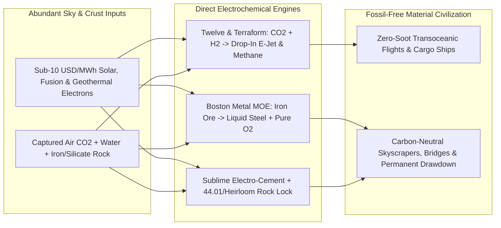

# CARBON EDITION • ABUNDANT CLEAN ENERGY
## Turning Thin Air into Jet Fuel, Green Steel & Stone — *When Clean Electricity Drops Below a Penny, the Sky Becomes Our Oil Well and Oxygen Replaces Smokestacks*

> **The Cynic's Belief:**
> *"Solar panels and batteries might run laptops and compact cars, but you can't fly a Boeing 787 across the Pacific
> on batteries, and modern civilization will always burn billions of tons of coal and oil to make jet fuel, steel,
> plastics, and concrete."*
>
> **The 2026 Breakthrough Reality:**
> Electrochemistry just severed heavy industry from fossil carbon forever. **Twelve** is producing drop-in *E-Jet*
> aviation fuel from captured $\text{CO}_2$ and water in Moses Lake, Washington; **Boston Metal's** Molten Oxide
> Electrolysis turns iron ore directly into liquid steel with **pure breathable oxygen** as the only exhaust;
> **Sublime Systems** makes zero-kiln electrochemical cement at ambient temperatures; and **44.01** plus **Heirloom**
> lock surplus sky carbon permanently into solid limestone and peridotite rock.

---

## ACT I: A DELIGHTFUL NEAR FUTURE (HUMAN STORY)

Thirty-six thousand feet above the North Pacific, Captain Priya Nair eases the thrust levers of her widebody jetliner
into cruise between Seattle and Tokyo. Nothing in the wing tanks was pumped out of a desert oilfield or refined in a
cancer-alley cracking tower. Every clear, odorless drop of **E-Jet** sustainable aviation fuel roaring cleanly through
her engines was synthesized forty-eight hours earlier in Moses Lake, Washington—stitched together from ambient sky
$\text{CO}_2$, Columbia River water, and cheap clean electrons:

* **Cleaner Contrails, Identical Engines:**
  Because electro-synthesized paraffinic jet fuel contains zero sulfur and virtually zero soot-forming aromatics,
  Priya's engines run cooler, require 20% fewer maintenance overhauls, and cut heat-trapping ice contrails across
  high altitudes by more than 70%—all without modifying a single gasket on existing commercial airliners.
* **The Steel Mill That Breathes Like a Forest:**
  Three thousand miles east near Woburn, Massachusetts—and down in Minas Gerais, Brazil—metallurgist Tiago Silva taps
  a glowing $1,600^\circ\text{C}$ ladle of ultra-pure liquid steel out of a **Boston Metal** electrolytic cell. There
  are no black coking-coal ovens, no blast-furnace carbon monoxide plumes, and no slag mountains—just clean electric
  current splitting iron oxide into mirror-bright liquid iron while the overhead vent pipe releases **pure $\text{O}_2$**,
  leaving mill air fresher than a city park.
* **Zero-Smoke Concrete & Sky-to-Stone Parks:**
  Across the river in Holyoke, Massachusetts, **Sublime Systems** pours high-strength structural concrete cured without
  ever firing a $1,450^\circ\text{C}$ limestone kiln, while out in California's Central Valley and the mountains of Oman,
  mineralization wells quietly turn yesterday's coal-age atmospheric $\text{CO}_2$ back into solid underground marble forever.

---

## ACT II: SOTA BREAKTHROUGHS, REAL COMPANIES & SYNERGIES

Critics used to dismiss "hard-to-abate" sectors—aviation, maritime shipping, steel, cement, and petrochemicals, which
together drive **>30% of global emissions**—because green electricity at \$60/MWh couldn't beat \$70/barrel crude oil
or \$120/ton metallurgical coal. When [Perovskite-Silicon Tandems](../perovskite-tandem-solar/REPORT.md),
[Geologic Hydrogen](../geologic-hydrogen-harvesters/REPORT.md), and off-peak [Compact Fusion](../fusion-power/REPORT.md)
push clean electrons below **\$5–\$10/MWh** (and $\text{H}_2$ toward \$0.50/kg), thermodynamics flips in electrochemistry's favor!

### 1. Four Electrochemical & Mineralization Engines (2024–2026)
Instead of burning ancient buried hydrocarbons for sloppy thermal heat, precise voltage splits oxides at the atomic bond:

* **Power-to-Liquids (*E-Fuels* from $\text{CO}_2 + \text{H}_2\text{O}$):**
  **Twelve's** *Opus* polymer-electrolyte-membrane (PEM) $\text{CO}_2$ electrolyzer uses metal-organic catalysts to split
  captured $\text{CO}_2$ into carbon monoxide ($\text{CO}$) + oxygen at low temperature; combining $\text{CO}$ with clean
  $\text{H}_2$ (syngas) inside modular Fischer-Tropsch reactors yields molecularly identical jet fuel, marine methanol,
  and naphtha for carbon-negative plastics. Meanwhile, **Terraform Industries** couples off-grid DC solar arrays directly
  to low-CAPEX Sabatier ($\text{CO}_2 + 4\text{H}_2 \rightarrow \text{CH}_4 + 2\text{H}_2\text{O}$) skids designed to
  undercut fracked natural gas in sunny deserts.
* **Molten Oxide Electrolysis (MOE) Zero-Carbon Steel:**
  Just as the 1886 Hall-Héroult process turned aluminum from a metal pricier than gold into kitchen foil via molten-salt
  electrolysis, **Boston Metal** passes DC current from an inert metallic anode straight through $1,600^\circ\text{C}$
  molten iron ore: $2\text{Fe}_2\text{O}_3 \rightarrow 4\text{Fe (l)} + 3\text{O}_2\text{ (g)}$—eliminating coking coal,
  blast furnaces, and even hydrogen storage tanks in a single step, even on lower-grade iron ores!
* **Ambient-Temperature Electrochemical Cement:**
  Traditional Portland cement emits ~8% of global $\text{CO}_2$—half from burning fossil fuel at $1,450^\circ\text{C}$,
  half chemically baked out of limestone ($\text{CaCO}_3 \rightarrow \text{CaO} + \text{CO}_2$). **Sublime Systems** uses
  room-temperature water electrolysis pH gradients to dissolve non-carbonate calcium silicate rocks (or industrial slags)
  into pure reactive calcium hydroxide and silica—achieving **zero fossil kilns and zero limestone process $\text{CO}_2$**.
* **Rapid Limestone Looping & Peridotite Mineralization:**
  **Heirloom Carbon** uses heated crushed limestone sponges to pull $\text{CO}_2$ passively out of ambient air in days
  rather than millennia, while Earthshot-winner **44.01** injects carbonated water into abundant ultramafic peridotite
  formations where natural magnesium/calcium silicates turn $\text{CO}_2$ into **solid calcite stone in <12 months**—zero
  leakage risk for a billion years.

> *"Anything we currently make from fossil fuels, we can make from air, water, and renewable electricity—molecularly
> identical, without digging up a drop of oil."*
> — **Dr. Etosha Cave**, Co-Founder & Chief Science Officer, Twelve

### 2. Verified 2025–2026 Electro-Fuel, Green Steel & Mineralization Leaders

| Pioneer / Facility | Industrial Sector Disrupted | Verified 2025–2026 Milestone | Commercial Scale & Offtake Partners |
| :--- | :--- | :--- | :--- |
| **Twelve** | Aviation jet fuel (*E-Jet*) & petrochemical feedstocks | Commissioned commercial **AirPlant One** in Moses Lake, WA; >\$645M raised to scale multi-plant SAF rollout | Binding 14-yr **260M-gallon IAG (British Airways)** deal + Alaska Airlines, Microsoft & Shopify |
| **Boston Metal** | Primary steelmaking & high-value ferroalloys (MOE) | Operating commercial revenue-generating MOE plant in **Brazil** (niobium/alloys) & multi-inert-anode steel cell in MA | Backed by ArcelorMittal, Microsoft & Breakthrough Energy; licensing multi-Mt zero-$\text{CO}_2$ steel cells |
| **Stegra (H2 Green Steel)** | Gigawatt-scale green hydrogen direct-reduced steel | Massive **Boden, Sweden** green steel mill nearing 2.5–5 Mt/yr commercial start on cheap Nordic hydro/wind | Half of initial 5-yr steel output pre-sold to **Mercedes-Benz, Volvo, Porsche, IKEA & Scania** |
| **Sublime Systems** | Structural Portland-replacement zero-kiln cement | Poured commercial building placements in Boston (One Boston Wharf); breaking ground on **Holyoke, MA** commercial plant | \$75M+ investment & North American/EU commercial offtake partnership with cement giants **Holcim & CRH** |
| **Heirloom & 44.01** | Direct Air Capture & permanent peridotite rock mineralization | Heirloom running commercial **Tracy, CA** limestone DAC facility; 44.01 mineralized $\text{CO}_2$ in Oman/UAE peridotite | Multi-hundred-thousand-ton permanent removal contracts with Microsoft, Frontier (Stripe/Alphabet) & Airlines |

---

## ACT III: REIMAGINING SOCIAL CONVENTIONS & GLOBAL PROOF

Cynics argue that no airline passenger or homebuilder will voluntarily pay a 40% "green premium" for clean jet fuel
or green steel. Smart industrial policy and consumer math already solved the green-premium riddle without hurting
household budgets:

1. **The 1% Car & Building Price Reality (Green-Steel Buyer Alliances):**
   Replacing conventional coal-blast-furnace steel with 100% green steel inside a \$38,000 passenger car—even at
   early 2026 First-of-a-Kind premiums—adds **less than \$300 (<0.8%)** to the sticker price of the car! That tiny
   fraction allowed Volvo, BMW, Mercedes-Benz, and IKEA to sign multi-billion-euro binding contracts that fully
   bankrolled Sweden's **Stegra** mill before a single ton shipped.
2. **Europe's `ReFuelEU Aviation` & `CBAM` Carbon Border Rules:**
   Rather than relying on voluntary charity, the European Union enacted binding **synthetic e-SAF blending mandates**
   (escalating from 2030 through 2050 for every jet departing EU airports) alongside the **Carbon Border Adjustment
   Mechanism (CBAM)**—pricing dirty imported steel and cement fairly so clean electrochemical mills win on merit.
3. **Turning Stranded Noon Solar into Transportable Liquid Wealth:**
   Curtailing sunny desert solar in Chile, Texas, Australia, or Spain wastes gigawatts because wires fill up at noon.
   Containerized **Terraform** and **Twelve** chemical skids drink that otherwise-wasted \$0–\$5/MWh electricity and
   bottle it into high-value liquid methanol and jet fuel that rides existing tankers, pipelines, and wing tanks!

| Trajectory Metric | 2026 Baseline | 2030 Sprint | 2035 Scaling | 2040 Maturity |
| :--- | :--- | :--- | :--- | :--- |
| **Synthetic E-Jet Cost** | \$5.50–\$7.50/gal FOAK plants (*AirPlant One*) | \$2.80–\$3.60/gal via \$0.60/kg $\text{H}_2$ & tandem solar | **\$1.65–\$2.20/gal**—parity with fossil Jet-A | <\$1.40/gal zero-soot sky fuel globally |
| **Zero-Carbon Steel Cost** | +15%–22% FOAK green premium (Boden / MOE pilots) | Parity in clean-power hubs + EU CBAM markets | **10%–18% cheaper** than coal blast furnaces | Coal blast furnaces obsolete worldwide |
| **Electro-Cement Share** | Commercial pilot pours (Holyoke, MA & EU) | 15+ Mt/yr zero-kiln & carbonated concrete hubs | 250+ Mt/yr; cities become net carbon-sink stone | Concrete shifts from 8% emitter to net $\text{CO}_2$ sponge |
| **Permanent $\text{CO}_2$ Lock** | Hundreds of kt/yr (Tracy CA, Iceland *Mammoth*, Oman) | 25+ Mt/yr DAC + basalt/peridotite mineralization | 500+ Mt/yr powered by off-peak fusion & solar | Multi-gigaton/yr historic climate restoration |

---

## ACT IV: THE SYNERGY CASCADE

Once humanity turns electricity directly into molecules, alloys, and stone, we don't just hit "net zero"—we gain
the power to clean up two centuries of industrial carbon while making every physical object cleaner and cheaper:

* **The Ultimate Sponge for Tandem Solar & Fusion:**
  Flexible electrolyzers and $1,600^\circ\text{C}$ MOE steel cells absorb every spare megawatt from [Perovskite-Silicon Tandems](../perovskite-tandem-solar/REPORT.md)
  and overnight [Compact Commercial Fusion](../fusion-power/REPORT.md), guaranteeing clean generators never run out of profitable buyers.
* **Geologic Hydrogen Shortcut:**
  Plugging <\$0.50/kg natural hydrogen from [Geologic Hydrogen Harvesters](../geologic-hydrogen-harvesters/REPORT.md) straight
  into *E-Jet* synthesis cuts electricity needed per gallon of jet fuel by more than **65%**.
* **Desalination Brine Feeds Zero-Carbon Cement:**
  Magnesium and calcium salts extracted from ocean brine in [Aquifer Rivers & Desalination](../aquifer-rivers-desalination/REPORT.md)
  feed directly into electrochemical cement and permanent $\text{CO}_2$-mineralizing concrete aggregates!
* **Ending Petrostate Geopolitics:**
  Every sunny plain, windy coast, or fusion-powered town can brew its own jet fuel, plastics, and fertilizer from thin air.

---

## References & Verified Sources

* **Featured Researcher / Leader:** [Dr. Etosha Cave — Co-Founder & Chief Science Officer, Twelve](https://www.twelve.co/)
* **Companies, Labs & Consortia:** [Twelve (E-Jet / AirPlant One)](https://www.twelve.co/) · [Boston Metal & Stegra](https://www.bostonmetal.com/) · [Terraform Industries](https://terraformindustries.com/) · [Sublime Systems](https://sublimesystems.com/) · [Heirloom Carbon](https://www.heirloomcarbon.com/) · [44.01 (Oman Peridotite Lock)](https://4401.earth/)
* **Global & Regulatory Precedents:** [Boden Sweden Gigawatt Green-Steel Pre-Purchase (Volvo, Mercedes, IKEA)](https://stegra.com/) · [EU ReFuelEU Binding Synthetic Aviation Fuel Mandate & CBAM](https://transport.ec.europa.eu/transport-modes/air/environment/refueleu-aviation_en) · [Moses Lake WA Commercial AirPlant One CO₂-to-SAF Production](https://www.twelve.co/) · [Oman 44.01 Subsurface Peridotite Permanent Mineralization (<12 Mos)](https://4401.earth/)
* **Connected Carbon Pathways:** [35.5% Perovskite-Silicon Tandems & Living Solar Skins](../perovskite-tandem-solar/REPORT.md) · [White Geologic Hydrogen, Blue Osmotic & Ambient Harvesters](../geologic-hydrogen-harvesters/REPORT.md) · [Compact Commercial Fusion](../fusion-power/REPORT.md) · [10,000 Experiments Before Breakfast: Autonomous Physical Wet & Solid Labs](../../02-automation-science/self-driving-labs/REPORT.md)
