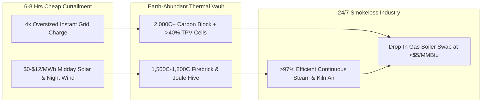

# CARBON EDITION • ABUNDANT CLEAN ENERGY
## Glowing Firebrick & Carbon Thermal Batteries — *Decarbonizing 1,500°C Steel, Cement & Chemicals*

> **The Cynic's Belief:**
> *"Cheap afternoon solar is cute for charging phones, but factories run 24/7 on roaring natural-gas and coal boilers.
> Lithium batteries would bankrupt a cement kiln or chemical refinery—meaning heavy industry is chained to fossil
> flames forever."*
>
> **The 2026 Breakthrough Reality:**
> Industrial process heat (~20% of all global $\text{CO}_2$ emissions) doesn't want electricity—it wants **heat**, and
> storing energy directly in ancient refractory firebrick or solid carbon blocks costs **one-tenth** per kilowatt-hour
> of chemical batteries with zero lithium, cobalt, or rare earths. By late 2026, Rondo Energy's radiant heat batteries
> deliver continuous **$1,500^\circ\text{C}$** industrial steam and air at $>97\%$ thermal round-trip efficiency using
> cheap off-peak solar and wind, while Antora Energy pairs $2,000^\circ\text{C}$ solid-carbon blocks with record $>40\%$
> thermophotovoltaic (TPV) cells, and Electrified Thermal Solutions' *Joule Hive* conductive bricks directly replace
> fossil burners at commercial factories worldwide.

---

## ACT I: A DELIGHTFUL NEAR FUTURE (HUMAN STORY)

At 2:00 AM under a starry, windless sky in California's San Joaquin Valley—and replicated at beverage, food, and chemical
plants from Thailand to northern Germany—master boiler operator Hector Dominguez checks his tablet beside a silent,
cool-to-the-touch insulated steel cube the size of a tennis court.

Ten hours earlier, between 10:00 AM and 4:00 PM when valley solar farms flooded the wholesale grid with \$4/MWh surplus
sunshine, resistive radiant elements inside that steel shell heated 3,000 tons of stacked clay-alumina firebricks until
its core glowed like miniature sunstone at $1,480^\circ\text{C}$:

* **24/7 Superheated Steam From Yesterday's Noon Sun:**
  Right now at 2:00 AM, closed-loop air glides through channels in the glowing brick stack and exits into the plant's
  existing steam boiler at a rock-steady $550^\circ\text{C}$ (or up to $1,500^\circ\text{C}$ for adjacent glass and lime
  kilns). The factory's four roaring natural-gas burners sit cold and retired—eliminating 45,000 tons of $\text{CO}_2$
  and $100\%$ of local nitrogen-oxide ($\text{NO}_x$) smog every year.
* **Cheaper Than Fracked Gas—Even Without Subsidies:**
  Because the battery only sips electricity during the cheapest 6–8 hours of sunny or windy glut—when wholesale prices
  routinely dip near zero or negative—Hector's plant pays **\$4.20 per MMBtu** of delivered continuous heat, undercutting
  volatile pipeline gas while locking in a predictable 35-year fuel budget.
* **Dirt, Sand & Carbon Supply Chain:**
  Nothing inside the thermal vault can catch fire, leak toxic acid, or suffer capacity fade. Clay refractory brick has
  lined steel blast-furnace cowpers for 160 years; Hector's stack is warrantied for 40+ years of daily deep cycling using
  materials dug from ordinary quarries on every continent.
* **Glowing Light Back to Grid Power:**
  Down the road at a food-processing microgrid, an Antora solid-carbon thermal block opens automated tungsten shutters
  during an evening grid peak—shining white-hot thermal light onto solid-state **thermophotovoltaic (TPV)** panels to
  export silent megawatts of electricity *and* process steam simultaneously.

---

## ACT II: SOTA BREAKTHROUGHS, REAL COMPANIES & SYNERGIES

Roughly half of all final energy consumed on Earth is **heat**, not electricity—and industrial process heat alone ($100^\circ\text{C}$
pasteurization steam up to $1,500^\circ\text{C}+$ steel, cement, glass, and ethylene cracking) accounts for **~20% of global
greenhouse gas emissions**. Running a continuous electric heater 24/7 fails economically because evening peak grid tariffs
are expensive; storing electricity in lithium-ion batteries to boil water later wastes money and scarce battery minerals.

### 1. Three Thermodynamic & Photonic Unlocks (2024–2026)
Thermal batteries exploit an asymmetric truth of renewable grids: **6 hours of ultra-cheap midday solar or midnight wind
can power 24 hours of continuous factory heat** when stored directly as high-temperature sensible or latent heat:

* **Stefan-Boltzmann Radiant Uniformity ($q \propto T^4$) up to $1,500^\circ\text{C}$:**
  Early resistive brick heaters melted wires because convective contact transfers heat unevenly. Rondo Energy solved
  high-temperature charging via **thermal radiation** ($q = \varepsilon \sigma (T_{\text{heater}}^4 - T_{\text{brick}}^4)$),
  beaming heat evenly across standard refractory firebrick stacks without hot spots, while **Electrified Thermal Solutions**
  (*Joule Hive*) engineered doped metal-oxide bricks that conduct electricity *directly* through the brick mass itself up
  to **$1,800^\circ\text{C}$**, deleting fragile metallic wire elements completely.
* **Solid-Carbon Blocks + $>40\%$ Thermophotovoltaics (TPV):**
  **Antora Energy** heats inexpensive, ultra-high-density solid carbon blocks (a abundant byproduct of industrial refining
  that stays solid past $3,000^\circ\text{C}$) past **$2,000^\circ\text{C}$**. Pairing glowing carbon with multi-junction
  III-V **thermophotovoltaic (TPV)** cells equipped with back-surface gold infrared mirrors reflects unusable sub-bandgap
  photons right back into the carbon block—vaulting solid-state heat-to-electricity efficiency past **40%** with zero
  moving turbine blades.
* **Miscibility-Gap Alloy (MGA) Phase-Change Bricks:**
  In Australia, **MGA Thermal** embeds microscopic metallic phase-change droplets inside a solid graphite matrix: when
  heated, the tiny internal metal grains melt (storing massive latent heat of fusion $\Delta H_{\text{fus}}$) while the
  outer brick stays rigid and stackable.

> *"Industry uses more energy than transportation or buildings, mostly as heat. By storing low-cost wind and solar in simple
> brick at 1,500°C, clean industrial heat becomes cheaper than fossil fuels today."*
> — **John O'Donnell**, Founder & Co-CEO, Rondo Energy

### 2. Verified 2025–2026 Industrial Thermal Battery Pioneers

| Pioneer / Lab | Core Storage Architecture | Verified 2025–2026 SOTA Milestone | Commercial Factory Offtake & Scale |
| :--- | :--- | :--- | :--- |
| **Rondo Energy & Siam Cement (SCG)** | $1,500^\circ\text{C}$ clay-alumina firebrick radiant heat battery (*RHB*) | Operating commercially since Calgren (CA); scaled SCG Rondo brick line to **90 GWh/yr** manufacturing capacity | Deploying multi-hundred-MWh units for Diageo, Covestro, Eastman & European food/chemical plants |
| **Antora Energy** | $2,000^\circ\text{C}+$ solid carbon thermal blocks + $>40\%$ solid-state TPV | Opened gigawatt-scale US TPV cell factory; backed by \$150M+ Series B (BlackRock, Temasek, Breakthrough Energy) | Delivers combined 24/7 zero-carbon industrial steam + on-demand dispatchable TPV electricity |
| **Electrified Thermal Solutions** | *Joule Hive* electrically conductive doped firebricks (up to $1,800^\circ\text{C}$) | Commissioned commercial-scale *Joule Hive* demonstration (US DOE Industrial Demonstrations awardee) | Direct flame-temperature hot air for cement calciners, glass furnaces, steel & ceramics |
| **MGA Thermal & Kraftblock** | Metallic phase-change graphite blocks (MGA) & recycled slag granules (Kraftblock) | Kraftblock commercial installations at PepsiCo (Netherlands) & steel waste-heat recovery across Germany | Replaces gas boilers in food frying, malting, district heat & foundry waste-heat capture |
| **Kyoto Group (Heatcube)** | Modular molten-salt thermal storage ($500^\circ\text{C}$ steam generation) | Commercial *Heatcube* live at Norbis Park (Denmark) & KALL Ingredients (Hungary), backed by Iberdrola | Turnkey medium-temperature steam decarbonization + grid frequency reserve |

---

## ACT III: REIMAGINING SOCIAL CONVENTIONS & GLOBAL PROOF

For decades, climate policy treated heavy industry ("hard-to-abate sectors") as the last domino that could only move in
2045 via expensive hydrogen pipelines. Thermal bricks flip that script—making factories the *easiest* buyers of curtailed
clean power right now:

1. **Turning Solar "Duck-Curve Curtailment" Into Industrial Gold:**
   In California, Texas, Spain, South Australia, and Chile, solar and wind farms dump millions of megawatt-hours at \$0 or
   negative wholesale prices because midday supply exceeds demand. A single 300 MWh firebrick unit acts as an enormous
   programmable sponge—soaking up 75 MW during solar noon so solar developers stay profitable while factories get sub-gas
   fuel.
2. **Keep the Factory Boiler, Just Swap the Firebox:**
   Factory managers hate multi-month shutdowns. Thermal batteries sit *outside* the existing plant wall and pipe superheated
   air or steam straight into the facility's existing heat-recovery steam generator (HRSG) or kiln manifold during a routine
   weekend maintenance window—preserving union boilermaker jobs while deleting stack emissions.
3. **Stanford 149-Country Firebrick Study Validation:**
   Peer-reviewed modeling by Prof. Mark Jacobson's team at Stanford (*PNAS Nexus*) confirmed that refractory firebrick
   thermal storage slashes global 100%-renewable grid capital costs by **\$1.27 trillion** across 149 countries compared
   to relying on batteries and hydrogen alone.

| Trajectory Metric | 2026 Baseline | 2030 Sprint | 2035 Scaling | 2040 Maturity |
| :--- | :--- | :--- | :--- | :--- |
| **Thermal Capex (\$/kWh-th)** | **\$15–\$28/kWh-th** installed turnkey (~$1/5$ of Li-ion batteries) | **\$10–\$16/kWh-th** via automated brick-kiln modular skids | **\$6–\$10/kWh-th** standardized container & silo arrays | **<\$6/kWh-th** commodity quarry-brick infrastructure |
| **Delivered Heat Cost** | \$5.50–\$8.00/MMBtu in high-solar/wind regions | **\$3.50–\$5.00/MMBtu** (beats fossil gas across EU, Asia & US) | **\$2.20–\$3.50/MMBtu** paired with <\$10/MWh tandem solar | **<\$2.00/MMBtu** universal smokeless industrial heat |
| **Max Operating Temp** | $1,500^\circ\text{C}$ (Rondo) to $1,800^\circ\text{C}$ (*Joule Hive* commercial) | Full commercial integration on cement calciners & crackers | $2,000^\circ\text{C}+$ carbon + 45%+ TPV cogeneration fleets | 100% fossil-burner retirement across steam, lime, glass & food |
| **Global Fleet Capacity** | ~2–4 GWh-th operational & under commissioning | **90+ GWh-th** deployed across US, EU, ASEAN & Australia | **800+ GWh-th** soaking up terawatt-scale midday solar | Multi-terawatt-hour industrial heat & grid sponge |

---

## ACT IV: THE SYNERGY CASCADE

Glowing brick and carbon vaults act as the universal adapter between intermittent sub-penny sunshine and 24/7 physical
manufacturing:

* **The Ultimate Sponge for Tandem Solar booms:**
  Every gigawatt of [35.5% Perovskite-Silicon Tandem Solar](../perovskite-tandem-solar/REPORT.md) built in sunny belts
  finds an insatiable midday buyer in industrial firebrick yards—preventing wholesale price cannibalization.
* **Zero-Coal Steel, Cement & Sky Fuels:**
  Combining $1,500^\circ\text{C}\text{--}1,800^\circ\text{C}$ solid-brick heat with
  [Turning Thin Air into Jet Fuel, Green Steel & Stone](../synthetic-sky-fuels/REPORT.md) drives high-temperature
  calcination, Fischer-Tropsch synthesis, and solid-oxide steam electrolysis ($\text{SOEC}$) at peak efficiency.
* **Multi-Day Grid Backup Teammate:**
  Alongside [100-Hour Iron-Air & Sodium Storage](../iron-sodium-storage/REPORT.md), Antora's $>40\%$ TPV carbon blocks
  ride through multi-day winter wind lulls while co-heating industrial parks and
  [Symbiotic Civic District Networks](../symbiotic-civic-data-centers/REPORT.md).

---

## References & Verified Sources

* **Featured Leader:** [John O'Donnell — Founder & Co-CEO, Rondo Energy](https://rondo.com/)
* **Companies & Labs:** [Rondo Energy & SCG](https://rondo.com/) · [Antora Energy](https://antora.com/) · [Electrified Thermal Solutions (*Joule Hive*)](https://electrifiedthermal.com/) · [MGA Thermal](https://www.mgathermalstorage.com/) · [Kraftblock](https://kraftblock.com/en/) · [Kyoto Group (*Heatcube*)](https://www.kyotogroup.no/)
* **Global & Peer-Reviewed Precedents:** [Stanford 149-Country Firebrick Decarbonization Study (*PNAS Nexus*)](https://academic.oup.com/pnasnexus) · [Rondo Calgren Commercial Operation & SCG 90 GWh Factory](https://rondo.com/) · [Antora >40% Efficiency Solid-State Thermophotovoltaic Cell (*Nature*)](https://antora.com/technology/) · [PepsiCo Netherlands Zero-Gas Kraftblock Thermal Plant](https://kraftblock.com/en/)
* **Connected Carbon Pathways:** [35.5% Perovskite-Silicon Tandems & Living Solar Skins](../perovskite-tandem-solar/REPORT.md) · [Turning Thin Air into Jet Fuel, Green Steel & Stone](../synthetic-sky-fuels/REPORT.md) · [Rust & Table Salt: 100-Hour Iron-Air & Sodium Grid Storage](../iron-sodium-storage/REPORT.md) · [Symbiotic Terrestrial Data Centers](../symbiotic-civic-data-centers/REPORT.md)
