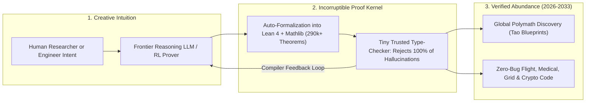

# Hallucination-Free Genius: Lean 4, AlphaProof & Co-Pilot Discovery
**Pillar 2: Embodied AI, Robotics & Self-Driving Science — Carbon Edition**

> **The Cynic's Reflex:**
> *"Large language models are fluent BS artists—they hallucinate fake legal citations, invent subtle off-by-one bugs, and can never be trusted to prove deep mathematics or run nuclear grids, surgical lasers, and passenger aircraft."*
>
> **The 2026 Breakthrough Reality:**
> The "AI hallucinates" objection has been permanently solved for deductive truth by coupling creative neural reasoning models with **uncheatable formal proof kernels** led by **Lean 4**. By late 2026, Lean's open **Mathlib** library surpassed **290,000 formally verified theorems and 130,000 definitions**, DeepMind's **AlphaProof** and **AlphaGeometry** conquered International Mathematical Olympiad challenges, AWS formally verified its global **Cedar** cloud security engine in Lean 4, and Fields Medalist **Terence Tao** turned solitary decade-long proof refereeing into joyous global polymath symphonies.

---

## Act I: Zero-Bug Skies and a Global Symphony of Minds — A Human Story from 2030

Rain lashes sideways across Zürich Airport at midnight in December 2030 as Captain Lukas Weber monitors the descent of a
180-passenger hydrogen-electric airliner through severe Alpine wind shear. Outside the cockpit glass, visibility is zero.
Inside, Lukas feels calm—not because he trusts an opaque neural network's statistical hunch, but because every single line of
the aircraft's flight-envelope and battery-management software carries a **cryptographic Lean 4 Mathematical Certificate**.

Three years earlier, aerospace safety engineers stopped relying on "99.9% unit-test coverage"—the old software standard where
one unhandled edge case could still bring down a plane or crash hospital infusion pumps worldwide:

* **Auto-Formalized Safety Kernels:** When avionics engineers wrote the wind-shear recovery controller, an AI formalization co-pilot translated the physical differential equations and Rust/C control code into **Lean 4**, then generated a machine-checked proof across *every mathematically possible sensor combination*—proving with $100\%$ logical certainty that no buffer overflow, deadlock, or control-surface oscillation can ever occur.
* **Meanwhile, in Mérida & UCLA:** Six thousand miles away in Mérida, Mexico, nineteen-year-old community-college student Mateo Ríos sits at a café laptop contributing a lemma to an open **Polymath Fluid-Dynamics Blueprint** coordinated by Fields Medalist Terence Tao. Mateo doesn't have an Ivy League pedigree, so fifty years ago no top journal editor would have spent two years reading his thirty-page manuscript.
* **Instant Trust Without Gatekeeping:** Today, Mateo sketches his intuitive geometric insight in plain Spanish; his open-source **Lean 4 AI Co-Pilot** translates the steps into formal tactics, catches a subtle boundary-condition slip in four seconds, helps him repair it, and passes the **2,500-line trusted Lean kernel**. Within ten seconds of Mateo hitting `git push`, the project's continuous-integration server turns green—unlocking a breakthrough turbulence bound immediately usable by fusion-tokamak and wind-turbine engineers worldwide.

---

## Act II: How Neural Intuition + Tiny Trusted Kernels Defeated Hallucination

To understand why **Neuro-Symbolic Auto-Formalization** is one of the most consequential leaps in the history of science,
consider how complementary two kinds of minds are:
1. **Frontier Neural Models** possess dazzling creative intuition—capable of guessing promising analogies across ten thousand theorems—yet left alone in natural language, a single plausible-sounding leap can hide a fatal logical flaw.
2. **Formal Proof Assistants (Lean 4, Rocq/Coq, Isabelle)** contain tiny, auditable logical kernels (just a few thousand lines of code) that enforce the axioms of mathematics like an incorruptible chess referee. **You cannot sweet-talk, bluff, or hallucinate past the Lean 4 type-checker.** Either every logical step compiles down to foundational axioms, or the kernel rejects it instantly with exact diagnostic feedback.

Between 2024 and late 2026, putting the neural creative engine inside a reinforcement-learning loop with the Lean 4 referee
ignited a runaway flywheel.

### 1. Lean 4 & Mathlib: Humanity's Unified, Machine-Checked Tree of Knowledge
Created by **Leonardo de Moura** (now Chief Architect of the **Lean Focused Research Organization**), Lean 4 is both an
expressive interactive theorem prover and a fast functional programming language:
* **Exponential Mathlib Growth:** Maintained by thousands of mathematicians and computer scientists globally, **Mathlib** crossed **290,000+ formally verified theorems and 130,000+ definitions** in 2026—unifying algebra, topology, measure theory, probability, and differential equations into one coherent, searchable software dependency tree where zero contradictions can hide.
* **Terence Tao's Blueprint Revolution:** In 2023–2026, Terence Tao spearheaded modular **Lean Blueprints** (such as formalizing the Polynomial Freiman-Ruzsa conjecture in just three weeks with two dozen online collaborators, followed by Carleson's theorem and equational theories). Complex proofs decompose into visual dependency graphs where dozens of human mathematicians and AI provers tackle sub-lemmas in parallel without ever needing to blindly trust each other's algebra!

### 2. Olympiad-Scale Reasoning: AlphaProof, AlphaGeometry & Open Provers
* **Google DeepMind (*AlphaProof* & *AlphaGeometry 2*):** Trained via AlphaZero-style reinforcement learning over millions of auto-formalized Lean statements, *AlphaProof* + *AlphaGeometry 2* achieved **Silver-Medal / Gold-threshold performance** on International Mathematical Olympiad (IMO) problems in 2024 and rapidly scaled to research-level lemmas by 2025–2026—inventing non-obvious intermediate constructions that stunned human Olympiad coaches.
* **Frontier Verification Startups & Open Ecosystems (*Harmonic / Aristotle*, *DeepSeek-Prover*, *LeanDojo*, *Symbolica*):** Open-weight and commercial mathematical superintelligence models mastered whole-repository tactic synthesis and **auto-formalization**—translating informal LaTeX papers and legacy C/Rust codebases into verified Lean specifications at 100x the speed of manual 2020 proof engineering.

### 3. Production Zero-Bug Software: From AWS Cedar to Medical & Grid Infrastructure
* **AWS *Cedar* Authorization Engine:** Amazon Web Services wrote the formal model and safety proofs of **Cedar**—the policy language guarding billions of daily cloud permissions—directly in **Lean 4**, proving mathematical soundness while differential testing millions of randomized inputs against production Rust code.
* **DARPA *TRACTOR* & Verified Systems:** Automated AI translation of legacy memory-unsafe C code into formally verified Rust and Lean-backed microkernels (building on *seL4*) slashed formal software verification costs from \$10,000 per line of code toward routine continuous integration.

### Comparing Verification Paradigms: Informal Prose & Unit Tests vs. Neuro-Symbolic Lean 4

| Verification Dimension | Legacy Software & Math Status Quo (2015–2023) | 2026–2030 Neuro-Symbolic Formal Stack (AI + Lean 4) | Real-World Consequence |
| :--- | :--- | :--- | :--- |
| **LLM Hallucination Risk** | High (plausible-sounding algebra or code bugs slip by) | **0.00% Accepted** (Lean 4 kernel rejects any invalid step) | Total deductive certainty even when AI explores 1M wild guesses |
| **Software Testing Coverage** | Finite unit/fuzz tests (~0.001% of state space) | **Exhaustive Symbolic Proof** (100% of mathematical inputs) | Eliminates buffer overflows, race conditions & integer wraparounds |
| **Research Peer Review** | 2–6 years of unpaid human journal refereeing | **<15 Seconds** automated Continuous Integration check | Unlocks 50-person global collaborations with zero trust friction |
| **Library Reusability** | Isolated PDF papers with incompatible notation | **290,000+ Unified Mathlib Theorems** (`import Mathlib`) | Physics, control theory & cryptography share one bedrock tree |
| **Cost per Critical Module** | \$2M+ and 18 months of rare PhD formal-methods labor | **95% AI-synthesized proof tactics** reviewed by engineers | Makes aerospace-grade zero-bug code affordable for local utilities |

### Answering "Who Checks the Checker?" — Why Tiny Trusted Kernels Work
Skeptics rightly ask: *"What if Lean 4 itself has a bug?"*
Formal verification solves this through **extreme architectural asymmetry**:
1. **Tiny Independent Checkers:** While an AI prover may have 200 billion parameters, Lean's logical kernel can be independently re-implemented from scratch in fewer than **2,500 lines of clean Rust, C, or Haskell** (such as independent external checkers *Nanoda* and *Lean4Lean*). Every critical proof is cross-checked by multiple independent tiny kernels written in different languages!
2. **Transparent Human-Readable Specs:** Engineers only need to audit the short **20-line human specification** (e.g., *"Infusion pump bolus never exceeds 5 milligrams per hour"*), not the 50,000 lines of machine-generated intermediate proof steps.
3. **Zero Trust Required in the AI:** Even an adversarial or buggy AI model *cannot* trick the kernel into certifying a false theorem without breaking foundational logic itself.

> *"In 10 to 15 years' time, we'll be in a new golden era of discovery—an era of incredible productivity and radical abundance."*
> — **Sir Demis Hassabis**, Co-Founder & CEO of Google DeepMind & 2024 Nobel Laureate

### 4. Leading Pioneers & Verified Milestones (2024–2026)

| Organization / Project | Core Breakthrough | Verified 2024–2026 Real-World Impact |
| :--- | :--- | :--- |
| **Lean FRO & Mathlib Community** (*Leonardo de Moura*) | Lean 4 language + unified formal mathematics repository | Surpassed **290,000 verified theorems & 130,000 definitions** in 2026; industry standard for AI-math integration. |
| **Google DeepMind** (*AlphaProof* & *AlphaGeometry 2*) | RL search inside Lean + neuro-symbolic geometry | Solved IMO Olympiad proofs with zero human hints; proving novel research-grade mathematical sub-goals. |
| **Terence Tao & Polymath Collaborations** | Modular Lean Blueprint graphs (PFR, Carleson, Equational) | Compressed multi-year peer-review bottlenecks into **3-week global open-source collaborations** of 20–50 contributors. |
| **Amazon Web Services (AWS)** (*Cedar* in Lean 4) | Industrial-scale formal security policy verification | Formally proved core security invariants of AWS Cedar authorization policies guarding global cloud infrastructure. |
| **Harmonic (*Aristotle*), LeanDojo & DeepSeek-Prover** | Auto-formalization & open tactic-generation models | Automated translation of informal LaTeX proofs and software specs into compiling Lean 4 code. |
| **seL4 Foundation & Verified Systems** | Mathematically proven OS microkernels + AI proof co-pilots | Zero-exploit safety isolation deployed in autonomous aviation, medical devices, and critical power-grid relays. |

---

## Act III: Reimagining Social Conventions — Ending Bug Fatalities, Cyber Ransomware & Academic Silos

For fifty years, society accepted a bizarre double standard: nobody would drive across a steel bridge if the civil engineer
shrugged and said, *"It probably holds trucks, though patch Tuesday will fix collapsed girders later."* Yet we ran hospitals,
power grids, water plants, and banks on unverified software riddled with memory exploits and race conditions!

1. **Retiring "Move Fast and Break Critical Infrastructure":**
   Ransomware shutdowns of children's hospitals and buggy crowd-sourced kernel updates costing \$10 billion in grounded flights become relics of the pre-formal era. Regulatory bodies increasingly require **Machine-Checkable Proof Certificates** for pacemakers, insulin pumps, autonomous braking, humanoid torque limiters, and grid inverters—feasible at last because AI co-pilots write 95% of the tedious proof scaffolding automatically.
2. **Science Without Pedigree Gatekeeping:**
   Historically, famous mathematicians still waited three to eight years for exhausted unpaid referees to verify a 200-page proof (and subtle errors often went unnoticed for decades). With Lean Blueprints, a brilliant student in Lagos, Mérida, or rural Kentucky contributes side-by-side with Fields Medalists—because the Lean kernel checks truth blindly, instantly, and without bias.
3. **Physics-Exact Engineering Design:**
   Formalized partial differential equations and control proofs eliminate conservative "3x guesswork safety padding" in aerospace structures, tokamak magnetic plasma confinement, and smart-grid power routing.

### Global Precedents & Institutional Proof Points
* **Lean Focused Research Organization (Lean FRO):** Philanthropically backed public-good engineering organization ensuring Lean 4 and Mathlib remain 100% open-source, fast, and free from proprietary lock-in forever.
* **FAA DO-178C Formal Methods Credits & EU Cyber Resilience Standards:** Aviation and European critical-infrastructure regulators explicitly grant certification credit for formal mathematical verification in safety-critical systems.
* **Ethereum, StarkWare & Zero-Knowledge Formal Verification:** Billions of dollars in cryptographic state transitions already verify mathematical correctness via Lean and formal proof circuits before execution.

### Four Everyday Lives Saved by Formally Verified Software by 2031
* **Hospital Infusion Pumps & Radiation Linear Accelerators:** Mathematically impossible for dose-calculation race conditions (like the historic Therac-25 tragedy) or ransomware memory exploits to harm a patient.
* **Continental High-Voltage Renewable Microgrids:** Inverter firmware proven free of cascading frequency oscillations during sudden cloud-cover or storm surges.
* **Autonomous Braking & Aviation Flight Envelopes:** Deterministic stopping-distance and collision-avoidance shields wrapping every neural driving and eVTOL policy.
* **Privacy-Preserving Civic Digital IDs:** Zero-knowledge cryptographic wallets formally verified in Lean 4 so citizens prove age or residency without ever leaking personal databases.

### Trajectory of AI-Assisted Formal Mathematics & Verified Engineering

| Stage & Era | Mathlib / Verified Corpus Scale | Cost to Formally Verify 10k Lines of Critical Code | Mathematical Collaboration Speed | Societal Safety & Discovery Dividend |
| :--- | :--- | :--- | :--- | :--- |
| **2022 Pre-LLM Era** | ~90,000 theorems (manual PhD labor) | \$2M – \$5M (18 months of specialist PhDs) | Multi-year lone-author peer review | Limited to tiny aerospace/crypto kernels |
| **Late 2026 SOTA** | **290,000+ theorems**; AlphaProof + Tao Blueprints | \$80k – \$250k (AI tactic co-pilots) | 3-week global modular blueprints | AWS Cedar, Olympiad proofs & verified Rust migration |
| **2029 Inflection** | 2M+ theorems across physics, control & chemistry | <\$5,000 (automated CI/CD proof synthesis) | Real-time 1,000-contributor global polymaths | Mandatory zero-bug certificates for medical & AV code |
| **2033 Abundance** | Universal formalization of undergrad-to-frontier STEM | Near \$0 (native compiler synthesis) | Continuous hallucination-free co-discovery | Critical infrastructure ransomware & bug crashes drop >95% |

---

## Act IV: The Synergy Cascade

AI Formal Mathematics is the **incorruptible trust backbone** safeguarding every physical robot and scientific engine in the Atlas:
* **General-Purpose Humanoids ([`general-purpose-humanoids`](../general-purpose-humanoids/REPORT.md)) & Autonomous Mobility ([`autonomous-ground-mobility`](../autonomous-ground-mobility/REPORT.md)):** Neural VLA brains propose flexible motions, while Lean-verified control-barrier kernels wrap them in an unbreakable mathematical safety shield—guaranteeing a robot can *never* apply dangerous force or violate stopping-distance physics.
* **Quantum Logical Simulation ([`quantum-logical-simulation`](../quantum-logical-simulation/REPORT.md)):** Formalizing quantum error-correcting surface and LDPC decoders in Lean 4 eliminates subtle classical decoder bugs while designing optimal fault-tolerant logical gate circuits.
* **Abundant Fusion & Clean Grids:** Formally verified plasma-control and microgrid frequency-stabilization controllers keep 100%-renewable continental grids rock-steady down to the microsecond.

---

## References & Verified Sources

* **Featured Researcher / Leader:** [Sir Demis Hassabis — Co-Founder & CEO, Google DeepMind & 2024 Nobel Laureate](https://deepmind.google/)
* **Companies, Labs & Consortia:** [Lean FRO & Global Mathlib Community (Leonardo de Moura)](https://lean-lang.org/) · [Google DeepMind (AlphaProof & AlphaGeometry 2)](https://deepmind.google/discover/blog/ai-solves-imo-problems-at-silver-medal-level/) · [Terence Tao & Open Lean Blueprint Consortia](https://terrytao.wordpress.com/) · [Amazon Web Services (Cedar Verified in Lean 4)](https://lean-lang.org/) · [Harmonic (Aristotle), LeanDojo & DeepSeek-Prover](https://leandojo.org/) · [seL4 Foundation & DARPA TRACTOR Verified Systems](https://sel4.systems/)
* **Global & Regulatory Precedents:** [Non-Profit Lean Focused Research Organization (100% Open Bedrock)](https://lean-lang.org/) · [AWS Production Formal Verification of Global Cedar Security Policies](https://www.cedarpolicy.com/) · [FAA DO-178C Formal Methods Certification Credit in Aviation](https://en.wikipedia.org/wiki/DO-178C) · [3-Week Global Polymath PFR & Equational Theories Blueprint Sprints](https://leanprover-community.github.io/)
* **Connected Carbon Pathways:** [Helpful Mechanical Hands: General-Purpose Humanoid Teammates](../general-purpose-humanoids/REPORT.md) · [Streets Returned to People: Safe Autonomous Mobility & Green Boulevards](../autonomous-ground-mobility/REPORT.md) · [Fault-Tolerant Quantum + AI Chemistry Simulators](../quantum-logical-simulation/REPORT.md) · [Making Conquest Obsolete: Resource Sovereignty & Asymmetric Defensive Shields](../../04-social-norms/defensive-shields-peace/REPORT.md)
