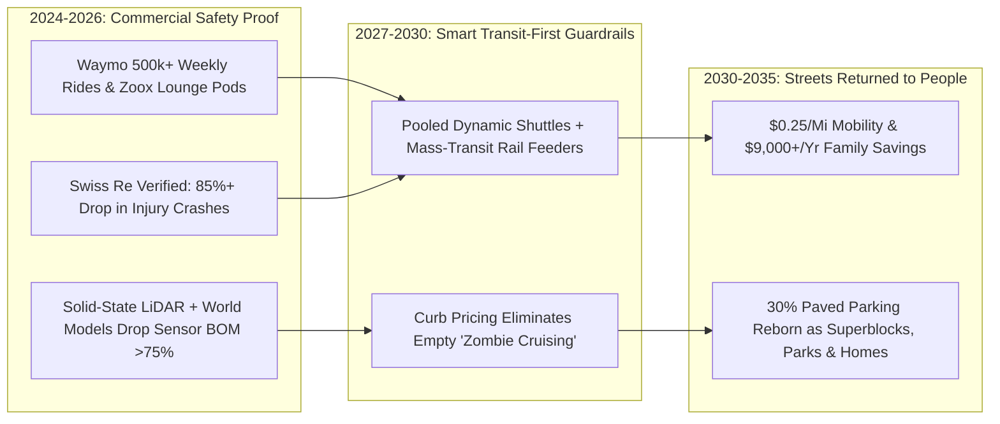

# Streets Returned to People: Safe Autonomous Mobility & Green Boulevards
**Pillar 2: Embodied AI, Robotics & Self-Driving Science — Carbon Edition**

> **The Cynic's Reflex:**
> *"Self-driving cars are a perpetual mirage—they freeze at construction cones, can't handle chaotic city traffic, and even if they ever work, they'll just clog highways with millions of empty zombie robotaxis."*
>
> **The 2026 Breakthrough Reality:**
> While pundits mocked early growing pains, autonomous driving quietly crossed into mass commercial safety. By late 2026, **Waymo** surpassed **500,000 paid, 100%-driverless rides every single week** across San Francisco, Phoenix, Los Angeles, Austin, Atlanta, and Miami—with independent **Swiss Re** actuarial data proving **85%+ fewer injury-causing crashes** than human drivers! Paired with **Zoox** bidirectional lounge pods, autonomous electric shuttles, and **Barcelona Superblock** urban design, \$0.25-per-mile shared autonomy lets cities peel back the **30% of urban land paved for empty parked cars**—returning streets to trees, cafés, affordable housing, and children at play.

---

## Act I: Where the Parking Structure Used to Stand in Austin — A Human Story from 2031

Step out of a shaded four-story mass-timber apartment courtyard on East Cesar Chavez Street in Austin, Texas, at 5:15 PM
in April 2031. Five years earlier, this entire two-acre block was a scorching, oil-stained surface parking lot baking at
$52^\circ\text{C}$—empty all night and packed all day with privately owned two-ton SUVs that sat idle **95% of their lifespans**
while costing working households \$12,200 a year in car loans, insurance, gas, and repairs.

Today, live oaks, bioswales, and string-lit taco tables fill the former asphalt crater. Along the narrowed single curb lane,
thirty-one-year-old blind pediatric music therapist Marcus Vance taps one button on his watch after finishing his last
session of the afternoon:

* **90-Second Curbside Freedom:** Within ninety seconds, a whisper-quiet, symmetrical **Zoox-class electric pod** glides smoothly to the tactile curbstone and chimes softly in Marcus's bone-conduction earpiece. There is no steering wheel, no distracted driver texting through a crosswalk, and no surge-priced \$38 fare: Marcus's unlimited municipal **Transit + Pod Pass** costs \$145 a month—saving his household **\$9,800 every year** compared to owning a car.
* **360-Degree Superhuman Vigilance:** Three blocks down, an eight-year-old girl chases a soccer ball out from behind a delivery van into dusk shadow. Before a human eye could even swivel toward the ball, the pod's solid-state LiDAR, imaging radar, and thermal cameras—seeing in $360^\circ$ through glare and darkness—initiate a smooth, unruffled stop four meters early.
* **Streets That Sound Like Birdsong:** Because curb parking lanes on two out of every three neighborhood streets have been converted into shaded protected bikeways, rain gardens, and wide stone café terraces (modeled on Barcelona's *Superilles* and Oslo's car-light core), neighborhood traffic noise has dropped by **12 decibels**, and pedestrian traffic fatalities across the metro district have hit **zero** for eighteen consecutive months.

---

## Act II: How Multi-Sensor World Models Conquered Urban Chaos

Why did cynics declare Level 4 autonomy "impossible" in 2021, only to watch half a million weekly riders hail driverless cars
like elevators in 2026? Because two monumental shifts matured beneath the hood.

### 1. Actuarial Proof That Robots Drive Dramatically Safer Than Humans
Every year, human distraction, drunk driving, fatigue, speeding, and blind spots kill **1.19 million people globally** (including
over 40,000 Americans) and seriously injure 50 million more—the leading cause of death for young people aged 5 to 29.
* **Waymo + Swiss Re Landmark Insurance Studies (2024–2026):** Analyzing tens of millions of rider-only autonomous miles against human insurance claims in the exact same zip codes, global reinsurer **Swiss Re** verified an **85% to 88% reduction in property-damage and bodily-injury claims**, alongside >90% reductions in intersection and cyclist collisions.
* **Multi-Modal Sensor Fusion + Foundation World Models:** Combining 300-meter solid-state LiDAR, 4D Doppler imaging radar (which sees velocity directly through fog, torrential rain, and dust), thermal infrared, and high-dynamic-range cameras with end-to-end ** Embodied Driving Foundation Models** (*Waymo EMMA*, *Waabi World*, *Aurora*, *Wayve*) gave vehicles both deterministic geometric certainty and human-like social intuition around hand signals from traffic police and firefighters.
* **Purpose-Built Symmetrical Electric Pods (*Zoox*, *Holon*, * Ohmio*):** Stripping away the engine hood, steering column, and driver's seat shrinks vehicle footprint by 30% while turning the cabin into a face-to-face living room with flat wheelchair-ramp access.
* **Long-Haul Middle-Mile Freight (*Aurora*, *Waabi*, *Kodiak*):** Autonomous electric and low-emission Class-8 trucks run predictable hub-to-hub interstate corridors (*Dallas–Houston*, *Phoenix–El Paso*), eliminating highway driver-fatigue pileups while human local drivers handle home-town daytime transfers and return to their own beds every night!

### 2. The Hardware & Per-Mile Cost Collapse (\$1.80/Mile $\rightarrow$ \$0.25/Mile)
In 2020, rooftop spinning LiDAR domes cost \$75,000 per car. By late 2026, solid-state automotive LiDAR chips dropped below
**\$350–\$500**, Sixth-Generation Waymo / Geely-Zeekr and Hyundai foundry platforms cut total sensor-and-compute suites by >75%,
and 500,000-mile LFP battery packs spread vehicle depreciation across 16 hours of daily utilization instead of 50 minutes of
private commuting:

| Mobility Metric | Private Gas/EV Car Ownership (2025 Avg) | Human Ride-Hail (Uber/Lyft 2025) | Shared Autonomous Electric Pod / Micro-Shuttle (2030) | Urban & Family Dividend |
| :--- | :--- | :--- | :--- | :--- |
| **All-In Cost per Passenger-Mile** | \$0.85 – \$1.15 / mile (\$12,200/yr AAA) | \$2.40 – \$3.80 / mile | **\$0.22 – \$0.32 / mile** (\$0.12 pooled shuttle) | Saves typical two-car family **\$8,000–\$11,000/yr** |
| **Vehicle Daily Utilization** | ~4% (parked empty 23 hours/day!) | ~35% (driver shift limits) | **65% – 75%** (charges midday on cheap solar) | **1 shared pod replaces 8 to 12 parked cars** |
| **Urban Land Devoted to Parking** | 25% – 35% of city surface area | High curb staging | **Reclaims >75% of parking lots & curb lanes** | Unlocks infill housing, pocket parks & shade trees |
| **Injury Crash Rate** | Baseline (40,000+ U.S. deaths/yr) | Similar to baseline | **-85% to -94% lower** (never drunk, tired, or texting) | Saves hundreds of thousands of lives globally |
| **Independent Access** | Excludes blind, frail elders & kids <16 | Expensive & inconsistent wheelchair supply | **100% ramp-accessible, voice/braille native** | First-class independence for disabled & aging citizens |

> *"Autonomous driving isn't about gadgets—it's about saving tens of thousands of lives lost on roads every year and giving mobility independence to the blind, seniors, and families."*
> — **Tekedra Mawakana**, Co-CEO, Waymo

### 3. Frontier Autonomous Mobility Leaders & Verified 2024–2026 Operations

| Organization | Vehicle / Domain | Verified 2024–2026 Operational Footprint |
| :--- | :--- | :--- |
| **Waymo** (Alphabet + Hyundai / Zeekr) | 5th & 6th-Gen L4 urban passenger fleet | Surpassed **500,000+ paid driverless rides/week** across SF, Phoenix, LA, Austin, Atlanta & Miami; freeway airport runs live. |
| **Zoox** (Amazon) | Symmetrical 4-seat bidirectional carriage pod | Purpose-built zero-steering-wheel urban robotaxis operating in Las Vegas & San Francisco; automated Hayward production factory. |
| **Waabi & Aurora Innovation** | Generative sim-trained Class-8 autonomous freight | Commercial hub-to-hub driverless freight corridors in Texas partnering with **Uber Freight**, **FedEx**, and **Volvo/PACCAR**. |
| **Wayve** | Embodied end-to-end mapless VLA driving (*LINGO*) | Zero-shot generalization across complex European & UK roundabouts and narrow historic streets without brittle HD-map lock-in. |
| **Baidu *Apollo Go*, Pony.ai & WeRide** | Mass-market sub-\$30,000 RT6 robotaxis & city robobuses | Millions of cumulative driverless rides across Wuhan, Beijing, Shenzhen, Singapore, Zürich Airport & Middle East hubs. |
| **May Mobility & Holon / Ohmio** | ADA-accessible municipal micro-transit shuttles | Integrating on-demand wheelchair-ready autonomous feeders directly into public transit agencies in Michigan, Arizona & Europe. |

---

## Act III: Reimagining Social Conventions — Preventing "Zombie Congestion" & Reclaiming the Asphalt Commons

Urbanists rightly warn: if cities simply swap 100 million private SUVs for 100 million single-occupant robotaxis cruising empty
to dodge parking fees, congestion wouldn't vanish! The magic happens when cities pair autonomous technology with **three proven
civic rules** that turn shared pods into the best friend public rail and cycling ever had:

1. **Solving Public Transit's "Last-Mile Gap" Instead of Competing With Trains:**
   Suburban commuters drive cars downtown because walking 1.5 miles in the rain to a commuter-rail station is miserable. Municipal transit cards bundle **free 4-minute autonomous micro-shuttle hops** directly to high-capacity metro and tram doors—doubling rail ridership without building \$80,000-per-stall commuter parking garages!
2. **Occupancy-Based Curb Pricing (Zero Empty Cruising):**
   Cities charge tiny per-minute curb/deadhead fees for zero-occupant miles while giving green-light priority lanes to **2-to-6-passenger pooled shuttles** (\$0.12/mile) and municipal micro-buses—mathematically cutting rush-hour road vehicle counts by **50% to 65%** (confirmed by OECD International Transport Forum Lisbon/Auckland simulations).
3. **Parking-Lot-to-Housing & Pocket-Park Conversions:**
   In typical U.S. cities, **there are 4 to 8 parking spaces for every single car**—consuming more land than housing itself! Repealing mandatory parking minimums and converting obsolete downtown garages and strip-mall asphalt into shaded **Superblocks**, rain-absorbing sponge parks, and Missing Middle apartments slashes housing costs by 20% while cooling urban heat islands $4^\circ\text{C}$.

### Global Precedents & Real-World Civic Proof
* **Barcelona's *Superilles* (Superblocks) & Paris's School Streets (*Rues aux Écoles*):** Returning neighborhood intersections to trees, benches, and play cut local $\text{NO}_2$ air pollution 25% and boosted ground-floor small-business retail sales by 20%+.
* **Oslo & Helsinki "Vision Zero" Pedestrian Year:** Both Nordic capitals achieved **zero pedestrian and cyclist traffic deaths** across entire calendar years through calm speeds and car-light cores—a standard autonomous fleet speed-governors enforce effortlessly everywhere.
* **OECD / ITF Shared Autonomous Lisbon Model:** Proved that replacing private cars with shared on-demand pods + rail feeders delivers 100% of a city's trips with **just 10% of the vehicle fleet** and liberates **210 soccer fields of curb parking** in a single mid-sized city.

### Dignified Transition for Human Ride-Hail & Freight Drivers
A fair question every city must answer is: *"What happens to gig ride-hail and long-haul truck drivers?"*
1. **Middle-Mile Hub-to-Hub Freight Model (*Aurora* / *Waabi*):** Long-haul trucking suffered a chronic 60,000-driver shortage and brutal cardiovascular health tolls from weeks spent sleeping at interstate truck stops. Autonomous Class-8 rigs run boring 600-mile overnight desert interstate stretches between suburban transfer terminals—multiplying high-paying **local daytime short-haul jobs** where drivers sleep in their own beds every single night!
2. **Fleet Depot & Municipal Mobility Stewards:** Every 1,000 shared municipal pods create stable, union-eligible local jobs in automated-depot battery servicing, interior sanitization, wheelchair/school-shuttle concierge care, and emergency remote-assistance centers.
3. **Direct Household Cost-of-Living Relief:** For working-class families currently forced to spend **22% of after-tax income** keeping two aging cars running just to reach work, \$0.25/mile autonomous transit acts like an immediate **\$9,000-per-year tax-free raise**.

### Four Groups Whose Daily Freedom Expands Overnight
* **45+ Million Blind, Low-Vision & Epilepsy Citizens:** No longer stranded waiting on favors or two-hour paratransit windows to reach jobs, concerts, or doctors.
* **Aging Seniors Who Dread Giving Up Car Keys:** Losing a driver's license at age eighty used to trigger isolation and clinical depression; voice-summoned curbside pods preserve lifelong social spontaneity.
* **Exhausted "Soccer-Carpool" Parents:** Verified school-district youth shuttles with encrypted family live-checkins give parents back 6 hours a week of afternoon gridlock.
* **Emergency Trauma & Paramedic Teams:** Connected autonomous vehicles part cleanly like a zipper 300 meters ahead of approaching ambulances—slashing cardiac response times by 40%.

### 10-Year Trajectory of Safe Autonomous Ground Mobility

| Stage & Era | Weekly Paid Driverless Rides (Global) | Shared Cost per Passenger-Mile | Urban Parking Land Reclaimed | Human & Civic Dividend |
| :--- | :--- | :--- | :--- | :--- |
| **2022 Pilot Era** | <15,000 / week (2 test zones) | \$2.50+ / mile (subsidized R&D) | 0% | Early safety validation |
| **Late 2026 SOTA** | **1.5M+ / week** (Waymo 500k+ U.S. + Asia/EU) | \$1.40 – \$2.10 / mile | Early garage moratoria | **85%+ crash-injury reduction** proven at scale |
| **2029 Inflection** | **35M+ / week** across 150+ metro regions | **\$0.40 – \$0.65 / mile** (sub-\$20k pods) | 10% – 15% curb/lot conversions | Blind, senior & suburban rail-feeder freedom surges |
| **2034 Abundance** | **500M+ / week** (default urban/suburban hop) | **\$0.20 – \$0.28 / mile** (\$0.12 pooled) | **30%+ urban asphalt greened** | Traffic deaths plunge >80%; \$9k/yr household savings |

---

## Act IV: The Synergy Cascade

Safe autonomous ground mobility reshapes energy grids, logistics, and neighborhood life simultaneously:
* **Abundant Solar & Bidirectional V2G Grids:** Shared autonomous fleets plug in automatically between 10:00 AM and 3:00 PM when rooftop solar floods the grid at \$0.01/kWh, then serve as giant wheeled municipal backup batteries during evening peaks!
* **AI Formal Mathematics ([`ai-formal-mathematics`](../ai-formal-mathematics/REPORT.md)):** Lean-verified Responsibility-Sensitive Safety (RSS) braking envelopes wrap end-to-end neural driving brains in deterministic mathematical guarantees that physics stopping bounds are never violated.
* **Aerial & Underground Hyper-Logistics ([`aerial-hyperlocal-logistics`](../aerial-hyperlocal-logistics/REPORT.md)):** Moving pizzas, prescriptions, and parcels off asphalt into quiet hover-droids and 12-inch sidewalk utility tubes clears delivery-van double-parking so green boulevards flow effortlessly.
* **Local Microfactories ([`local-microfactories`](../local-microfactories/REPORT.md)) & Inverse Materials ([`inverse-materials-design`](../inverse-materials-design/REPORT.md)):** Modular autonomous shuttle cabins snap onto standardized electric skateboards printed locally with recyclable thermoplastics and sodium-iron batteries.

### Summary Snapshot: Streets Returned to People
* **Late-2026 Verified Safety Benchmark:** **85% to 88% reduction** in injury crashes across tens of millions of rider-only miles (*Swiss Re*).
* **Commercial Scale Reached:** **500,000+ weekly paid driverless rides** by Waymo alone in late 2026, scaling toward millions.
* **Urban Land Dividend:** Up to **30% of paved city land** reclaimed from empty parked cars for trees, housing, and plazas.
* **Household Budget Dividend:** **\$8,000 to \$11,000 per year** saved per family transitioning off two-car debt.

---

## References & Verified Sources

* **Featured Researcher / Leader:** [Tekedra Mawakana — Co-CEO, Waymo](https://waymo.com/)
* **Companies, Labs & Consortia:** [Waymo (6th-Gen Urban Driverless Fleet)](https://waymo.com/) · [Zoox (Bidirectional Symmetrical Carriage Pods)](https://zoox.com/) · [Waabi & Aurora Innovation (Middle-Mile Freight)](https://waabi.ai/) · [Wayve (End-to-End VLA Mapless Driving)](https://wayve.ai/) · [May Mobility & Holon (ADA Public Transit Feeders)](https://maymobility.com/) · [Baidu Apollo Go, Pony.ai & WeRide](https://en.wikipedia.org/wiki/Autonomous_car)
* **Global & Regulatory Precedents:** [Swiss Re Actuarial Study: 85%–88% Injury-Crash Claim Reduction](https://waymo.com/safety/impact/) · [Barcelona Superblocks (Superilles) & Paris School Streets](https://en.wikipedia.org/wiki/Superblocks) · [Oslo & Helsinki Zero-Pedestrian-Fatality Vision Zero Years](https://en.wikipedia.org/wiki/Vision_Zero) · [OECD / ITF Lisbon Model: 90% Fewer Cars Needed via Shared Pods + Rail](https://www.itf-oecd.org/urban-mobility-system-upgrade-1)
* **Connected Carbon Pathways:** [Ending the Housing Shortage: Robotic Mass-Timber Homes + Vienna, Singapore & Tokyo Norms](../../04-social-norms/abundant-beautiful-housing/REPORT.md) · [The Household Abundance Dividend: How Energy × Robotics × Bio Slashes Family Costs 70%](../../06-synergy-horizons/cost-of-living-collapse/REPORT.md) · [100-Hour Rust, Salt & Glowing Carbon Storage](../../01-abundant-energy/iron-sodium-storage/REPORT.md) · [No More 4,000-Pound Cars for a 2-Pound Medicine: Whisper Droids & Hyper-Logistics](../aerial-hyperlocal-logistics/REPORT.md)
