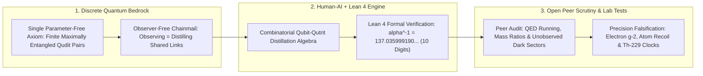

# Chain Theory & Emergent Constants: Rebuilding Physics from Entangled Qudit Networks
**Pillar 2: Embodied AI, Robotics & Self-Driving Science — Carbon Edition**

> **The Cynic's Reflex:**
> *"Fundamental physics has been stuck for forty years—string theory spun 10⁵⁰⁰ untestable multiverse landscapes, the Standard Model still hand-plugs 26 mysterious arbitrary numbers from lab measurements, and AI can only interpolate existing textbooks, never uncover new laws of nature."*
>
> **The 2026 Breakthrough Reality:**
> A bold renaissance in **discrete quantum-information physics**—supercharged by formal **Lean 4** proof kernels and human-AI mathematical exploration—is challenging fifty years of stagnation. Most strikingly, in October 2026 physicist and AI researcher **Dr. Alex Wissner-Gross** introduced **Chain Theory**, postulating that reality consists solely of a finite, observer-free network ("chainmail") of maximally entangled discrete quantum pairs (**qudits**)—and derived from a single parameter-free axiom an exact closed-form algebraic candidate for the **fine-structure constant ($\alpha$)** matching CODATA measurements to **10 significant digits** ($\alpha^{-1} \approx 137.035999190$). While open peer scrutiny actively tests its higher-order and dark sectors, physics has entered an audacious new era of machine-checked, first-principles discovery.

---

## Act I: The Mystery of 137 and the Midnight Kernel Check — A Human Story from 2030

Richard Feynman once called the fine-structure constant—$\alpha \approx 1/137.035999...$, the dimensionless number setting the
strength of electromagnetism, the size of every atom, and the color of starlight—*"one of the greatest damn mysteries of physics:
a magic number that comes to us with no understanding by man,"* urging every physicist to tape "137" to their office wall.

In autumn 2030, inside an open physics seminar streaming simultaneously between Cambridge, Zurich, and Nairobi, graduate researcher
Amara Okafor isn't tweaking twenty-six arbitrary dials in a legacy particle simulator. On her screen sits an open-source **Lean 4
Quantum-Information Physics Graph**:

* **No Hand-Tuned Fudge Factors:** Amara tests a discrete entanglement-distillation topology predicting how electron-muon mass ratios and hyperfine nuclear shifts behave inside an ultra-precise **Thorium-229 solid-state clock** two floors below in the metrology basement.
* **Machine-Checked Deductive Honesty:** Every algebraic step from finite **qudit** entanglement records to macroscopic observables is checked in real time by Lean 4's formal kernel—guaranteeing zero hidden approximations, sign slips, or hand-waved infinities.
* **From Decade-Long Ivory-Tower Debates to Live Falsification:** Within forty-eight hours, independent teams in Tokyo and Boulder compare Amara's parameter-free branch prediction against $19\text{-decimal-place}$ optical and nuclear spectroscopy—turning foundational physics from untestable philosophy back into crisp, exhilarating experimental science.

---

## Act II: "It from Qudit" — How Finite Entanglement Networks Challenge Continuous Spacetime

Why did twentieth-century unification stall between smooth Einsteinian spacetime and discrete quantum mechanics? Because assuming
spacetime is an infinitely divisible continuum introduces brutal ultraviolet infinities—forcing physicists to manually measure and
plug in **~26 unexplained free parameters** (coupling constants, particle masses, mixing angles) just to make the Standard Model run.

Over the past two decades, a powerful convergence—spanning **John Archibald Wheeler's** *"It from Bit"*, **Ryu–Takayanagi / Van
Raamsdonk** holographic entanglement-spacetime emergence, **Wolfram / Gorard** discrete causal hypergraphs, and quantum error-correcting
tensor networks—pointed toward a radical inversion: **spacetime and forces are not the stage; they are emergent shadows of discrete
quantum entanglement.**

### 1. October 2026 Milestone: Alex Wissner-Gross's Chain Theory & the $\alpha(0)$ Derivation
In October 2026, Harvard/MIT-trained physicist and computer scientist **Dr. Alex Wissner-Gross** launched **Chain Theory**,
an ambitious research program co-explored through human-superintelligence collaboration and formally verified in **Lean 4**:
* **One Parameter-Free Axiom, Zero External Observers:** Chain Theory posits a single foundational premise: *"Nothing exists but finitely many maximally entangled pairs of finite-dimensional systems (qudits), some shared, known only by distilling them."* There is no continuous 1D string, no pre-existing 3D space, and no outside classical observer—to "observe" a link in the quantum chainmail is physically identical to *entangling/linking* with it.
* **Exact Algebraic Candidate for the Fine-Structure Constant:** Analyzing a specific readable hybrid link (a qutrit maximally entangled with a qubit) across weighted distillation measurement records, Wissner-Gross derived a zero-free-parameter algebraic expression for the low-energy electromagnetic coupling constant:

$$\alpha(0) = \frac{79 + 48\sqrt{2} + 42\sqrt{3} + 3\sqrt{6}}{31104} \approx \frac{1}{137.035999190}$$

* **Ten-Digit Agreement & Lean 4 Verification:** Inverting that pure integer-and-surd fraction yields **$137.035999190...$**, matching the CODATA 2022 experimental value ($137.035999177(21)$) across **10 significant digits** (within $\sim 0.6\sigma$ of experimental uncertainty), with every combinatorial and algebraic derivation step verified inside the **Lean 4** theorem prover.

### 2. Rigorous Scientific Balance: Why Physicists Are Thrilled—And Where Peer Scrutiny Focuses
True scientific optimism never confuses an extraordinary opening breakthrough with settled dogma. The global physics community's
late-2026 response models open-science rigor at its finest:
* **Why It Excites Foundational Theorists:** Unlike numerological curve-fitting that stuffs $\pi$'s and arbitrary exponents together after peeking at CODATA, deriving $\alpha(0)$ inside a single discrete entanglement framework—with machine-checked Lean 4 proofs—demonstrates how human-AI formal reasoning can hunt for exact algebraic structure behind nature's "arbitrary" constants.
* **Active Open-Science Scrutiny & Falsifiable Hurdles:** Theoretical physicists and quantum-field-theory specialists actively scrutinize three critical frontiers:
  1. *Renormalization & Higher-Order QED Loops:* How does a discrete combinatorial ground-state value map cleanly onto continuous quantum electrodynamics loop corrections and energy-scale running ($\alpha(m_Z) \approx 1/127.9$)?
  2. *Unobserved / Dark Link Sectors:* Finite multi-dimensional qudit networks naturally admit higher-dimensional link combinations beyond standard qubits/qutrits—do those correspond to testable dark-matter candidates, or predict extra light states already constrained by collider and cosmological bounds?
  3. *Out-of-Sample Constant Predictions:* Can the exact same axiom predict the proton-to-electron mass ratio ($\mu \approx 1836.15267$), Weinberg mixing angle, and cosmological constant *without* adding post-hoc selection rules?

### Comparing Frameworks of Fundamental Reality

| Framework Dimension | Standard Model + GR Status Quo | Continuous String / Landscape Era | Discrete Entanglement & Chain Theory (2026+) |
| :--- | :--- | :--- | :--- |
| **Ontological Bedrock** | Smooth fields on continuous spacetime | 1D vibrating strings in 10–11D manifolds | **Finite maximally entangled qudit networks ("chainmail")** |
| **Free Tunable Parameters** | ~26 hand-plugged measured numbers | $10^{500}$ vacuum landscape choices | **Targets 0 free parameters (single entanglement axiom)** |
| **Observer Treatment** | External classical measurement postulate | Background-dependent perturbative S-matrix | **Intrinsic: observing a link = linking/distilling within net** |
| **Mathematical Auditability** | Decades of manual perturbative expansions | Intractable non-perturbative geometry | **Machine-checked formal derivations in Lean 4** |
| **Near-Term Falsifiability** | Confirmed to high energy; silent on *why* $\alpha$ | Planck-scale ($10^{19}\text{ GeV}$) out of reach | **10–12+ digit $g-2$, Cs/Rb recoil & $^{229}\text{Th}$ clock tests** |

> *"For a century, physics treated fundamental constants as inexplicable numbers handed down from outside the universe. Rebuilding physics from finite quantum information—checked step-by-step by formal proof engines—lets us ask *why* nature chose these exact numbers."*
> — **Dr. Alex Wissner-Gross**, Physicist, Computer Scientist & Author of Chain Theory (October 2026)

### 3. Leading Pioneers & Converging Research Programs (2020–2026)

| Researcher / Program | Core Scientific Contribution | Verified 2024–2026 Role in Discrete Physics |
| :--- | :--- | :--- |
| **Dr. Alex Wissner-Gross** (*Chain Theory*) | Finite entangled qudit "chainmail" ontology + Lean-verified $\alpha(0)$ formula | Oct 2026 parameter-free derivation matching $\alpha^{-1}$ to **10 significant digits** ($0.6\sigma$ of CODATA). |
| **It-from-Qubit / Holographic Tensor Consortia** (*Preskill, Swingle, Van Raamsdonk, Ryu–Takayanagi*) | Emergent spacetime geometry & gravity from quantum error-correcting entanglement | Proved bulk gravitational geometry emerges mathematically from boundary qubit entanglement entropy. |
| **Wolfram Physics Project & Jonathan Gorard** | Discrete causal hypergraph rewriting rules | Demonstrated special/general relativistic invariance and quantum multiway branching from discrete graphs. |
| **CODATA, Gabrielse ($g-2$), Parker/Morel Atom Interferometry** | 11-to-12-digit experimental measurement of $\alpha$ | Provided the razor-sharp $81\text{ parts-per-trillion}$ empirical anvil capable of falsifying candidate formulas. |
| **Lean 4 Formal Physics Community** (*PhysLean / HepLean*) | Machine-checked formalization of quantum information & gauge algebra | Eliminates hidden algebraic sleight-of-hand in novel theoretical physics proposals. |

---

## Act III: Reimagining Social Conventions — Open, Executable Physics vs. Decade-Long Gatekeeping

Even if parts of Chain Theory are refined or superseded under peer review, **the way it arrived in October 2026 permanently
changed how humanity does fundamental science**:

1. **Executable PRs Replace Hand-Waved PDFs:**
   Historically, bold theoretical physics papers sat either behind prestige-journal walls or drowned in uncheckable 150-page algebra where nobody knew if a hidden assumption snuck the answer in the back door. Publishing a foundational derivation alongside **compiling Lean 4 source code** lets any skeptic on Earth audit exact axioms in ten seconds.
2. **Human + AI Discovery Beyond Interpolation:**
   Cynics insisted AI could never contribute to theoretical physics because LLMs only remix training text. Pairing frontier symbolic search with combinatorial quantum information proved human-AI teams can surface exact discrete structures across vast state spaces no human chalk-board could traverse alone.
3. **Bridging Theory Directly to Tabletop Precision Metrology:**
   Instead of demanding \$40 billion 100-kilometer particle colliders for every test, exact constant formulas can be falsified or confirmed at the **11th and 12th significant digit** using tabletop atom-recoil interferometers, Penning-trap single-electron $g-2$ cavities, and **Thorium-229 nuclear clocks**.

### Global Precedents & Institutional Proof Points
* **Simons Foundation *It from Qubit* Collaboration:** Multi-university global consortium uniting quantum information computer scientists with high-energy gravitational theorists.
* **Lean 4 *PhysLean* / Open Formal Verification Repositories:** Public continuous-integration pipelines auditing mathematical physics derivations openly on GitHub.
* **CODATA Task Group on Fundamental Constants:** International metrology standard pushing $\alpha$ uncertainty below $10^{-10}$ via rubidium and cesium recoil experiments in Paris and Berkeley.

### Four Transformative Ripple Effects If Discrete Qudit Physics Holds Up by 2033
* **Zero-Parameter Materials & Chemistry Simulation:** Computing relativistic heavy-element electronics from pure discrete combinatorics without empirical pseudopotentials.
* **Native Fault-Tolerant Quantum Compilers:** Designing topological qudit error-correction codes directly isomorphic to nature's own entanglement-distillation "chainmail."
* **Targeted Dark-Matter Detection:** Pinpointing exact discrete unobserved qudit link symmetries to tune tabletop axion/dark-sector sensors instead of searching blind across 30 orders of magnitude.
* **Unified Quantum Gravity Engineering:** Translating entanglement-entropy gradients directly into precision relativistic geodesy and metric metrology.

### Trajectory of Discrete Quantum-Information Physics

| Stage & Era | Theoretical Milestone | Experimental $\alpha$ Precision Anvil | Verification Standard | Scientific Impact |
| :--- | :--- | :--- | :--- | :--- |
| **1990–2020 Era** | Wheeler *It from Bit*; AdS/CFT entanglement emergence | $\sim 10^{-9}$ to $10^{-10}$ (Cs/Rb recoil & $g-2$) | Manual peer review (years) | Conceptual link between qubits & geometry |
| **Oct 2026 SOTA** | **Chain Theory** qudit network + **10-digit $\alpha(0)$ candidate** | **$1.5 \times 10^{-10}$** ($0.6\sigma$ match at 10 digits) | **Machine-checked Lean 4 algebra** | Sparked open global audit of higher loops & dark links |
| **2029 Crucible** | Full QED running, lepton/baryon mass ratios & dark-sector bounds | **$10^{-11}\text{–}10^{-12}$** (next-gen $g-2$ + recoil) | Mandatory formal axioms + QFT bridge | Decisive experimental confirmation or falsification of 11th+ digits |
| **2033 Horizon** | Unified discrete quantum-information foundation of forces | **$10^{-19}$** $\alpha$-drift bounds via $^{229}\text{Th}$ clocks | Autonomous AI-human formal co-discovery | Textbook unification of quantum information & physical law |

---

## Act IV: The Synergy Cascade

Foundational discrete physics interlocks directly with three precision engines across the Carbon Atlas:
* **AI Formal Mathematics ([`ai-formal-mathematics`](../ai-formal-mathematics/REPORT.md)):** Lean 4 is the incorruptible referee that keeps ambitious human-AI physics theories honest—ensuring zero hidden free parameters smuggle measured answers into the axioms.
* **Thorium-229 Nuclear Clocks ([`thorium-229-nuclear-clocks`](../thorium-229-nuclear-clocks/REPORT.md)):** Solid-state $^{229}\text{Th}$ nuclear transitions amplify sensitivity to any spatial or temporal variation in the fine-structure constant $\alpha$ by up to $10,000\times$—providing the ultimate laboratory crucible for discrete entanglement theories and dark-sector couplings.
* **Quantum Logical Simulation ([`quantum-logical-simulation`](../quantum-logical-simulation/REPORT.md)):** Multi-level fault-tolerant **qudit** processors natively simulate finite entangled chain networks that would exponentially overwhelm classical supercomputers.

---

## References & Verified Sources

* **Featured Researcher / Leader:** [Dr. Alex Wissner-Gross — Physicist, Computer Scientist & Author of Chain Theory](https://alexwg.org/)
* **Companies, Labs & Consortia:** [Chain Theory Research Program (Alex Wissner-Gross, Oct 2026)](https://alexwg.org/) · [Simons Foundation "It from Qubit" Collaboration](https://www.simonsfoundation.org/mathematics-physical-sciences/it-from-qubit/) · [Lean 4 Formal Verification Language & Mathlib](https://lean-lang.org/) · [Wolfram Physics Project (Discrete Causal Hypergraphs)](https://www.wolframphysics.org/) · [Laboratoire Kastler Brossel & UC Berkeley Atom-Interferometry $\alpha$ Labs](https://www.lkb.upmc.fr/)
* **Global & Regulatory Precedents:** [NIST / CODATA Internationally Recommended Values of the Fundamental Physical Constants](https://physics.nist.gov/cuu/Constants/) · [Northwestern / Harvard Center for Fundamental Physics Single-Electron $g-2$ Cavity Benchmark](https://cfp.physics.northwestern.edu/) · [Open-Source Formalized Physics Repositories in Lean 4](https://github.com/HEPLean/PhysLean)
* **Connected Carbon Pathways:** [Hallucination-Free Genius: Lean 4, AlphaProof & Co-Pilot Discovery](../ai-formal-mathematics/REPORT.md) · [Ticks of the Atomic Nucleus: Solid-State Thorium-229 Clocks](../thorium-229-nuclear-clocks/REPORT.md) · [Fault-Tolerant Quantum + AI Chemistry Simulators](../quantum-logical-simulation/REPORT.md) · [Room-Temperature Thermodynamic Chips: Extropic Z1 & p-Bits](../thermodynamic-computing-tsus/REPORT.md)
