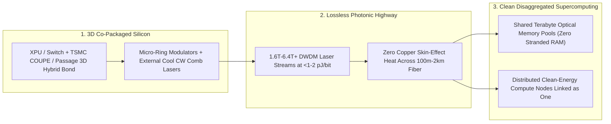

# Computing with Laser Light: Co-Packaged Silicon Photonics Shattering the Copper Energy Wall
**Pillar 2: Embodied AI, Robotics & Self-Driving Science — Carbon Edition**

> **The Cynic's Reflex:**
> *"AI chips are slamming into an immovable physics wall—pushing terabits per second across copper wires melts interconnects after just a few inches, wastes up to half a data center's electricity just moving bits around, and forces companies to cram 500-megawatt furnaces next to city power grids."*
>
> **The 2026 Breakthrough Reality:**
> Copper's sixty-year reign inside computers has yielded to **Co-Packaged Silicon Photonics (CPO)** and **3D Optical I/O Chiplets**. Between 2025 and late 2026, **TSMC's *COUPE*** 3D photonic stacking, **NVIDIA's *Spectrum-X / Quantum-X Photonics*** switches, **Broadcom's *Bailly* 51.2T CPO**, **Ayar Labs' *TeraPHY*** chiplets, **Celestial AI's *Photonic Fabric***, and **Lightmatter's *Passage*** interposers brought **1.6T–3.2T+ laser waveguides directly onto the silicon package** at **`<1–2 picojoules per bit`**—slashing interconnect energy **$5\times\text{–}10\times$**, stretching lossless reach **$10\times\text{–}100\times$**, and turning disaggregated solar/hydro compute campuses into one unified optical supercomputer.

---

## Act I: A Supercomputer Spread Gently Across Three Solar Valleys — A Human Story from 2030

In Northern Sweden's Luleå river valley—and echoed across sunny desert mesas in New Mexico—municipal heating engineer Astrid
Holmberg walks through a whisper-quiet 15-megawatt community compute pavilion tucked beside a district greenhouse complex. Five
years earlier, hyperscalers demanded monstrous single-site 1-gigawatt campuses because **electrical copper cables degraded sharply
beyond two meters**—forcing 100,000 hot GPUs to sit crammed inside one building that strained local transmission lines.

Astrid inspects a cool optical patch panel feeding warm $55^\circ\text{C}$ return water straight into neighborhood apartment radiators
and winter tomato greenhouses:

* **Zero Copper Bottleneck, Zero Stranded Memory:** Inside each server blade, compute dies sit directly atop **3D Co-Packaged Photonic Interposers** streaming **32 terabits per second of multi-wavelength laser light** straight out of the silicon package edge at **`0.8 picojoules per bit`**—roughly **$8\times$ less interconnect power** than 2024 pluggable copper/optical transceivers.
* **Three Valleys Acting as One Chip:** Because photons glide through glass fiber for **hundreds of meters to kilometers with near-zero resistive loss or capacitive heat**, Astrid's pavilion pools shared terabyte memory racks seamlessly with two sister hydro- and wind-powered pavilions miles away—training open climate and medical foundation models at 95% hardware utilization without ever overloading a town's power substation.

---

## Act II: Why Copper Hit the Wall—And How Photons Moved Inside the Chip Package

For decades, Moore's Law shrunk transistors inside a chip, while **shuffling bits *between* chips and HBM memory** quietly became
computing's biggest energy hog:
1. **The Copper RC & Skin-Effect Tax:** At 200+ gigabits per lane, high-frequency electrons crowd onto the outer skin of copper traces, turning inches of printed-circuit board into a space heater. By 2025, pluggable transceivers and copper retimers devoured **$15\text{–}25\text{ picojoules per bit}$**—burning **35% to 50% of an AI cluster's total wall-plug power** just moving numbers from chip A to chip B, while stranding expensive GPUs idle waiting on memory!
2. **Photons Have Zero Resistance and Zero Capacitance:** Laser light racing through micron-thin **silicon and silicon-nitride ($\text{Si}_3\text{N}_4$) waveguides** suffers virtually zero distance-dependent heating whether traveling 5 millimeters or 500 meters, and carries dozens of color channels (**DWDM wavelengths**) down a single strand thinner than a human hair.

### 1. Foundry Inflection: TSMC *COUPE* & 300 mm Wafer-Scale Silicon Photonics
The missing link before 2025 was packaging: assembling tiny lasers by hand cost a fortune. Semicon foundries solved it with 3D wafer
integration:
* **TSMC *COUPE* (Compact Universal Photonic Engine):** Stacks an advanced electronic die ($2\text{–}3\text{ nm}$ SerDes/modulator driver) directly onto a 65 nm **Photonic Integrated Circuit (PIC)** via copper-to-copper **SoIC-X hybrid bonding**—shrinking parasitic capacitance by $10\times$ and scaling **1.6T $\rightarrow$ 3.2T $\rightarrow$ 6.4T+** optical engines at standard semiconductor wafer volumes.
* **GlobalFoundries *Fotonix*, Intel Silicon Photonics & Tower Semiconductor:** Standardized monolithic and heterogeneous 300 mm CMOS+photonics lines with high-reliability external Continuous-Wave (CW) laser sources and detachable fiber connectors.

### 2. Verified 2025–2026 Commercial Systems: Switches, Optical Chiplets & Memory Fabrics
* **Broadcom (*Bailly* 51.2T CPO) & NVIDIA (*Spectrum-X Photonics* / *Quantum-X Photonics*):** Replaced hundreds of hot, failure-prone front-panel pluggable modules ( consuming $30\text{ W}$ each) with co-packaged silicon-photonic engines clustered around the switch ASIC—cutting optical networking power by **$>3.5\times$ to $5\times$**, boosting cluster mean-time-between-failures (MTBF) by **$10\times$**, and scaling 1.6 Tb/s ports across 100,000+ XPU fabrics.
* **Ayar Labs (*TeraPHY* Optical I/O Chiplets + *SuperNova* Light Source):** Demonstrated multi-terabit UCIe-compatible in-package optical I/O chiplets operating at **`<2–4 pJ/bit`**—enabling direct chip-to-chip optical scale-up networks across dozens of racks instead of cramming only 8 or 72 GPUs inside one copper NVLink cabinet.
* **Celestial AI (*Photonic Fabric*) & Lightmatter (*Passage* M1000 3D Photonic Interposer):** Shattered the "Memory Wall" by optically disaggregating massive pools of HBM and DDR memory away from hot compute dies at **`~1–2 pJ/bit`** and nanosecond-class latency, while Lightmatter's 3D *Passage* substrate routes dozens of reticle-sized XPUs over programmable photonic waveguides beneath the silicon.

### Comparing Chip-to-Chip Interconnect Generations

| Interconnect Metric | Copper PCB + Pluggable Optics (2023–2024) | Active Copper Cables & Retimers | Co-Packaged Silicon Photonics & Optical I/O (2026+) |
| :--- | :--- | :--- | :--- |
| **Energy per Bit Moved** | $15\text{–}25\text{ pJ/bit}$ | $8\text{–}15\text{ pJ/bit}$ (short reach only) | **`0.8–3.5 pJ/bit` ($5\times\text{–}10\times$ energy cut)** |
| **Lossless High-Speed Reach** | $<0.3\text{ m}$ PCB + noisy DSP hops | $1\text{–}3\text{ meters}$ thick copper bundles | **$100\text{ m}$ to $2\text{ km+}$ single-mode glass fiber** |
| **Bandwidth Shore Density** | Capped by bulky copper pin pitch | Rack cable-spaghetti airflow block | **$10\times\text{–}40\times$ higher via DWDM multi-color wavelengths** |
| **Link Reliability (Flaps)** | Frequent hot pluggable laser failures | Connector wear & EMI crosstalk | **$10\times$ higher uptime (replaceable cool external CW lasers)** |
| **Memory Architecture** | Marooned inside $8\text{-chip}$ copper silos | Rigid single-rack limits | **Disaggregated rack-to-campus optical memory pools** |

> *"Silicon photonics co-packaged directly with processors breaks the copper wall once and for all—turning an entire clean-energy data center or multi-site campus into one giant, energy-frugal chip connected at the speed of light."*
> — **Industry Consensus across NVIDIA Photonics, TSMC COUPE & Ayar Labs Optical I/O Roadmaps (2025–2026)**

### 3. Leading Pioneers & Verified Milestones (2025–2026)

| Company / Foundry | Core Photonic Breakthrough | Verified 2025–2026 Milestone |
| :--- | :--- | :--- |
| **TSMC** (*COUPE* 3D Photonic Engine) | 3D SoIC-X hybrid bonding of electronics onto 300 mm PICs | Qualified **1.6T** optical engine roadmap scaling to **6.4T–12.8T** in-package XPU interconnects. |
| **NVIDIA** (*Spectrum-X & Quantum-X Photonics*) | Co-packaged $1.6\text{ Tb/s}$-port micro-ring silicon-photonic switches | Unveiled 100T–400T CPO switches saving **tens of megawatts** per 100k-GPU cluster & $10\times$ resiliency. |
| **Broadcom** (*Bailly* 51.2T CPO) | Production co-packaged optical Ethernet switch silicon | Shipped commercial **51.2 Tb/s** Bailly CPO eliminating front-panel optical transceiver DSP heat. |
| **Ayar Labs** (*TeraPHY* + *SuperNova*) | UCIe-standard in-package optical I/O chiplets | Demonstrated **4–8 Tb/s** bidirectional optical chiplets for direct XPU-to-XPU scale-up fabrics. |
| **Celestial AI & Lightmatter** (*Photonic Fabric* / *Passage*) | Optical memory disaggregation & 3D photonic interposers | Unlocked sub-2-pJ/bit terabyte optical memory pooling and multi-reticle 3D wafer-scale photonic substrates. |

---

## Act III: Reimagining Social Conventions — Ending Megawatt Grid Chokepoints & E-Waste GPU Obsolescence

Today's copper-bound architecture creates massive economic and ecological waste: when an AI chip's onboard HBM memory fills up,
companies throw out the whole \$30,000 board every 18 months—and utilities face demands to build fossil-gas peaker plants just to
feed concentrated 1-gigawatt copper-tethered server warehouses.

1. **Right-Sized Clean-Energy Compute Micro-Campuses:**
   Because glass fiber carries petabits across kilometers at `<1–2 pJ/bit`, compute no longer has to crowd onto a single stressed
   suburban substation. Modular 10–25 MW optical pavilions can sit directly beside existing hydro dams, curtailed wind farms,
   geothermal wells, and district-heating loops—connected optically into a single virtual cluster.
2. **Modular Upgradeability Ends Whole-Server E-Waste:**
   Optical disaggregation (**Celestial AI / CXL-over-Optics**) decouples compute chiplets, thermodynamic samplers, and memory blades.
   Upgrading compute no longer forces trashing terabytes of working HBM/DRAM modules, slashing embodied semiconductor carbon by 40%+.
3. **10× Fewer Midnight Crash Restarts:**
   In 100,000-GPU training runs, overheating pluggable transceivers caused job-killing link flaps every few hours. Moving cool
   continuous-wave laser boxes to serviceable rack bays while keeping passive silicon waveguides on-chip boosts cluster uptime $10\times$.

### Global Precedents & Institutional Proof Points
* **Optical Internetworking Forum (OIF) Co-Packaged Optics & UCIe Optical Standards:** Open multi-vendor interoperability standards preventing proprietary cable lock-in.
* **Nordic & Swiss Data-Center District-Heating Mandates (Stockholm Data Parks, Luleå):** Proven municipal models routing liquid-cooled server warmth directly into tens of thousands of homes—made vastly easier by modular optically linked sites.
* **U.S. DOE *COOLERCHIPS* & ARPA-E *ENLITENED* Photonic Interconnect Programs:** Public R&D catalysts behind picojoule/bit silicon-nitride and micro-ring modulator commercialization.

### Four Breakthrough Capabilities Unlocked by Co-Packaged Photonics by 2032
* **100-Terabyte Unified-Memory Science Clusters:** Simulating whole human cells, tokamak plasmas, and kilometer-scale climate clouds in shared optical RAM without partitioning bottlenecks.
* **Sub-20-Watt Home & Clinic Optical Workstations:** Silent fiber-linked thin terminals tapping neighborhood library compute commons with zero fan noise.
* **Cryogenic-to-Room-Temp Quantum Optical Bridges:** Replacing thousands of heat-leaking coaxial copper cables inside quantum dilution refrigerators with hair-thin photonic fibers!
* **Solid-State LiDAR & Chip-Scale Spectrometers:** Reusing 300 mm CMOS silicon-photonic waveguides to put \$12 eye-safe 3D LiDAR and blood-glucose optical sensors into everyday devices.

### Trajectory of Co-Packaged Silicon Photonics

| Stage & Era | Interconnect Architecture | Energy per Bit | Max Lossless XPU Fabric Scale | Grid & Data-Center Footprint |
| :--- | :--- | :--- | :--- | :--- |
| **2022 Pluggable Era** | Copper traces + OSFP pluggable modules | $18\text{–}25\text{ pJ/bit}$ | 8 GPUs per copper node | Monolithic power-hungry warehouses |
| **Late 2026 SOTA** | **51.2T–400T CPO switches + TSMC *COUPE* + *TeraPHY*** | **`1.5–4.5 pJ/bit` (-75%+)** | **Hundreds of XPUs + optical memory pools** | Saves tens of MW per cluster; $10\times$ reliability |
| **2029 Inflection** | Universal 3D optical I/O chiplets on every XPU & HBM stack | **`0.5–1.0 pJ/bit`** | **10,000+ XPUs as one flat memory space** | Distributed renewable district-heating pavilions |
| **2033 Abundance** | Quantum-dot comb lasers + plasmonic/photonic hybrid dies | **`<0.15 pJ/bit`** | **Continent-spanning optical compute grid** | Interconnect energy tax drops below 5% of compute |

---

## Act IV: The Synergy Cascade

Co-Packaged Silicon Photonics is the lossless nervous system uniting compute, energy, and space across the Carbon Atlas:
* **Thermodynamic Computing TSUs ([`thermodynamic-computing-tsus`](../thermodynamic-computing-tsus/REPORT.md)) & Quantum Logical Simulation ([`quantum-logical-simulation`](../quantum-logical-simulation/REPORT.md)):** Photonic chiplets stitch deterministic GPUs, room-temperature `Z1` thermodynamic samplers, and cryogenic logical qubit modules into one seamless heterogeneous supercomputer without copper heat leaks.
* **Superconducting Grids ([`superconducting-grids`](../../01-abundant-energy/superconducting-grids/REPORT.md)) & Perovskite Tandem Solar ([`perovskite-tandem-solar`](../../01-abundant-energy/perovskite-tandem-solar/REPORT.md)):** Long-reach optical interconnects let compute follow clean, zero-marginal-cost solar and hydro electrons rather than forcing dirty power lines into cities.
* **Orbital Radiative Compute ([`orbital-radiative-compute`](../../05-space-frontier/orbital-radiative-compute/REPORT.md)) & Orbital Laser Mesh ([`orbital-laser-mesh`](../../05-space-frontier/orbital-laser-mesh/REPORT.md)):** Radiation-hard silicon-photonic chiplets feed terabit free-space laser transceivers directly in low Earth orbit.

---

## References & Verified Sources

* **Featured Pioneers / Platforms:** [TSMC COUPE, NVIDIA Photonics, Broadcom Bailly & Ayar Labs Optical I/O Ecosystem](https://ayarlabs.com/)
* **Companies, Labs & Consortia:** [TSMC (Compact Universal Photonic Engine — COUPE)](https://www.tsmc.com/) · [NVIDIA (Spectrum-X & Quantum-X Silicon Photonics)](https://www.nvidia.com/en-us/networking/) · [Broadcom (Bailly 51.2T Co-Packaged Optics)](https://www.broadcom.com/) · [Ayar Labs (TeraPHY Optical I/O & SuperNova Laser)](https://ayarlabs.com/) · [Celestial AI (Photonic Fabric Memory Disaggregation)](https://www.celestial.ai/) · [Lightmatter (Passage 3D Photonic Interposer)](https://lightmatter.co/)
* **Global & Regulatory Precedents:** [Optical Internetworking Forum (OIF) Co-Packaged Optics Framework](https://www.oiforum.com/) · [Universal Chiplet Interconnect Express (UCIe) Optical Consortium](https://www.uciexpress.org/) · [ARPA-E ENLITENED Photonic Data-Center Efficiency Program](https://arpa-e.energy.gov/) · [Stockholm Data Parks Municipal Waste-Heat District Heating Model](https://stockholmdataparks.com/)
* **Connected Carbon Pathways:** [Room-Temperature Thermodynamic Chips: Extropic Z1 & p-Bits](../thermodynamic-computing-tsus/REPORT.md) · [Fault-Tolerant Quantum + AI Chemistry Simulators](../quantum-logical-simulation/REPORT.md) · [Zero-Loss HTS Superconducting Transmission Grids](../../01-abundant-energy/superconducting-grids/REPORT.md) · [Space-Cooled Orbital Radiative Compute Clusters](../../05-space-frontier/orbital-radiative-compute/REPORT.md)
