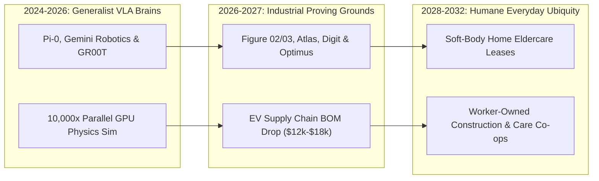

# Helpful Mechanical Hands: General-Purpose Humanoid Teammates
**Pillar 2: Embodied AI, Robotics & Self-Driving Science — Carbon Edition**

> **The Cynic's Reflex:**
> *"Humanoid robots are viral parkour stunts stitched together with hidden teleoperators—overpriced toys that will either stumble over a crumpled bathmat or dystopically strip working people of their livelihoods while billionaires hoard the factory keys."*
>
> **The 2026 Breakthrough Reality:**
> Between 2024 and late 2026, Vision-Language-Action (VLA) foundation models—led by Physical Intelligence's $\pi_0$, NVIDIA GR00T, and Google DeepMind's Gemini Robotics—replaced brittle, hand-coded choreography with true generalist physical reasoning. Riding high-volume electric-vehicle actuator and battery supply chains, humanoid bills of materials are plunging toward \$12,000–\$18,000, deploying today from BMW body shops to gentle aging-in-place pilots where seniors keep their homes, dignity, and independence.

---

## Act I: Morning Tea in Fukuoka — A Human Story from 2031

Sunlight spills across the tatami mats of a quiet wooden townhouse in Fukuoka, Japan, in April 2031.
Seventy-nine-year-old retired shipwright Kenji Takahashi wakes to the aroma of roasted *hojicha* tea.
Four years earlier, after a mild stroke weakened his left side, Kenji's daughter Haruka faced an agonizing choice:
quit her architecture practice to provide twenty-four-hour lifting support, or place her fiercely independent father
on a three-year institutional nursing waitlist.

Instead, standing quietly beside the sliding cedar screen is *Sora*—a five-foot-five, soft-knit-clad 1X-class
domestic humanoid leased through Fukuoka's municipal Long-Term Care Insurance cooperative for \$110 a month.

* **Dignified Morning Mobility:** When Kenji sits up, Sora steps forward with compliant, tendon-driven arms covered in warm, breathable acoustic fabric. Its 24-degree-of-freedom tactile hands sense micro-shifts in Kenji's center of gravity at 500 Hz, steadying his transfer from futon to slippers without ever grabbing roughly or rushing his pace.
* **Ending Caregiver Burnout:** While Kenji stretches on the veranda overlooking his persimmon tree, Sora strips and washes the heavy cotton bedding, scrubs the deep soaking tub—the single chore most responsible for family caregiver back injuries—and sets down two porcelain cups of tea just as Haruka arrives on her bicycle before work.
* **Pure Human Connection:** Haruka doesn't spend her morning visit changing soiled linens, worrying about bathroom falls, or nursing a herniated disc. She spends forty unhurried minutes sketching garden trellises with her father and laughing over old coastal sailing photographs.
* **Injury-Free Neighborhood Craft:** Three blocks away, at an infill mass-timber housing site, a local four-person carpenters' cooperative directs six weather-sealed construction humanoids carrying ninety-pound acoustic floor panels up narrow stairwells. Nobody goes home with crushed vertebrae or silica-scarred lungs; young apprentices learn architectural joinery instead of serving as human pack-mules.

---

## Act II: The 2024–2026 Embodied Intelligence Breakout

For forty years, humanoid robotics was trapped in Moravec's Paradox: computers could beat grandmasters at chess,
yet a million-dollar robot froze if a coffee mug sat two centimeters to the left. Every motion required months of
rigid inverse-kinematics coding, aerospace-grade titanium harmonic gearboxes costing \$25,000 a set, and safety cages
bolted to factory concrete. Between 2024 and late 2026, three simultaneous breakthroughs shattered that wall forever.

### 1. Vision-Language-Action (VLA) Brains Replace Rigid Choreography
Instead of programming joint angles line by line, researchers fused frontier multimodal vision-language models with
continuous high-frequency motor flow-matching and diffusion policies:

* **Generalist Cross-Embodiment Policies ($\pi_0$ & $\pi_{0.5}$):** Physical Intelligence demonstrated that a single foundation neural network trained across dozens of robot morphologies can fold crumpled laundry fresh out of a dryer, bus cluttered restaurant tables, assemble cardboard boxes, and scoop coffee beans without task-specific code.
* **World-Physics & Semantic Reasoning:** Google DeepMind's **Gemini Robotics** and NVIDIA's **Project GR00T** (paired with Isaac Lab GPU physics gyms running 10,000+ parallel simulated robots faster than real time) gave humanoids common-sense spatial intelligence. Tell a robot, *"Pack the fragile glass jars on top of the canned tomatoes so nothing cracks,"* and its VLA policy translates spoken intent directly into subtle fingertip force modulation.
* **Tactile & Tendon Dexterity:** Sanctuary AI's hydraulic-tactile *Phoenix* hands (with sub-millimeter haptic sensitivity) and 1X's compliant bio-inspired *NEO* tendon drives replaced bone-crushing industrial gears with soft, force-limited artificial muscles safe enough to steady a toddler or peel a ripe peach.

### 2. EV Supply Chains Crush Hardware Costs Toward \$12,000–\$18,000
Underneath its woven exterior, a humanoid robot is an electric vehicle reconfigured with arms and legs:
axial-flux brushless motors, lithium-iron-phosphate or silicon-anode pouch cells, \$10 automotive CMOS cameras,
and edge AI system-on-chips. By piggybacking on global EV supply chains—and replacing slow CNC-machined aerospace
titanium with precision-cast alloys and reinforced PEEK polymers—bills of materials collapsed from \$250,000 research
prototypes in 2021 toward **\$12,000–\$18,000** at volume scale:

* **Quasi-Direct-Drive & Cycloidal Actuators (\$3,200–\$4,800/set):** High-torque-density axial-flux motors eliminate fragile, ultra-expensive Swiss harmonic gears while allowing natural back-drivable compliance when bumped by a human elbow.
* **Monolithic Tactile Hands (\$800–\$1,400/pair):** Elastomeric fingertips embedded with optical and barometric shear sensors detect a slipping glass within two milliseconds.
* **On-Device Privacy-First Edge Compute (\$650):** Automotive-grade neural processors run 7B-parameter VLA policies locally inside the robot's chest—meaning bedroom and bathroom cameras never stream raw household video to corporate cloud servers.

### Subsystem Bill-of-Materials (BOM) Transformation (2022 Prototype vs. 2026–2029 Volume EV Supply Chain)

| Hardware Subsystem | 2022 Aerospace Prototype | Late 2026 Commercial Fleet | 2029 Mass-Scale Target | Engineering Unlock |
| :--- | :--- | :--- | :--- | :--- |
| **28–36 Joint Actuators** | \$65,000 (CNC steel harmonic) | \$6,800 (cast quasi-direct-drive) | \$2,400 | High-speed EV stator winding + polymer/alloy cycloidal gears |
| **Dexterous Tactile Hands** | \$24,000 (custom lab tendons) | \$2,600 (16–22 DoF modular) | \$750 | Monolithic molded elastomers + optical shear skins |
| **Battery & Power Bus** | \$4,500 (custom aerospace pack) | \$950 (2.5–4 kWh EV cylindrical/pouch) | \$480 | 450–550 Wh/kg silicon-anode cells (8–10 hr shift) |
| **Vision & Edge AI Compute** | \$12,000 (workstation GPUs + LiDAR) | \$1,100 (automotive SoC + CMOS) | \$450 | Multi-camera surround vision + 4nm local VLA inference |
| **Chassis, Knit Shell & Assembly** | \$45,000 (hand-built 6-week build) | \$5,500 (automated sub-assemblies) | \$2,800 | Die-cast magnesium/aluminum torso + soft washable acoustic knit |
| **Total Turnkey Hardware BOM** | **~\$150,500** | **~\$16,950** | **~\$6,880** | **>95% cost reduction via EV & consumer-electronics scaling** |

### Why Humanoid Form Factors Beat Specialized Appliances Inside Existing Homes
Critics often ask: *"Why give a robot two legs and two hands when dishwashers already have boxes and factories have conveyors?"*
The answer is **zero-retrofit universality**:
1. **Stairs, Narrow Hallways & Door Handles:** Over 90% of the world's housing stock, historic clinics, ships, and construction sites were built around the 60-centimeter shoulder width and step height of the human body.
2. **Using Existing Human Tools:** Instead of buying a \$40,000 robotic vacuum, a \$30,000 robotic lawnmower, and a \$50,000 patient hoist, a single humanoid pushes a standard broom, operates an existing garden hose, opens standard prescription bottles, and folds clothes onto existing wooden shelves.
3. **Instant Task Reallocation:** A municipal humanoid crew that frames affordable housing on Tuesday can clear storm-felled branches on Wednesday and sort community recycling on Thursday via an overnight skill update.

> *"There are not enough humans to do the physical work the world needs—embodied AI lets us unlock abundance across every physical industry, until eventually physical labor becomes optional, freeing billions of people to spend their lives doing what they actually choose to do."*
> — **Brett Adcock**, Founder & CEO, Figure AI

### 3. Frontier Pioneers & Verified 2024–2026 Deployments

| Organization & Platform | Core Engineering Architecture | Verified 2024–2026 Milestone & Real-World Footprint |
| :--- | :--- | :--- |
| **Figure AI** (*Figure 02 / 03* + *Helix*) | Dual-system fast/slow VLA neural control; custom electric actuators; 16-DoF hands | Deployed on **BMW Spartanburg** body-shop lines autonomously inserting sheet-metal components; commissioned high-volume **BotQ** robot manufacturing plant. |
| **Physical Intelligence** ($\pi_0$ / $\pi_{0.5}$) | Cross-embodiment flow-matching VLA foundation models | Zero-shot and few-shot mastery of deformable laundry folding, grocery bagging, and unscripted domestic cleanup across diverse hardware bodies. |
| **Boston Dynamics** (*All-Electric Atlas*) | Fully electric 360-degree super-human range joints + DeepMind VLA | Retired messy hydraulics in 2024; executing autonomous part-sequencing workflows inside **Hyundai** automotive manufacturing facilities by 2026. |
| **Agility Robotics** (*Digit*) | Bipedal logistics specialist + **RoboFab** Salem, Oregon factory | First commercial **Robots-as-a-Service (RaaS)** bipedal fleet moving thousands of totes daily across **GXO Logistics** and **Schaeffler** warehouses. |
| **1X Technologies** (*NEO*) | Soft, compliant tendon-driven actuation; ultra-light 30 kg frame | Purpose-built for quiet, pinch-free residential companionship, tidying, laundry, and assistive mobility in aging-in-place home trials. |
| **Tesla** (*Optimus Gen 2 / Gen 3*) | Vertically integrated EV actuators, 22-DoF tendon hands, FSD vision stack | Autonomous battery-cell sorting in factory bays; relentless design-for-manufacturing targeting sub-\$20,000 mass-production unit cost. |
| **Sanctuary AI & Google DeepMind** | Haptic sub-millimeter dexterous hands (*Phoenix*) & *Gemini Robotics* | Fine-motor industrial sorting, compliant electronics assembly, and natural-language spatial reasoning over unseen everyday objects. |

---

## Act III: Reimagining Social Conventions — From "Job Thief" to Co-Owned Care & Trade Crews

Cynicism around robotics rarely stems from a love of scrubbing factory vats or hauling drywall up five flights of stairs.
Nobody mourns the disappearance of hand-cranked washboards or coal-shoveling boiler rooms. Cynicism stems from fearing
that automation will enrich distant monopolies while leaving working families precarious and seniors warehoused.
When low-cost humanoids meet thoughtful democratic institutions, three social norms flip for the better:

1. **Aging in Place as a Universal Right, Not a Luxury:**
   By 2030, Japan, South Korea, Italy, Germany, and rural North America face a shortfall of over 15 million eldercare workers. Nursing burnout and spinal injuries drive 40%+ annual staff turnover. Rather than warehousing elders in understaffed institutions, municipal care vouchers subsidize soft-body home humanoids to handle night-watch fall prevention, heavy transfers, and laundry—freeing human nurses and adult children to bring empathy, clinical wisdom, and unhurried companionship.
2. **Worker-Owned "Fleet-in-a-Box" Trade Cooperatives:**
   When a ruggedized humanoid costs \$14,000—less than a compact pickup truck—capital ownership democratizes. Carpenters, roofers, electricians, and commercial cleaners finance 3-robot crews through local credit unions. Tradespeople triple their productive output, slash jobsite orthopedic injuries by over 75%, and transition from selling exhausted joints to directing high-skill craft.
3. **Retiring "3D" (Dirty, Dangerous, Demeaned) Human Sacrifice:**
   Confined-space chemical tank scrubbing, disaster rubble shoring, toxic e-waste disassembly, and live substation maintenance cease to be hazards any human is economically forced to endure.

### Global Precedents & Institutional Proof Points
* **Japan's MHLW & AMED KAIGO Care-Robot Subsidies:** Japan already reimburses 50%–80% of certified transfer-assist and mobility robotics across thousands of eldercare providers, establishing the actuarial and safety template for residential humanoid leases.
* **Nordic Municipal Welfare-Tech Commons (Denmark & Sweden):** Cities such as Odense and Västerås integrate home assistive robotics into universal municipal eldercare budgets, demonstrating higher senior independence *and* lower nurse sick-leave rates.
* **ISO 13482 & Air-Gapped Home Privacy Mandates:** Emerging European and East Asian domestic robotics charters mandate passive mechanical force limits and strict local-only video processing ("what happens in the home stays on the chest chip").
* **German Works-Council Co-Determination (*Mitbestimmung*):** Automotive plants piloting bipedal robotics alongside human technicians codify ergonomic relief guarantees—retiring overhead shoulder-strain stations first while upskilling assembly workers into high-wage fleet stewards.

### Everyday Household & Municipal Hours Reclaimed (Per Typical Family by 2031)
When physical chores stop eating every evening and weekend, ordinary households recover an estimated **14 to 18 hours per week** of unhurried life:
* **Laundry, Folding, Ironing & Linen Changes:** 4.5 hours/week reclaimed.
* **Deep Bathroom, Kitchen & Floor Sanitization:** 4.0 hours/week reclaimed.
* **Heavy Grocery Unloading, Yard Upkeep & Seasonal Maintenance:** 3.5 hours/week reclaimed.
* **Safe Mobility Spotting & Nighttime Peace-of-Mind for Aging Parents:** Priceless emotional relief for multi-generational families.

### The 10-Year Trajectory of General-Purpose Humanoids

| Stage & Era | Typical Unit BOM | All-In Hourly Operating Cost | Fleet Scale & Capability Milestone | Primary Human Dividend |
| :--- | :--- | :--- | :--- | :--- |
| **2024 Baseline** | \$85,000 – \$150,000 | ~\$14.00 / hr (pilot RaaS) | Single-task warehouse tote movers & teleop demos | Early proof of bipedal factory uptime |
| **Late 2026 SOTA** | \$16,000 – \$35,000 | ~\$3.20 / hr | VLA foundation models ($\pi_0$, Helix, Gemini Robotics); thousands on auto/3PL lines | Eliminates repetitive ergonomic strain on assembly lines |
| **2029 Inflection** | \$10,500 – \$14,000 | ~\$0.95 / hr | Certified soft-body home eldercare & trade-crew co-ops; 2M+ active units | Seniors age at home; construction injuries plunge 70%+ |
| **2033 Abundance** | \$6,500 – \$8,500 | ~\$0.45 / hr | 20M+ global fleet; verified open skill libraries; 95% recyclable modular frames | Dangerous physical drudgery becomes genuinely optional |

---

## Act IV: The Synergy Cascade

Because humanoids are built in the exact shape of staircases, doorknobs, lab benches, and hand tools we already own,
they unlock every neighboring pathway without requiring humanity to rebuild its cities from scratch:

* **Inverse Materials Design ([`inverse-materials-design`](../inverse-materials-design/REPORT.md)):** Rare-earth-free iron-nitride ($\alpha''\text{-Fe}_{16}\text{N}_2$) magnets from Niron Magnetics and self-lubricating polymer composites slash actuator weight by 30% while insulating humanoid scaling from neodymium mining bottlenecks.
* **AI Formal Mathematics ([`ai-formal-mathematics`](../ai-formal-mathematics/REPORT.md)):** Formally verified control envelopes in **Lean 4** mathematically guarantee that a domestic humanoid's balance and force-limiting controllers will never violate safe torque thresholds near a frail grandparent or sleeping infant.
* **Self-Driving Labs ([`self-driving-labs`](../self-driving-labs/REPORT.md)) & Local Microfactories ([`local-microfactories`](../local-microfactories/REPORT.md)):** Bipedal lab and workshop teammates walk effortlessly between legacy centrifuges, fume hoods, and neighborhood CNC cells—turning ordinary town workshops and university benches into 24/7 engines of discovery and local repair.

---

## References & Verified Sources

* **Featured Researcher / Leader:** [Brett Adcock — Founder & CEO, Figure AI](https://www.figure.ai/)
* **Companies, Labs & Consortia:** [Figure AI (Figure 02/03 & Helix)](https://www.figure.ai/) · [Physical Intelligence (π₀ / π₀.₅)](https://www.physicalintelligence.company/) · [Boston Dynamics (All-Electric Atlas) & Google DeepMind](https://bostondynamics.com/) · [Agility Robotics (Digit & RoboFab)](https://agilityrobotics.com/) · [1X Technologies (NEO)](https://www.1x.tech/) · [Tesla (Optimus) & Sanctuary AI](https://www.sanctuary.ai/)
* **Global & Regulatory Precedents:** [Japan MHLW & AMED KAIGO Nursing-Care Robot Subsidies (up to 80%)](https://www.amed.go.jp/en/) · [Nordic Municipal Aging-in-Place Welfare-Tech Hubs (Odense & Västerås)](https://denmark.dk/) · [ISO 13482 Personal Care Robot Intrinsic Force-Limiting Standard](https://www.iso.org/standard/53820.html) · [German Automotive Works-Council Ergonomic Co-Determination Pilots](https://en.wikipedia.org/wiki/Works_council)
* **Connected Carbon Pathways:** [Designing Matter Backwards: AI Super-Materials Without Rare-Earth Scars](../inverse-materials-design/REPORT.md) · [Hallucination-Free Genius: Lean 4, AlphaProof & Co-Pilot Discovery](../ai-formal-mathematics/REPORT.md) · [Curing the Loneliness Epidemic: Turning Dead Strip Malls into Walkable Village Commons](../../04-social-norms/intergenerational-villages/REPORT.md) · [Rescuing Displaced Workers Today: Denmark's 90% Wage-Bridge & Rapid Craft Pivots](../../04-social-norms/displaced-worker-bridge/REPORT.md)
