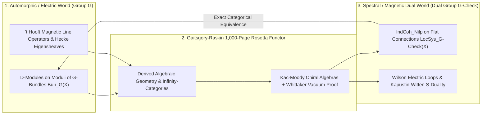

# The Grand Rosetta Stone of Mathematics: Gaitsgory, Raskin & the 1,000-Page Geometric Langlands Proof
**Pillar 2: Embodied AI, Robotics & Self-Driving Science — Carbon Edition**

> **The Cynic's Reflex:**
> *"Modern pure mathematics has splintered into hyper-specialized silos so abstract that nobody understands a colleague down the hall—and the deepest unification dreams of the twentieth century are decades away from human reach, with zero bearing on real-world physics."*
>
> **The 2026 Breakthrough Reality:**
> After more than thirty years of sustained effort building on **Robert Langlands's** 1967 vision and **Alexander Beilinson and Vladimir Drinfeld's** geometric reformulation, a nine-mathematician symphony led by **Dennis Gaitsgory** (*Max Planck Institute for Mathematics*, awarded the **2025 Breakthrough Prize in Mathematics**) and **Sam Raskin** (*Yale University*)—together with **Dima Arinkin, Dario Beraldo, Justin Campbell, Lin Chen, Joakim Faergeman, Kevin Lin, and Nick Rozenblyum**—completed a monumental **five-paper, ~1,000-page proof** settling the **unramified Geometric Langlands Conjecture** in characteristic zero. Even more remarkably, this mathematical "Grand Rosetta Stone" turns out to be the exact mirror of **Kapustin–Witten electromagnetic S-duality** in four-dimensional quantum gauge field theory—linking prime-number symmetries, Riemann surfaces, and magnetic monopoles under one cathedral roof.

---

## Act I: Two Dialects of the Same Universe — A Human Story from 2030

Snow dusts the cobblestones along the Rhine in Bonn, Germany, in February 2030 as twenty-seven-year-old theoretical physicist **Dr. Amina Al-Mansoor** and algebraic geometer **Dr. Henrik Lindholm** stand side-by-side before a wall-sized interactive **Lean-Langlands Blueprint** screen at the Max Planck Institute.

Amina studies **topological quantum error-correcting codes and non-Abelian anyons**—trying to compute an intractable strong-coupling magnetic monopole scattering amplitude inside a 4D gauge theory. Ten years ago, her calculation would have hit an infinite perturbative wall, and Henrik's papers on *derived categories of $\mathcal{D}$-modules* might as well have been written in Linear A.

Today, they cross the **Geometric Langlands Bridge** in twenty minutes:

* **Translating Across the Dictionary:** Using **Kapustin–Witten S-duality**—now anchored on Gaitsgory and Raskin's proven categorical equivalence—Amina's impossible strongly coupled magnetic gauge integral on group $G$ translates *exact-for-exact* into a clean, weakly coupled geometric **flat connection** on the Langlands dual group $\check{G}$.
* **Machine-Assisted Functorial Transport:** What looked like an intractable wilderness of infinite-dimensional bundles on one side of the mirror collapses into an explicit, computable spectral eigenvalue problem on the other.
* **From Pure Thought to Physical Hardware:** By afternoon tea, Henrik and Amina verify the invariant inside an open formal blueprint—handing condensed-matter engineers in Delft an exact topologicalbraiding phase for fault-tolerant quantum hardware.

---

## Act II: How Nine Minds Built a 1,000-Page Bridge Across Mathematics

To grasp why mathematicians call the **Langlands Program** the *"Grand Unified Theory of Mathematics,"* start with a famous 1940 letter written from a French military prison by **André Weil**. Weil compared modern mathematics to a **three-column Rosetta Stone**:
1. **Column I — Number Theory:** Prime numbers and algebraic number fields (where Andrew Wiles proved Fermat's Last Theorem via a special Langlands case!).
2. **Column II — Function Fields over Finite Curves:** Curves defined over finite clock-arithmetic fields (bridged via Laurent Lafforgue and Vladimir Drinfeld's Fields Medal proofs).
3. **Column III — Geometry of Riemann Surfaces:** Smooth complex shapes—doughnuts and pretzels—where topology, calculus, and complex physics live.

In 1967, thirty-year-old **Robert Langlands** wrote a humble 17-page letter to Weil proposing that seemingly unrelated worlds—**Galois symmetries** of equations and **automorphic harmonic waves**—were secretly coupled through a mysterious **Langlands Dual Group** ($\check{G}$). In the 1980s–1990s, **Vladimir Drinfeld** and **Alexander Beilinson** translated that vision onto complex Riemann surfaces (Column III), birthing the **Geometric Langlands Conjecture**.

### 1. The Dictionary: Automorphic Waves $\leftrightarrow$ Spectral Geometry
In its modern categorical form pioneered by **Beilinson, Drinfeld, Arinkin, and Gaitsgory**, the Geometric Langlands equivalence states an exact isomorphism between two vast infinite-dimensional universes attached to any complex algebraic curve $X$ and reductive symmetry group $G$:

$$\text{D-mod}(\text{Bun}_G(X)) \;\simeq\; \text{IndCoh}_{\text{Nilp}}(\text{LocSys}_{\check{G}}(X))$$

* **The Automorphic Left Side ($\text{Bun}_G$):** Sheaves of differential equations ($\mathcal{D}$-modules) living over the geometric space of all $G$-bundles on the surface $X$—the geometric analogue of decomposing a drum's vibration into fundamental harmonic frequencies.
* **The Spectral Right Side ($\text{LocSys}_{\check{G}}$):** Coherent sheaves over the space of flat $\check{G}$-connections (fundamental-group representations, the geometric cousin of Galois symmetries), corrected delicately by Arinkin–Gaitsgory's **nilpotent singular support** ($\text{Nilp}$).

### 2. The Monumental 2024–2026 Nine-Author Synthesis
For three decades, proving this equivalence seemed almost superhumanly subtle because standard algebra blurred topological "higher homotopies" to zero. **Dennis Gaitsgory**, **Jacob Lurie**, **Bertrand Toën**, and **Gabriele Vezzosi** first had to co-invent an entire new foundational language—**Derived Algebraic Geometry** and $\infty$-categories—just to state the theorem cleanly!

Then, culminating in **five interlocking papers totaling nearly 1,000 pages** released in 2024 and celebrated globally across 2025–2026 (earning Gaitsgory the **\$3M Breakthrough Prize in Mathematics**):
* **Nine Interlocking Architects:** **Dennis Gaitsgory** and **Sam Raskin**, working hand-in-hand with former students and peers **Dima Arinkin, Dario Beraldo, Justin Campbell, Lin Chen, Joakim Faergeman, Kevin Lin, and Nick Rozenblyum**, conquered the final boss of the proof: constructing the universal **Poincaré / Whittaker vacuum sheaf** compatibility and proving via **Kac–Moody chiral algebras** and *ambidexterity* that the Langlands functor is neither losing information nor missing states—it is a **100% lossless categorical equivalence**.

### 3. Why Physicists Gasped: Kapustin–Witten Electric-Magnetic S-Duality
In 2006, physicists **Anton Kapustin** and Fields Medalist **Edward Witten** discovered something uncanny: if you take four-dimensional $\mathcal{N}=4$ supersymmetric Yang–Mills quantum gauge theory and compactify two dimensions onto the Riemann surface $X$, **physical electromagnetic S-duality**—which swaps electric charges (group $G$, coupling $e$) with magnetic monopoles (Langlands dual group $\check{G}$, coupling $1/e$) and maps **'t Hooft magnetic line operators** to **Wilson electric loops**—becomes *literally the Geometric Langlands Correspondence*! Gaitsgory and Raskin's proof placed a century of physicist intuition onto granite mathematical bedrock.

### Comparing Unification Milestones Across André Weil's Three-Column Rosetta Stone

| Rosetta Column | Mathematical Terrain | Landmark Breakthroughs | What the Dictionary Unlocks |
| :--- | :--- | :--- | :--- |
| **Column I: Arithmetic** | Rational numbers $\mathbb{Q}$ & Prime Numbers | Wiles–Taylor ($\text{GL}_2$, Fermat's Last Theorem, 1994); Scholze Fargues–Fontaine *p*-adic geometry | Translates prime-number distribution & elliptic curves into modular harmonic waves |
| **Column II: Function Fields** | Curves over finite fields $\mathbb{F}_q(t)$ | Drinfeld ($\text{GL}_2$, 1980s) & Laurent Lafforgue ($\text{GL}_n$, 2002); Vincent Lafforgue | Bridges Weil's finite-field Riemann Hypothesis with geometric symmetry |
| **Column III: Complex Curves** | Riemann surfaces over $\mathbb{C}$ | **Gaitsgory, Raskin & 7 Co-Authors (2024–2026, ~1,000 pp.)** | **Full categorical Geometric Langlands proved** for all reductive groups $G$ |
| **Column IV: Quantum Physics** | 4D Gauge Theory & Conformal Field Theory | Kapustin–Witten S-Duality; Frenkel Kac–Moody Affine Algebras | Maps strong-coupling magnetic monopoles ($G$) to computable electric flat bundles ($\check{G}$) |

> *"Geometric Langlands is a bridge between two completely different continents of mathematics—and when nine friends finally meet in the middle of the span after thirty years, you realize the two continents were always one planet."*
> — **Spirit of the Gaitsgory–Raskin Geometric Langlands Collaboration**, Max Planck Institute for Mathematics & Yale University (2025 Breakthrough Prize Milestone)

### 4. Leading Architects & Sister Unification Programs (2024–2026)

| Mathematician / Research Group | Core Contribution | 2024–2026 Impact Across Math & Physics |
| :--- | :--- | :--- |
| **Dennis Gaitsgory (MPIM Bonn) & Sam Raskin (Yale)** | Co-leaders of the 5-paper, ~1,000-page Geometric Langlands proof | Proved categorical unramified Geometric Langlands; Gaitsgory awarded **2025 Breakthrough Prize (\$3M)**. |
| **Arinkin, Beraldo, Campbell, Chen, Faergeman, Lin & Rozenblyum** | Singular support ($\text{Nilp}$), Whittaker models, Kac–Moody & spectral gluing | Turned lone-hero math into a modular, multi-generational 9-author collaborative triumph. |
| **Alexander Beilinson & Vladimir Drinfeld** (*U. Chicago*) | Quantization of Hitchin integrable systems & chiral algebras | Authored the foundational vision linking differential operators on $\text{Bun}_G$ to opers on $\check{G}$. |
| **Edward Witten (IAS) & Anton Kapustin (Caltech)** | Gauge-theoretic S-duality formulation of Geometric Langlands | Connected abstract algebraic geometry directly to 4D quantum Yang–Mills & topological field theory. |
| **Peter Scholze (MPIM Bonn) & Laurent Fargues** | Geometrization of the Local Arithmetic Langlands Program | Transporting Gaitsgory–Raskin geometric tools back into prime-number *p*-adic arithmetic via the Fargues–Fontaine curve! |
| **Edward Frenkel (UC Berkeley) & Ben-Zvi–Sakellaridis–Venkatesh** | Relative Langlands duality & physics-period unification | Unifying electric/magnetic quantum field phases with number-theoretic $L$-functions. |

---

## Act III: Reimagining Social Conventions — Multi-Author Symphonies Replacing the "Lone Tortured Genius" Myth

For centuries, popular movies portrayed great mathematicians as isolated hermits guarding secret notebooks in attics for decades. The Geometric Langlands victory models a healthier, far more joyful scientific culture:

1. **Intergenerational Mentorship as a Superpower:**
   Nearly all nine co-authors on the 1,000-page proof were former PhD students, postdocs, or close mentees in an open intellectual family tree spanning Bonn, Harvard, Chicago, MIT, Yale, and Wisconsin—sharing unfinished drafts openly for over a decade rather than racing to scoop one another.
2. **Next Frontier — Auto-Formalizing 1,000-Page Cathedrals in Lean 4:**
   A 1,000-page proof written in $\infty$-categorical derived algebraic geometry challenges even elite human referees. By late 2026, mathematicians began charting the multi-year roadmap to decompose Geometric Langlands and $\infty$-category foundations (* Riehl–Verity / Lurie Kerodon*) into **Lean 4 Blueprints**—so future physicists and graduate students can query, compose, and build atop every lemma with instant compiler certainty.
3. **Feeding Back to Prime Numbers & Cryptography:**
   Through **Peter Scholze and Laurent Fargues's** *geometrization of local arithmetic Langlands* and **Ben-Zvi, Sakellaridis & Venkatesh's** relative duality, proving Column III (geometry) actively hands back powerful geometric weapons to crack Column I (prime numbers, $L$-functions, and post-quantum algebraic structures).

### Global Precedents & Institutional Proof Points
* **MPIM Bonn & Yale Open Five-Paper Release (2024–2026):** Nearly 1,000 pages of coordinated derived-geometric proofs published openly for global community seminar verification, honored with the **2025 Breakthrough Prize in Mathematics**.
* **Fargues–Scholze Arithmetic-Geometric Bridge:** Proven blueprint demonstrating that geometric sheaf techniques on curves (*Fargues–Fontaine curve*) solve concrete local *p*-adic representation problems in number theory.
* **Kerodon & Higher-Category Formalization Initiatives:** Jacob Lurie's open digital encyclopedia of $\infty$-categories paired with emerging **Lean 4** higher-algebra libraries laying the groundwork for machine-checked functorial dictionaries.

### Four Frontier Domains Transformed by the Langlands Rosetta Stone by 2033
* **Non-Perturbative 4D Quantum Gauge Amplitudes:** Using proven Kapustin–Witten S-duality functors to translate intractable strong-coupling magnetic monopole dynamics into solvable weak-coupling flat connections.
* **Topological Quantum Error-Correcting Codes:** Designing fault-tolerant non-Abelian anyon braiding gates grounded in modular tensor categories and 2D conformal chiral algebras.
* **Prime-Number Distribution & Special $L$-Values:** Transporting geometric Whittaker and Eisenstein sheaf methods back across Weil's Rosetta Stone toward deeper cases of the arithmetic Langlands conjectures.
* **Queryable Formal Higher-Category Libraries:** Graduate students and physicists composing 1,000-page geometric dualities inside interactive Lean Blueprints without decade-long prerequisite barriers.

### Trajectory of Langlands Unification & Physics-Geometry Cross-Pollination

| Stage & Era | Langlands Horizon Reached | Collaboration Architecture | Formal / Computational Accessibility | Physics & Technology Resonance |
| :--- | :--- | :--- | :--- | :--- |
| **1967–1995 Classical Roots** | Langlands letter; Wiles $\text{GL}_2$ modularity | 1–2 author heroic marathons | Handwritten / isolated LaTeX | Early hints of modular symmetry in string theory |
| **2006–2018 Derived Buildout** | Kapustin–Witten physics link; Lurie/Gaitsgory $\infty$-categories | Small specialist circles | Thousands of pages of dense preprints | S-duality dictionary framed for 4D gauge fields |
| **2024–2026 Breakthrough** | **Full Unramified Geometric Langlands Proved (~1,000 pp.)** | **9-author open multi-paper symphony** | Kerodon + Lean $\infty$-category foundations | Exact bridge to topological QFTs & Fargues–Scholze |
| **2032 Unified Horizon** | Ramified, Quantum & Relative Arithmetic-Geometric synthesis | Global human + AI Lean Blueprints | Queryable machine-checked functor libraries | Topological quantum codes & non-perturbative gauge solvers |

---

## Act IV: The Synergy Cascade

The Geometric Langlands Rosetta Stone resonates directly across neighboring Carbon frontiers:
* **AI Formal Mathematics & Lean 4 ([`ai-formal-mathematics`](../ai-formal-mathematics/REPORT.md)):** Monumental 1,000-page proofs like Gaitsgory–Raskin are the ultimate catalyst for **Lean 4 $\infty$-category libraries**, ensuring humanity's deepest theorems never remain locked inside ten human brains.
* **3D Kakeya & Hilbert's Sixth Problem ([`kakeya-hilbert-sixth-proofs`](../kakeya-hilbert-sixth-proofs/REPORT.md)):** Together with Wang–Zahl's 3D Kakeya proof and Deng–Hani–Ma's kinetic derivation of fluid equations, Geometric Langlands anchors the **2025–2026 Golden Biennium of Pure & Physical Mathematics**.
* **Fault-Tolerant Quantum Logical Simulation ([`quantum-logical-simulation`](../quantum-logical-simulation/REPORT.md)):** Topological quantum field theories, modular tensor categories, and Kapustin–Witten line-operator dualities supply the exact algebraic grammar governing non-Abelian topological qubits and gauge-lattice quantum simulators.

---

## References & Verified Sources

* **Featured Breakthrough:** [Proof of the Geometric Langlands Conjecture — Dennis Gaitsgory, Sam Raskin, Dima Arinkin, Dario Beraldo, Justin Campbell, Lin Chen, Joakim Faergeman, Kevin Lin & Nick Rozenblyum (MPIM Bonn Five-Paper Archive)](https://www.mpim-bonn.mpg.de/gaitsgory/GLC/)
* **Institutions & Prizes:** [Max Planck Institute for Mathematics (Bonn — Dennis Gaitsgory & Peter Scholze)](https://www.mpim-bonn.mpg.de/) · [Breakthrough Prize in Mathematics (2025 Laureate Dennis Gaitsgory)](https://breakthroughprize.org/) · [Yale University Department of Mathematics (Sam Raskin)](https://math.yale.edu/) · [Institute for Advanced Study — Robert Langlands & Edward Witten Archives](https://www.ias.edu/math/langlands)
* **Foundational Monographs & Physics Links:** [Anton Kapustin & Edward Witten — Electric-Magnetic Duality and the Geometric Langlands Program (*Communications in Number Theory and Physics*)](https://arxiv.org/abs/hep-th/0604151) · [Edward Frenkel — *Love and Math* & Langlands Gauge Duality](https://math.berkeley.edu/~frenkel/) · [Kerodon — Jacob Lurie's Open Online Textbook of Higher Category Foundations](https://kerodon.net/)
* **Connected Carbon Pathways:** [Hallucination-Free Genius: Lean 4, AlphaProof & Co-Pilot Discovery](../ai-formal-mathematics/REPORT.md) · [Needles, Atoms & Fluids: Solving 3D Kakeya, Hilbert's Sixth Problem & Formalized Harmonic Analysis](../kakeya-hilbert-sixth-proofs/REPORT.md) · [Fault-Tolerant Quantum + AI Chemistry Simulators](../quantum-logical-simulation/REPORT.md) · [Sacred Worth, Contemplation & Deep Human Flourishing](../../04-social-norms/sacred-worth-contemplation/REPORT.md)
