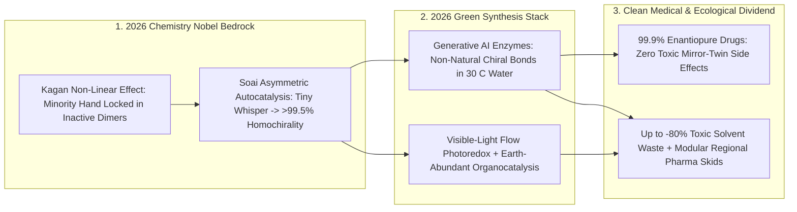

# 2026 Chemistry Nobel: Spontaneous Mirror-Symmetry Breaking & Zero-Waste Chiral Synthesis
**Pillar 2: Embodied AI, Robotics & Self-Driving Science — Carbon Edition**

> **The Cynic's Reflex:**
> *"Pharmaceutical and specialty chemical manufacturing will always be an energy-guzzling toxic soup—boiling petroleum solvents at high pressure, throwing away 50 to 100 kilograms of hazardous waste for every 1 kilogram of pure single-handed medicine, while nobody even knows how Earth's own biology picked left-handed amino acids."*
>
> **The 2026 Breakthrough Reality:**
> In October 2026, the **Nobel Prize in Chemistry** honored **Henri B. Kagan** and **Kenso Soai** for solving how mirror-symmetric chemistry non-linearly amplifies tiny imbalances into **100% single-handed ("homochiral") molecules**—cracking the century-old mystery of life's origin and anchoring modern asymmetric synthesis. Paired in 2026 with **AI-designed directed-evolution biocatalysts** and **continuous-flow photoredox organocatalysis** (**Merck, Codexis, Solugen**), green chemical plants now forge **99.9% enantiopure** medicines and agrochemicals in room-temperature water—slashing toxic organic solvent waste by up to **80%**.

---

## Act I: Pure Medicine Without the Chemical Smokestack — A Human Story from 2030

Along the lush green riverfront outside Cork, Ireland—and mirrored at a compact municipal bio-foundry in Hyderabad, India—process
engineer Aoife Murphy walks past sunlit glass tubular reactors humming quietly at $28^\circ\text{C}$ ($82^\circ\text{F}$). Ten years
earlier, manufacturing a complex chiral oncology or antiviral drug required three-story stainless-steel batch vats filled with
flammable dichloromethane, toxic palladium/rhodium salts, and cryogenic cooling—generating **60 tons of hazardous incinerated
solvent waste** per ton of active medicine, while driving generic drug shortages whenever an overseas solvent plant went offline.

Aoife taps the inline polarimeter readout on Batch #412 of a pediatric anti-seizure therapy:

* **99.98% Single-Handed Purity in Plain Water:** Your left and right hands contain identical atoms yet cannot superimpose; drug receptors in a child's brain are equally "handed" (**chiral**), where the left-handed molecule heals while its mirror twin (**enantiomer**) can cause liver toxicity or birth defects. Inside Aoife's continuous-flow reactor, **AI-designed immobilized enzymes** coupled with **blue-LED photoredox organocatalysts** snap carbon centers exclusively into the healing $(S)$-hand on the very first pass—zero wasteful racemic $50/50$ separation required.
* **80% Less Waste, 70% Cheaper Essential Generics:** Because nonlinear chiral amplification and bespoke biocatalysts run in warm aqueous buffer at 1 atmosphere, the plant's environmental waste ratio (**E-factor**) plunged from $65\text{ kg}$ of waste per kilogram of medicine down to $<8\text{ kg}$ (mostly benign water and salt)—slashing pediatric drug prices across public health systems worldwide.

---

## Act II: Cracking Pasteur's 178-Year Puzzle — From the Soai Reaction to AI Biocatalysts

Ever since Louis Pasteur hand-sorted left- and right-handed tartrate crystals with tweezers in 1848, two twin mysteries haunted
chemistry:
1. **The Origin-of-Life Paradox (Homochirality):** Ordinary test-tube chemistry without living enzymes produces an exact **50:50 ("racemic") mix** of left- and right-handed molecules—which prevents RNA and proteins from folding! How did prebiotic Earth jump from dead 50:50 symmetry to **100% L-amino acids and 100% D-sugars**?
2. **The Industrial Chiral Bottleneck:** Over **60% of small-molecule pharmaceuticals** and next-generation crop-protection agents are chiral. Throwing away half a batch after late-stage chiral chromatography—or relying on scarce, toxic precious-metal catalysts—made clean medicine shockingly wasteful.

### 1. The October 2026 Nobel Prize in Chemistry: Henri B. Kagan & Kenso Soai
The Royal Swedish Academy of Sciences awarded the **2026 Nobel Prize in Chemistry** jointly to **Henri B. Kagan** (Université
Paris-Saclay) and **Kenso Soai** (Tokyo University of Science) *"for the discovery of non-linear effects and autocatalysis in
asymmetric organic synthesis"*:
* **Henri B. Kagan's Non-Linear Chiral Amplification:** Upended textbook dogma by proving that an impure chiral catalyst (say, only $20\%$ enantiomeric excess) can yield a $>95\%$ enantiopure product! Because opposite-handed catalyst molecules lock each other up into inactive *meso* dimers while the slight majority hand stays hyper-active, **tiny chiral nudges amplify non-linearly**. Also pioneered $C_2$-symmetric diphosphine ligands (**DIOP**) and Kagan's $\text{SmI}_2$ single-electron chemistry.
* **Kenso Soai's Asymmetric Autocatalysis (The Soai Reaction):** Discovered the first—and still iconic—chemical reaction where a chiral pyrimidyl alkanol **catalyzes its own creation while suppressing its mirror twin**. Starting from an almost undetectable chiral whisper—circularly polarized starlight, chiral quartz crystal surfaces, or even a $0.00005\%$ statistical isotope imbalance between $^{12}\text{C}$ and $^{13}\text{C}$—the Soai snowball amplifies symmetry breaking to **$>99.5\%$ single-handed purity**!

### 2. The 2025–2026 Industrial Revolution: AI Enzymes + Flow Photoredox Catalysis
Building directly on nonlinear stereocontrol, late-2026 chemical engineering fused three clean catalytic engines:
* **De Novo AI Chiral Biocatalysts (*Codexis, Merck, Baker/Arnold Lineages*):** Generative protein foundation models (RFdiffusion2 / AlphaProteo / ProteinMPNN successors) design hyper-stable enzymes for reactions that *never existed in nature* (chiral silicon-carbon, boron-carbon, and strained cyclopropane bonds)—delivering **$>99.9\%$ enantiomeric excess ($ee$)** in ambient water without precious metals.
* **Chemo-Enzymatic & Cell-Free Industrial Scaling (*Solugen Bioforge, Merck Continuous Manufacturing*):** Solugen's Houston and Minnesota **Bioforges** combine evolved enzymes with earth-abundant metal catalysts in zero-wastewater continuous loops, while **Merck's** award-winning biocatalytic cascades (from *islatravir* and *molnupiravir* to 2026 oncology pipelines) compress 12-step solvent-heavy syntheses into **3-step aqueous cascades**.
* **Blue-LED Asymmetric Photoredox Organocatalysis:** Visible-light LEDs paired with small organic chiral catalysts forge crowded 3D $sp^3$ stereocenters at room temperature in narrow glass microchannels—eliminating high-pressure thermal runaway hazards.

### Comparing Chemical Manufacturing Paradigms

| Synthesis Dimension | Legacy Racemic & Precious-Metal Batch (2000s) | Early Asymmetric Transition Metals (2015) | 2026+ AI Biocatalysis + Autocatalytic / Flow Cascades |
| :--- | :--- | :--- | :--- |
| **Mirror Purity ($ee$)** | $50:50$ mix (discard $50\%$ of batch at end!) | $85\%\text{–}98\%$ $ee$ (needs recrystallization) | **$99.5\%\text{–}99.99\%$ $ee$ directly in flow** |
| **Catalyst Elements** | Stoichiometric reagents, $\text{Cr(VI)}$, $\text{AlCl}_3$ | Scarce $\text{Rh, Ir, Pd, Ru}$ ($> \$5,000/\text{oz}$) | **Biodegradable AI enzymes, light & abundant $\text{Fe/Ni/Zn}$** |
| **Solvent & Conditions** | Boiling chlorinated/THF solvents ($-78^\circ\text{C}$ to $150^\circ\text{C}$) | Pressurized organic solvents | **Ambient $25\text{–}35^\circ\text{C}$ water / green bio-solvents** |
| **Waste per kg Drug (E-Factor)** | $50\text{–}120\text{ kg}$ hazardous toxic waste | $25\text{–}50\text{ kg}$ waste | **$<5\text{–}12\text{ kg}$ (**up to 80%+ toxic solvent cut**)** |
| **Plant Footprint** | Acre-wide batch tank farms | Multi-batch campaign suites | **Shipping-container continuous modular flow skids** |

> *"That a vanishingly small chiral imbalance—even between carbon-12 and carbon-13 isotopes—can snow-ball through autocatalysis into near-perfect single-handed purity bridges the non-living chemical cosmos and the living homochiral world."*
> — **2026 Nobel Prize in Chemistry Scientific Background**, Honoring **Henri B. Kagan** & **Kenso Soai**

### 3. Leading Pioneers & Verified Milestones (2024–2026)

| Laureate / Organization | Core Breakthrough | Verified 2024–2026 Impact |
| :--- | :--- | :--- |
| **Henri B. Kagan** (*Université Paris-Saclay — 2026 Nobel*) | Non-linear effects in asymmetric catalysis & chiral ligands | Proved sub-pure catalysts yield ultra-pure chiral drugs; foundational to industrial stereoselective chemistry. |
| **Kenso Soai** (*Tokyo Univ. of Science — 2026 Nobel*) | Asymmetric autocatalysis (**Soai Reaction**) | Demonstrated spontaneous & amplified mirror-symmetry breaking to $>99.5\%$ $ee$; origin-of-life landmark. |
| **Merck Process R&D & Codexis** | Multi-enzyme biocatalytic cascades & AI enzyme evolution | Replaced 10+ toxic organic-solvent steps with aqueous room-temp cascades; multiple EPA Green Chemistry Awards. |
| **Solugen** (*Bioforge Chemo-Enzymatic Platform*) | Cell-free AI enzyme + heterogeneous metal reactor scale-up | Commercial 10,000-ton-scale carbon-negative specialty chemicals from corn dextrose with zero wastewater. |
| **Photoredox & Organocatalysis Labs** (*MacMillan, List, Jacobsen, Nicewicz*) | Visible-light radical & hydrogen-bond asymmetric catalysis | Unlocked rapid 3D chiral drug libraries and continuous-flow manufacturing without precious metals. |

---

## Act III: Reimagining Social Conventions — Ending "Sacrifice Zone" Chemical Valleys & Drug Shortages

For a century, communities living downwind of petrochemical corridors—from Louisiana's "Cancer Alley" to river basins outside
industrial hubs—paid with their lungs for society's medicines, plastics, and fertilizers, while hospitals suffered chronic shortages
of off-patent sterile drugs reliant on fragile 10,000-mile solvent supply chains.

1. **Clean Neighborhood Bio-Foundries Replace Toxic Tank Farms:**
   When chiral synthesis runs at $30^\circ\text{C}$ in water inside sealed continuous-flow glass modules with **80% less organic solvent**,
   pharmaceutical manufacturing no longer requires hazardous-waste incinerators—allowing every country and region to run clean,
   on-demand essential-medicine micro-plants within five miles of regional hospitals.
2. **Targeted Chiral Agrochemicals That Spare Bees & Soil:**
   Historically, many herbicides and fungicides were sprayed onto farmland as lazy 50:50 racemic mixtures—meaning **half the tonnage
   dumped onto soil and watersheds was biologically useless chemical runoff**! Single-enantiomer green synthesis cuts field chemical
   loads by **50% overnight** with identical crop protection.
3. **Astrobiology's Sharpest Biosignature:**
   Understanding Kagan–Soai symmetry amplification guides NASA and ESA sample-return and Europa/Enceladus/Mars instruments to
   distinguish abiotic chiral mineral amplification from living metabolic homochirality.

### Global Precedents & Institutional Proof Points
* **2026 Nobel Prize in Chemistry (Royal Swedish Academy of Sciences, Oct 2026):** Elevated non-linear stereochemical amplification and autocatalysis to chemistry's highest global honor.
* **FDA *Guidance on Development of Stereoisomeric Drugs* & EMA Chiral Purity Mandates:** Regulatory frameworks requiring rigorous single-enantiomer characterization for new therapeutics.
* **U.S. EPA *Presidential Green Chemistry Challenge Awards* & ACS Pharmaceutical Roundtable:** Industry-wide Process Mass Intensity (PMI) benchmarks driving down organic solvent consumption across top-20 global drugmakers.

### Four Everyday Lives Touched by Clean Homochiral Chemistry by 2032
* **Safer Pediatric & Maternal Medicines:** Zero off-target toxicity from unwanted mirror-image drug isomers, priced pennies per dose.
* **Half-Dose Precision Crop Protection:** Enantiopure biodegradable pheromones and fungicides cutting agricultural watershed runoff by 50%+.
* **Clean Fragrance, Vitamin & Nutrition Ingredients:** Menthol, vitamins E/K, and amino-acid supplements brewed enzymatically without petrochemical benzene.
* **Chiral Spintronic & Optical Metamaterials:** Homochiral organic polymers powering ultra-efficient circularly polarized OLED displays and **Chiral-Induced Spin Selectivity (CISS)** biosensors.

### Trajectory of Clean Asymmetric & Homochiral Manufacturing

| Stage & Era | Dominant Chiral Technology | Typical Pharmaceutical Waste (E-Factor) | Precious-Metal Dependency | Global Health & Eco Impact |
| :--- | :--- | :--- | :--- | :--- |
| **1980s Racemic Era** | 50:50 batch synthesis + wasteful chiral resolution | $80\text{–}150\text{ kg}$ toxic waste / kg API | Stoichiometric heavy metals | High side-effect risk & severe river pollution |
| **2001–2021 Era** | Homogeneous $\text{Rh/Ru/Pd}$ ligands + early organocatalysis | $30\text{–}60\text{ kg}$ waste / kg API | High ($\text{Rh, Ir, Pd}$) | Enabled blockbuster single-hand drugs |
| **Late 2026 SOTA** | **Nobel Kagan/Soai bedrock + AI biocatalysts + LED flow** | **$8\text{–}18\text{ kg}$ (-75% to -80% solvents)** | **Rapidly dropping (enzymes + Fe/Ni)** | Aqueous Merck/Codexis/Solugen industrial lines |
| **2033 Abundance** | Autonomous self-driving AI-enzyme + autocatalytic flow skids | **$<3\text{ kg}$ (closed-loop water & bio-carbon)** | **Near zero** | Sovereign clean regional generics & -50% farm runoff |

---

## Act IV: The Synergy Cascade

Homochiral Asymmetric Catalysis bridges atomic biology, autonomous labs, and spintronics across the Carbon Atlas:
* **Self-Driving Labs ([`self-driving-labs`](../self-driving-labs/REPORT.md)):** Robotic microfluidic synthesis platforms screen 10,000 continuous-flow photoredox and nonlinear ligand conditions per week—discovering new asymmetric cascades $100\times$ faster than manual flasks.
* **Protein Atomic Nanofabrication ([`protein-atomic-nanofabrication`](../protein-atomic-nanofabrication/REPORT.md)):** Generative protein design crafts custom homochiral enzymatic pockets with sub-angstrom active-site geometry for any target carbon-carbon or carbon-nitrogen bond.
* **Forever-Chemical Cleanup ([`forever-chemical-cleanup`](../../03-bioscience-regeneration/forever-chemical-cleanup/REPORT.md)) & Precision Fermentation ([`precision-fermentation-rewilding`](../../03-bioscience-regeneration/precision-fermentation-rewilding/REPORT.md)):** Replacing racemic petrochemical agrochemicals and chlorinated solvents stops toxic chemical plumes at the factory gate before they ever enter groundwater.

---

## References & Verified Sources

* **Featured Researchers / Leaders:** [Henri B. Kagan & Kenso Soai — Laureates of the 2026 Nobel Prize in Chemistry](https://www.nobelprize.org/prizes/chemistry/)
* **Companies, Labs & Consortia:** [Nobel Prize in Chemistry Official Archive (Royal Swedish Academy of Sciences)](https://www.nobelprize.org/prizes/chemistry/) · [Tokyo University of Science (Soai Asymmetric Autocatalysis)](https://www.tus.ac.jp/en/) · [Université Paris-Saclay ICMMO (Kagan Non-Linear Effects)](https://www.universite-paris-saclay.fr/en) · [Codexis (AI-Directed Enzyme Biocatalysis)](https://www.codexis.com/) · [Solugen (Chemo-Enzymatic Bioforge Platform)](https://solugen.com/) · [ACS Green Chemistry Institute Pharmaceutical Roundtable](https://www.acs.org/greenchemistry.html)
* **Global & Regulatory Precedents:** [U.S. EPA Green Chemistry Challenge Awards (Biocatalytic Drug Synthesis)](https://www.epa.gov/greenchemistry) · [FDA Guidance on Development of New Stereoisomeric Drugs](https://www.fda.gov/regulatory-information/search-fda-guidance-documents/development-new-stereoisomeric-drugs) · [European Medicines Agency ICH Q6A & Q11 Green Continuous Flow Standards](https://www.ema.europa.eu/en)
* **Connected Carbon Pathways:** [24/7 Autonomous Wet-Labs & Cloud Foundries](../self-driving-labs/REPORT.md) · [Atomic Lego: Programmable De Novo Protein Nanomachines](../protein-atomic-nanofabrication/REPORT.md) · [Destroying Forever Chemicals & Healing Aquifers](../../03-bioscience-regeneration/forever-chemical-cleanup/REPORT.md) · [Precision Fermentation & Rewilding Half the Earth](../../03-bioscience-regeneration/precision-fermentation-rewilding/REPORT.md)
