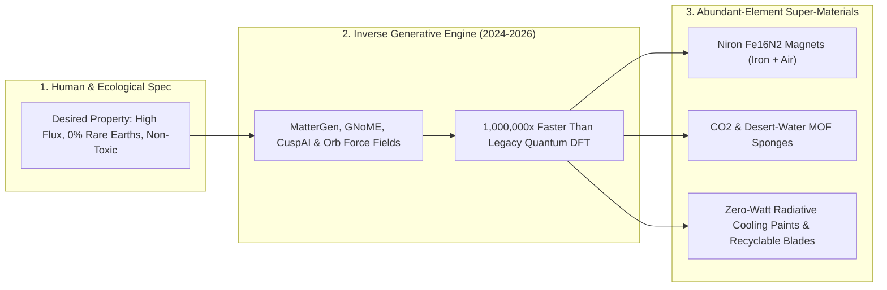

# Designing Matter Backwards: AI Super-Materials Without Rare-Earth Scars
**Pillar 2: Embodied AI, Robotics & Self-Driving Science — Carbon Edition**

> **The Cynic's Reflex:**
> *"Every clean-energy promise is just an ecological shell game—trading oil wells for toxic rare-earth strip mines, cobalt pits, and geopolitical chokepoints, because finding a better magnet or battery crystal takes twenty years of lucky lab accidents."*
>
> **The 2026 Breakthrough Reality:**
> Humanity has flipped materials science from slow forward screening to **Generative Inverse Design**—telling AI diffusion models like Microsoft's **MatterGen**, DeepMind's **GNoME** (2.2 million stable crystals), **Orbital Materials**, and **CuspAI** the exact magnetic, thermal, or carbon-capture properties we want, and generating stable atomic lattices made purely from abundant Earth-crust elements. Already, **Niron Magnetics' Clean Earth Magnet** ($\alpha''\text{-Fe}_{16}\text{N}_2$) replaces mined rare earths with iron and nitrogen from thin air!

---

## Act I: Cool Roofs in Jaipur and Clean Motors in Minnesota — A Human Story from 2031

Step onto the flat lime-plastered rooftop of a public girls' middle school in Jaipur, India, at 1:30 PM in May 2031.
Outside in the street shade, the desert pre-monsoon air shimmers at $44^\circ\text{C}$. Yet when twelfth-grade physics teacher
Meera Sharma places her palm directly against the school's gleaming white roof membrane, the surface feels cool to the touch—
actually $5^\circ\text{C}$ cooler than the surrounding shade air!

Downstairs in Classroom 4B, sixty students study algebra comfortably at $26^\circ\text{C}$ with **zero air-conditioning compressors**
straining the neighborhood grid:

* **Passive Sky-Window Radiative Cooling:** Two summers earlier, local painters rolled on a \$1.40-per-square-meter **AI-designed barium-sulfate/silica metamaterial coating**. Engineered backwards via inverse optical scattering models, its hierarchical nanopores reflect **98.2% of incoming sunlight** while beaming indoor building heat straight out through the atmosphere's $8\text{–}13\text{ }\mu\text{m}$ infrared transparency window into the $-270^\circ\text{C}$ cold sink of deep space—dropping indoor temperatures $6^\circ\text{C}$ to $8^\circ\text{C}$ using zero watts of electricity.
* **Drinking Water Pulled From Dry Desert Night Air:** Beside the school courtyard sits a silent solar drum packed with two kilograms of an inverse-designed **Metal-Organic Framework (MOF)** crystal sponge (developed via CuspAI and UC Berkeley reticular chemistry). All night long at 18% desert humidity, its tailored aluminum-fumarate nanopores drink water molecules out of thin air; morning sunlight warms the drum to release **90 liters of pure mineralized drinking water** for the school's lunch kitchen.
* **Eight Thousand Miles Away in Sartell, Minnesota:** Inside **Niron Magnetics'** buzzing manufacturing plant, technicians pull trays of super-powerful permanent magnets destined for offshore wind turbines, EV motors, and humanoid joints. Not one gram of neodymium, praseodymium, or dysprosium was strip-mined or acid-leached to make them. Their record magnetic flux comes entirely from abundant **iron** and **atmospheric nitrogen** arranged in a metastable body-centered tetragonal $\alpha''\text{-Fe}_{16}\text{N}_2$ lattice.

---

## Act II: Flipping the Arrow of Discovery — From Trial-and-Error Rocks to Inverse Diffusion

For five thousand years—from Bronze Age tin smelters to Thomas Edison testing 6,000 carbonized bamboo filaments—materials
discovery ran **forwards**: take whatever crystals nature happened to bake inside volcanoes, test their properties one by one,
and wait twenty years to commercialize a lucky hit. Before 2023, humanity's entire experimental catalog of stable inorganic
crystals (*ICSD*) totaled roughly **48,000 structures**.

Between late 2023 and late 2026, graph neural networks and 3D equivariant crystal diffusion models blew the periodic table wide open.

### 1. Mapping 2.2 Million Crystals & Generating Matter Backwards
* **Google DeepMind (*GNoME*):** Graph Networks for Materials Exploration discovered **2.2 million new thermodynamically stable crystal structures**—equivalent to 800 years of cumulative human crystallographic discovery—including **380,000 ultra-stable candidates** immediately uploaded to Lawrence Berkeley Lab's open *Materials Project*, with over 736 already independently synthesized in physical labs around the world.
* **Microsoft Research (*MatterGen* & *MatterSim*):** Instead of merely screening a fixed list of candidates, *MatterGen* introduced **3D generative crystal diffusion**: input target constraints—*"shear modulus $>150\text{ GPa}$, zero rare earths,zero toxic heavy metals, band gap $1.4\text{ eV}$"*—and the model denoises 3D atomic coordinates, element species, and unit-cell angles directly into novel synthesizable crystals, validated across temperatures and pressures by *MatterSim* machine-learning force fields at **1,000,000x the speed of quantum Density Functional Theory (DFT)**.
* **Domain-Specialized Generative Engines (*CuspAI*, *Orbital Materials*, *Altrove*, *Periodic Labs*):** *CuspAI* acts as a "search engine for porous MOFs," designing molecular carbon-capture and PFAS-filtration sponges with picometer pore selectivity, while *Orbital Materials'* **Orb** foundation force fields simulate million-atom catalytic surfaces in seconds.

### 2. Four Scarcity Bottlenecks Solved by Abundant-Element Substitution
1. **Rare-Earth-Free Super-Magnets (*Niron Magnetics* $\alpha''\text{-Fe}_{16}\text{N}_2$):** Sintered neodymium-dysprosium magnets create radioactive thorium tailings and acute supply concentration. Iron nitride delivers higher intrinsic magnetization than neodymium using two of the cheapest, cleanest elements on Earth: iron ($5\%$ of Earth's crust) and nitrogen ($78\%$ of air).
2. **Low-Energy $\text{CO}_2$ & Atmospheric Water MOFs (*Svante* / *CALF-20*, *CuspAI*, *Atoco*):** Zinc- and aluminum-based Metal-Organic Frameworks capture industrial $\text{CO}_2$ amidst steam or harvest desert drinking water at $<20\%$ relative humidity without toxic amines.
3. **Zero-Electricity Radiative-Cooling Coatings & Aerogels (*SkyCool Systems*, *Pirta*, Purdue/Columbia nanopaints):** Passive daytime sub-ambient cooling paints slash urban building air-conditioning loads by **20% to 40%** across tropical cities.
4. **Self-Healing Vascular & Vitrimer Structural Composites:** Wind-turbine blades and bridge decks infused with reversible dynamic covalent networks heal micro-cracks autonomously under gentle solar warmth—and dissolve cleanly back into reusable monomer resin at end of life instead of piling up in fiberglass landfills.

### Legacy Mining-Dependent Materials vs. 2026–2030 Inverse-Designed Abundant Substitutes

| Critical Application | Legacy Scarce / Toxic Material | Inverse-Designed Abundant Substitute | Geopolitical & Ecological Breakthrough |
| :--- | :--- | :--- | :--- |
| **EV, Wind & Robot Motors** | Neodymium + Dysprosium ($\text{NdFeB}$) | **Iron-Nitride ($\alpha''\text{-Fe}_{16}\text{N}_2$) Clean Earth Magnets** | **0% rare-earth mining**; raw element cost drops >85%; +15% higher magnetic flux potential |
| **Grid & EV Batteries** | Cobalt/Nickel NMC + liquid carbonate | **Sodium-Iron-Manganese & Solid Halide/Oxide Lattices** | Uses ocean salt, iron & abundant phosphates; non-flammable & zero cobalt pits |
| **Solar Tandem Top Cells** | Indium-Gallium arsenide (scarce indium) | **Lead-free Perovskites & Earth-Abundant Chalcogenides** | Printable roll-to-roll solar skins exceeding **33% efficiency** without rare metals |
| **Tropical Building Cooling** | HFC refrigerant AC units (grid spikes) | **Barium-Sulfate / Silica Radiative-Cooling Nanopaints** | Drops roof/indoor temp **$6^\circ\text{C}$** passively with **0 watts** of power |
| **Point & Direct Air $\text{CO}_2$** | Corrosive aqueous monoethanolamine | **Tailored Hydrophobic MOF Sponges (*CALF-20* / next-gen)** | Cuts regeneration steam energy **50%+**; survives millions of humid cycles |

### Bridging the "Synthesizability Gap" — From Pretty Lattice to Factory Floor
Early computational crystal papers in the 2010s drew skepticism because a crystal stable at absolute zero ($0\text{ K}$) in a vacuum often fell apart in humid room-temperature air or required impossible $50\text{ GPa}$ diamond-anvil pressures to bake.
Between 2024 and 2026, three filters closed the synthesizability gap:
1. **Finite-Temperature ML Force Fields (*MatterSim*, *MACE-MP*, *Orb*):** Models simulate vibrational phonons, grain boundaries, moisture attack, and $1,000^\circ\text{C}$ thermal expansion across millions of atoms in minutes—filtering out fragile crystals before a furnace ever turns on.
2. **Precursor Reaction-Pathway Scoring:** Generative agents co-predict not just the final crystal, but the cheapest solid-state or sol-gel precursor salts and furnace ramp temperatures required to grow pure phase.
3. **Closed-Loop Kilogram Scaling:** Partnering generative models directly with roll-to-roll slot-die coaters and rotary kilns ensures new magnets, MOF pellets, and roof coatings launch on existing industrial paint and ceramic machinery.

> *"For centuries, humanity discovered materials by trial, error, and serendipity; inverse AI design lets us ask nature for the exact atomic lattice our clean future requires."*
> — **Prof. Kristin Persson**, Director of the Materials Project, Lawrence Berkeley National Laboratory

### 3. Real Companies & National Labs Shipping Inverse-Designed Matter (2024–2026)

| Organization | Core Platform / Material | Verified 2024–2026 Real-World Milestone |
| :--- | :--- | :--- |
| **Niron Magnetics** | $\alpha''\text{-Fe}_{16}\text{N}_2$ Clean Earth Magnets | Opened commercial Sartell, MN pilot manufacturing plant; automotive & audio OEM partnerships (**GM**, **Stellantis**, **Volvo**). |
| **LBNL *Materials Project* & DeepMind *GNoME*** | Open 2.2M+ crystal database + stability GNNs | Expanded humanity's known stable inorganic crystal map **nearly 10x**; hundreds of novel structures physically synthesized. |
| **Microsoft Research** (*MatterGen* / *MatterSim*) | Conditional 3D crystal diffusion + universal ML force field | Open-sourced generative inverse crystal design hitting 2x+ higher stability/novelty rates across magnetic & mechanical targets. |
| **CuspAI & Svante (*CALF-20*)** | Generative MOF molecular sponges | Ton-scale industrial MOF production capturing cement/flue $\text{CO}_2$ and engineering custom water-harvesting & PFAS sorbents. |
| **Orbital Materials** (*Orb* Foundation Models) | Ultra-fast neural interatomic potentials | Partnering with cloud data centers and industrial chemical plants to deploy next-gen carbon-removal & green-fuel catalysts. |
| **SkyCool Systems & Cool-Roof Consortia** | Radiative sky-cooling optical metamaterial films/paints | Commercial cold-storage, grocery, and tropical school retrofits cutting cooling electricity 20%–100%. |

---

## Act III: Reimagining Social Conventions — Ending "Resource Wars" and Toxic Mining Sacrifice Zones

Cynics love to claim that transitioning off fossil fuels merely swaps petro-states for rare-earth monopolies and open-pit
tailings ponds. Inverse materials design demolishes that scarcity trap at the atomic root:

1. **Designing Out Geopolitical Chokepoints Before Building the Factory:**
   Every country on Earth has iron rust, silica sand, limestone, table salt, aluminum clay, and atmospheric nitrogen. When generative models constrain synthesis solely to the **top 12 abundant, non-toxic crustal elements**, resource wars over dysprosium or cobalt lose their economic logic overnight.
2. **Passive Cooling Equity for the Global South:**
   Nearly 3 billion people live in regions facing dangerous wet-bulb heat waves before 2035, often where electrical grids are fragile. A \$50 bucket of radiative-cooling nanopaint applied by local community crews lowers classroom, clinic, and tin-roof home temperatures by $6^\circ\text{C}$ immediately—saving elders and infants without adding one watt of fossil peak demand.
3. **"Cradle-to-Monomer" Circular Industrial Codes:**
   Instead of burying shredded wind-turbine blades in landfills, municipal procurement rules mandate **vitrimer and unzippable polymer matrices** designed backwards for one-step mild chemical recycling.

### Global Precedents & Institutional Proof Points
* **Open *Materials Project* Commons (300,000+ Registered Researchers Globally):** Funded by the U.S. DOE at LBNL, proving open-access quantum crystal data accelerates academic and startup innovation worldwide without paywalls.
* **EU Critical Raw Materials Act & Substitution R&D Mandates:** European industrial policy explicitly co-finances rare-earth-free motor topologies, sodium-ion cells, and recyclable composite blades.
* **Indian *Cool Roofs* Municipal Programs (Hyderabad / Telangana & Ahmedabad):** Pioneering citywide cool-roof mandates covering hundreds of square kilometers of low-income housing and schools—ready-made distribution channels for sub-ambient radiative nanopaints.

### Everyday Household Miracles You Can Touch by 2031
* **Shatter-Proof Self-Healing Phone & Window Glass:** Transparent ceramic-polymer interlayers that seal hailstone or sidewalk-drop micro-fractures without spiderwebbing.
* **Zero-Watt Cool Tin & Concrete Roofs:** \$50 paint buckets turning stifling $42^\circ\text{C}$ top-floor apartments into comfortable $27^\circ\text{C}$ living spaces.
* **Forever-Chemical-Free Cookware & Rainwear:** Omniphobic silica-biomimetic surfaces shedding oil and rain cleanly without a single fluorinated PFAS bond.
* **15-Minute Sodium-Iron Home & Car Batteries:** Built from abundant salt and rust—impossible to catch fire even if punctured by a nail.

### Trajectory of Inverse-Designed Materials (2024–2034)

| Era & Milestone | Idea-to-Verified-Material Timeline | Rare-Earth Share in New Motors/Turbines | Synthesizable Crystal Catalog | Societal & Ecological Payoff |
| :--- | :--- | :--- | :--- | :--- |
| **2022 Pre-Generative** | 15 – 25 years | >95% $\text{NdFeB}$ dependent | ~48,000 experimental crystals | Mining bottlenecks & long clean-tech delays |
| **Late 2026 SOTA** | 12 – 24 months | First commercial $\text{Fe}_{16}\text{N}_2$ lines live | **2.2M+ predicted**; thousands synthesized | GNoME, MatterGen, Niron & CALF-20 prove industrial scale |
| **2029 Inflection** | 6 – 12 weeks (paired with SDLs) | 25%+ rare-earth-free motors & sodium grids | 10M+ multi-property metamaterials | Tropical cool roofs & cheap MOF carbon capture go mainstream |
| **2034 Abundance** | <14 days custom local recipe | >80% abundant crustal elements | On-demand atomic specification | End of toxic critical-mineral sacrifice zones |

---

## Act IV: The Synergy Cascade

Inverse Materials Design supplies the miracle physical building blocks for every hardware pathway in the Carbon Atlas:
* **Self-Driving Labs ([`self-driving-labs`](../self-driving-labs/REPORT.md)):** Generative AI proposes stable crystal coordinates in seconds; autonomous furnaces and microfluidic bays like LBNL's *A-Lab* synthesize and stress-test the top 50 candidates over the weekend.
* **General-Purpose Humanoids ([`general-purpose-humanoids`](../general-purpose-humanoids/REPORT.md)) & eVTOL Transit ([`evtol-3d-transit`](../evtol-3d-transit/REPORT.md)):** Rare-earth-free $\text{Fe}_{16}\text{N}_2$ magnets and ultra-lightweight self-healing composites give robots and electric air taxis higher power-to-weight ratios without mining scars.
* **Quantum Logical Simulation ([`quantum-logical-simulation`](../quantum-logical-simulation/REPORT.md)):** For strongly correlated d- and f-orbital superconductors where classical DFT blurs, fault-tolerant logical qubits compute exact ground-state energies to train the next generation of neural force fields.
* **Local Microfactories ([`local-microfactories`](../local-microfactories/REPORT.md)):** Vitrimer resins and abundant aluminum-silicon printable alloys allow neighborhood fabrication commons to recycle broken furniture, bike frames, and appliance housings locally at near-100% material recovery.

### Summary Metrics Snapshot (2024 vs. 2033 Target)
* **Known Stable Inorganic Crystal Map:** Expanded from ~48,000 structures to **2.2M+ verified candidates** (and climbing past 10M).
* **Idea-to-Pilot-Line Cycle:** Compressed from **18 years** of trial-and-error screening down to **months or weeks**.
* **Critical Rare-Earth Mining Dependency:** On track to drop **>80%** across motors, wind generators, and grid storage.
* **Passive Urban Cooling Dividend:** **$6^\circ\text{C}$–$8^\circ\text{C}$** zero-watt roof cooling protecting hundreds of millions of tropical residents.

---

## References & Verified Sources

* **Featured Researcher / Leader:** [Prof. Kristin Persson — Director, The Materials Project, Lawrence Berkeley National Laboratory](https://next-gen.materialsproject.org/)
* **Companies, Labs & Consortia:** [Niron Magnetics (Clean Earth Fe₁₆N₂ Magnets)](https://www.nironmagnetics.com/) · [LBNL Materials Project & Google DeepMind (GNoME)](https://next-gen.materialsproject.org/) · [Microsoft Research (MatterGen & MatterSim)](https://www.microsoft.com/en-us/research/) · [CuspAI & Svante (CALF-20 MOF Sponges)](https://cusp.ai/) · [Orbital Materials (Orb Force Fields)](https://www.orbitalmaterials.com/) · [SkyCool Systems (Radiative Sky-Cooling Films)](https://www.skycoolsystems.com/)
* **Global & Regulatory Precedents:** [US DOE Open Materials Project Commons (300,000+ Global Researchers)](https://next-gen.materialsproject.org/) · [Indian Municipal Cool-Roof Mandates (Hyderabad & Ahmedabad)](https://www.nrdc.org/) · [EU Critical Raw Materials Substitution & Circular Blade Directives](https://single-market-economy.ec.europa.eu/sectors/raw-materials/areas-specific-interest/critical-raw-materials_en) · [Niron Sartell Commercial Rare-Earth-Free Magnet Plant Launch](https://www.nironmagnetics.com/)
* **Connected Carbon Pathways:** [100-Hour Rust, Salt & Glowing Carbon Storage](../../01-abundant-energy/iron-sodium-storage/REPORT.md) · [35.5% Perovskite-Silicon Tandems & Living Solar Skins](../../01-abundant-energy/perovskite-tandem-solar/REPORT.md) · [10,000 Experiments Before Breakfast: Autonomous Physical Wet & Solid Labs](../self-driving-labs/REPORT.md) · [Helpful Mechanical Hands: General-Purpose Humanoid Teammates](../general-purpose-humanoids/REPORT.md)
