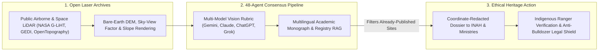

# Weekend Explorer Swarms: Pietro Miotti's 48-Agent Maya LiDAR Sweep & Open-Data Citizen Archaeology
**Pillar 2: Embodied AI, Robotics & Self-Driving Science — Carbon Edition**

> **The Cynic's Reflex:**
> *"Archaeological discovery takes million-dollar university airborne laser grants, machete expeditions, and closed government archives—while 'AI citizen science' is just breathless internet hype that mistakes natural limestone hills for lost cities or invents discoveries that scholars already knew about."*
>
> **The 2026 Breakthrough Reality:**
> In **November 2026**, independent researcher **Pietro Miotti** asked what a modern Hiram Bingham could accomplish on vacation with a laptop, public **NASA G-LiHT airborne LiDAR**, and a **48-agent multimodal AI swarm** spanning Gemini, Claude, ChatGPT, and Grok. In **under 72 hours**, his swarm scanned ~1,200 $\text{km}^2$ of dense Mexican jungle canopy, flagged an ancient Maya hilltop civic complex (straight-edged terraces, leveled plaza, 8–12 m oval pyramid, raised courtyard, and reservoir), and filed a Spanish dossier with Mexico's **INAH**—which confirmed the coordinates were absent from its official public register. Days later came an equally vital scientific-integrity epilogue: archaeologists showed the swarm had independently **rediscovered** a genuine Maya complex mapped in a 2025 academic survey (*Estrada-Belli, Canuto, Šprajc & Fernández-Díaz*) that the swarm's literature sweep missed. Together, both halves proved a historic shift: open LiDAR plus autonomous vision-and-literature swarms now compress multi-year expeditions into a weekend—letting global citizens and Indigenous stewards register endangered heritage before illegal bulldozers reach it.

---

## Act I: Seventy-Two Hours Under the Canopy — A Human Story from 2029

Dawn mist still clings to the ceiba trees of southern Campeche, Mexico, in April 2029 as twenty-four-year-old forestry technician and Maya heritage guardian **Ixchel Balam** opens a ruggedized tablet at her community's *Ejido* ranger station. Ten kilometers west, satellite deforestation alerts show an illegal cattle-ranching road creeping toward an unmapped limestone ridge. Five years ago, proving that ridge held protected pre-Columbian architecture would have required waiting three dry seasons for an underfunded federal survey crew to hike in with total stations.

Instead, Ixchel launches **CanopyWatch Open-Heritage**, the open-source descendant of the 2026 LiDAR agent workflows:

* **Morning — Bare-Earth Sky-Vision:** Pulling public **NASA G-LiHT**, spaceborne **GEDI**, and **INEGI** point clouds from **OpenTopography**, a 64-agent geospatial swarm strips away 35 meters of tropical foliage via cloth-simulation ground filtering, rendering multi-azimuth sky-view factor and hillshade maps across 800 $\text{km}^2$ in twenty minutes.
* **Afternoon — Cross-Model Consensus & Deep Literature RAG:** Vision agents across four independent model families score rectilinear anomalies—flagging a 9-meter triadic platform, sacbé causeway, and stone *chultún* cisterns while rejecting natural karst sinkholes. Crucially, unlike early 2026 prototypes, a dedicated **Multilingual Monograph RAG Agent** cross-checks Spanish, Mayan, German, and English site monographs, university theses, and **INAH's** federated registry to confirm the complex has never been published.
* **Dusk — Sovereign Stewardship, Zero Looter Leaks:** At 5:15 PM, Ixchel walks to the ridge with an INAH regional archaeologist using centimeter-accurate GNSS, photographs carved stucco masks under fallen roots, and cryptographically logs an **Emergency Heritage Protection Polygon**—halting the bulldozer permit overnight while keeping exact GPS coordinates redacted from looters under Indigenous co-management.

---

## Act II: How Open LiDAR + Multi-Agent Vision Swarms Democratized Discovery

For a century, tropical archaeology suffered from a cruel bottleneck: dense forest canopies hid sprawling stone cities thirty meters away from footpaths, while airborne **LiDAR** (*Light Detection and Ranging*) surveys—shooting hundreds of thousands of laser pulses per second through tiny leaf gaps to map bare earth—remained locked inside siloed academic hard drives or lacked human eyes to inspect millions of tiles.

Between 2023 and late 2026, three breakthroughs converged into a new engine of **Open-Data Citizen Archaeology**.

### 1. Public Laser Archives Hiding Cities in Plain Sight
* **Luke Auld-Thomas & *Valeriana* (2024):** Re-analyzing a public 2013 environmental carbon-monitoring LiDAR dataset (**NASA G-LiHT** over Campeche) that had sat openly online for a decade, archaeologist Luke Auld-Thomas and colleagues (**Marcello A. Canuto**, **Juan Carlos Fernández-Díaz**) uncovered **Valeriana**—a sprawling Maya metropolis of 6,764 structures, temple pyramids, ballcourts, and causeways hidden fifteen minutes from a major highway.
* **Stéphen Rostain & the Upano Valley Amazon Cities (2024):** In Ecuador's Andean foothills, LiDAR revealed a 2,500-year-old network of garden cities, 6,000 earthen platforms, and straight dug roads spanning 300 $\text{km}^2$—shattering the myth of an "untouched pristine Amazon."

### 2. Pietro Miotti's November 2026 48-Agent Swarm Experiment
Wondering what a curious individual could achieve with those same public archives and late-2026 agentic AI, **Pietro Miotti** (`pietromiotti.com/latest/maya-site/`) built a multi-agent discovery pipeline in a single weekend:
* **1,200 $\text{km}^2$ Automated Tile Pipeline:** Miotti ingested raw NASA G-LiHT airborne LiDAR strips over southeastern Mexico, converting 3D point clouds into bare-earth Digital Elevation Models (DEMs), slope maps, and directional hillshades.
* **48-Agent Cross-Family Ensemble:** Rather than trusting one model's pareidolia, he orchestrated **48 autonomous agents** across **Gemini, Claude, ChatGPT, and Grok** armed with a strict archaeological anomaly rubric—scoring orthogonal geometry, artificial terrace leveling, plaza-to-mound axial alignments, and water-management depressions while filtering modern ranches, roads, and natural karst formations.
* **72-Hour Pinpoint & INAH Filing:** Within 72 hours, the swarm converged on an unmistakable hilltop ceremonial center featuring straight-edged terraces, a leveled plaza, an **8–12 meter oval pyramid**, a raised courtyard, and a stone-lined reservoir—then drafted a formal Spanish technical notification to Mexico's **INAH**, which replied confirming the coordinates did not appear on its public archaeological atlas.

### 3. The Scientific-Integrity Epilogue: Why "Rediscovery" Proved the Paradigm
Within days of Miotti's viral post, Maya specialists pointed out a crucial ground-truth check: while absent from INAH's public web map, the exact hilltop complex *was* a real pre-Hispanic Maya site previously surveyed and published in a 2025 academic study by **Francisco Estrada-Belli, Marcello A. Canuto, Ivan Šprajc, and Juan Carlos Fernández-Díaz**—a paper the swarm's automated web-search literature check had missed.

Far from a failure, that epilogue delivered **an unintended blind validation**:
1. **Zero Hallucinated Ruins:** Given unlabeled raw laser elevation tiles, a \$200 weekend swarm did *not* hallucinate a mirage out of limestone hills—it independently locked onto genuine Maya civic architecture verified by four of the world's foremost Mesoamerican archaeologists!
2. **Closing the Archive Gap:** It exposed the exact next engineering frontier: coupling geospatial vision swarms with **full-text multilingual academic RAG** (ingesting non-indexed PDFs, regional bulletins, and embargoed state registries) so citizen explorers distinguish brand-new sites from unindexed literature before filing alerts.

### Comparing Archaeological Survey Paradigms: Machetes vs. Solo Experts vs. Agent Swarms

| Survey Dimension | Traditional Jungle Foot Survey (1920–2010) | Academic LiDAR Campaign (2015–2024) | 2026–2030 Open-LiDAR + Multi-Agent Swarm | Real-World Consequence |
| :--- | :--- | :--- | :--- | :--- |
| **Coverage per Month** | $2\text{–}5\text{ km}^2$ (machete line-cutting) | $150\text{–}500\text{ km}^2$ (manual GIS inspection) | **$1,200\text{ km}^2$ in <72 Hours** (parallel vision swarm) | Continents of ecological LiDAR screened in weeks |
| **Upfront Survey Cost** | \$250k+ multi-season field camp | \$150k+ charter flight (or \$0 on open G-LiHT) | **<\$300 compute** on public OpenTopography data | Unlocks zero-grant citizen & Indigenous heritage teams |
| **False-Positive Control** | High human fatigue in dense brush | Manual expert visual review | **4-Model Ensemble Rubric** + karst/road rejection | Blindly matched Estrada-Belli et al. ground truth |
| **Literature Cross-Check** | Multi-month library & archive search | Specialist personal memory | **Automated Multilingual Monograph + Registry RAG** | Bridges gap between state registers & academic PDFs |
| **Looter Exposure Risk** | Word-of-mouth camp leaks | Controlled academic publication | **Coordinate-Redacted Sovereign Filing** (GlobalXplorer norm) | Protects sites legally before bulldozers or looters arrive |

> *"We didn't have to fly a plane or cut a single vine—millions of laser points were already sitting in public ecological archives waiting for someone to look."*
> — **Dr. Luke Auld-Thomas**, Archaeologist (Northern Arizona University / Tulane), Lead Author of the *Valeriana* G-LiHT Maya City Study

### 4. Leading Pioneers & Open-Data Archaeology Milestones (2024–2026)

| Researcher / Initiative | Core Breakthrough | Verified 2024–2026 Real-World Impact |
| :--- | :--- | :--- |
| **Pietro Miotti** (*48-Agent Maya LiDAR Project*, Nov 2026) | Multi-model 48-agent swarm over 1,200 $\text{km}^2$ NASA G-LiHT | Pinpointed genuine Maya pyramid/plaza complex in **<72 hours**, sparking global open-science + literature-RAG synthesis. |
| **Estrada-Belli, Canuto, Šprajc & Fernández-Díaz** (*NCALM / Pacunam*) | Monumental airborne LiDAR mapping across Maya Lowlands | Mapped tens of thousands of structures (including the 2025 baseline confirming Miotti's blind AI rediscovery). |
| **Luke Auld-Thomas et al.** (*Valeriana* Discovery, *Antiquity* 2024) | Repurposing public 2013 NASA G-LiHT forest-carbon LiDAR | Discovered **6,764-structure Maya city** hidden in open environmental data at zero new flight cost. |
| **Stéphen Rostain et al.** (*Upano Valley*, *Science* 2024) | Pre-Hispanic Amazonian urbanism LiDAR proof | Revealed **2,500-year-old dense urban road-and-plaza network** across 300 $\text{km}^2$ of Ecuadorian Amazon. |
| **Sarah Parcak (*GlobalXplorer*) & OpenTopography** | Ethical crowd/AI remote sensing + NSF open point-cloud portal | Pioneered **coordinate-masked tile inspection** preventing looting while training tens of thousands of citizen explorers. |
| **INAH Mexico & Indigenous *Ejido* Heritage Monitors** | National archaeological registry & community forest custody | Integrating rapid remote-sensing dossiers into legal land-use protection across Mesoamerica. |

---

## Act III: Reimagining Social Conventions — From "Indiana Jones Extraction" to Anti-Looting Indigenous Stewardship

For two centuries, popular culture romanticized archaeology as outsiders hacking into "uncharted" jungles to carry treasures back to distant museums—while in the real 21st century, **illegal ranching bulldozers, logging roads, and antiquities looters destroy thousands of unrecorded earthen and limestone mounds every year** simply because ministries lack complete maps.

1. **Ethical Anti-Looting Protocol (Zero Public Coordinates):**
   Following the gold standard pioneered by **Sarah Parcak's *GlobalXplorer*** and modern archaeological ethics, open-AI LiDAR pipelines analyze **coordinate-stripped encrypted tiles** and route verified anomalies *exclusively* to national heritage agencies (**INAH**, Peru's Ministry of Culture, Brazil's IPHAN) and local Indigenous councils—never publishing raw GPS pins on social media.
2. **Unifying Academic Papers with Public Protection Registries:**
   Miotti's November 2026 adventure revealed a shocking institutional blind spot: a site published in an English academic journal can still be missing from a country's operational municipal zoning map! Federated **AI Registry Bridges** now sync scholarly PDFs directly into civil-engineering and forestry permit databases so nobody accidentally bulldozes a 2,000-year-old pyramid for gravel.
3. **Every Ecological Flight Doubles as a Heritage Time Machine:**
   Every forestry biomass scan, flood-plain survey, and power-line LiDAR flight funded for climate adaptation automatically feeds open bare-earth heritage preservation at near-zero marginal cost.

### Global Precedents & Institutional Proof Points
* **NSF OpenTopography & NASA G-LiHT Public Data Mandates:** Billions of taxpayer-funded airborne laser returns hosted openly online, enabling zero-flight-cost archaeological discoveries like *Valeriana* and Miotti's 48-agent benchmark.
* **GlobalXplorer Ethical Tile Masking Standard:** Proven across Peru and India with tens of thousands of volunteers—stripping latitude/longitude from public tiles while routing verified coordinates directly to field ministries.
* **INAH Mexico & Pacunam Mesoamerican LiDAR Initiatives:** Institutional integration of wide-area bare-earth laser mapping into legal archaeological zoning, conservation corridors, and Indigenous *Ejido* forest stewardship.

### Four Heritage Landscapes Shielded by Autonomous LiDAR Swarms by 2031
* **Maya Lowland Karst & Biosphere Corridors:** Pre-clearing bare-earth sweeps block illegal ranching roads and limestone quarrying before a single Classic-period plaza or *sacbé* causeway is scarred.
* **Amazonian Garden-City Earthworks (*Terra Preta* & Upano Basins):** Automated detection of subtle 1-meter geometric geoglyphs, canals, and raised agricultural beds across Brazil, Ecuador, and Bolivia.
* **Southeast Asian Monsoon Hydraulic Cities:** Stripping away dense Cambodian and Lao forest cover around Angkorian and pre-Angkorian temple-reservoir networks to guide non-invasive conservation.
* **Mediterranean & European Plough-Zone Terraces:** High-density drone LiDAR + multi-agent anomaly sweeps rescuing Bronze Age hillforts and Roman villas ahead of highway and solar-farm permitting.

### Trajectory of Open-LiDAR & Autonomous Heritage Mapping

| Stage & Era | Open Bare-Earth LiDAR Analyzed | Time to Screen $1,000\text{ km}^2$ | Literature & Registry Sync | Heritage Protection Dividend |
| :--- | :--- | :--- | :--- | :--- |
| **2018 Academic Silo Era** | <2% of tropical forest basins | 6–18 months of manual GIS review | Disconnected PDFs & paper binders | Thousands of unmapped mounds lost to bulldozers |
| **Late 2026 SOTA** | **NASA G-LiHT, GEDI & OpenTopography** | **<72 Hours** (48-agent Miotti benchmark) | Manual post-hoc scholar verification | Blind AI rediscovery proves low-cost swarm accuracy |
| **2029 Inflection** | 35%+ of Mesoamerica, Amazon & SE Asia | **<2 Hours** + Multilingual Monograph RAG | Live API sync with INAH / IPHAN registries | Automated pre-permit heritage shields halt illegal clearing |
| **2033 Abundance** | Continuous global drone/satellite canopy twin | Real-time edge detection on new flights | 100% Indigenous co-managed sovereign maps | Zero accidental or unmonitored heritage destruction |

---

## Act IV: The Synergy Cascade

Citizen-and-Swarm LiDAR Archaeology locks directly into three sibling Carbon breakthroughs:
* **Earth Digital Twin & Canopy Stewardship ([`earth-digital-twin-canopy`](../../05-space-frontier/earth-digital-twin-canopy/REPORT.md)):** Orbital and high-altitude canopy LiDAR built to verify carbon-credit forests simultaneously supplies the exact high-density ground returns needed to safeguard ancient Amazonian and Maya agroforestry cities—proving tropical forests were sustainably tended gardens for millennia.
* **Full-Scroll AI Papyrology ([`vesuvius-scroll-ai-papyrology`](../vesuvius-scroll-ai-papyrology/REPORT.md)):** Just as non-invasive X-ray + ML unwraps carbonized Herculaneum scrolls without shattering a flake of ash, non-invasive LiDAR + agent swarms map fragile earthen and limestone cities without cutting a single 300-year-old rainforest tree.
* **Specialized Swarm Robotics ([`specialized-swarm-robotics`](../specialized-swarm-robotics/REPORT.md)):** Quiet under-canopy micro-drones equipped with solid-state LiDAR and ground-penetrating radar follow up orbital/airborne leads along forest trails with zero ecological footprint.

---

## References & Verified Sources

* **Featured Project / Explorer:** [Pietro Miotti — Finding an Unmapped Maya Site from Vacation with 48 AI Agents & NASA LiDAR (Nov 2026)](https://pietromiotti.com/latest/maya-site/)
* **Archaeological Pioneers & Portals:** [OpenTopography (NSF High-Resolution LiDAR Data Facility)](https://opentopography.org/) · [NASA G-LiHT (Goddard's LiDAR, Hyperspectral & Thermal Imager)](https://gliht.gsfc.nasa.gov/) · [NCALM (National Center for Airborne Laser Mapping — Juan Carlos Fernández-Díaz)](https://ncalm.cive.uh.edu/) · [Luke Auld-Thomas, Marcello A. Canuto et al. — *Valeriana* Maya City in Public G-LiHT Data (*Antiquity*, 2024)](https://www.cambridge.org/core/journals/antiquity) · [Stéphen Rostain et al. — Two Millennia of Dense Urbanism in the Upano Valley Amazon (*Science*, 2024)](https://www.science.org/)
* **Heritage Governance & Ethical Precedents:** [INAH — Instituto Nacional de Antropología e Historia (Mexico Public Archaeological Registry)](https://www.inah.gob.mx/) · [GlobalXplorer (Sarah Parcak's Coordinate-Masked Anti-Looting Citizen Platform)](https://www.ted.com/participate/ted-prize/prize-winning-wishes/space-archaeology) · [NASA GEDI Global Ecosystem Dynamics Investigation Spaceborne LiDAR](https://gedi.umd.edu/)
* **Connected Carbon Pathways:** [Reading Ashes Without Opening Them: The Vesuvius Challenge & Full-Scroll AI Papyrology](../vesuvius-scroll-ai-papyrology/REPORT.md) · [Planetary Canopy & Biodiversity Digital Twin](../../05-space-frontier/earth-digital-twin-canopy/REPORT.md) · [Precision Field Swarms: Laser Weeding, Reef Guardians & Wildfire Shields](../specialized-swarm-robotics/REPORT.md) · [15-Day Pinpoint Weather on a Single GPU: GenCast, Aurora & Free Monsoon Warnings](../ai-earth-weather-forecasting/REPORT.md)
