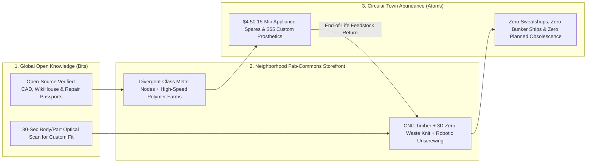

# Neighborhood Fab-Commons: Custom, Repairable Goods Made Two Blocks Away
**Pillar 2: Embodied AI, Robotics & Self-Driving Science — Carbon Edition** *(New in Carbon)*

> **The Cynic's Reflex:**
> *"Everything we buy will always come wrapped in disposable plastic from 8,000-mile bunker-fuel container ships, built with glued-shut planned obsolescence so a broken \$2 plastic latch forces you to throw a \$700 washing machine into the county landfill."*
>
> **The 2026 Breakthrough Reality:**
> Mass manufacturing's century-old "giant distant factory" monopoly is cracking open. Multi-material robotic micro-cells—combining **Divergent 3D / Czinger** generative laser-sintered aluminum nodes, high-speed **Prusa / Bambu** polymer farms, CNC mass-timber joinery, zero-waste 3D knitwear looms, and **Apple Daisy**-class robotic disassembly recyclers—can now fit inside any town's vacant big-box storefront! Paired with **France's mandatory Repairability Index** and **Sweden's tax-free repair laws**, **Neighborhood Fab-Commons** let citizens download open-source CAD designs and print custom prosthetics, ergonomic furniture, e-bikes, or appliance spare parts two blocks away in two hours from 100% local circular materials.

---

## Act I: Saturday Morning at the Old Strip Mall in Malmö — A Human Story from 2031

Walk through the sunny glass doors of a former vacant electronics superstore two blocks off the bike path in Malmö, Sweden,
at 10:00 AM on a Saturday in September 2031. Five years earlier, this building sat boarded up while shipping trucks hauled
cheap particleboard bookshelves in from across two oceans and municipal dumpsters overflowed with appliances discarded over a
single cracked nylon gear.

Today, the 25,000-square-foot hall hums quietly as the **Kirseberg Municipal Fab-Commons & Tool Library**—half sunlit Nordic
bakery-café, half clean automated microfactory behind soundproof viewing glass:

* **The \$4.50 Twelve-Minute Appliance Rescue:** Retired music teacher Ingrid Lindqvist sets down the snapped door-hinge cam from her fourteen-year-old induction dishwasher. Instead of waiting four weeks for an "out-of-production" \$140 OEM assembly—or buying a new machine—the counter scanner reads the QR **Digital Product Passport** stamped on the broken part, pulls the manufacturer's legally mandated open CAD file, and prints a **carbon-fiber-reinforced PEEK replacement cam** in twelve minutes for **\$4.50** (with zero VAT under Sweden's repair tax exemption!).
* **Custom Pediatric Prosthetic Before Lunch:** At the next oak bench, eleven-year-old Samir—who outgrew his forearm prosthetic socket over the summer—picks a cobalt-and-gold Voronoi pattern on a tablet after a 30-second optical arm scan. Inside Bay 3, a multi-material elastomeric and carbon-lattice printer fabricates a breathable, featherweight custom bionic socket tailored to his exact residual limb geometry in **90 minutes** for \$65—1/80th the legacy \$8,000 clinic wait.
* **Cargo E-Bike From Recycled Soda Cans:** In Bay 5, local framebuilder Freja pulls four **generative AI aluminum-alloy lug nodes** sintered overnight from shredded local beverage cans, slots in standard domestically pultruded carbon-flax tubes (using **Divergent 3D's** fixtureless modular joinery), and rolls out a custom family cargo e-bike by 1:00 PM—zero \$20M stamping dies, zero transoceanic container ships, and 100% unboltable for future upgrades!

---

## Act II: Why Tiny Flexible Robotic Cells Now Beat Distant Million-Unit Sweatshops

Why did the twentieth century concentrate manufacturing into gigantic single-purpose factories 8,000 miles from consumers?
Because **hard steel tooling** (injection molds and automotive body-stamping dies) cost **\$5 million to \$200 million up front**!
To pay off a \$50 million steel die, a company *had* to stamp 500,000 identical copies, store them in warehouses for nine months,
burn heavy bunker oil shipping 40% empty air in cardboard boxes across oceans, and slash prices on the 30% of unsold clothes
and goods dumped straight into landfills or desert incinerators.

Between 2024 and late 2026, **Toolless Software-Defined Micro-Manufacturing + Robotic Disassembly** flipped unit economics on its head.

### 1. Five Core Microfactory Cells That Fit Inside One Storefront
1. **Fixtureless Generative Metal + Composite Assembly (*Divergent 3D DAPS* — Czinger / Aston Martin / Bugatti / Aerospace):** Instead of \$150M automotive stamping lines, AI topology-optimization software designs organic, bone-like hollow aluminum alloy nodes printed via multi-laser powder-bed fusion and assembled by six-axis vision robots with **zero custom jigs**—switching from printing a wheelchair frame at 9:00 AM to a cargo-bike chassis at 9:05 AM via software alone!
2. **High-Speed Engineering Polymer Farms (*Bambu Lab*, *Prusa Pro AFS*, *Carbon*, *EOS*):** CoreXY input-shaping kinematics and automated plate-swapping racks jumped polymer throughput **5x to 10x** between 2022 and 2026, printing UV-stable ASA, self-lubricating nylon, and biocompatible elastomers at injection-molded strength for <\$18/kg.
3. **Robotic CNC Mass-Timber & Flat-Pack Joinery (*Shaper*, *OpenDesk* / *WikiHouse* CNC cells):** Precision spindle routers turn regionally harvested FSC plywood and cross-laminated timber into snap-fit acoustic desks, kitchen cabinetry, and backyard studio walls with zero toxic formaldehyde glue.
4. **Zero-Waste On-Demand 3D Whole-Garment Knitting (*Shima Seiki WholeGarment*, *Unmade*):** In the legacy apparel industry, **30% of all garments sewn globally are never sold**! Automated 3D knitters spin a custom-sized merino sweater or athletic shoe upper directly from yarn cones in **28 minutes** after a customer orders—zero fabric scraps on the cutting-room floor, zero unsold inventory burned.
5. **Closed-Loop Robotic Disassembly & Shred-to-Filament Feedstock (*Apple Daisy / Dave*, * Molg*, * Envisioning Circularity*):** Vision-guided robotic unscrewing cells strip end-of-life electronics, motors, and plastics back into pure sorted copper, aluminum, magnet alloys, and clean polymer pellets—turning yesterday's broken toaster into tomorrow's e-bike fender two aisles over!

### Legacy Globalized Mass Factory vs. 2026–2033 Neighborhood Robotic Microfactory

| Manufacturing Dimension | Legacy Distant Mass Factory (2015–2024) | 2026–2033 Neighborhood Robotic Fab-Commons | Household, Town & Climate Win |
| :--- | :--- | :--- | :--- |
| **Upfront Tooling Cost** | \$2M – \$150M hard steel dies (locks design) | **\$0 custom tooling** (100% software-defined CAD) | Batch-of-1 custom fit costs same as Batch-of-10,000 |
| **Supply Chain Distance** | 6,000 – 12,000 miles (container ships + trucks) | **0.5 – 5 miles** ("ship kilobytes, print atoms locally") | Eliminates maritime bunker fuel, tariffs & port delays |
| **Unsold Overproduction Waste** | 25% – 35% discounted/landfilled (esp. apparel) | **0% unsold inventory** (made-on-demand in <2 hrs) | Ends fast-fashion & seasonal warehouse waste |
| **Appliance Spare-Part Access** | Discontinued after 5 yrs; \$120+ warehouse markup | **Permanent Digital Passport CAD** printed in 15 min | Extends washer, fridge & heat-pump lifespans **2x+** |
| **End-of-Life Retirement** | Glued shut; shredded into toxic mixed landfill | **Standardized screws + robotic unscrewing (*Molg*)** | **>90% local alloy & polymer loop recovery** |

> *"Instead of shipping atoms across oceans in container ships, global Fab Labs let cities transmit bits at the speed of light and fabricate locally from circular materials."*
> — **Prof. Neil Gershenfeld**, Director, MIT Center for Bits and Atoms

### 2. Pioneers Building the Distributed Microfactory Stack (2024–2026)

| Organization / Movement | Core Micro-Manufacturing Layer | Verified 2024–2026 Milestone & Real-World Proof |
| :--- | :--- | :--- |
| **Divergent Technologies** (*DAPS*) | AI generative metal printing + fixtureless robot assembly | Production chassis subframes shipping on **Czinger**, **Aston Martin**, **Bugatti**, and defense airframes with zero stamping tooling. |
| **MIT Fab Foundation & *Fab City* Global Initiative** | Global network of 2,700+ open community Fab Labs | **50+ pledged cities** (Barcelona, Paris, Amsterdam, Shenzhen, Boston) transitioning toward "Locally Productive, Globally Connected" circular goods. |
| **Prusa Research (*AFS*) & Bambu Lab** | Automated 24/7 high-speed modular polymer print farms | Self-ejecting containerized 30-to-100-printer micro-farms producing tens of thousands of end-use mechanical parts/month in <200 sq ft. |
| **Apple (*Daisy* & * Taz*) & Molg Robotics** | Robotic circular disassembly of electronics & servers | *Daisy* disassembles up to **200 devices/hour** recovering pure cobalt, gold & aluminum; *Molg* automates circular server/industrial unscrewing. |
| **Shima Seiki (*WholeGarment*) & Unmade** | On-demand 3D seam-free robotic garment knitting | Retail-storefront and micro-hub knit cells producing custom-fit zero-waste garments in <30 minutes on demand. |
| **WikiHouse & OpenDesk** | Open-source structural CNC timber architecture & furniture | Precision zero-glue snap-fit homes and workspace furniture cut locally by independent town woodshop CNC routers worldwide. |

---

## Act III: Reimagining Social Conventions — Killing Planned Obsolescence & Rebirthing Town Craft

For forty years, consumers felt powerless watching everyday appliances grow flimsier, glued shut with proprietary pentalobe
screws, while small-town Main Streets lost both manufacturing pride and repair shops. Combining robotic microfactories with
**Right-to-Repair law** creates a joyful civic renaissance:

1. **Mandatory Digital Spare-Part Passports (The End of "Part Discontinued"):**
   Modeled on **France's Repairability & Durability Index** and the **EU Ecodesign for Sustainable Products Regulation (ESPR)**, every appliance, stroller, wheelchair, and power tool sold carries a QR **Digital Product Passport**. If a manufacturer stops stocking a physical spare part—or prices it above 5% of appliance cost—its cryptographic CAD file automatically unlocks for licensed local **Fab-Commons** printing at cost!
2. **Public Libraries Evolve Into "Libraries of Things & Makers":**
   Just as nineteenth-century towns decided no family should have to buy 5,000 hardcover books privately to be literate, twenty-first-century public libraries co-locate **Tool Libraries & Fab-Commons** in repurposed big-box retail spaces—giving every teenager, retiree, occupational therapist, and local entrepreneur access to \$500,000 of precision machinery for a library card and raw-material weight fees.
3. **Dignified Custom Assistive Devices for Disabled & Aging Neighbors:**
   Standard mass manufacturing ignores bodies outside the "middle 80% bell curve." Local optical scanning + 90-minute microfactory printing delivers custom one-handed kitchen grips, wheelchair seating contours, and growing kids' prosthetics at 95% lower cost.

### Global Precedents & Legal Proof Points
* **France's Mandatory Repairability Index (*Indice de Réparabilité*) & Repair Bonus Fund:** Scores electronics and appliances 1–10 at point of sale and pays citizens **€15 to €60 instant cash rebates** at certified neighborhood repair cafés and shops!
* **Sweden's Tax-Free Repair Policy & Vienna's *Reparaturbon*:** Slashing VAT on bicycle, shoe, textile, and appliance repairs while Vienna's municipal repair vouchers fund 50% of any citizen repair bill up to €200—already diverting tens of thousands of tons of e-waste!
* **Barcelona's Municipal *Ateneus de Fabricació* (Public Neighborhood Fab Labs):** City-funded public digital-fabrication centers open free to every neighborhood school, disability clinic, and citizen cooperative—where residents pay by "social return" (teaching a neighbor or fixing a community item).

### How Local Microfactories Guarantee Industrial Quality & Safety ("Verified Open Hardware")
A smart skeptic asks: *"Won't backyard-printed bike frames or toaster switches crack or catch fire?"*
Modern Neighborhood Fab-Commons are **not** 2014 hobbyist garage printers—they run **closed-loop industrial metrology**:
1. **Inline Laser & Ultrasonic Layer Inspection:** Every sintered aluminum node and structural polymer gear undergoes real-time optical tomography during printing; any internal void above 50 microns automatically flags and recycles the part before it leaves the bay.
2. **Royalty Micro-Streams for Global Industrial Designers:** An ergonomic chair designer in Milan or Nairobi publishes a certified, finite-element-tested CAD file; whenever a Fab-Commons in Malmö or Ohio prints that chair from local ash wood, the designer automatically earns a **\$12 creator royalty**—turning physical product design into an indie creator economy like Spotify or GitHub!
3. **Zero Sweatshop Labor Arbitrage:** Because robotic cells do the toxic sanding, laser sintering, and repetitive sewing for pennies of solar electricity, brands lose all financial incentive to chase \$2-an-hour overseas garment sweatshops.

### Four Everyday Purchases Transformed Two Blocks From Home
* **Custom-Scanned Running Shoes & Orthopedic Insoles:** 3D-knitted uppers + elastomeric lattice midsoles tuned independently for your left and right arches in 35 minutes—100% recyclable into next year's pair.
* **Snap-Fit Solid-Wood Apartment Furniture (*OpenDesk*):** Cut from local timber without particleboard sawdust or missing Allen-wrench mystery screws.
* **Out-of-Warranty Heat-Pump, Stroller & Wheelchair Parts:** Printed from Digital Product Passports in 15 minutes for <\$6.
* **Custom Adaptive Gaming Controllers & Kitchen Grips:** Built free of charge for stroke survivors and arthritic seniors through municipal occupational-therapy vouchers.

### 10-Year Trajectory of Neighborhood Microfactories & Circular Repair

| Stage & Era | Average Consumer Good Supply-Chain Miles | Appliance / Gadget Repair Rate | Custom Pediatric Prosthetic Socket Cost | Local & Planetary Dividend |
| :--- | :--- | :--- | :--- | :--- |
| **2022 Disposable Era** | ~7,500 miles | <15% (glued shut / pricey parts) | \$4,000 – \$10,000 (weeks wait) | Overflowing e-waste landfills & dead malls |
| **Late 2026 SOTA** | ~5,800 miles (early reshoring) | 28% in EU Right-to-Repair zones | \$450 – \$1,200 (early 3D clinics) | France/Vienna repair bonuses + 2,700 Fab Labs |
| **2029 Inflection** | **<1,500 miles** for 30% of durable goods | **55%+** via Digital Part Passports | **\$65 – \$120** (same-morning local) | Vacant strip malls reborn as vibrant Fab-Commons |
| **2034 Abundance** | **<10 miles** for furniture, spares & knitwear | **>80% modular circular lifespan** | **<\$45** universal library access | Planned obsolescence & fast-fashion trash ended |

---

## Act IV: The Synergy Cascade

Neighborhood Fab-Commons anchor the circular physical loop of the entire Carbon Atlas right on Main Street:
* **Protein & Atomic Nanofabrication ([`protein-atomic-nanofabrication`](../protein-atomic-nanofabrication/REPORT.md)):** Enzymatic PET and textile depolymerization vats digest stained clothes and broken food containers directly into pure virgin-grade pellets feeding the neighborhood print farm!
* **General-Purpose Humanoids ([`general-purpose-humanoids`](../general-purpose-humanoids/REPORT.md)):** Two bipedal shop assistants tend CNC timber routers, swap polymer build plates, and run robotic unscrewing cells on the quiet overnight shift so custom orders placed at 9:00 PM are waiting by 8:00 AM.
* **Aerial & Underground Hyper-Logistics ([`aerial-hyperlocal-logistics`](../aerial-hyperlocal-logistics/REPORT.md)):** Once your \$4.50 dishwasher hinge cam cools off the build plate, a quiet **Zipline** droid or **Pipedream** sidewalk tote drops it at your kitchen door in six minutes—making local repair faster than shopping online!

### Summary Snapshot: Global Bits, Local Circular Atoms
* **Upfront Hard-Tooling Required:** **\$0** (software-defined CAD switches products in seconds).
* **Overproduction Inventory Waste:** **0%** (made on demand after scan/order, vs. 30% legacy apparel waste).
* **Robotic Circular Recovery (*Daisy / Molg*):** **Up to 200 devices/hour** cleanly unscrewed into pure metal and polymer feedstocks.
* **Repair Cost Transformation:** **\$4 to \$12** for 15-minute local spare parts backed by EU/French-style Digital Product Passports.
* **Global Pioneer Network:** **2,700+ MIT-affiliated Fab Labs** and **50+ Fab Cities** already laying the civic groundwork.

---

## References & Verified Sources

* **Featured Researcher / Leader:** [Prof. Neil Gershenfeld — Director, MIT Center for Bits and Atoms](https://cba.mit.edu/)
* **Companies, Labs & Consortia:** [Divergent Technologies (DAPS Generative Metal + Robot Cells)](https://en.wikipedia.org/wiki/3D_printing) · [MIT Center for Bits and Atoms & Global Fab City Network](https://cba.mit.edu/) · [Prusa Pro AFS & Bambu Lab Automated Print Farms](https://www.prusa3d.com/) · [Apple (Daisy) & Molg Robotics (Circular Disassembly)](https://www.apple.com/environment/) · [Shima Seiki (WholeGarment Zero-Waste 3D Knitting)](https://www.shimaseiki.com/) · [WikiHouse & OpenDesk (Open CNC Timber Joinery)](https://www.wikihouse.cc/)
* **Global & Regulatory Precedents:** [France Mandatory Repairability Index & €15–€60 Instant Repair Bonus](https://en.wikipedia.org/wiki/Repairability) · [Sweden Repair VAT Exemption & Vienna 50% Reparaturbon Vouchers](https://www.reparaturbonus.at/) · [EU Ecodesign Digital Product Passport Right-to-Repair Mandate](https://environment.ec.europa.eu/topics/circular-economy_en) · [Barcelona Municipal Ateneus de Fabricació & 50+ Pledged Fab Cities](https://fab.city/)
* **Connected Carbon Pathways:** [Demonetizing the Essentials: When a Modest Income Buys a 2026 Millionaire's Life](../../04-social-norms/fab-commons-wealth/REPORT.md) · [De Novo Protein Machines & Atomic-Precision Manufacturing](../protein-atomic-nanofabrication/REPORT.md) · [Helpful Mechanical Hands: General-Purpose Humanoid Teammates](../general-purpose-humanoids/REPORT.md) · [No More 4,000-Pound Cars for a 2-Pound Medicine: Whisper Droids & Hyper-Logistics](../aerial-hyperlocal-logistics/REPORT.md)
