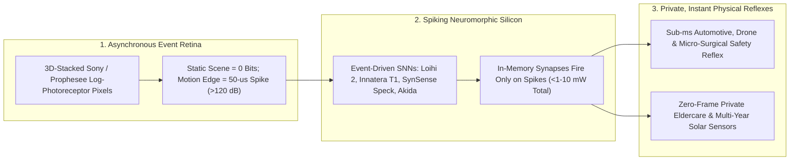

# Milliwatt Insect Brains: Event-Based Retinas & Spiking Neuromorphic Chips for Always-On Edge Intelligence
**Pillar 2: Embodied AI, Robotics & Self-Driving Science — Carbon Edition**

> **The Cynic's Reflex:**
> *"Smart cameras and edge AI are trapped between three terrible choices: blur into useless smears in dark tunnels or blinding headlights, drain wearable batteries in two hours shooting 60 wasteful frames per second, or stream creepy 24/7 surveillance video of your living room to corporate clouds."*
>
> **The 2026 Breakthrough Reality:**
> Inspired by dragonfly eyes and biological neurons, **Event-Based Vision Sensors** (**Prophesee *Metavision* GenX320 / Sony IMX636**) and **Spiking Neuromorphic Chips** (**Intel *Loihi 2 / Hala Point*, Innatera *T1*, SynSense *Speck*, BrainChip *Akida***) threw out the 19th-century movie-frame paradigm. Instead of re-transmitting 95% unchanging background pixels 60 times a second, each pixel fires an asynchronous **microsecond spike** *only* when light changes—delivering **$>120\text{ dB}$ dynamic range** ($50\,\mu\text{s}$ child-in-tunnel reflex against blinding headlights), **$100\times$ lower data & milliwatt power**, and **100% local privacy** where no recognizable video frame is ever recorded.

---

## Act I: Fifty Microseconds Between Glare and Grace — A Human Story from 2030

Rain slicks the cobblestone mouth of an Alpine highway tunnel outside Lugano at dusk in November 2030. As delivery van driver
Marco Bellini exits the pitch-black tunnel bore straight into low, blinding autumn sun reflecting off wet asphalt, a seven-year-old
boy chases a soccer ball off the shaded curb right inside the contrast blind spot.

On a conventional 2022 RGB frame camera, two disasters happen simultaneously: the $16.7\text{-millisecond}$ shutter saturates into a
washed-out white smear across the sun glare while underexposing the dark tunnel shadow, and the neural net waits three frames
($50\text{ milliseconds}$) before realizing an object moved. Marco's van carries a **$4\text{-milliwatt}$ Event-Neuromorphic Reflex
Module** behind the windshield:

* **Seeing into Sun & Shadow Simultaneously ($>120\text{ dB}$):** Each pixel on the stacked **Sony/Prophesee event retina** adapts its own logarithmic photoreceptors independently—ignoring static road and sky while firing crisp **microsecond spikes** the instant the child's sneaker crosses luminance edges inside the dark shadow, completely unblinded by the $100,000\text{-lux}$ sun!
* **$50\text{-Microsecond}$ Spiking Reflex:** Fed directly into a **spiking neuromorphic processor**, sparse event spikes trigger pre-tensioned emergency braking in **$0.4\text{ milliseconds}$**—forty times faster than a human blink and twenty times faster than frame-based vision—bringing the van to a calm stop two meters shy of the ball.
* **Meanwhile, in Kyoto & Colorado:** Across the Pacific, 84-year-old retired teacher Mrs. Sato lives independently with a wall-mounted **zero-image eldercare fall sensor**: because the SynSense/Prophesee chip emits *only* anonymous motion-contour spikes and processes them locally on $2\text{ milliwatts}$, zero photos of her bedroom ever exist—while in Colorado, coin-sized solar **wildfire neuromorphic sentinels** run five years maintenance-free on pine trunks.

---

## Act II: Retiring Eadweard Muybridge's 1878 Movie Frame — How Spikes Beat Snapshots

Every standard camera on Earth still imitates 19th-century celluloid film: open a global shutter 30 or 60 times per second, read out
all **8 million pixels** even if 98% of the room hasn't budged, convert them into heavy dense matrices, and burn watts running
convolutional layers over empty walls!

Nature solved vision 500 million years ago with a radically smarter architecture—a housefly dodges a swatter in milliseconds on
**$0.01\text{ milliwatts}$** using **sparse, asynchronous spikes**:
1. **Asynchronous Log-Luminance Event Pixels (Dynamic Vision Sensors / DVS):** Every individual pixel circuits its own continuous analog comparator. If a pixel's brightness doesn't change, it sends **zero bits** and draws nanoamps. The microsecond $\Delta \log(I)$ crosses a tiny threshold, that single pixel emits an event tuple `(x, y, timestamp_μs, +/- polarity)`—yielding **$10,000+\text{ fps}$ equivalent motion tracking** with **$10\times\text{–}1,000\times$ less raw data**!
2. **Spiking Neural Networks (SNNs) & Compute-in-Memory:** Standard GPUs waste power multiplying zeros in sparse event streams. Neuromorphic processors wire leaky-integrate-and-fire silicon neurons directly to local synaptic SRAM/memristive memory—consuming picojoules **only when an incoming spike arrives**.

### 1. Event-Retina SOTA (2025–2026): Prophesee, Sony & Hybrid RGB-Event Stacking
* **Prophesee (*Metavision* GenX320) & Sony Semiconductor (*IMX636 / IMX646*):** Utilizing 3D wafer-stacked Cu-Cu hybrid bonding (photodiodes on top, asynchronous per-pixel CMOS logic underneath), Sony and Prophesee shrunk event pixels below $4.86\,\mu\text{m}$ while achieving **$>120\text{ dB}$ intra-scene dynamic range** (from $0.05\text{ lux}$ starlight to $>100,000\text{ lux}$ direct sunlight) and microsecond latency—with GenX320 drawing just **$36\,\mu\text{W}$ in ultra-low-power wake-on-event mode**!
* **iniVation + SynSense Merger & Samsung / OmniVision Hybrid Sensors:** Combined ultra-tiny integrated retina+SNN single-die **system-on-chips (*Speck*)** alongside hybrid smartphone sensors merging crisp still RGB photography with blur-free event deblurring and gaze tracking in AR glasses.

### 2. Spiking Neuromorphic Processors (2025–2026): Micro-Edge to Billion-Neuron Scale
* **Intel Labs (*Loihi 2* & *Hala Point*):** Scaled asynchronous programmable spiking neural hardware from milliwatt robot reflexes up to **Hala Point**—a microwave-oven-sized **1.15-billion-neuron** system ($1,152$ Loihi 2 chips) executing sparse AI optimization and continuous learning up to **$50\times$ faster and $100\times$ more energy-efficiently** than CPU/GPU architectures.
* **Innatera (*Spiking Neural Processor T1*), SynSense (*Speck / Xylo*) & BrainChip (*Akida 2.0*):** Shipped commercial sub-milliwatt analog/mixed-signal and digital event-based processors embedded directly inside hearing aids, radar/ECG vitals wearables, smart factory vibration monitors, and surgical micro-robots.

### Comparing Conventional Frame Vision vs. Event-Neuromorphic Intelligence

| Vision & Compute Metric | Conventional 60-fps RGB Camera + Edge GPU | Event Retina (DVS) + Spiking Neuromorphic Chip (2026+) | Real-World Advantage |
| :--- | :--- | :--- | :--- |
| **Temporal Resolution / Latency** | $16.7\text{–}33\text{ ms}$ frame blind gaps + motion blur | **$1\text{–}50\,\mu\text{s}$ ($>10,000\text{ fps}$ equivalent, zero blur)** | Dodges drones, sparks, surgical tremor & highway hazards |
| **Dynamic Range (Glare/Dark)** | $\sim 60\text{–}70\text{ dB}$ (blinds in sun-to-tunnel glare) | **$>120\text{ dB}$ ($1,000,000:1$ light contrast)** | Sees dark pedestrians straight through oncoming high-beams |
| **Redundant Data Volume** | $100\%$ of pixels read every $16\text{ ms}$ ($>2\text{ Gb/s}$) | **$10\times\text{–}1,000\times$ lower (zero static background bits)** | Eliminates storage bloat and memory-bus heat |
| **Always-On Edge Power** | $2,000\text{–}15,000\text{ mW}$ ($2\text{–}15\text{ W}$) | **`0.5–15 mW` ($100\times\text{–}1,000\times$ lower power)** | Runs years on a coin cell or tiny indoor solar strip |
| **Intrinsic Privacy** | Captures full identifiable faces & private rooms | **Records zero static images (anonymous motion contours)** | Safe for hospital rooms, schools & eldercare bathrooms |

> *"Frames were invented for human cinema, not machine intelligence. By letting each pixel speak only when the world changes—and processing spikes where memory lives—machines gain biological reflexes at a thousandth of the energy."*
> — **Luca Verre**, Co-Founder & CEO of Prophesee (Pioneers of *Metavision* Event-Based Vision)

### 3. Leading Pioneers & Verified Milestones (2024–2026)

| Organization / Lab | Core Breakthrough | Verified 2024–2026 Milestone |
| :--- | :--- | :--- |
| **Prophesee & Sony Semiconductor** (*GenX320 / IMX636*) | 3D-stacked high-DR event vision sensors | Shipped commercial $>120\text{ dB}$ automotive/industrial IMX636 and $36\,\mu\text{W}$ wake-mode GenX320 micro-sensors. |
| **Intel Labs** (*Loihi 2* & *Hala Point*) | Asynchronous spiking chips & 1.15B-neuron system | Demonstrated $100\times$ efficiency gains on sparse optimization and sub-millisecond robotic closed-loop control. |
| **SynSense + iniVation** (*Speck* & *Xylo*) | Single-chip integrated DVS retina + spiking SNN | Delivered sub-5-milliwatt vision-and-audio neuromorphic SoCs for consumer wearables, AR & eldercare. |
| **Innatera** (*Spiking Neural Processor T1*) | Analog-mixed-signal spiking microcontroller | Ultra-low-power ($<1\text{ mW}$) radar presence, ECG arrhythmia & acoustic anomaly detection at sensor edge. |
| **ETH Zurich / UZH Robotics** (*Davide Scaramuzza*) | Event-camera agile drone dodging & deblurring | Proved quadrotors dodging thrown objects at $10\text{ m/s}$ in $3.5\text{ ms}$ onboard latency using pure event streams. |

---

## Act III: Reimagining Social Conventions — Ending Surveillance Capitalism & Disposable Battery Trash

For fifteen years, "smart homes" and "smart cities" meant bolting power-hungry cloud video cameras onto doorbells, nurseries, nursing
homes, and streetlights—normalizing pervasive facial surveillance while tossing billions of dead lithium batteries into landfills.

1. **Privacy-by-Physics in Eldercare, Hospitals & Schools:**
   Seniors overwhelmingly want to age at home safely, yet rightly refuse bedroom or bathroom cameras that could leak intimate video.
   An **event-neuromorphic fall and respiration sensor** physically *cannot* photograph a stationary face, book title, or room—it
   senses only microsecond motion dynamics locally on $2\text{ mW}$, alerting paramedics to a fall with **mathematically provable
   visual anonymity**.
2. **All-Day Smart Glasses & Week-Long Medical Wearables:**
   Eye-tracking in AR/communication glasses for ALS patients (who speak via gaze) used to cook temples at $1.5\text{ watts}$ using
   120-fps IR cameras. Event-based eye tracking runs at $1,000\text{ Hz}$ on **`<2 milliwatts`**—turning heavy headsets into featherlight
   everyday eyeglasses.
3. **Zero-Maintenance Planetary & Industrial Infrastructure:**
   Sub-milliwatt spiking vibration, arc-fault, and optical spark detectors harvest ambient indoor light or machine vibration to monitor
   rural bridges, wind-turbine bearings, and forest canopies for a decade without ever changing a battery.

### Global Precedents & Institutional Proof Points
* **EU General Data Protection Regulation (GDPR) & Hospital *Privacy-by-Design* Procurement:** Healthcare systems adopting non-frame event sensors in dementia and ICU wards because anonymous spike streams bypass biometric video storage liabilities.
* **Euro NCAP Vision Zero Night/Glare Pedestrian Safety Roadmap:** Automotive safety standards pushing Automatic Emergency Braking (AEB) performance into extreme twilight, tunnel-glare, and rain conditions where event retinas excel.
* **Open Neuromorphic Community (*Lava*, *Tonic*, *Rockpool*, *snnTorch*):** Open-source PyTorch-compatible spiking software frameworks democratizing neuromorphic training across 500+ university labs.

### Four Everyday Breakthroughs Powered by Milliwatt Neuromorphic Chips by 2031
* **14-Day AI Hearing Aids:** Separating three overlapping voices in a noisy café with $0.8\text{-ms}$ spiking beamforming (zero lip-sync lag!) on a tiny zinc-air or rechargeable cell.
* **Laser-Sharp Micro-Surgical Endoscopes:** Tracking beating heart tissue or retinal micro-tremors at $10,000\text{ Hz}$ to stabilize robotic surgical instruments instantaneously.
* **Featherlight Gaze-Controlled Assistive Glasses:** Empowering paralyzed or nonverbal users with effortless 16-hour outdoor sunlight eye-typing.
* **Instant High-Speed Rail & Grid-Arc Cutoff:** Spotting pantograph or transformer micro-sparks in $20\,\mu\text{s}$—shutting breakers before equipment melts or brushfires ignite.

### Trajectory of Event-Based Vision & Neuromorphic Edge Compute

| Stage & Era | Sensor & Silicon Integration | Active Vision + Inference Power | Latency / Dynamic Range | Societal Deployment |
| :--- | :--- | :--- | :--- | :--- |
| **2016 Early Lab DVS** | Large $18\,\mu\text{m}$ pixels + external FPGA | $500\text{–}2,000\text{ mW}$ | $100\,\mu\text{s}$ / $110\text{ dB}$ | Academic drone & robotics benches |
| **Late 2026 SOTA** | **Sony IMX636 + Prophesee GenX320 + Loihi 2 / Speck / T1** | **`0.5–15 mW` ($36\,\mu\text{W}$ sleep)** | **$20\text{–}50\,\mu\text{s}$ / $>120\text{ dB}$** | Industrial QA, AR eye-tracking, smart wearables & ADAS |
| **2029 Inflection** | Monolithic 3D RGB+Event+Spiking SNN sensor dies | **`0.1–2 mW` (energy-harvested)** | **$<10\,\mu\text{s}$ / $>130\text{ dB}$** | Standard automotive AEB co-sensor & private eldercare |
| **2033 Abundance** | Altermagnetic/memristive synapses + insect-scale flyers | **`<50 μW` (ambient light powered)** | **Sub-microsecond biological parity** | Battery-free ecological sensors & universal robot skin |

---

## Act IV: The Synergy Cascade

Neuromorphic Event Vision provides the fast, frugal sensory reflexes for physical AI across the Carbon Atlas:
* **General-Purpose Humanoids ([`general-purpose-humanoids`](../general-purpose-humanoids/REPORT.md)) & Autonomous Ground Mobility ([`autonomous-ground-mobility`](../autonomous-ground-mobility/REPORT.md)):** While high-level VLA foundation models plan semantic tasks at $10\text{–}50\text{ Hz}$, milliwatt event-spiking reflex arcs guard fingertip slip, catches falling teacups, and triggers $50\,\mu\text{s}$ glare-proof emergency braking.
* **Thermodynamic Computing TSUs ([`thermodynamic-computing-tsus`](../thermodynamic-computing-tsus/REPORT.md)) & Altermagnetism Spintronics ([`altermagnetism-spintronics`](../altermagnetism-spintronics/REPORT.md)):** Combining spiking sensory retinas with non-volatile altermagnetic synapses and sub-watt `p-bit` Bayesian uncertainty chips builds complete $10\text{-milliwatt}$ autonomous insect-class explorers.
* **Specialized Swarm Robotics ([`specialized-swarm-robotics`](../specialized-swarm-robotics/REPORT.md)):** Ultra-light pollination, orchard-inspection, and search-and-rescue micro-drones fly $3\times$ longer by replacing heavy GPU vision boards with $2\text{-gram}$ event-neuromorphic SoCs.

---

## References & Verified Sources

* **Featured Pioneers / Leaders:** [Prophesee (Luca Verre & Christoph Posch) & ETH Zurich Robotics (Prof. Davide Scaramuzza)](https://www.prophesee.ai/)
* **Companies, Labs & Consortia:** [Prophesee (Metavision GenX320 & Sony IMX636 Event Sensors)](https://www.prophesee.ai/) · [Sony Semiconductor Solutions Event-Based Vision Sensors](https://www.sony-semicon.com/en/products/is/industry/evs.html) · [Intel Labs Neuromorphic Computing (Loihi 2 & Hala Point)](https://www.intel.com/content/www/us/en/research/neuromorphic-computing.html) · [SynSense & iniVation (Speck & Xylo Neuromorphic SoCs)](https://www.synsense.ai/) · [Innatera Nanosystems (Spiking Neural Processor T1)](https://innatera.com/) · [BrainChip (Akida Event-Based AI)](https://brainchip.com/)
* **Global & Regulatory Precedents:** [Open Neuromorphic Hardware & snnTorch / Lava Research Consortium](https://open-neuromorphic.org/) · [University of Zurich Robotics & Perception Group (Agile Event-Camera Flight)](https://rpg.ifi.uzh.ch/) · [Euro NCAP Adverse-Light & Nighttime Vulnerable Road User Safety Protocols](https://www.euroncap.com/)
* **Connected Carbon Pathways:** [Helpful Mechanical Hands: General-Purpose Humanoid Teammates](../general-purpose-humanoids/REPORT.md) · [Streets Returned to People: Safe Autonomous Mobility](../autonomous-ground-mobility/REPORT.md) · [Room-Temperature Thermodynamic Chips: Extropic Z1 & p-Bits](../thermodynamic-computing-tsus/REPORT.md) · [Altermagnetism: Terahertz Zero-Stray-Field Spintronics](../altermagnetism-spintronics/REPORT.md)
