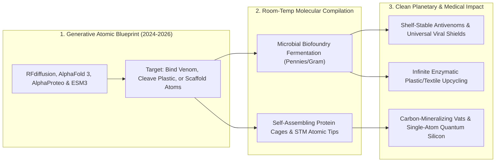

# De Novo Protein Machines & Atomic-Precision Manufacturing
**Pillar 2: Embodied AI, Robotics & Self-Driving Science — Carbon Edition**

> **The Cynic's Reflex:**
> *"Nanotechnology is sci-fi vaporware, 'plastic recycling' just dumps bottles into overseas landfills, and biology is far too messy to engineer from scratch—we're stuck tweaking random bacterial proteins that boil apart at fifty degrees."*
>
> **The 2026 Breakthrough Reality:**
> Crowned by the **2024 Nobel Prize in Chemistry**, humanity crossed from *reading* evolutionary proteins to **writing brand-new molecular machines from first principles** that never existed in four billion years of nature! Using **RFdiffusion**, **AlphaFold 3**, **AlphaProteo**, **ESM3**, and **Cradle**, scientists now compile hyper-stable custom enzymes that unzip polyester trash back into virgin clear bottles in hours, neutralize lethal cobra venom at room temperature without horse serum, self-assemble nanoscale mineral lattices, and join **atomic-precision scanning-probe silicon lithography** to build matter atom by atom.

---

## Act I: Antivenom in a Pocket and Virgin Bottles from Harbor Trash — A Human Story from 2031

Heat shimmers off a cassava plot outside Tamale in northern Ghana in August 2031 when seventeen-year-old student Kwame Boateng
steps barefoot near brushwood and feels the searing strike of a saw-scaled viper.

Six years earlier, snakebite envenoming killed over **100,000 rural villagers and children** across Africa, South Asia, and Latin
America every year—and maimed 400,000 more—because century-old antivenoms were brewed by injecting horses with crude venom,
refrigerating fragile glass vials at $4^\circ\text{C}$, and hoping rural clinics three hours down unpaved roads hadn't lost power:

* **Two Minutes After the Bite:** Kwame's mother pulls a \$4 foil-sealed autoinjector from the village teacher's unrefrigerated canvas first-aid pouch—stocked alongside bandages after sitting through two $43^\circ\text{C}$ dry seasons without losing a single percent of potency.
* **De Novo Molecular Handcuffs:** Inside is a cocktail of **AI-designed de novo mini-proteins** (pioneered by Nobel Laureate Prof. David Baker's Institute for Protein Design and Technical University of Denmark's Prof. Andreas Laustsen-Kiel). Generated via **RFdiffusion** to wrap around lethal three-finger neurotoxins and metalloproteinases with picomolar lock-and-key precision, these synthetic 60-amino-acid binders contain zero horse antibodies—meaning zero anaphylactic shock, $95^\circ\text{C}$ thermal stability, and vat fermentation at pennies per dose! Within twenty minutes, Kwame's swelling halts completely.
* **Meanwhile, in Marseille Harbor:** Inside **Carbios'** silent bio-recycling bioreactors on the French coast, bales of dirty, colored, multi-layer carpet fiber and ocean-recovered PET bottles bathe in warm $68^\circ\text{C}$ water seeded with AI-engineered depolymerase enzymes. No smokestacks, no crude oil, no mechanical "downcycling" into brittle grey park benches: in ten hours, **97% of the plastic unzips cleanly into pure monomer crystals**, repolymerized next door into crystal-clear medical-grade bottles indistinguishable from virgin petroleum plastic.

---

## Act II: From Reading Evolution's Scrapbook to Writing Custom Molecular Machines

To appreciate how extraordinary the 2024–2026 protein revolution is, consider the combinatorics: a modest 200-amino-acid
protein has $20^{200}$ ($10^{260}$) possible sequences—vastly more than all the atoms in the observable universe ($10^{80}$).
Evolution explored only a microscopic pinhole of that space—and evolution never needed an enzyme to digest synthetic 1970s
plastics, survive $90^\circ\text{C}$ industrial vats, or pattern 2-nanometer silicon quantum dots!

Between 2024 and late 2026, generative biology and atomic-scale surface physics unlocked **programmable nanoscale matter**.

### 1. Generative De Novo Protein Design: RFdiffusion, AlphaProteo, AlphaFold 3 & ESM3
* **UW Institute for Protein Design (*RFdiffusion*, *ProteinMPNN*, *RFdiffusion All-Atom* — Baker Lab):** Awarded the **2024 Nobel Prize in Chemistry** (shared by David Baker, Demis Hassabis, and John Jumper), *RFdiffusion* generates novel 3D protein backbones around any target molecule—small-molecule pollutants, viral spikes, snake neurotoxins, or catalytic transition states—jumping experimental binder hit rates **from $<0.1\%$ to $20\%–50\%$ on the very first wet-lab plate**!
* **Google DeepMind (*AlphaFold 3* & *AlphaProteo*):** *AlphaFold 3* extended atomic-resolution structure prediction across all of life's molecules—proteins, DNA, RNA, metal ions, and small-molecule drugs—while *AlphaProteo* designed sub-nanomolar binders with **3x to 300x higher binding affinities** than previous methods against cancer and viral targets (*VEGF-A*, *SARS-CoV-2*).
* **EvolutionaryScale (*ESM3*) & *Cradle* / *Profluent*:** Trained across billions of metagenomic sequences from deep-sea vents to hot springs, *ESM3* generated a functional glowing fluorescent protein (*esmGFP*) separated by **equivalent to 500 million years of evolutionary distance** from any natural sequence, while *Cradle* and *Profluent* engineer industrial enzymes and custom CRISPR gene editors with 10x higher thermostability and specificity.

### 2. Self-Assembling Protein Nanocages, Plastic Depolymerases & Carbon-Fixing Enzymes
* **Infinite Enzymatic Plastic & Polyurethane Un-Making (*Carbios*, *Protein Evolution*, UT Austin *FAST-PETase*):** AI-optimized cutinases and amidases break down recalcitrant polyester clothing blends and packaging at mild temperatures into pure terephthalic acid and ethylene glycol—closing the circular materials loop forever.
* **De Novo Mineral & Electronic Scaffolds:** Self-assembling icosahedral protein nanocages and DNA origami frames position gold nanoparticles, photosynthetic chromophores, and perovskite nanocrystals with **0.2-nanometer repeatable spacing** inside water at room temperature.
* **Atomic-Precision Hydrogen-Depassivation Lithography (*Zyvex Labs*, UNSW *Silicon Quantum Computing*):** Using automated Scanning Tunneling Microscope (STM) tips under ultra-high vacuum to pluck individual hydrogen atoms off silicon lattices one by one, engineers place single phosphorus donor atoms with **exact 0.38-nanometer single-atom precision**—building ultra-low-noise solid-state quantum processors and zero-defect calibration standards.

### Legacy Chemical/Mechanical Industry vs. 2026–2031 De Novo Molecular & Atomic Fabrication

| Industrial / Medical Challenge | Legacy 20th-Century Process | 2026–2031 De Novo Protein / Atomic Solution | Cost, Safety & Climate Leap |
| :--- | :--- | :--- | :--- |
| **Snakebite & Toxin Antidotes** | Horse-serum immunization; \$1,000+; requires $4^\circ\text{C}$ fridge | **RFdiffusion thermostable mini-proteins** (\$3–\$8/dose) | Survives **$90^\circ\text{C}+$** unrefrigerated; zero serum sickness |
| **Polyester & Textile Recycling** | 85% landfilled/incinerated; mechanical melt degrades fibers | **AI-engineered PETase/amidase bioreactors** ($65^\circ\text{C}$ water) | **>95% conversion** of mixed colored clothing to virgin monomers |
| **Specialty Pharma & Fine Chemicals** | Toxic palladium catalysts + boiling chlorinated solvents | **Custom de novo cascade enzymes** in room-temp water | Cuts hazardous chemical waste (*E-factor*) by **80%–95%** |
| **Industrial $\text{CO}_2$ Mineralization** | Slow geological weathering or energy-heavy kilns | **Hyper-thermostable engineered Carbonic Anhydrase** | Accelerates $\text{CO}_2$-to-limestone mineralization **1,000,000x** |
| **Sub-Nanometer Device Patterning** | \$380M EUV lithography masks with stochastic edge blur | **DNA/Protein Self-Assembly + Zyvex STM Single-Atom Placement** | **Exact 1-atom ($0.38\text{ nm}$)** deterministic placement |

> *"The wondrous diversity in nature provides inspiration for a whole new world of designed proteins to cure disease, degrade plastics and other pollutants, and help us adjust to a changing climate."*
> — **Prof. David Baker**, 2024 Nobel Laureate in Chemistry & Director, UW Institute for Protein Design

### 3. Frontier Organizations & Verified Milestones (2024–2026)

| Organization / Pioneer | Core Capability | Verified 2024–2026 Milestone & Real-World Footprint |
| :--- | :--- | :--- |
| **UW Institute for Protein Design (Baker Lab)** | *RFdiffusion*, *ProteinMPNN*, de novo enzymes & nanocages | **2024 Chemistry Nobel**; published *Nature* de novo snake-venom neutralizers & licensed influenza/RSV nanoparticle vaccines (*SKYCovione* lineage). |
| **Google DeepMind & Isomorphic Labs** | *AlphaFold 3* (200M+ structures) & *AlphaProteo* | **2024 Chemistry Nobel**; unlocked joint protein-DNA-ligand complex prediction and high-affinity binder generation. |
| **Carbios & Protein Evolution** | Commercial enzymatic PET & textile biorecycling | Scaling **50,000-ton/year** Longlaville enzymatic PET plant with major beverage & apparel brands (*Patagonia*, *L'Oréal*, *Inditex*). |
| **EvolutionaryScale (*ESM3*) & Profluent** | Generative protein & open CRISPR editor language models | Generated functional novel proteins 500M evolutionary years from nature and **OpenCRISPR-1** non-natural human genome editors. |
| **Cradle & Ginkgo / Zymergen Biofoundries** | Iterative ML protein optimization + high-throughput vats | Cut enzyme engineering rounds from 3 years to months for bio-based nylons, food enzymes, and PFAS/pollutant bioremediation. |
| **Zyvex Labs & Silicon Quantum Computing** | Atomic-precision STM lithography (*ZyvexLitho1*) | Commercialized **sub-nanometer single-atom silicon patterning** for ultra-coherent spin qubits and atomic metrology. |

---

## Act III: Reimagining Social Conventions — Brewing Clean Industry Like Beer Instead of Refining Crude Oil

Most industrial pollution comes from one brutal 19th-century habit: smashing hydrocarbons together at $500^\circ\text{C}$ in toxic
solvents because we didn't know how to build precise molecular chisels. Every spider spins silk stronger than steel by weight
out of flies and pond water at room temperature! De novo protein machines bring nature's gentle precision to heavy industry:

1. **Closing the Plastic & Fast-Fashion Loop for Real:**
   Consumers grew rightly cynical when they learned only 9% of plastics ever got recycled because melted mixed plastics turn grey and brittle. Enzymatic depolymerization doesn't melt plastic—it snips polymer chains back to pure transparent building blocks infinitely, turning harbor trash and old gym shirts into permanent domestic feedstocks.
2. **Neglected Tropical Antidotes & Room-Temperature Vaccines as Global Commons:**
   Because open-weight models like *RFdiffusion* and *ProteinMPNN* are freely downloadable by university labs in Brazil, India, Kenya, and Thailand, local researchers design shelf-stable antidotes for regional scorpion stings, cobras, and dengue strains without waiting for Western pharmaceutical boards.
3. **Mandatory Nucleic-Acid Screening & Safe-by-Design Biocontainment:**
   Every commercial gene-synthesis vendor (*International Gene Synthesis Consortium*) enforces cryptographic sequence screening, while de novo industrial enzymes run as **cell-free purified powders** incapable of replicating outside the vat.

### Global Precedents & Institutional Proof Points
* **WHO Snakebite Envenoming Roadmap & Wellcome Trust Antivenom Consortia:** Backing clinical translation of de novo recombinant antivenoms to halve global snakebite deaths and amputations before 2030.
* **France & EU Recycled-Content Packaging Mandates:** Legally requiring rising shares of food-grade circular PET—creating guaranteed commercial demand for enzymatic depolymerization hubs like Carbios.
* **Open *AlphaFold Protein Structure Database* (EMBL-EBI — 200M+ Structures, 2M+ Users in 190 Countries):** History's greatest gift of open scientific infrastructure, accelerating malaria vaccine, antibiotic-resistance, and honeybee-health breakthroughs worldwide.

### Four Everyday Pollution & Health Problems Solved by Custom Proteins
1. **Destroying "Forever Chemicals" (PFAS) & Pesticide Runoff:** De novo haloalkane dehalogenase and laccase enzymes immobilized inside municipal water-treatment cartridges cleave stubborn carbon-fluorine and organophosphate bonds in ambient municipal water.
2. **Universal Mosaic Pandemic & Influenza Vaccines:** Self-assembling 60-subunit protein icosahedrons display receptor-binding domains from 8 to 20 viral strains simultaneously—training human B-cells to neutralize mutated variants before they even jump species.
3. **Zero-Allergen Precision Food & Silk Textiles:** Fermentation-brewed spider-silk parkas (biodegradable in seawater yet tougher than Kevlar) and hypoallergenic infant-formula proteins engineered without gliadin or beta-lactoglobulin epitopes.
4. **Bio-Leaching Critical Metals Without Cyanide:** Engineered metalloproteins selectively chelate lithium from geothermal brines and recover 99% pure gold, copper, and neodymium from shredded circuit boards in room-temperature water baths—replacing open-air acid and cyanide heaps!

### Why Biosecurity Scales Alongside Open Discovery
Critics rightly insist that powerful generative biology must never lower barriers to dangerous pathogens. Between 2024 and 2026, biosecurity matured into a rigorous multi-layer architecture:
* **Universal Benchtop & Cloud DNA Synthesis Screening:** Every order converting digital `.fasta` sequences into physical DNA oligos undergoes automated structural homology checks against restricted viral and toxin motifs.
* **Cell-Free Industrial Execution:** Plastic-degrading, carbon-mineralizing, and e-waste-leaching enzymes are shipped to factories as purified, non-living biodegradable protein powders—zero living GMOs ever enter rivers or soil.
* **Instant Defensive Countermeasure Design:** If a novel zoonotic virus emerges naturally, *RFdiffusion* + *AlphaProteo* generate picomolar nasal-spray decoy mini-proteins within **72 hours** of genome sequencing.

### 10-Year Trajectory of De Novo Protein & Atomic Fabrication

| Era & Milestone | De Novo Binder / Enzyme First-Try Hit Rate | Cost of Enzymatic Virgin-Grade Recycled PET | Shelf-Stable Biologics Share | Societal & Ecological Dividend |
| :--- | :--- | :--- | :--- | :--- |
| **2020 Pre-Diffusion** | <0.1% (100,000+ manual yeast screens) | 3x–4x virgin petro-PET (pilot scale) | <5% (strict cold chain required) | High failure cost; horse-serum antivenoms |
| **Late 2026 SOTA** | **20% – 50%** (*RFdiffusion* / *AlphaProteo*) | Approaching $1.3\times$ virgin parity at 50kt scale | Rapidly growing pediatric/field trials | Nobel breakout; first commercial bio-recycling plants |
| **2029 Inflection** | **>75%** (including multi-step custom enzymes) | **Cheaper than crude-oil PET** ($<\$1.10/\text{kg}$) | 40%+ new biologics room-temp stable | \$5 pocket antivenoms; textile landfill diversion surges |
| **2034 Abundance** | Near-deterministic sequence-to-machine compiler | Universal circular monomer economy | >80% cold-chain-free global reach | Petrochemical solvent pollution slashed >70% |

---

## Act IV: The Synergy Cascade

De novo molecular machines plug seamlessly into every neighboring pillar of the Carbon Atlas:
* **Self-Driving Labs ([`self-driving-labs`](../self-driving-labs/REPORT.md)):** Generative models design 96 candidate plastic-eating or carbon-fixing enzymes in ten minutes; automated *AutoDNA* biofoundries synthesize, express, and assay their catalytic turnover rate $k_{\text{cat}}$ by Tuesday morning.
* **Quantum Logical Simulation ([`quantum-logical-simulation`](../quantum-logical-simulation/REPORT.md)):** Logical qubits calculate exact quantum-tunneling activation barriers inside metallo-enzyme active sites—turning sluggish first-draft de novo enzymes into million-turnover-per-second industrial powerhouses!
* **Holographic Bio-Microassembly ([`holographic-bio-microassembly`](../holographic-bio-microassembly/REPORT.md)):** Custom non-immunogenic human structural proteins serve as ultra-pure optical bio-inks for 20-second volumetric organoid and cartilage printing.
* **Local Microfactories ([`local-microfactories`](../local-microfactories/REPORT.md)):** Enzymatic depolymerization vats turn town plastic and textile waste directly into pure monomer pellets for neighborhood 3D manufacturing cells.

### Summary Snapshot: Programmable Nanoscale Matter
* **First-Plate De Novo Binder Hit Rate:** Jumped **>200x** (from $<0.1\%$ to $20\%–50\%$) between 2021 and 2026.
* **Enzymatic Plastic Recovery:** **97%+ pure monomer yield** from colored/mixed PET packaging and polyester clothing.
* **Atomic Silicon Lithography Precision:** **0.38 nanometers** (single-atom placement accuracy).

---

## References & Verified Sources

* **Featured Researcher / Leader:** [Prof. David Baker — 2024 Nobel Laureate in Chemistry & Director, UW Institute for Protein Design](https://www.ipd.uw.edu/)
* **Companies, Labs & Consortia:** [UW Institute for Protein Design (RFdiffusion / ProteinMPNN)](https://www.ipd.uw.edu/) · [Google DeepMind & Isomorphic Labs (AlphaFold 3 & AlphaProteo)](https://alphafold.ebi.ac.uk/) · [Carbios & Protein Evolution (Enzymatic PET/Textile Upcycling)](https://en.wikipedia.org/wiki/PETase) · [EvolutionaryScale (ESM3) & Profluent (OpenCRISPR)](https://www.evolutionaryscale.ai/) · [Cradle Bio (Generative Industrial Enzymes)](https://www.cradle.bio/) · [Zyvex Labs & UNSW Silicon Quantum Computing (0.38 nm STM)](https://www.zyvexlabs.com/)
* **Global & Regulatory Precedents:** [EMBL-EBI Open AlphaFold DB (200M+ Structures, 190 Countries)](https://alphafold.ebi.ac.uk/) · [WHO & Wellcome Trust Recombinant Snakebite Antivenom Consortia](https://www.who.int/health-topics/snakebite) · [France & EU Mandatory Circular Food-Grade PET Packaging Targets](https://environment.ec.europa.eu/topics/plastics_en) · [International Gene Synthesis Consortium Cryptographic Biosecurity](https://genesynthesisconsortium.org/)
* **Connected Carbon Pathways:** [Healing a Toxified Planet: Supercritical PFAS Destruction, Plastic-Eating Enzymes & Clean Rivers](../../03-bioscience-regeneration/forever-chemical-cleanup/REPORT.md) · [The Billion-Hectare Rewilding: Solar Proteins, Vertical Orchards & Returning Half the Earth to Wild Nature](../../03-bioscience-regeneration/precision-fermentation-rewilding/REPORT.md) · [10,000 Experiments Before Breakfast: Autonomous Physical Wet & Solid Labs](../self-driving-labs/REPORT.md) · [Neighborhood Fab-Commons: Custom, Repairable Goods Made Two Blocks Away](../local-microfactories/REPORT.md)
