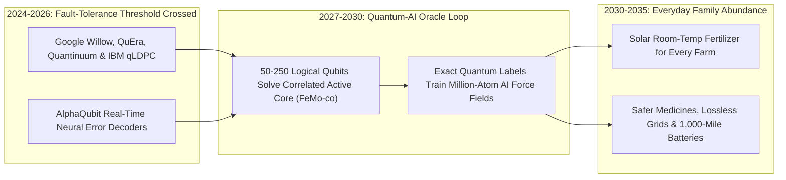

# Fault-Tolerant Quantum + AI Chemistry Simulators
**Pillar 2: Embodied AI, Robotics & Self-Driving Science — Carbon Edition** *(New in Carbon)*

> **The Cynic's Reflex:**
> *"Quantum computing has been 'ten years away' for thirty years—fragile chandelier gimmicks drowned in thermal noise that only threaten to break bank encryption while never solving a single problem a regular family cares about."*
>
> **The 2026 Breakthrough Reality:**
> Between 2024 and late 2026, quantum computing crossed its historic **Kitty Hawk fault-tolerance threshold**: for the first time in history, bundling noisy physical qubits into **error-corrected logical qubits** made error rates drop *exponentially* rather than rise! Led by Google's below-threshold **Willow** processor, **QuEra** neutral-atom arrays, **Quantinuum** trapped-ion logical gates, and **IBM's Starling** LDPC roadmap, hybrid Quantum-AI simulators are zeroing in on humanity's ultimate chemical prize: cracking strongly correlated catalysts like **FeMo-co** to brew zero-carbon, room-temperature fertilizer for every farm on Earth.

---

## Act I: Solar Fertilizer in the Rift Valley — A Human Story from 2033

Dawn breaks over a four-hectare maize and bean cooperative outside Nakuru in Kenya's Great Rift Valley in March 2033.
Agronomist Samuel Kiprop flips a wall switch inside a shipping-container micro-plant sitting beside the village solar array.
Inside the container, gentle ambient-pressure electro-catalytic stacks hum quietly at $28^\circ\text{C}$, drinking in rainwater,
ordinary nitrogen air, and midday sunshine—and trickling rich, zero-carbon liquid ammonium nutrient straight into the
cooperative's drip-irrigation tanks for **\$0.12 per kilogram**.

Ten years earlier, Samuel's neighbors went broke whenever distant natural-gas wars tripled the price of imported synthetic
fertilizer. For over a century, humanity fed half its population using the 1909 **Haber-Bosch process**—cooking fossil methane
at $450^\circ\text{C}$ and **200 atmospheres of crushing pressure** inside billion-dollar refineries that belched nearly **2% of all
global greenhouse emissions**:

* **Nature's 3-Billion-Year-Old Secret:** Every clover root on Earth already knew a cleaner trick: soil bacteria use an enzyme cofactor called **FeMo-co** ($\text{Fe}_7\text{MoS}_9\text{C}$—iron, molybdenum, sulfur, and carbon) to snap atmospheric $\text{N}_2$'s triple bond effortlessly at room temperature and 1 atmosphere!
* **Why Supercomputers Hit a Brick Wall:** For fifty years, chemists tried to copy FeMo-co onto durable industrial electrodes—and failed, because simulating 50+ strongly entangled d-shell electrons spinning across iron and molybdenum atoms requires tracking $2^{100}+$ quantum amplitudes simultaneously, choking the largest classical GPU supercluster on Earth.
* **The Quantum-AI Breakthrough:** In 2029, a 160-logical-qubit fault-tolerant quantum processor paired with a neural force-field model mapped FeMo-co's exact multi-electron transition states to chemical precision ($<1\text{ kcal/mol}$)—revealing a synthetic iron-molybdenum sulfide electro-catalyst any regional micro-plant can stamp onto steel mesh.
* **Samuel's Harvest:** Today, Nakuru's farmers never wait on foreign cargo ships or fossil gas pipelines. Their harvest yields are up 65%, river algal blooms have vanished through precision fertigation, and village wealth stays in the valley.

---

## Act II: Crossing the Fault-Tolerant Threshold — From Noisy Qubits to Verified Logical Engines

For decades, skeptics had a valid point about the "NISQ" (Noisy Intermediate-Scale Quantum) era: adding more raw physical
qubits actually made calculations *worse*, because quantum decoherence crept in faster than gates could run. Everything hinged
on one make-or-break physics milestone: **Below-Threshold Quantum Error Correction (QEC)**—proving that encoding 1 "logical qubit"
across a grid of physical qubits reduces logical error exponentially each time the grid grows.

Between 2024 and late 2026, three independent hardware modalities crossed that Rubicon simultaneously.

### 1. The 2024–2026 Logical Qubit Breakout
* **Google Quantum AI (*Willow* Below-Threshold Surface Code):** Google's superconducting *Willow* chip demonstrated that scaling a surface-code logical qubit from a $3\times 3$ array to $5\times 5$ and $7\times 7$ **cut the logical error rate in half ($\Lambda = 2.14$) with every step**, achieving logical lifetimes longer than the best individual physical qubit inside the chip, backed by real-time neural syndrome decoders (*AlphaQubit*).
* **Neutral-Atom Reconfigurable Logical Arrays (*QuEra*, Harvard/MIT Lukin Group, *Atom Computing*):** Using optical laser tweezers to shuttle rubidium and ytterbium atoms mid-circuit with transversal gates, neutral-atom processors demonstrated **48 to 100+ entangled logical qubits** executing deep error-detected algorithms in a glass vacuum cell the size of a grape.
* **Trapped-Ion High-Fidelity Logical Chemistry (*Quantinuum* H2 / *Helios* + Microsoft):** Achieving $>99.9\%$ physical two-qubit gate fidelities and active teleportation-based error correction, Quantinuum and Microsoft demonstrated logical qubits **800x cleaner** than underlying physical error rates—running the first end-to-end hybrid **Quantum + Classical HPC + AI catalytic chemistry workflows**.
* **High-Rate qLDPC Codes (*IBM Starling* Roadmap & *Riverlane*):** Quantum Low-Density Parity-Check (qLDPC) codes slashed the physical-to-logical qubit overhead by **up to 10x** compared to planar surface codes—pulling 200-logical-qubit, 100-million-gate fault-tolerant chemistry machines straight into the late-2020s window.

### 2. Why Hybrid Quantum + AI Beats Either Alone ("Quantum-Centric Supercomputing")
Critics once imagined a quantum computer would have to simulate all 10,000 atoms of a protein at once. In reality, **99% of a molecule behaves smoothly enough for fast classical AI neural potentials**—only the tiny 40-to-80-orbital active core (where transition-metal electrons entangle wildly during bond-breaking or superconductivity) baffles classical physics!
1. **Quantum Processor as the "Exact Oracle":** Logical qubits run Quantum Phase Estimation (QPE) and Sample-Based Quantum Diagonalization (SQD) on the strongly correlated active site (like FeMo-co, Photosystem II's $\text{Mn}_4\text{CaO}_5$ water-splitting cluster, or cytochrome P450 liver enzymes).
2. **AI Foundation Model as the "Million-Atom Amplifier":** Exact ground- and excited-state energies from the quantum chip serve as gold-standard training labels for equivariant neural force fields—letting classical GPUs screen **millions of catalyst variants** with quantum-exact accuracy!

### Classical Approximation vs. 2026–2031 Fault-Tolerant Quantum-AI Simulation

| Chemical / Physical Challenge | Classical DFT / GPU Supercomputer Limit | Fault-Tolerant Logical Quantum + AI Hybrid | Concrete Everyday Breakthrough Unlocked |
| :--- | :--- | :--- | :--- |
| **Room-Temp $\text{N}_2$ Fixation (*FeMo-co*)** | Fails completely on open-shell $\text{Fe}_7\text{MoS}_9\text{C}$ spins ($>15\text{ kcal/mol}$ error) | **$<1\text{ kcal/mol}$ chemical accuracy** via ~100–200 logical qubits | Solar container fertilizer replacing **2% of global $\text{CO}_2$ emissions** |
| **Artificial Photosynthesis ($\text{Mn}_4\text{CaO}_5$)** | Exponential scaling wall on multi-reference $\text{O–O}$ bond step | Exact excited-state charge-transfer dynamics | Cheap sunlight-to-liquid-fuel & green hydrogen catalysts without iridium |
| **Cytochrome P450 Drug Metabolism** | Misses subtle heme-iron spin flips causing toxic liver side effects | Exact active-site spin energetics in hours | Cuts late-stage clinical drug toxicity failures by **50%+** |
| **Solid-State Battery Interfaces** | Approximates lithium-dendrite electron tunneling poorly | Exact interfacial redox barriers training ML force fields | Non-flammable **1,000-mile EV batteries** with zero capacity fade |
| **High-$T_c$ Superconductors** | Cuprate/nickelate Cooper-pair mechanism unresolved for 40 years | Native Fermi-Hubbard & multi-band correlation simulation | Lossless city power cables & compact hospital MRI / fusion magnets |

> *"Nature is quantum mechanical at its foundation; fault-tolerant logical qubits give us a native telescope into the exact chemistry of catalysis, energy, and medicine."*
> — **Dr. Hartmut Neven**, Founder & Lead, Google Quantum AI

### 3. Frontier Logical-Quantum Pioneers & Verified 2024–2026 Milestones

| Organization & Platform | Modality & Error-Correction Architecture | Verified 2024–2026 Milestone |
| :--- | :--- | :--- |
| **Google Quantum AI** (*Willow* + *AlphaQubit*) | Superconducting transmons + surface code + neural decoder | First **below-threshold scaling ($\Lambda = 2.14$)** where larger logical grids beat physical qubit lifetimes. |
| **QuEra Computing & Harvard/MIT** | Neutral rubidium atoms in dynamic optical tweezers | Demonstrated **48+ logical qubits** with transversal CNOT gates and reconfigurable error-corrected circuits. |
| **Quantinuum** (*H2* / *Helios*) & **Microsoft** | QCCD trapped ytterbium/barium ions + active syndrome extraction | Logical error rates **800x lower** than physical qubits; executed first logical-qubit catalytic chemistry workflow. |
| **IBM Quantum** (*Heron* $\rightarrow$ *Starling* Roadmap) | Modular superconducting couplers + **Bivariate Bicycle qLDPC** | Demonstrated 90% memory-overhead savings via qLDPC codes + Sample-Based Quantum Diagonalization (SQD) on HPC. |
| **PsiQuantum & Xanadu** | Silicon-photonic manufacture on commercial 300mm wafer fabs | Utility-scale cryogenic/room-temp photonic interconnects built in GlobalFoundries fabs (Brisbane & Chicago sites). |
| **Phasecraft, QSimulate &SandboxAQ** | Quantum-classical-AI chemistry algorithms | Compressed quantum gate depth **1,000x** for solid-state battery cathodes, perovskites, and enzyme active sites. |

---

## Act III: Reimagining Social Conventions — Post-Quantum Security + Public-Cloud Chemical Oracles

Two fears have dominated public talk around quantum computing: *"Will it crack everyone's bank passwords?"* and *"Will only
three superpowers own the chandelier?"* Both fears already have concrete institutional answers:

1. **The Encryption Threat Is Already Neutralized by Math:**
   In August 2024, NIST finalized global **Post-Quantum Cryptography (PQC)** standards (**ML-KEM / Kyber**, **ML-DSA / Dilithium**, **SLH-DSA**), already deployed across Chrome, Signal, iMessage, AWS, and Cloudflare—meaning ordinary classical laptops run lattice encryption that even a million-qubit quantum computer cannot crack. Quantum computing's real legacy won't be espionage; it will be **chemistry**.
2. **Cloud-Shared "CERNs for Chemistry" (No Lab Needs to Buy One):**
   Because a single 200-logical-qubit machine needs only hours to generate exact quantum energy labels that permanently upgrade open-weight AI chemistry models, a single national-lab quantum-HPC center lifts *every* university and startup worldwide!
3. **Ending Fossil Fertilizer Vulnerability:**
   Decentralizing nitrogen fixation from giant natural-gas Haber-Bosch complexes to solar village electro-catalyzers insulates global food prices from pipeline geopolitics forever.

### Global Precedents & Public-Access Proof Points
* **NIST Post-Quantum Cryptography Rollout (FIPS 203/204/205):** Proactive global upgrade protecting civilian health, banking, and civic records years ahead of cryptanalytically relevant machines.
* **EuroHPC, RIKEN (Japan *Fugaku* + IBM Heron) & U.S. DOE National Quantum Centers:** Public supercomputing facilities tightly coupling quantum processors directly into open academic HPC racks via high-speed optical links.
* **Wellcome Leap *Quantum for Bio* & Novo Nordisk Foundation Quantum Programme (\$200M+):** Philanthropic biomedical trusts guaranteeing quantum health simulations remain open to academic medicine and global disease research.

### Why Ordinary Families Will Feel Quantum Chemistry Long Before Owning a Quantum Chip
You will never carry a cryogenic chandelier in your backpack—just as you never carried a wind tunnel in your pocket to fly safely on a jetliner. Instead, fault-tolerant logical simulators reshape daily household budgets behind the scenes:
* **30%–50% Cheaper, Fossil-Free Groceries in Import-Dependent Regions:** Solar village nitrogen fixation severs the link between volatile natural-gas wars and farmgate grain prices.
* **Fewer Recalled Medicines & Faster Rare-Cancer Drugs:** Exact simulation of Cytochrome P450 liver heme enzymes catches dangerous off-target metabolic side effects on silicon before Phase II human trials ever start.
* **Zero-Fire 15-Minute Solid-State Car & Home Batteries:** Mapping exact solid-electrolyte interphase (SEI) electron tunneling eliminates dendrite short-circuits.
* **Lossless Underground Superconducting City Power Lines:** Understanding cuprate and nickelate pairing lets utilities push 5x more clean wind and solar power through narrow existing urban conduits with zero resistive heat loss.

### Comparing Hardware Modalities Racing Toward 1,000 Logical Qubits
Rather than relying on a single fragile physics bet, humanity now holds **four orthogonal shots on goal**:
1. **Superconducting Transmons + qLDPC Codes (*Google*, *IBM*, *Rigetti*, *Alice & Bob* cat qubits):** Nanosecond gate speeds leveraging solid-state lithographic control.
2. **Neutral-Atom Optical Tweezers (*QuEra*, *Atom Computing*, *Pasqal*, *Infleqtion*):** All-to-all dynamic connectivity at microkelvin laser cooling inside compact vacuum chambers.
3. **Trapped-Ion QCCD Chips (*Quantinuum*, *IonQ*, *Oxford Ionics*):** Industry-leading $>99.9\%$ native gate fidelities with modular photonic links.
4. **Silicon Photonics (*PsiQuantum*, *Xanadu*):** Manufactured directly on existing 300-millimeter semiconductor foundry lines with optical fiber networking built in from day one.

### 10-Year Trajectory of Fault-Tolerant Quantum Chemistry Simulation

| Stage & Era | Verified Logical Qubits | Reliable Logical Gate Operations | Chemistry Reach | Societal & Industrial Impact |
| :--- | :--- | :--- | :--- | :--- |
| **2022 NISQ Era** | 0 (raw noisy physical qubits) | ~100 noisy two-qubit gates | Toy $\text{H}_2$ / $\text{LiH}$ molecules classical laptops solve | Pure physics experiments |
| **Late 2026 SOTA** | **12 – 50+ logical qubits** (below threshold) | $10^3 - 10^4$ error-corrected/detected ops | Small correlated clusters + SQD hybrid runs | *Willow*, QuEra & Quantinuum prove QEC works |
| **2029 Inflection** | **150 – 300 logical qubits** (qLDPC / neutral atom) | $10^6 - 10^7$ fault-tolerant T-gates | Exact **FeMo-co** & P450 active-site benchmarks | Quantum-trained AI force fields transform catalysis |
| **2033 Abundance** | **1,000 – 5,000+ logical qubits** | $10^9+$ continuous fault-tolerant ops | Full excited-state photochemistry & high-$T_c$ lattices | Room-temp solar fertilizer, safer drugs & lossless grids |

---

## Act IV: The Synergy Cascade

Fault-tolerant quantum simulation acts as the **deep-physics ground truth** powering adjacent Carbon Edition pathways:
* **Inverse Materials Design ([`inverse-materials-design`](../inverse-materials-design/REPORT.md)):** Whenever classical DFT fails on strongly correlated magnetic or superconducting d/f-electron crystals, logical qubits compute exact reference energies so *MatterGen*-class diffusion models stop guessing blind.
* **Protein & Atomic Nanofabrication ([`protein-atomic-nanofabrication`](../protein-atomic-nanofabrication/REPORT.md)):** *AlphaFold 3* predicts 3D protein folds brilliantly, while logical quantum chemistry calculates exact electron-tunneling transition rates inside designed metallo-enzymes—creating 100x faster plastic-degrading and carbon-fixing biocatalysts.
* **AI Formal Mathematics ([`ai-formal-mathematics`](../ai-formal-mathematics/REPORT.md)):** Real-time neural decoders (*AlphaQubit*) and Lean-verified compiler passes optimize T-gate counts by 10x, squeezing 2035-class chemistry onto 2029-scale hardware.

---

## References & Verified Sources

* **Featured Researcher / Leader:** [Dr. Hartmut Neven — Founder & Lead, Google Quantum AI](https://quantumai.google/)
* **Companies, Labs & Consortia:** [Google Quantum AI (Willow & AlphaQubit)](https://quantumai.google/) · [QuEra Computing & Harvard/MIT Neutral-Atom Labs](https://www.quera.com/) · [Quantinuum (Helios / H2) & Microsoft](https://www.quantinuum.com/) · [IBM Quantum (Heron & Starling qLDPC Roadmap)](https://www.ibm.com/quantum) · [PsiQuantum & Riverlane](https://www.psiquantum.com/) · [Phasecraft & QSimulate (Quantum-AI Chemistry)](https://www.phasecraft.io/)
* **Global & Regulatory Precedents:** [NIST Post-Quantum Cryptography Standards Live (FIPS 203/204/205)](https://csrc.nist.gov/projects/post-quantum-cryptography) · [Japan RIKEN Fugaku + Quantum-Centric Public HPC Supercenter](https://www.riken.jp/en/) · [EuroHPC & US DOE Open National Quantum Chemistry Testbeds](https://eurohpc-ju.europa.eu/) · [Wellcome Leap & Novo Nordisk Foundation \$200M+ Quantum-Bio Commons](https://wellcomeleap.org/)
* **Connected Carbon Pathways:** [Designing Matter Backwards: AI Super-Materials Without Rare-Earth Scars](../inverse-materials-design/REPORT.md) · [De Novo Protein Machines & Atomic-Precision Manufacturing](../protein-atomic-nanofabrication/REPORT.md) · [Lossless HTS Superhighways & Autonomous Microgrids](../../01-abundant-energy/superconducting-grids/REPORT.md) · [Turning Thin Air into Jet Fuel, Green Steel & Stone](../../01-abundant-energy/synthetic-sky-fuels/REPORT.md)
