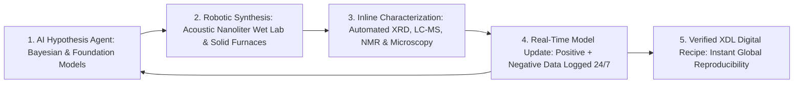

# 10,000 Experiments Before Breakfast: Autonomous Physical Wet & Solid Labs
**Pillar 2: Embodied AI, Robotics & Self-Driving Science — Carbon Edition**

> **The Cynic's Reflex:**
> *"AI only shuffles digital pixels and text—it can't touch messy test tubes, stubborn powders, or real wet biology. Discovering a new medicine, battery electrolyte, or clean catalyst will always take fifteen years, two billion dollars, and legions of sleep-deprived PhD students pipetting clear liquids by hand."*
>
> **The 2026 Breakthrough Reality:**
> Closed-loop **Self-Driving Laboratories (SDLs)** have married hypothesis-generating AI agents directly to robotic liquid handlers, solid-state furnaces, X-ray diffractometers, and mass spectrometers running 24/7. From Lawrence Berkeley National Laboratory's **A-Lab** autonomously synthesizing dozens of brand-new inorganic crystals to **Emerald Cloud Lab**, **Lila Sciences**, **Radical AI**, Liverpool's mobile robotic chemist, and **AutoDNA** molecular loops, empirical discovery has accelerated 10x to 100x—turning lone-bench serendipity into continuous, reproducible science.

---

## Act I: A Cure Brewed Over a Weekend in Kumasi & Glasgow — A Human Story from 2031

At 5:40 PM on a rainy Friday in November 2031, twenty-eight-year-old computational biochemist Dr. Ama Mensah closes her
laptop at Kwame Nkrumah University of Science and Technology (KNUST) in Kumasi, Ghana, and heads out to dinner with her
husband and six-year-old son.

Ten years earlier, Ama would have faced two bleak options to test a promising new enzyme-stabilizing excipient capable of
keeping pediatric malaria and dengue biologics potent at $40^\circ\text{C}$ without cold-chain freezers: wait nine months for
imported specialty reagents to clear customs, or move permanently abroad to wash glassware until midnight in an elite Boston lab.

Instead, before leaving her desk, Ama uploads a twenty-line open-protocol specification to a federated **Regional Cloud SDL**
node shared across West African universities and linked to sister autonomous synthesis bays in Glasgow and Berkeley:

* **Friday Night Hypothesis-to-Pipette Loop:** At 6:00 PM, an active-learning Bayesian agent translates Ama's stability target into an initial batch of **384 distinct polymer-peptide formulations**. Acoustic droplet ejectors fire nanoliter reagent pulses—using 1,000x less chemical volume than human pipettes—into sealed microfluidic plates.
* **Saturday 3:00 AM Real-Time Course Correction:** Automated thermal-stress chambers heat the candidates while inline Raman spectroscopy, liquid chromatography–mass spectrometry (LC-MS), and dynamic light scattering measure protein unfolding every twelve minutes. When an unexpected histidine-trehalose co-crystal outperforms predictions by 40%, the AI scientist autonomously designs **four successive generations** of follow-up experiments before dawn—logging 4,200 physical assays by Sunday noon.
* **Monday Morning Before Coffee:** When Ama opens her dashboard at 8:30 AM Monday with a cup of cocoa, she doesn't find raw noise; she finds three fully characterized, non-toxic formulations that keep vaccines stable for six months in Sahara-summer heat, complete with cryptographic provenance logs and a standardized **Chemputer (.xdl)** synthesis recipe ready for local hospital micro-compounding that afternoon.
* **Reclaiming the Scientist's Mind:** Ama hasn't pipetted a single microliter by hand all year. Freed from repetitive carpal-tunnel drudgery, her five-person Kumasi team publishes on par with billion-dollar pharmaceutical campuses—focused 100% on asking bold biological questions for diseases big pharma once ignored.

---

## Act II: Closing the Loop Between Digital Intelligence and Physical Matter

Why did scientific R&D become steadily *more* expensive per breakthrough between 1970 and 2020 ("Eroom's Law")?
Because even as computation sped up a million-fold, physical experimentation stayed artisanal: a brilliant scientist
spent 85% of their week weighing powders, labeling vials, babysitting chromatography columns, and failing to reproduce
another lab's unrecorded room-humidity quirks. Over 50% of published preclinical wet-lab studies failed replication tests.

Between 2024 and late 2026, **Closed-Loop Autonomous Science** fused four mature layers into a single 24/7 engine.

### 1. Active-Learning AI Agents That Learn From Negative Results
Traditional high-throughput screening blindly tests 100,000 static guesses at huge cost. Self-Driving Labs run **Bayesian optimization and reinforcement-learning active loops**: test 48 smart candidates, measure exact physical reality within minutes, update the world model—including every failed reaction, which human journals almost never publish!—and immediately pick the maximally informative next experiment. This slashes the number of physical trials needed to find an optimal catalyst or drug formulation by **90% to 99%**.

### 2. Solid-State Synthesis, Mobile Robot Chemists & Cloud Wet Labs
* **Autonomous Inorganic Solid-State Synthesis (*LBNL A-Lab*):** At Lawrence Berkeley National Laboratory, A-Lab integrated literature-trained natural-language models, *Materials Project* thermodynamic predictions, robotic powder dosing, tube furnaces, and automated X-ray diffraction (XRD) to synthesize **41 novel inorganic solid compounds in just 17 days** of continuous autonomous operation—actively rewriting failed furnace recipes mid-run when phase impurities appeared.
* **Free-Roaming Mobile Robotic Chemists (*University of Liverpool*):** Prof. Andrew Cooper's mobile robotic scientists navigate standard human laboratories using laser SLAM, operating legacy gas chromatographs, balances, and photochemistry racks for weeks on end—discovering hydrogen-evolution photocatalysts **6x more active** than initial formulations after autonomously executing 688 multi-variable experiments.
* **Programmable Digital Chemistry & *AutoDNA* Read-Write Loops:** Prof. Lee Cronin's **Chemputer** and universal Chemical Description Language (**XDL**) compile peer-reviewed chemical synthesis into executable robot code, while automated DNA/RNA synthesis and nanopore sequencing loops (*AutoDNA* / biofoundry pipelines) design, assemble, express, and assay custom genetic circuits without human hands touching a tube.
* **Commercial Autonomous Mega-Platforms (*Emerald Cloud Lab*, *Lila Sciences*, *Radical AI*):** Browser-programmable cloud laboratories with 200+ automated analytical instruments allow any researcher with a laptop and a \$2,000 grant to run the exact same robotic protocols as a Fortune 50 pharma giant.

### Anatomy of a Closed-Loop Self-Driving Lab Stack (Legacy Bench vs. 2026–2030 SDL)

| Experimental Layer | Legacy Artisanal Lab (2015–2022) | 2026–2030 Autonomous Self-Driving Lab | Speed / Cost / Quality Leap |
| :--- | :--- | :--- | :--- |
| **Hypothesis Selection** | Human literature reading + intuition (batches of 5–10) | **Bayesian Active Learning + Multi-Agent World Models** | **90%–99% fewer trials** needed to locate global optimum |
| **Liquid & Powder Handling** | Manual microliter pipettes & spatula weighing | **Acoustic Nanoliter Droplet Ejectors & Robotic Dosing** | **1,000x less reagent cost**; zero repetitive-strain human error |
| **Synthesis Execution** | Hand-watched glass flasks & manual tube furnaces | **Programmable XDL Fluidics, Micro-Reactors & Multi-Furnaces** | 24/7/365 unattended synthesis across air-free & high-temp conditions |
| **Inline Characterization** | Walk sample down hall; wait 3 days for core-facility queue | **Direct Robotic Feed to Inline XRD, LC-MS, NMR & Raman** | Characterization latency drops from **72 hours to <8 minutes** |
| **Data & Negative Results** | Handwritten notebooks; failed runs discarded unpublished | **100% Cryptographic Telemetry (Positive + Dark Data)** | **>98% cross-lab reproducibility**; rich training fuel for AI |
| **Protocol Sharing** | Ambiguous prose paragraphs ("stir vigorously overnight") | **Executable `.xdl` / JSON Digital Chemistry Code** | Instant one-click synthesis replay in hospitals or labs worldwide |

### Built-In Biosecurity & Chemical Safety Guardrails
Cynics reasonably ask: *"If an autonomous lab can synthesize molecules from code, how do we stop accidental hazards or misuse?"*
Cloud and institutional Self-Driving Labs actually provide **dramatically stronger safety governance** than millions of unmonitored manual benches:
1. **Automated Pre-Execution Screening:** Every incoming `.xdl` synthesis graph and *AutoDNA* sequence order passes mandatory cryptographic screening against regulated pathogen, toxin, and energetic-precursor registries *before* a single valve opens.
2. **Nanoliter Containment:** Exploring reaction space at 2.5-nanoliter microfluidic volumes means even an unexpected exothermic spike releases less thermal energy than striking a wooden match—eliminating traditional fume-hood explosions.
3. **Hermetic Human Isolation:** Toxic solvents, pyrophoric battery electrolytes, and air-sensitive catalysts remain 100% sealed inside inert argon robotic gloveboxes where no graduate student ever inhales fumes.

### Four Everyday Breakthroughs Accelerated by Self-Driving Labs
* **Room-Temperature Biologics & Rare-Disease Therapies:** Screening personalized antisense oligonucleotides and heat-stable vaccine excipients for patient populations as small as 50 children.
* **PFAS-Free Coatings & Biodegradable Packaging:** Rapidly evolving bio-derived barrier polymers that match Teflon's water resistance without "forever chemicals."
* **Cobalt-Free Solid-State Electrolytes:** Testing thousands of ceramic grain-boundary dopants per week to deliver non-flammable, 10-minute-charging EV batteries.
* **Green Electro-Catalysts:** Discovering abundant iron-nickel-molybdenum water-splitting catalysts that replace scarce iridium in clean hydrogen electrolyzers.

> *"Digitizing chemistry means a life-saving molecule discovered in one automated lab in the morning can be synthesized locally in a hospital across the world that afternoon."*
> — **Prof. Lee Cronin**, Regius Chair of Chemistry, University of Glasgow & Creator of the Chemputer

### 3. Frontier Self-Driving Lab Pioneers & Verified 2024–2026 Capabilities

| Lab / Organization | Domain & Core Hardware | Verified 2024–2026 Milestone & Scientific Output |
| :--- | :--- | :--- |
| **Lawrence Berkeley National Lab (*A-Lab*)** | Solid-state battery & clean-energy oxides/phosphates | Autonomously synthesized **dozens of novel predicted inorganic crystals** via closed-loop powder dispensing, multi-furnace baking & inline XRD. |
| **Emerald Cloud Lab (ECL)** | Remote browser-controlled 200+ instrument wet lab | Full cloud-programmable life-science & chemistry execution; 100% digital telemetry capturing every barometric, thermal, and pipetting micro-event. |
| **University of Liverpool (Cooper Group)** | Mobile autonomous robotic chemists in standard labs | Multi-robot coordination across standard benches operating synthesis + LC-MS + NMR to discover new photocatalysts and supramolecular cages. |
| **University of Glasgow (*Chemputer* / XDL)** | Universal programmable organic synthesis | Compiled complex small-molecule pharmaceuticals and functional dyes into portable **XDL** code executable across standardized fluidic rigs. |
| **Lila Sciences & Radical AI** | Venture-scale Autonomous Science super-facilities | Vertically integrated AI reasoning models driving massive closed-loop biology, catalysis, and materials discovery bays 24/7/365. |
| **Argonne (*Polybot*) & Acceleration Consortium** | Polymers, perovskites & organic electronics (U of Toronto) | Discovered next-generation organic solid-state laser emitters and perovskite solar ink formulations **10x–50x faster** than manual R&D. |

---

## Act III: Reimagining Social Conventions — Ending the "Grad-Student Sweatshop" & Democratizing Cures

For generations, academic science romanticized an unhealthy convention: brilliant twenty-four-year-olds spending six years
performing mind-numbing manual pipetting in poorly ventilated basements, hoarding secret lab notebooks, and watching rare
diseases go unstudied because screening costs \$500 million. Self-Driving Labs rewrite the social contract of science:

1. **Ending the Reproducibility Crisis Forever:**
   When every nanoliter dispense, stir speed, ambient humidity reading, and negative result is captured automatically in open, machine-readable **XDL / JSON** provenance logs, "it worked in our lab's hands" disappears. Any lab on Earth can replay, audit, and build upon a breakthrough overnight.
2. **Global South & Rare-Disease Scientific Equity:**
   Through **Remote Cloud Wet Labs**, a university team in Nairobi, Kumasi, Bogotá, or a patient-led rare-disease foundation of fifty families can rent two hours of world-class robotic mass-spectrometry and high-content cell screening for a few hundred dollars—without needing \$80 million in local cleanroom capital first.
3. **Publishing "Dark Data" as a Public Good:**
   Human scientists publish successes and bury failed reactions in desk drawers—causing thousands of other labs to waste years repeating the same dead ends. Autonomous labs publish **100% of both positive and negative phase-space data**, turning every "failed" crystal or unstable protein into rocket fuel for global foundation models.

### Global Precedents & Institutional Proof Points
* **Canada's \$200M+ *Acceleration Consortium* (University of Toronto):** Led by Prof. Alán Aspuru-Guzik, uniting public universities, national labs, and open-source SDL hardware standards so small labs can build modular \$5,000–\$25,000 self-driving testbeds.
* **U.S. DOE National Lab Autonomous Discovery Networks (LBNL, Argonne, Oak Ridge):** Publicly funded autonomous beamlines and synthesis hubs granting merit-based remote access to researchers nationwide.
* **UK *Dial-a-Molecule* & Digital Chemistry Standards (XDL):** Establishing open-access, vendor-neutral chemical execution code analogous to HTML or PDF for physical matter.
* **Global Biofoundries Alliance (GBA):** Over 30 public non-profit biofoundries across Asia, Europe, Australia, and the Americas sharing standardized *AutoDNA* protocols for climate enzymes, sustainable biomanufacturing, and rapid pandemic countermeasures.

### How the Working Scientist's Week Transforms (2022 Manual Bench vs. 2031 SDL Era)
Instead of making curious humans obsolete, Self-Driving Labs restore the joy that drew young minds into science in the first place:
* **Manual Liquid Pipetting & Vial Labeling:** Drops from **24 hours/week** to **0 hours/week**.
* **Waiting on Core-Facility Instrument Queues:** Drops from **10 hours/week** to **automated overnight streaming**.
* **Troubleshooting Irreproducible Literature Recipes:** Drops from **8 hours/week** to **instant XDL audit verification**.
* **Deep Biological/Physical Thinking, Cross-Disciplinary Collaboration & Clinical Translation:** Expands from **<6 hours/week** to **35+ unhurried hours/week**.

### Open-Hardware Micro-SDLs for High Schools & Community Colleges
Not every Self-Driving Lab is a \$50 million facility:
* Open-source fluidic platforms (**Opentrons Flex**, **Jubilee** multi-tool changers, and University of Toronto **\$500 "Hello World" color-mixing active-learning kits**) now let public high-school students in rural towns train real Bayesian optimization loops on safe food-dye and enzyme kinetics before they even enter college.

### The 10-Year Trajectory of Self-Driving Physical Science

| Stage & Era | Typical Discovery Cycle (New Catalyst / Formulation) | Cost Per Verified Experimental Point | Reproducibility Rate | Primary Scientific & Human Dividend |
| :--- | :--- | :--- | :--- | :--- |
| **2024 Manual Baseline** | 7 – 14 years (artisanal bench trial & error) | \$150 – \$800 / assay | ~45%–55% across labs | High failure cost locks out rare/neglected diseases |
| **Late 2026 SOTA** | 6 – 18 months (early closed-loop SDLs) | \$8 – \$25 / assay | >92% on XDL/Cloud rigs | A-Lab, ECL, Lila & Acceleration Consortium prove 10x–30x speedup |
| **2029 Inflection** | 3 – 8 weeks (federated multi-modal SDLs) | \$0.80 – \$2.50 / assay | >98.5% cryptographic | Cloud SDLs empower Global South universities & rare-disease co-ops |
| **2033 Abundance** | 48 – 96 hours (10,000+ nanoliter loops/day) | <\$0.15 / assay | >99.5% universal replay | Personalized biologics, room-temp enzymes & clean batteries on demand |

---

## Act IV: The Synergy Cascade

Self-Driving Labs are the **physical verification engine** that turns digital AI dreams across the Carbon Atlas into touchable reality:
* **Inverse Materials Design ([`inverse-materials-design`](../inverse-materials-design/REPORT.md)):** Generative models like *MatterGen* and *GNoME* propose millions of theoretical crystals on silicon; Self-Driving Labs physically bake, test, and validate which ones survive real-world moisture, voltage, and stress in days rather than decades.
* **Protein & Atomic Nanofabrication ([`protein-atomic-nanofabrication`](../protein-atomic-nanofabrication/REPORT.md)):** *AlphaFold 3* and *RFdiffusion* dream up custom plastic-eating enzymes and room-temperature therapeutics; automated biofoundries synthesize the DNA, express the proteins, and evolve their catalytic speed 50x over a weekend.
* **General-Purpose Humanoids ([`general-purpose-humanoids`](../general-purpose-humanoids/REPORT.md)):** Bipedal lab assistants carry sample racks between legacy analytical instruments that weren't built with conveyor ports—retrofitting thousands of existing university chemistry departments into 24/7 Self-Driving Labs for pennies on the dollar.

---

## References & Verified Sources

* **Featured Researcher / Leader:** [Prof. Lee Cronin — Regius Chair of Chemistry, University of Glasgow & Creator of the Chemputer](https://www.chem.gla.ac.uk/cronin/)
* **Companies, Labs & Consortia:** [Lawrence Berkeley National Lab (A-Lab)](https://www.lbl.gov/) · [Emerald Cloud Lab (ECL)](https://www.emeraldcloudlab.com/) · [Lila Sciences & Radical AI](https://www.lila.ai/) · [University of Liverpool (Mobile Robotic Chemist)](https://www.liverpool.ac.uk/) · [University of Glasgow (Chemputer / XDL)](https://www.chem.gla.ac.uk/cronin/) · [U of Toronto Acceleration Consortium & Argonne Polybot](https://acceleration.utoronto.ca/)
* **Global & Regulatory Precedents:** [Canada's \$200M+ Open Acceleration Consortium SDL Standards](https://acceleration.utoronto.ca/) · [US DOE Autonomous National Lab Beamline & Synthesis Networks](https://www.energy.gov/science/office-science) · [Global Biofoundries Alliance (30+ Non-Profit AutoDNA Hubs)](https://biofoundries.org/) · [Universal Chemical Description Language (.xdl) Open Execution Spec](https://www.chem.gla.ac.uk/cronin/)
* **Connected Carbon Pathways:** [Designing Matter Backwards: AI Super-Materials Without Rare-Earth Scars](../inverse-materials-design/REPORT.md) · [De Novo Protein Machines & Atomic-Precision Manufacturing](../protein-atomic-nanofabrication/REPORT.md) · [One-Dose Genetic Cures: In Vivo CRISPR & Base Editing for All](../../03-bioscience-regeneration/invivo-crispr-cures/REPORT.md) · [Helpful Mechanical Hands: General-Purpose Humanoid Teammates](../general-purpose-humanoids/REPORT.md)
