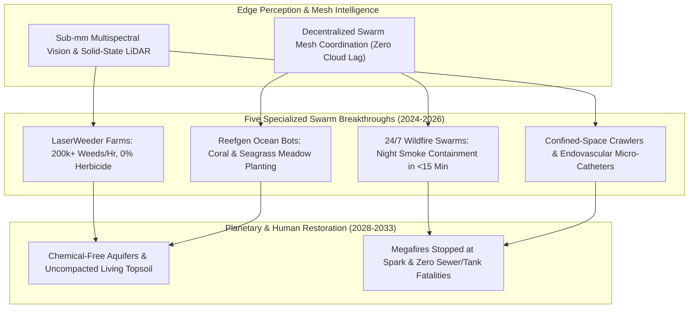

# Symphonic Swarms: Chemical-Free Farms, Ocean & Wildfire Rescue Bots
**Pillar 2: Embodied AI, Robotics & Self-Driving Science — Carbon Edition**

> **The Cynic's Reflex:**
> *"Swarm robotics sounds like sci-fi drone shows or surveillance nightmares—meanwhile real farms stay addicted to chemical herbicides, firefighters still breathe lethal smoke, and municipal workers still climb into deadly toxic sewers."*
>
> **The 2026 Breakthrough Reality:**
> Non-humanoid, domain-specialized robotic swarms are already performing physical miracles no human body could ever attempt. Today, **Carbon Robotics' LaserWeeders** zap over 200,000 weeds per hour with millimeter-accurate thermal pulses—eliminating synthetic herbicides across hundreds of thousands of acres—while night-flying autonomous water-drop swarms, **Reefgen** underwater seagrass planters, endovascular micro-catheters, and confined-space sewer crawlers rescue ecosystems and human lives alike.

---

## Act I: Fireflies Over the Salinas Valley — A Human Story from 2030

Stand at the edge of an organic carrot and spinach farm in California's Salinas Valley just before midnight in June 2030.
Third-generation grower Elena Morales leans against her electric pickup with a thermos of chamomile tea, watching what
looks like a silent constellation of ruby fireflies gliding across forty acres of dark loam.

Ten years ago, keeping weeds from choking delicate baby carrot shoots required either saturating the soil with synthetic
pre-emergent herbicides or hiring crews of sixty workers to hunch over rows in $38^\circ\text{C}$ heat with short-handled hoes—
work that scarred backs and exposed farmworkers to drift chemicals.

Tonight, three solar-charged autonomous **LaserWeeder** gantries roll whisper-quietly down the beds at five miles per hour:

* **Sub-Millimeter Surgical Precision:** Underneath each canopy, high-resolution multispectral cameras and edge neural chips inspect every square millimeter of soil at 120 frames per second, distinguishing a three-day-old pigweed sprout from a heirloom carrot cotyledon just two millimeters away.
* **Zero Chemicals, Living Earthworms:** Thirty diode lasers fire microsecond $10.6\text{-}\mu\text{m}$ thermal bursts straight into each weed's meristematic growth cells—killing **99.9% of weeds** without disturbing soil mycorrhizae or leaving a single microgram of chemical residue in the town's aquifer.
* **Night Watch on the Ridge:** Forty miles north in the Santa Cruz Mountains, lightning strikes a dry pine ridge at 2:14 AM. Within ninety seconds, satellite infrared triggers a local Forestry Cooperative hangar. Six autonomous heavy-lift rotorcraft launch into smoky night winds too hazardous for human helicopter pilots, dousing the half-acre ember bed in four minutes while tracked **Thermite**-class brush bots carve a containment break.
* **Elena's Morning:** When sunrise hits the valley, earthworms and ladybugs teem in the dark soil. Elena's former hand-weeding crew—now certified **Ag- Swarm Technicians** earning \$44 an hour—review soil-carbon telemetry from shaded cab tablets before harvesting chemical-free greens for regional schools.

---

## Act II: Why Specialized Morphologies Outperform Human Bodies

While general-purpose humanoids excel inside human doorways, nature itself never settled on a single body plan:
albatrosses soar across oceans, earthworms aerate soil, and schools of fish coordinate effortlessly without a central boss.
Between 2024 and late 2026, coupling low-cost edge vision, solid-state LiDAR, mesh radio coordination, and ruggedized electric
drivetrains unlocked five extraordinary classes of specialized robotic swarms.

### 1. Agricultural Laser & Micro-Stewardship Swarms
* **Carbon Robotics (*LaserWeeder G2*):** Armed with up to 30 high-power $\text{CO}_2$ and fiber lasers plus 42 Nvidia edge GPUs trained on tens of millions of labeled plant images, a single implement destroys **200,000 to 600,000 weeds per hour** day or night—paying back its hardware cost in 1–2 seasons by slashing herbicide and hand-weeding expenses up to 80%.
* **Small-Scale Solar Field Bots (*Aigen*, *Farm-ng*, *Monarch*):** Ultra-lightweight 150-pound solar-powered rovers roll continuously through cotton, sugar-beet, and vineyard rows without compacting wet topsoil the way 15-ton diesel tractors do.

### 2. Autonomous Wildfire Suppression & Night Aerial Tankers
* **Night-Flying Autonomous Drop Swarms (*Rain*, *Sikorsky Matrix*, *Pyka*):** Historically, aerial firefighting halted at dusk and in heavy smoke—giving wildfires twelve unchecked nighttime hours to explode into megafires. Autonomous perception-guided rotorcraft and fixed-wing swarms now fly through zero-visibility smoke plumes within fifteen minutes of ignition, extinguishing nascent fires before they reach towns.
* **Tracked Fireline & Hazmat Bots (*Howe & Howe Thermite*, *Shark Robotics Colossus*):** Heat-shielded tracked robots push directly into $800^\circ\text{C}$ warehouse infernos and canyon brushfires where sending human firefighters would mean certain death.

### 3. Ocean Restoration, Confined-Space Rescue & Endovascular Micro-Bots
* **Benthic Marine Planters (*Reefgen*, * Coral Vita* partners):** Suitcase-sized autonomous underwater vehicles (AUVs) hover centimeters above coastal seabeds, planting **tens of thousands of Eelgrass (*Zostera*) shoots and heat-resilient coral plugs per day** to rebuild storm-surge buffers and fish nurseries.
* **Confined-Space & Sewer Crawlers (*Flyability Elios 3*, *Gecko Robotics*, *PipeTrekker*):** Ultrasonic wall-climbing crawlers and collision-tolerant caged drones inspect municipal water mains, boiler tubes, and hydrogen tanks—ending the silent epidemic of confined-space asphyxiation deaths.
* **Magnetic Endovascular Micro-Catheters (*Stereotaxis*, ETH Zurich / MIT magnetic soft Continuum bots):** Millimeter-thin magnetically steered catheters snake gently through tortuous cerebral arteries within the "golden hour" of ischemic stroke, bringing specialist thrombectomy precision to rural clinics via remote robotic telerobotics.

### Engineering Comparison: Monolithic Legacy Heavy Machinery vs. Specialized Autonomous Swarms

| Operational Metric | Legacy Industrial Monolith (2015–2023) | 2026–2030 Specialized Robotic Swarm | Ecological & Human Benefit |
| :--- | :--- | :--- | :--- |
| **Row-Crop Weed Control** | 15-ton sprayer applying broad-spectrum synthetic herbicides | **LaserWeeder + 150-lb Solar Rovers** (thermal micro-pulses) | **0% chemical residue**; zero herbicide-resistant superweeds; uncompacted living loam |
| **Wildfire Night Response** | Grounded human helicopters from dusk till dawn | **LiDAR/Thermal Autonomous Rotorcraft + Tracked Mules** | Extinguishes lightning ignitions at <1 acre instead of 50,000-acre megafires |
| **Coastal Habitat Repair** | Manual SCUBA divers planting ~600 shoots/day | **Reefgen Benthic AUV Swarms** planting 8,000+ shoots/day | Restores natural storm-surge seagrass barriers 10x faster at 1/5th the cost |
| **Sewer & Tank Inspection** | Human entry in breathing gear (asphyxiation hazard) | **Ultrasonic Magnetic Crawlers & Caged LiDAR Drones** | **100% elimination** of confined-space worker fatalities; continuous leak prevention |
| **Fleet Resilience** | Single \$600k tractor breakdown halts harvest | Graceful swarm degradation (9 of 10 bots continue seamlessly) | Zero single-point-of-failure downtime during tight weather windows |

### Why Decentralized Swarm Intelligence Scales Safely Without Cloud Fragility
A common skeptic worry is: *"What happens if rural cellular service drops or a central server gets hacked?"*
Modern agricultural, marine, and wildfire swarms operate on **local biological-inspired rules**:
1. **100% On-Board Edge Vision:** LaserWeeders and pipe crawlers process every plant leaf and weld seam locally on ruggedized onboard GPUs—never requiring internet connectivity to distinguish crop from weed.
2. **Peer-to-Peer Mesh Deconfliction:** Like starlings wheeling in flight, autonomous wildfire rotorcraft broadcast encrypted ultra-wideband/mesh positions directly to neighboring airframes 50 times per second.
3. **Physical Energy Containment:** Agricultural lasers point strictly downward inside heavy light-absorbing safety skirts and automatically interlock within one millisecond if wheel-contact or tilt sensors detect lift.

> *"When sub-millimeter computer vision meets high-power lasers, farmers eliminate chemical herbicides completely while restoring living soil."*
> — **Paul Mikesell**, Founder & CEO, Carbon Robotics

### 4. Real-World Swarm & Specialized Robotics Pioneers (2024–2026)

| Pioneer & System | Specialized Form Factor | Verified 2024–2026 Performance & Impact |
| :--- | :--- | :--- |
| **Carbon Robotics** (*LaserWeeder*) | Multi-row towed/autonomous laser thermal array | **200,000+ weeds/hr** zapped at sub-mm accuracy across 100+ crop types in North America, Europe & Australia; **0% herbicide**. |
| **Aigen** (*Element* Solar Fleet) | 100% solar-powered lightweight field swarm | Autonomous mechanical weeding & soil telemetry running 14+ hrs/day solely on canopy solar panels and regenerative braking. |
| **Rain & Sikorsky (*Matrix*)** | Pre-positioned autonomous wildfire rotorcraft | Rapid autonomous dispatch integrated with early-detection wildfire cameras to douse lightning/powerline ignitions day or night. |
| **Shark Robotics** (*Colossus*) | Fireproof tracked suppression & rescue mule | Battle-tested since Notre-Dame; withstands extreme radiant heat while hauling 1,000 kg of hose, water cannon, or injured evacuees. |
| **Reefgen** (*Cora* Underwater Bot) | Hovering benthic seagrass & coral-plug AUV | Automates labor-intensive seagrass shoot insertion and reef outplanting 10x faster than human SCUBA dive teams. |
| **Gecko Robotics & Flyability** | Magnetic ultrasonic wall-climbers & caged LiDAR drones | Maps sub-millimeter corrosion across dams, ship hulls, and municipal sewers with **zero human confined-space entry**. |

---

## Act III: Reimagining Social Conventions — Cooperative Equipment Pools & Ecological Stewardship

For a century, industrial efficiency meant "bigger, heavier, and more toxic": 20-ton tractors crushing soil pores and blanket-spraying broad-spectrum poisons because machines were too blind to tell crop from weed. Specialized intelligent swarms flip that industrial logic upside down—making **regenerative polyculture cheaper than chemical monoculture**:

1. **Rural Equipment Cooperatives (The Modern Barn-Raising):**
   A single grower with 80 acres doesn't need to buy a \$500,000 laser rig alone. Modeled on France's *CUMA* (*Coopératives d'Utilisation de Matériel Agricole*), ten neighboring family farms co-own two autonomous LaserWeeder and soil-sampling units that roll seamlessly from farm to farm all spring—giving small family plots lower per-acre operating costs than giant agro-conglomerates.
2. **From "Accepting Megafire Smoke Seasons" to Instant Spark Containment:**
   Cities across Western North America, the Mediterranean, and Australia came to treat orange toxic skies and \$100 billion wildfire losses as an inescapable new normal. Autonomous solar-charged drone nests spaced every 15 miles across wildland-urban interfaces restore rapid 10-minute suppression while allowing safe, bot-shepherded prescribed winter cultural burns.
3. **Outlawing Deadly Confined-Space Entry:**
   Every year, dozens of municipal utility workers suffocate inside hydrogen-sulfide sewer vaults and chemical tanks. Just as building codes mandated hardhats and trench shoring, updated occupational standards make sending a human into an unventilated pipe—when a \$15,000 crawler can inspect it—legally obsolete.

### Global Precedents & Real-World Policy Proof
* **France's 11,500+ *CUMA* Farm Machinery Cooperatives:** Over a third of French farmers already share specialized precision machinery democratically at cost, providing a plug-and-play financing model for laser and solar field swarms.
* **EU Sustainable Use of Pesticides & Drinking-Water Protection Zones:** European water utilities in Denmark and Germany actively co-fund non-chemical mechanical and laser weeding for farmers above municipal aquifers—because preventing nitrate/herbicide runoff costs 10x less than filtering poisoned tap water.
* **California & Australian Autonomous Wildfire Detection Networks (*ALERTCalifornia*):** Over 1,050 AI pan-tilt-zoom cameras already spot smoke plumes minutes before the first 911 call, creating the live sensor backbone for autonomous water-drop dispatch.

### Annual Planetary & Municipal Dividends per 1,000-Swarm Regional Basin
When a single agricultural and wildland watershed transitions from chemical sprayers and reactive firefighting to autonomous swarms:
* **Synthetic Herbicide Eliminated:** Over 450,000 pounds of active chemical ingredients kept out of soil and groundwater annually.
* **Topsoil Carbon & Fungal Recovery:** Uncompacted root zones infiltrate 3x more winter stormwater, cutting downstream town flood peaks.
* **Particulate Wildfire Smoke Avoided:** Stopping just two 40,000-acre megafires prevents millions of pediatric asthma ER visits across downwind cities.
* **Zero Confined-Space Municipal Fatalities:** Every sewer main, digester dome, and water tower inspected continuously without risking a single utility worker's life.

### Trajectory of Specialized Ecological & Rescue Swarms (2024–2034)

| Era & Milestone | Agricultural Herbicide Displacement | Wildfire Night-Dispatch Latency | Ocean & Infrastructure Reach | Economic & Ecological Unlock |
| :--- | :--- | :--- | :--- | :--- |
| **2024 Baseline** | <0.5% specialty vegetable acreage | Daylight human aircraft only (8–12 hr night gap) | Manual SCUBA restoration; sporadic crawlers | First commercial LaserWeeders prove ROI |
| **Late 2026 SOTA** | Millions of specialty & row-crop acres | 15–20 min autonomous pilot zones | Tens of thousands of daily seagrass/coral plugs | Edge AI vision drops below \$400 per sensor node |
| **2029 Inflection** | 35%+ vegetable & row crops via farm co-ops | <10 min 24/7 wildland-urban coverage | Mandatory zero-human sewer/tank inspection | Herbicide runoff into rivers drops >45% in co-op basins |
| **2034 Abundance** | >80% chemical herbicide elimination | 90%+ megafire ignitions stopped under 2 acres | 1M+ hectares of coastal blue-carbon meadows | Regenerative polyculture becomes the cheapest way to farm |

---

## Act IV: The Synergy Cascade

Specialized swarms weave directly into the broader Carbon Edition ecosystem:
* **Self-Driving Labs ([`self-driving-labs`](../self-driving-labs/REPORT.md)) & Protein Nanofabrication ([`protein-atomic-nanofabrication`](../protein-atomic-nanofabrication/REPORT.md)):** Field rovers collect live rhizosphere microbiome samples and stream telemetry back to automated wet labs designing custom nitrogen-fixing bio-inoculants.
* **Abundant Solar & Solid-State Batteries:** High-efficiency tandem solar skins and 500 Wh/kg batteries allow lightweight field and ocean bots to graze continuously on sunlight without diesel refueling trucks.
* **AI Formal Mathematics ([`ai-formal-mathematics`](../ai-formal-mathematics/REPORT.md)):** Formally verified collision-avoidance and airspace-deconfliction kernels guarantee thousands of night-flying wildfire and medical drones share skies with commercial aviation at zero collision risk.

---

## References & Verified Sources

* **Featured Researcher / Leader:** [Paul Mikesell — Founder & CEO, Carbon Robotics](https://carbonrobotics.com/)
* **Companies, Labs & Consortia:** [Carbon Robotics (LaserWeeder)](https://carbonrobotics.com/) · [Aigen (Solar Field Swarm)](https://www.aigen.io/) · [Rain & Sikorsky Matrix (Night Wildfire Rotorcraft)](https://www.lockheedmartin.com/) · [Shark Robotics (Colossus Fire Mules)](https://www.shark-robotics.com/) · [Reefgen (Underwater Seagrass & Coral Bots)](https://www.reefgen.io/) · [Gecko Robotics & Flyability (Confined-Space Crawlers)](https://www.geckorobotics.com/)
* **Global & Regulatory Precedents:** [France's 11,500+ CUMA Democratic Farm Equipment Cooperatives](https://en.wikipedia.org/wiki/Agricultural_cooperative) · [Danish & German Municipal Water-Utility Non-Chemical Farming Subsidies](https://agriculture.ec.europa.eu/farming/organic-farming_en) · [ALERTCalifornia 1,050+ Camera AI Wildfire Early-Detection Backbone](https://alertcalifornia.org/) · [OSHA / EU Zero-Human Confined-Space Robotic Inspection Mandates](https://www.osha.gov/confined-spaces)
* **Connected Carbon Pathways:** [35.5% Perovskite-Silicon Tandems & Living Solar Skins](../../01-abundant-energy/perovskite-tandem-solar/REPORT.md) · [Saving Every Living Lineage: Heat-Evolved Coral Reefs, AI Bio-Acoustics & Living Biobanks](../../03-bioscience-regeneration/assisted-coral-cryobanks/REPORT.md) · [Earth's Protective Canopy: Catching Wildfires in 3 Minutes & Plugging Methane Leaks from Orbit](../../05-space-frontier/earth-digital-twin-canopy/REPORT.md) · [10,000 Experiments Before Breakfast: Autonomous Physical Wet & Solid Labs](../self-driving-labs/REPORT.md)
