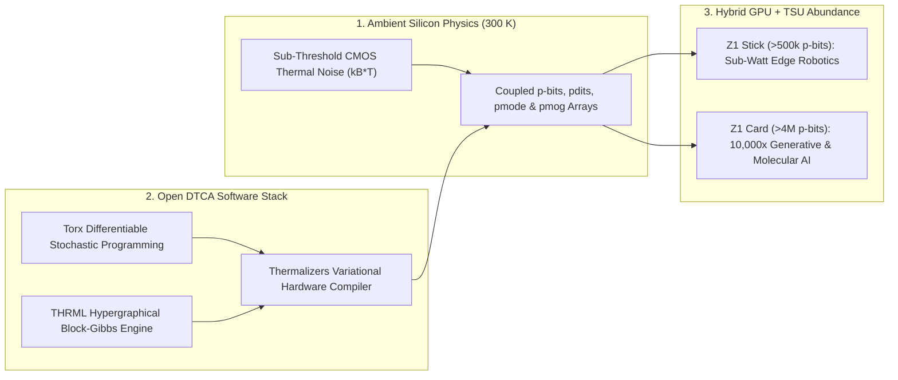

# Room-Temperature Thermodynamic Chips: Extropic Z1, p-Bits & Harnessing Thermal Noise for 10,000× AI Efficiency
**Pillar 2: Embodied AI, Robotics & Self-Driving Science — Carbon Edition**

> **The Cynic's Reflex:**
> *"Generative AI and robotic world models are hitting an insurmountable energy wall—training and running probabilistic reasoning across billions of devices will devour entire power grids, while quantum computers require giant millikelvin dilution refrigerators."*
>
> **The 2026 Breakthrough Reality:**
> For seventy years, digital chipmakers spent gigawatts fighting the random thermal jiggling of electrons inside room-temperature silicon. Between 2025 and late 2026, **Thermodynamic Computing** flipped that script—turning ambient thermal noise ($k_B T$) into a native physical engine for probabilistic AI. Led by **Extropic's** **Denoising Thermodynamic Computer Architecture (DTCA)**, open-source **`Torx` / `Thermalizers` / `THRML`** software stack, a **\$75M U.S. Department of Commerce Letter of Intent**, and the Fall 2026 **`Z1` chip tapeout**, **Thermodynamic Sampling Units (TSUs)** target **100× to 10,000× better energy efficiency** than digital GPUs on generative sampling, uncertainty-aware robotics, and molecular physics—all on standard room-temperature CMOS silicon.

---

## Act I: A Half-Watt Brain in a Mountain Blizzard — A Human Story from 2030

Snow whips through a dark pine ravine in the Dolomites at 2:00 AM in February 2030 as search-and-rescue volunteer Elena Rossi
launches three backpack-sized quadrotors to locate an overdue backcountry skier beneath avalanche debris. Cell towers are dead.
Cold mountain air saps lithium batteries in minutes. Five years earlier, a small drone could carry either a power-hungry 150-watt
GPU that drained its battery in six minutes, or a tiny microcontroller too rigid to navigate swirling snow and shifting branches.

Tonight, each rescue drone carries a thumb-sized, 0.8-watt **M.2 Thermodynamic Sampling Unit (`Z1 Stick` successor)** slotted
beside a lightweight vision processor:

* **Surfing Uncertainty at Microsecond Speed:** Instead of forcing millions of deterministic 64-bit floating-point transistors to *pretend* to roll dice using pseudo-random number generators, the TSU lets half a million coupled **probabilistic bits (`p-bits`)** settle naturally through room-temperature thermal electron fluctuations—sampling 10,000 plausible 3D wind-gust and snow-drift trajectories per second on **less power than a bike taillight**.
* **Calibrated Life-or-Death Confidence:** When an infrared glint flickers beneath a fallen spruce, the drone's probabilistic world model doesn't spit out an overconfident hallucination; it computes an exact Bayesian posterior map in milliseconds, flagging an $89\%$ probability of a buried thermal pocket two meters upslope.
* **Meanwhile, in a Rural Clinic in Oaxaca:** On the same morning, community pharmacist Dr. Mateo Cruz runs de novo ligand-docking and Boltzmann conformational sampling for a local Chagas-disease parasite mutation directly on a silent desktop workstation outfitted with a **PCIe `Z1 Card`**, completing in twenty minutes—for \$0.04 of solar electricity—a free-energy molecular simulation that once monopolized a \$2 million hospital GPU cluster for three days.

---

## Act II: Turning Silicon's Oldest Enemy into Generative AI's Native Engine

Why do deterministic digital GPUs burn megawatts when running diffusion models, Monte Carlo tree search, or molecular dynamics?
Because **generative AI and physical nature are fundamentally probabilistic**, while von Neumann digital logic is rigidly
deterministic:
1. **The Digital Tax on Randomness:** To draw a single sample from a complex probability distribution (like denoising an image, predicting uncertain pedestrian motion, or sampling a protein's thermal folding states), a GPU must push billions of electrons across high-voltage logic gates to deterministically *simulate* randomness via pseudo-random arithmetic—wasting $>99.9\%$ of its energy fighting the natural thermal noise already present in silicon!
2. **Physics-Native Sampling ($E \sim k_B T$):** At room temperature, sub-threshold CMOS transistors naturally fluctuate due to thermal Johnson–Nyquist and shot noise. By coupling arrays of noisy transistors with programmable analog weights and letting the circuit relax toward thermal equilibrium, **nature computes the Boltzmann/Gibbs probability distribution for free** in nanoseconds.

### 1. Academic Bedrock: Probabilistic Bits (`p-bits`) & Stochastic Silicon
* **Purdue University (*Prof. Supriyo Datta*) & UC Santa Barbara (*Prof. Kerem Camsari*):** Pioneered the mathematical and hardware theory of **probabilistic bits (`p-bits`)**—tunable stochastic three-terminal devices that fluctuate continuously between $0$ and $1$ at gigahertz rates—demonstrating on CMOS/MRAM arrays that coupled `p-bits` solve combinatorial optimization, Bayesian inference, and quantum-inspired Monte Carlo problems orders of magnitude faster per watt than digital CPUs.
* **Normal Computing & Academic Consortia:** Demonstrated thermodynamic linear-algebra and stochastic differential equation (SDE) solvers proving calibrated uncertainty quantification for high-consequence engineering and scientific AI.

### 2. Extropic's 2025–2026 SOTA Stack: From `X0` to the `Z1` Silicon Tapeout
Founded by physicist **Guillaume Verdon** and CTO **Trevor McCourt**, **Extropic** transformed thermodynamic computing from
cryogenic superconducting lab experiments into mass-producible, room-temperature standard CMOS products:
* **Denoising Thermodynamic Computer Architecture (DTCA):** Rather than relying on fragile analog precision, DTCA orchestrates cascades of coupled physical primitives—binary **`p-bits`**, discrete multi-state **`pdits`**, continuous thermal modes (**`pmode`**), and Gaussian-mixture samplers (**`pmog`**)—that iteratively denoise pure thermal chaos into rich, structured joint probability distributions.
* **Oct 2025 `X0` Prototype & `XTR-0` Dev Kit $\rightarrow$ July 2026 \$75M U.S. Commerce LOI:** Following live hardware demonstrations of its `X0` CMOS prototype and `XTR-0` developer platform in October 2025, Extropic signed a landmark **\$75 million Letter of Intent with the U.S. Department of Commerce** in July 2026 to onshore and scale high-volume domestic foundry fabrication of Thermodynamic Sampling Units.
* **Summer 2026 Open Software Ecosystem (`Torx`, `Thermalizers`, `THRML`):** Extropic open-sourced **`THRML`** (a JAX-integrated library for block-Gibbs sampling on thermodynamic hypergraphical models), **`Torx`** (a "PyTorch for stochastic differentiable programming" enabling end-to-end gradient training through noisy physical hardware), and **`Thermalizers`** (the variational compilation layer mapping high-level generative models onto physical TSU coupling graphs).
* **Fall 2026 `Z1` Tapeout (`Z1 Stick`, `Z1 Card` & `Z1T`):** Taped out on standard sub-threshold CMOS, the flagship **`Z1` TSU** packages **`>500,000` p-bits** into the sub-watt M.2 **`Z1 Stick`** for edge robots/drones and **`>4,000,000` p-bits** onto the **`Z1 Card`** PCIe accelerator to sit beside data-center GPUs—alongside **`Z1T`** thermodynamic transformer co-processor architectures.

### Comparing Compute Paradigms for Generative & Scientific Sampling

| Compute Dimension | Digital GPU Cluster (2024–2026) | Cryogenic Quantum Annealer | Room-Temp CMOS TSU (Extropic `Z1` 2026+) |
| :--- | :--- | :--- | :--- |
| **Operating Temperature** | Active liquid cooling ($35\text{–}70^\circ\text{C}$) | $15\text{ millikelvin}$ (\$5M+ dilution fridge) | **Ambient Room Temp ($300\text{ K}$)** |
| **How Randomness Works** | Simulated via millions of deterministic ALU gates | Quantum tunneling across fragile Josephson loops | **Native sub-threshold electron thermal noise** |
| **Energy per Generative Sample** | $1\times$ baseline ($400\text{–}1,200\text{ W}$ per chip) | High wall-plug cryogenics overhead ($>15\text{ kW}$) | **$100\times\text{–}10,000\times$ Lower ($<1\text{ W}$ edge / PCIe)** |
| **Foundry Manufacturability** | Cutting-edge $2\text{–}3\text{ nm}$ + scarce CoWoS HBM | Exotic niobium/aluminum cleanrooms | **Standard mature CMOS silicon fabs** |
| **Ideal Workload** | Dense deterministic matrix multiply (prefill) | Niche ground-state quantum spin glasses | **Generative denoising, world models & MD physics** |

> *"Nature doesn't burn megawatts of deterministic logic gates to simulate probability—every warm atom is already a thermodynamic computer. By harmonizing AI algorithms with the physics of matter, we unlock orders-of-magnitude leaps in intelligence per joule."*
> — **Guillaume Verdon**, Founder & CEO of Extropic

### 3. Leading Pioneers & Verified Milestones (2025–2026)

| Organization / Lab | Core Breakthrough | Verified 2025–2026 Milestone |
| :--- | :--- | :--- |
| **Extropic** (*Guillaume Verdon & Trevor McCourt*) | Denoising Thermodynamic Computer Architecture (DTCA) & `Z1` TSU | Oct 2025 `X0`/`XTR-0`; July 2026 **\$75M U.S. Commerce LOI**; Fall 2026 **`Z1` tapeout** (`>500k` p-bit M.2 & `>4M` p-bit PCIe). |
| **Extropic Open-Source Stack** (*Torx, Thermalizers, THRML*) | End-to-end differentiable stochastic compiler & JAX simulator | Summer 2026 release letting ML engineers train energy-based & denoising models just like PyTorch. |
| **Purdue University & UCSB** (*Supriyo Datta & Kerem Camsari*) | Foundational `p-bit` physics & CMOS/spintronic stochastic circuits | Proved gigahertz room-temperature `p-bit` arrays outperform digital Monte Carlo by orders of magnitude per watt. |
| **Normal Computing** | Thermodynamic ASICs for linear algebra & uncertainty-aware AI | Hardware-verified stochastic differential equation (SDE) solvers with calibrated confidence bounds. |
| **U.S. Dept. of Commerce CHIPS R&D** | Domestic thermodynamic semiconductor manufacturing initiative | Backed \$75M LOI to scale TSU wafer production on existing domestic CMOS foundry nodes. |

---

## Act III: Reimagining Social Conventions — Breaking the Megawatt AI Monopoly & Hallucinated Overconfidence

When frontier AI requires \$10 billion, 500-megawatt data centers and bespoke 2-nanometer EUV lithography, intelligence inevitably
centralizes into three or four hyperscale monopolies—while communities battle over local water tables and electric bills.

1. **Democratizing Frontier Simulation on Mature Silicon Fabs:**
   Because TSUs *embrace* transistor noise rather than fighting it, they do not require bleeding-edge \$400 million High-NA EUV machines. Standard mature domestic and regional CMOS fabs (28 nm to 65 nm) can stamp out millions of \$35 **`Z1 Stick`** modules—giving public universities, Global South clinics, and worker-owned robotics co-ops sovereign generative compute without hyperscaler rent.
2. **Ending "Confidently Wrong" AI in Medicine & Aviation:**
   Deterministic LLMs compress probability distributions into a single greedy token guess, hiding dangerous uncertainty. Native Bayesian sampling on TSUs makes **calibrated uncertainty ("I am 62% unsure—request human doctor review")** cheaper and faster than guessing blindly.
3. **Slashing Data-Center Grid Strain via Hybrid GPU + TSU Nodes:**
   Pairing deterministic GPUs (for dense representation encoding) with PCIe **`Z1 Cards`** (offloading expensive iterative diffusion, MCMC, and reasoning rollouts) bends the AI electricity curve downward just as global electrification accelerates.

### Global Precedents & Institutional Proof Points
* **U.S. CHIPS Act \$75M Commerce LOI (July 2026):** First federal semiconductor commitment explicitly recognizing Thermodynamic Sampling Units as a strategic post-GPU architecture for domestic manufacturing.
* **Open-Source JAX / `THRML` & `Torx` Licensing:** Ensures universities and independent researchers can simulate, audit, and compile thermodynamic algorithms without proprietary vendor lock-in.
* **IEEE Rebooting Computing & Physics-Based AI Standards:** Industry benchmarks shifting hardware evaluation from raw deterministic FLOPS to **Verified Samples per Joule**.

### Four Everyday Breakthroughs Powered by Sub-Watt TSUs by 2031
* **All-Day Home Care Humanoids:** Running continuous 3D tactile-and-obstacle uncertainty world models on 2 watts instead of a noisy 300-watt backpack server fan.
* **Chairside Hospital Drug Personalization:** Rapid Boltzmann free-energy binding simulations matching chemotherapy molecules to a patient's exact tumor biopsy before lunch.
* **Grid-Independent Rural Weather & Flood Nowcasting:** Solar-powered village micro-stations running 1,000-member thermodynamic ensemble flood forecasts offline.
* **Always-Calm Hearing & Neuro-Prosthetics:** Micro-watt Bayesian audio denoising separating one friend's voice from a crowded restaurant with zero cloud latency.

### Trajectory of Thermodynamic Sampling Units (TSUs)

| Stage & Era | Physical `p-bit` / Mode Scale per Package | Energy Efficiency vs. Digital GPU Sampling | Software & Foundry Maturity | Real-World Deployment |
| :--- | :--- | :--- | :--- | :--- |
| **2023 Lab Era** | $8\text{–}300$ discrete FPGA/MRAM `p-bits` | $10\times$ in benchtop toy spin-glass demos | Hand-wired spice circuits | University physics labs (Purdue, UCSB) |
| **Late 2026 SOTA** | **`>500k` (`Z1 Stick`) to `>4M` (`Z1 Card`)** | **$100\times\text{–}1,000\times$** targeted on DTCA models | Open **`THRML` + `Torx` + `Thermalizers`** | Early-access PCIe servers & edge robotics dev kits |
| **2029 Inflection** | $100\text{M+}$ 3D-stacked CMOS + spintronic `p-bits` | **$5,000\times\text{–}10,000\times$** on hybrid `Z1T` workloads | Native PyTorch/JAX backend auto-offload | Standard co-processor in data centers, AVs & clinics |
| **2033 Abundance** | $1\text{B+}$ multimodal thermal modes on \$15 chips | **$>10,000\times$** approaching Landauer thermal floor | Universal stochastic compiler target | Every robot, phone & lab simulates physics natively |

---

## Act IV: The Synergy Cascade

Thermodynamic Computing multiplies every compute- and physics-bound breakthrough across the Carbon Atlas:
* **Altermagnetism Spintronics ([`altermagnetism-spintronics`](../altermagnetism-spintronics/REPORT.md)) & Neuromorphic Event Vision ([`neuromorphic-event-vision`](../neuromorphic-event-vision/REPORT.md)):** Pairing event-based microsecond retinas with altermagnetic gigahertz stochastic `p-bits` creates 10-milliwatt insect-scale autonomous flyers and lifelong medical wearables.
* **Self-Driving Labs ([`self-driving-labs`](../self-driving-labs/REPORT.md)) & Inverse Materials Design ([`inverse-materials-design`](../inverse-materials-design/REPORT.md)):** TSUs sample finite-temperature Boltzmann ensembles of catalysts, electrolytes, and proteins $1,000\times$ faster—feeding exact free-energy landscapes into robotic synthesis loops.
* **Co-Packaged Silicon Photonics ([`co-packaged-silicon-photonics`](../co-packaged-silicon-photonics/REPORT.md)):** Laser optical interconnects link racks of deterministic GPUs and thermodynamic `Z1` samplers into unified, low-wattage clean-energy supercomputers.

---

## References & Verified Sources

* **Featured Researcher / Leader:** [Guillaume Verdon — Founder & CEO, Extropic](https://extropic.ai/)
* **Companies, Labs & Consortia:** [Extropic (Z1 TSU, DTCA, Torx, Thermalizers & THRML)](https://extropic.ai/) · [Extropic Open-Source GitHub (THRML & Stochastic Stack)](https://github.com/extropic-ai) · [Purdue University Probabilistic Computing Lab (Prof. Supriyo Datta)](https://engineering.purdue.edu/ECE) · [UC Santa Barbara OPUS Lab (Prof. Kerem Camsari)](https://www.ece.ucsb.edu/) · [Normal Computing (Thermodynamic AI Hardware)](https://www.normalcomputing.ai/)
* **Global & Regulatory Precedents:** [U.S. Department of Commerce \$75M CHIPS R&D Letter of Intent with Extropic (July 2026)](https://www.nist.gov/chips) · [IEEE Rebooting Computing Physics-Based & Stochastic AI Initiative](https://rebootingcomputing.ieee.org/) · [Open-Source JAX Ecosystem for Scientific & Thermodynamic ML](https://github.com/jax-ml/jax)
* **Connected Carbon Pathways:** [Altermagnetism: The Third Form of Magnetism](../altermagnetism-spintronics/REPORT.md) · [Milliwatt Insect Brains: Event-Based Retinas & Spiking Neuromorphic Chips](../neuromorphic-event-vision/REPORT.md) · [Computing with Laser Light: Co-Packaged Silicon Photonics](../co-packaged-silicon-photonics/REPORT.md) · [24/7 Autonomous Wet-Labs & Cloud Foundries](../self-driving-labs/REPORT.md)
