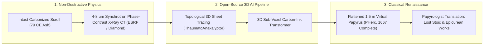

# Reading Ashes Without Opening Them: The Vesuvius Challenge & Full-Scroll AI Papyrology
**Pillar 2: Embodied AI, Robotics & Self-Driving Science — Carbon Edition**

> **The Cynic's Reflex:**
> *"Two thousand Herculaneum scrolls were baked into solid lumps of charcoal by Mount Vesuvius in 79 CE—carbon ink written on carbonized papyrus has zero X-ray contrast, every attempt to unroll them shatters them into dust, and humanity's lost classical library is gone forever."*
>
> **The 2026 Breakthrough Reality:**
> Founded by **Nat Friedman, Daniel Gross, and Prof. Brent Seales** (*University of Kentucky EduceLab*), the open-source **Vesuvius Challenge** united particle-accelerator X-ray microtomography with thousands of student and amateur machine-learning contributors worldwide (**Youssef Nader, Luke Farritor, Julian Schilliger, Marcel Roth, Micha Nowak**). After recovering the first Epicurean passages in 2023–2025 (including Philodemus's *On Vices, Book 1* in *PHerc. 172*), the consortium achieved a **historic June 2026 milestone**: for the first time in human history, an **entire unopened Herculaneum scroll (*PHerc. 1667*)** was virtually unwrapped and read from beginning to end—revealing ~1.5 meters of lost 2nd-century BCE **Stoic philosophy** linked to **Chrysippus's disciple Aristocreon**, without disturbing a single grain of volcanic ash.

---

## Act I: A Voice Across Nineteen Centuries — A Human Story from 2030

Morning sunlight slants across the Bay of Naples in October 2030 as classical papyrologist **Dr. Chiara Esposito** stands inside the conservation vault of Naples' *Biblioteca Nazionale*, gazing through glass at a blackened, Fist-sized cylinder that looks exactly like a burnt fireplace log. Nineteen hundred and fifty-one years earlier, a 500 °C pyroclastic surge from Mount Vesuvius flash-carbonized this papyrus roll inside Herculaneum's **Villa of the Papyri**—the only intact library to survive from Greco-Roman antiquity.

For two hundred and seventy years after Bourbon tunnelers first found the villa in 1752, curators faced heartbreak: touch a scroll with scalpels or glue, and priceless poetry or philosophy splintered into unreadable black flakes.

Today, Chiara never touches the scroll at all:

* **Non-Destructive Synchrotron Scan:** Over the weekend, the intact carbonized roll rode in a cushioned nitrogen case to a compact fourth-generation phase-contrast X-ray beamline, capturing 4-micron 3D voxel geometry across all 180 fused spiral wraps in forty minutes.
* **Autonomous Volumetric Unwrapping:** Back in Naples, an open-source descendant of Julian Schilliger and Marcel Roth's **ThaumatoAnakalyptor** + topological neural tracer disentangles crushed, pleated papyrus sheets like a 3D origami solver—flattening two meters of fused charcoal into a seamless virtual ribbon with zero human mesh-stitching.
* **Reading Lost Voices Over Espresso:** By 11:00 AM, 3D ink-detection transformers highlight crisp Greek uncial columns invisible to the human eye. With gasps around her seminar table, Chiara and three graduate students in Cairo and Oxford read a lost tragedy by **Sophocles**—and realize that hundreds more unopened scrolls still sleeping beneath volcanic *tufo* at Herculaneum can be rescued whole.

---

## Act II: How Synchrotron Physics + Open-Source ML Solved an "Impossible" Problem

Why did reading unopened Herculaneum scrolls defeat physicists for decades? Unlike medieval parchment written with dense iron-gall or lead ink (which glows brightly in standard medical X-rays, allowing Brent Seales's team to virtually read the burnt Hebrew **En-Gedi Scroll** in 2016), ancient Mediterranean scribes wrote on **papyrus reeds using soot-and-gum carbon ink**. Once Vesuvius carbonized the papyrus itself, **black carbon ink sat atop black carbonized charcoal**—leaving near-zero absorption contrast.

Between 2023 and June 2026, a radical prize-driven open-science architecture cracked every single bottleneck in sequence.

### 1. 4–8 Micron Phase-Contrast Synchrotron Tomography
Using Britain's **Diamond Light Source** and France's **European Synchrotron Radiation Facility (ESRF)** in Grenoble, Prof. **Brent Seales's EduceLab** scanned intact scrolls at 4-to-8-micron resolution using **propagation-based phase-contrast X-ray microtomography**—capturing microscopic refractive-index and surface-relief textures where dried carbon ink subtly thickened papyrus fibers by just a few millionths of a meter.

### 2. Global Open-Prize Crowdsourcing: From First Word to First Passages (2023–2025)
In March 2023, **Nat Friedman** and **Daniel Gross** partnered with Seales to launch the **\$1M+ Vesuvius Challenge** (`scrollprize.org`), posting terabytes of raw 3D scroll scans, open-source tutorials, and Discord bounties so anyone on Earth could compete:
* **First Letters & 2023 Grand Prize:** 21-year-old Nebraska undergrad **Luke Farritor** spotted the first Greek word (*ΠΟΡΦΥΡΑϹ* — "purple"), and shortly after, **Youssef Nader** (Egyptian grad student in Berlin), **Luke Farritor**, and **Julian Schilliger** (Swiss robotics student) won the \$700,000 Grand Prize using 3D TimeSformer/ResNet architectures to recover 15 columns (>2,000 characters) of **Philodemus** meditating on music, capers, and Epicurean pleasure—with zero ink label hallucinations.
* **2025 Oxford Scroll Breakthrough (*PHerc. 172*):** Applying upgraded automated segmentation and ink models to Oxford Bodleian Library's *Scroll 5*, **Marcel Roth** and **Micha Nowak** revealed columns and the title page of **Philodemus's *On Vices, Book 1*** (*On Flattery*).

### 3. The Historic June 2026 Milestone: *PHerc. 1667* Unwrapped End-to-End
For two years, skeptics still pointed to the hardest bottleneck: manually tracing torn, telescoped, S-folded papyrus layers ("segmentation") took hundreds of hours per square centimeter, leaving 90% of each scroll unread.
* **Full-Scroll Virtual Unwrapping:** By **June 2026**, breakthroughs in automated 3D surface sheet-tracing, topological umbilical-axis alignment, and self-supervised ink transformers conquered the entire volume of ***PHerc. 1667* (*Scroll 4*)**—recovering **~1.4–1.5 meters of continuous papyrus spanning 20–22 columns of ancient Greek** from outer wrap to inner *umbilicus*, marking the **first unopened Herculaneum scroll ever read from start to finish**.
* **A Lost Stoic Treasure:** Stunningly, whereas almost all previously read Herculaneum fragments were Epicurean, *PHerc. 1667* unveiled a lost **2nd-century BCE Stoic ethical treatise** exploring human nature, moral impulse, and practical wisdom—and in its final preserved column named **Aristocreon**, nephew and prized disciple of Stoic titan **Chrysippus of Soli**!

### Comparing Papyrology Eras: Mechanical Destruction vs. Early Virtual Slices vs. Full-Scroll AI

| Restoration Dimension | Piaggio Mechanical Unrolling (1753–1900s) | Manual Virtual Segmentation (2019–2023) | June 2026+ Autonomous Full-Scroll AI Pipeline | Real-World Consequence |
| :--- | :--- | :--- | :--- | :--- |
| **Physical Damage to Scroll** | Catastrophic (outer wraps crushed/scraped off) | **0.0% Non-Invasive** | **0.0% Non-Invasive** | Fragile ash artifacts preserved intact forever |
| **Segmentation Speed** | Months per fragment (irreversible) | ~100 human hours per $1\text{ cm}^2$ | **End-to-End 1.5 m Scroll Automated** (*PHerc. 1667*) | Scales from 1 scroll/year to all ~1,800 cataloged fragments |
| **Carbon-on-Carbon Ink Readout** | Naked-eye / infrared (fails on unopened lumps) | Faint isolated patches | **3D Sub-Voxel Phase-Contrast Transformers** | Reads microscopic ink thickness on crushed charcoal |
| **Talent Pool** | Handful of museum conservators | Single university lab | **3,000+ Global Open-Source ML Contributors** | 21-year-old students & papyrologists co-author history |
| **Broader Archive Reach** | Herculaneum fragments only | Metallic-ink parchment (*En-Gedi*) | **Mummy Cartonnage, Palimpsests & Fire-Damaged Archives** | Unlocks hidden texts inside bindings worldwide |

> *"For nearly three hundred years these scrolls sat on shelves as unreadable lumps of charcoal. Now, for the first time, we have read an entire unopened scroll from beginning to end."*
> — **Vesuvius Challenge & EduceLab Papyrology Consortium**, June 2026 *PHerc. 1667* Milestone

### 4. Leading Pioneers & Classical Recovery Milestones (2016–2026)

| Pioneer / Organization | Core Breakthrough | Verified Real-World Impact |
| :--- | :--- | :--- |
| **Brent Seales & UKy *EduceLab*** | Virtual unwrapping physics & phase-contrast X-ray papyrology | Proved non-invasive reading on *En-Gedi* (2016) & built the synchrotron dataset foundation for Herculaneum. |
| **Nat Friedman & Daniel Gross** (*Vesuvius Challenge*) | Open-data, staged micro-bounty & Discord tournament architecture | Mobilized **3,000+ global ML engineers**, turning a 270-year cold case into weekly open-source breakthroughs. |
| **Youssef Nader, Luke Farritor & Julian Schilliger** | 3D ink-detection transformers & *ThaumatoAnakalyptor* | Won \$700k 2023 Grand Prize reading 2,000+ Greek letters of Philodemus with zero destructive contact. |
| **Marcel Roth, Micha Nowak & 2025–2026 Teams** | Whole-scroll automated tracing (*PHerc. 172* & *PHerc. 1667*) | Uncovered Philodemus's *On Vices* title (2025) & **first end-to-end unopened scroll *PHerc. 1667*** (June 2026). |
| **ESRF (Grenoble) & Diamond Light Source (UK)** | Coherent high-flux synchrotron microtomography beamlines | Captured multi-terabyte 4–8 $\mu\text{m}$ volumetric scans across dozens of Naples, Paris, and Oxford scrolls. |
| **Google DeepMind (*Ithaca* / *Aeneas*)** | Epigraphic restoration, dating & attribution transformers | Complements virtual unwrapping by restoring lacunae and dating damaged Greek and Latin texts. |

---

## Act III: Reimagining Social Conventions — The Case for Excavating the Full Villa of the Papyri

Over **99% of ancient Greek and Roman literature was lost** during the collapse of antiquity—including 83 of Sophocles' 90 plays, Aristotle's public dialogues, Sappho's complete nine books of lyric poetry, Livy's lost Roman histories, and almost every foundational work of early Stoicism (Chrysippus wrote over 700 rolls, of which zero survived intact until *PHerc. 1667* proved Stoic scrolls sat inside the Villa!).

1. **Unlocking the Unexcavated Floors of the Villa of the Papyri:**
   Archaeologists know that the lower terrace and main Latin/Greek wings of Herculaneum's Villa of the Papyri **have never been excavated**—preserved intact under 25 meters of volcanic rock! For decades, authorities rightly paused digging until conservation science could read carbonized scrolls without destroying them. June 2026's full-scroll *PHerc. 1667* proof satisfies that exact condition: humanity can now safely stabilize and virtually read thousands more scrolls awaiting discovery underground.
2. **A Blueprint for Prize-Driven Open Science:**
   The Vesuvius Challenge shattered academic hoarding. Releasing raw terabyte scans under open licenses with staged \$10k–\$700k milestones where winning code is open-sourced within hours created a cooperative-competitive flywheel 50x faster than closed grant cycles.
3. **Rescuing Global Damaged Heritage Beyond Rome:**
   The exact same non-invasive CT + 3D sheet-segmentation stack is already expanding to **Egyptian mummy cartonnage** (waste papyri layered inside funerary masks), **fused Mayan bark-paper codices**, **Timbuktu & Cotton Library fire-charred manuscripts**, and **medieval bookbindings**.

### Global Precedents & Institutional Proof Points
* **June 2026 *PHerc. 1667* Full-Scroll Milestone:** First unopened Herculaneum scroll virtually unwrapped end-to-end (~1.5 m, 20+ columns), unveiling a 2nd-century BCE Stoic treatise linked to Chrysippus's school (*Aristocreon*).
* **ESRF Grenoble & Diamond Light Source Heritage Beamtime:** Dedicated European synchrotron microtomography access establishing non-destructive 4–8 $\mu\text{m}$ digital archiving for Naples, Paris, and Oxford collections.
* **Staged Open-Source Micro-Prize Model (`scrollprize.org`):** Demonstrated that releasing raw scientific datasets with rapid open-code bounties compresses multi-decade academic bottlenecks into 36 months.

### Four Lost Worlds Unlocked by Non-Invasive AI Papyrology by 2032
* **The Unexcavated Villa of the Papyri Lower Wings:** Ethical, conservation-ready justification to recover and virtually read thousands of Latin and Greek scrolls still sealed beneath Herculaneum's volcanic rock.
* **Egyptian Mummy Cartonnage Without Unmasking:** Reading everyday Ptolemaic tax receipts, women's letters, and Sappho/Euripides fragments layered inside painted funerary masks while leaving museum artifacts untouched.
* **Fire- & Flood-Fused Library Treasures:** Virtual sheet separation of the 1731 Cotton Library charred Anglo-Saxon parchments, 1944 Chartres manuscripts, and fused Mesoamerican codices.
* **Hidden Medieval Palimpsests & Spine Bindings:** Combining multispectral X-ray fluorescence with 3D micro-CT to read scraped-away Archimedes-class mathematical treatises hidden inside monastic bindings.

### Trajectory of Non-Invasive AI Papyrology & Lost-Library Recovery

| Stage & Era | Unopened Scrolls Read | Segmentation Labor per Scroll | Classical Corpus Recovered | Global Archive Spillover |
| :--- | :--- | :--- | :--- | :--- |
| **2022 Pre-Challenge Era** | 0 Herculaneum scrolls | Impossible on crushed carbon rolls | Fragmentary peeled outer scraps | Limited to metallic-ink *En-Gedi* parchment |
| **2023–2025 Breakthroughs** | Passages in *Scroll 1* & *PHerc. 172* | Weeks of hybrid human-ML tracing | 2,000+ chars + *On Vices* title | 3,000-person open-source ML community formed |
| **June 2026 Milestone** | **1st Complete Scroll (*PHerc. 1667*)** | Days of largely automated 3D tracing | **Full 1.5 m Stoic treatise** (*Aristocreon*) | High-throughput scanning at ESRF & Diamond |
| **2031 Classical Renaissance** | **300+ Intact Scrolls + New Villa Dig** | <2 Hours fully autonomous pipeline | Hundreds of Greek & Latin lost books | Global rescue of fire/water-fused manuscripts |

---

## Act IV: The Synergy Cascade

Full-Scroll AI Papyrology amplifies discovery across archaeology, history, and materials imaging:
* **Open-Data Citizen Archaeology ([`lidar-agent-citizen-archaeology`](../lidar-agent-citizen-archaeology/REPORT.md)):** Non-invasive laser canopies find buried cities from above while non-invasive synchrotron X-rays read the fragile libraries sleeping inside them—ushering in a **Zero-Destruction Golden Age of Archaeology**.
* **AI Formal Mathematics & Verified Kernels ([`ai-formal-mathematics`](../ai-formal-mathematics/REPORT.md)):** Topological differential-geometry solvers guarantee bijective, tear-free 2D parameterization of crumpled 3D papyrus manifolds without artificially warping letter strokes.
* **Self-Driving Materials & Battery Labs ([`self-driving-labs`](../self-driving-labs/REPORT.md)):** The 3D sub-voxel phase-contrast segmentation networks built to trace folded papyrus sheets transfer directly to non-destructive inspection of solid-state battery dendrites, composite aircraft wings, and neural connectomics!

---

## References & Verified Sources

* **Featured Initiative:** [Vesuvius Challenge — Official Open-Source Scroll Prize & June 2026 *PHerc. 1667* Full-Scroll Milestone](https://scrollprize.org/)
* **Research Labs & Synchrotrons:** [University of Kentucky EduceLab (Prof. Brent Seales)](https://educelab.engr.uky.edu/) · [ESRF — European Synchrotron Radiation Facility (Grenoble)](https://www.esrf.fr/) · [Diamond Light Source (UK National Synchrotron)](https://www.diamond.ac.uk/) · [Biblioteca Nazionale Vittorio Emanuele III (Officina dei Papiri Ercolanesi, Naples)](https://www.bnnonline.it/) · [Bodleian Libraries, University of Oxford (*PHerc. 172*)](https://www.bodleian.ox.ac.uk/)
* **Epigraphy & Open-Science Precedents:** [Google DeepMind *Ithaca* & *Aeneas* Ancient Text Restoration](https://deepmind.google/discover/blog/restoring-and-attributing-ancient-texts-using-deep-neural-networks/) · [En-Gedi Scroll Non-Invasive Micro-CT Precedent (*Science Advances*, 2016)](https://www.science.org/journal/sciadv) · [ThaumatoAnakalyptor Open-Source 3D Sheet Segmentation Repository](https://github.com/schillij95/ThaumatoAnakalyptor)
* **Connected Carbon Pathways:** [Weekend Explorer Swarms: Pietro Miotti's 48-Agent Maya LiDAR Sweep & Open-Data Citizen Archaeology](../lidar-agent-citizen-archaeology/REPORT.md) · [Hallucination-Free Genius: Lean 4, AlphaProof & Co-Pilot Discovery](../ai-formal-mathematics/REPORT.md) · [24/7 Autonomous Discovery: Robotic Wet-Labs & Closed-Loop Synthesis](../self-driving-labs/REPORT.md) · [Sacred Worth, Contemplation & Deep Human Flourishing](../../04-social-norms/sacred-worth-contemplation/REPORT.md)
