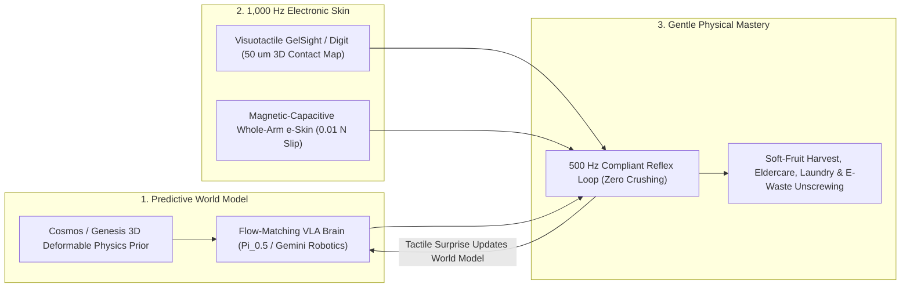

# Robots That Imagine & Feel: Latent Physics World Models Paired with Optical Tactile Skins
**Pillar 2: Embodied AI, Robotics & Self-Driving Science — Carbon Edition**

> **The Cynic's Reflex:**
> *"Robots can beat grandmasters at chess and weld steel car frames bolted to factory jigs, yet Moravec's Paradox still rules the real world: hand a robot a wet teacup, a tangled cotton shirt, a ripe raspberry, or a frail grandmother's elbow, and its blind metal claws either crush it or drop it."*
>
> **The 2026 Breakthrough Reality:**
> Between 2024 and November 2026, robotics finally closed **Moravec's Paradox** by fusing two biological superpowers that humans use every waking second: **predictive physical imagination** and **rich fingertip touch**. **Vision-Language-Action (VLA) brains and latent physics world models** (**Physical Intelligence $\pi_0$ / $\pi_{0.5}$**, **Google DeepMind *Gemini Robotics***, **NVIDIA *Cosmos***, and the **Genesis** 43-million-FPS differentiable physics engine) mentally simulate how crumpled cloth, sloshing soup, and fragile stems deform 500 milliseconds *before* moving—while **sub-millimeter visuotactile and magnetic electronic skins** (**GelSight / Meta *Digit***, **Sanctuary AI**, **Columbia / MIT / CMU e-skins**) detect **$0.01\text{ N}$ incipient micro-slip** at 1,000 Hz, turning clumsy industrial pincers into gentle, intuitive hands.

---

## Act I: Raspberries at Dawn, Gentle Hands at Dusk — A Human Story from 2030

Morning fog drifts across the Willamette Valley in Oregon in July 2030 as berry grower **Elena Morales** walks calmly down rows of dead-ripe Marionberries and heritage raspberries alongside four quiet, solar-powered harvesting carts. Ten years earlier, 35% of soft caneberries rotted unpicked during heatwaves because mechanical shakers pulverized delicate drupelets into juice and seasonal labor shortages left family farms bankrupt.

Elena watches a soft-elastomer three-fingered gripper reach beneath a thorny leaf:

* **Imagining the Stem Before Touching:** Using an on-board **Latent World Model**, the harvester sees only half the berry behind a leaf yet predicts the hidden pedicel angle and stem tension in 12 milliseconds—approaching from beneath so thorns never snag the fruit.
* **Feeling $0.01\text{ N}$ Micro-Shear:** The instant its **GelSight-class optical elastomer fingertip** touches the berry, an internal micro-camera reads microscopic skin dimples, feels the exact firmness that separates a tart berry from a sun-sweetened ripe one, twists with **0.18 Newtons** of shear—less than the weight of two postage stamps—and cradles the unbruised fruit into a breathable pulp punnet.
* **Same Hands, Sacred Care:** That evening in Portland, Elena visits her eighty-four-year-old father, who is recovering from hip surgery. A municipal home-care assistant wrapped in warm, washable **capacitive-magnetic e-skin** senses his tiny involuntary muscle tremor the millisecond he stands up, smoothly adjusting support under his forearm with the exact compliant gentleness of a seasoned physical therapist.

---

## Act II: Solving Moravec's Paradox with Predictive Brains + Electronic Skin

In 1988, roboticist **Hans Moravec** observed a humbling irony: teaching computers abstract calculus or Go takes tiny amounts of data, yet buttoning a toddler's sweater or peeling a boiled egg requires **a billion years of evolutionary sensorimotor intuition**. Why? Because cameras alone get **blocked by the robot's own fingers** at the exact moment of contact!

By late 2026, coupling **Generative World Models** ("what *will* happen if I push here?") with **High-Resolution Tactile Skins** ("what *is* slipping against my skin right now?") gave machines closed-loop physical common sense.

### 1. Flow-Matching VLAs & Latent World Models: Mental Physics Before Motion
* **Physical Intelligence ($\pi_0$ & $\pi_{0.5}$):** Led by Karol Hausman, Sergey Levine, Chelsea Finn, and colleagues, $\pi_0$ introduced **flow-matching continuous action generation** over 50 Hz motor trajectories—unloading chaotic dryers, folding crumpled laundry piles, assembling cardboard boxes, and busing cluttered café dishes zero-shot across unseen homes with $\pi_{0.5}$ open-world generalization.
* **NVIDIA *Cosmos*, DeepMind *Gemini Robotics* & *Genesis* Sim-to-Real:** NVIDIA's open **Cosmos World Foundation Models** and DeepMind's **Gemini Robotics** learn intuitive 3D physics from millions of hours of real-world interaction video, while the open-source **Genesis** physics engine simulates deformable cloth, elastomers, and non-Newtonian liquids at **43 million frames per second** on a single GPU (430,000x faster than real time)—giving a robot 100 years of virtual tactile practice over a weekend!

### 2. Visuotactile & Magnetic Electronic Skins: Seeing Through Touch
How do human fingertips tell silk from sandpaper or sense a wet wineglass starting to slip *before* it drops? Through **17,000 mechanoreceptors per hand**. Between 2024 and late 2026, three tactile sensor families hit mass-manufacturing cost curves:
* **Optical Visuotactile Fingertips (*GelSight Mini*, Meta *Digit* / *Sparsh*):** Pioneered at MIT by **Prof. Edward Adelson**, GelSight places a tiny \$3 smartphone CMOS camera + tricolor LEDs behind a reflective silicone gel pad. Any contact—even a human hair or microscopic screw thread—deforms the gel into a **sub-50-micron 3D height and shear-force map**, pre-trained self-supervised via Meta's **Sparsh** touch encoders.
* **Magnetic & Multimodal Soft Skins (*ReSkin*, *AnySkin*, Columbia 3D Finger & Sanctuary AI):** **Columbia University**, **CMU**, and **NYU** engineered thin, replaceable magnetic-elastomer skins (*AnySkin*) and multi-layered bionic fingers that localize normal and shear forces down to **$0.01\text{ Newtons}$** with zero fragile internal wiring—snap off a worn \$5 silicone skin like a phone case and snap on a fresh one with zero recalibration!

### Comparing Manipulation Generations: Blind Factory Arms vs. Vision-Only VLAs vs. World-Model + Tactile Skins

| Manipulation Dimension | Legacy Industrial Arm (2000–2020) | Vision-Only VLA Robot (2023–2024) | Late-2026 World-Model + Tactile Skin Stack | Real-World Consequence |
| :--- | :--- | :--- | :--- | :--- |
| **Occlusion at Contact** | Blind (requires sub-mm rigid jigs) | Fingers block camera right at grasp! | **50 $\mu\text{m}$ 3D Tactile Image + World Prior** | Threads tiny cables & unbuttons shirts by feel in the dark |
| **Minimum Force Sensitivity** | $2\text{–}10\text{ N}$ (crushes berries/eggs) | $0.5\text{–}2\text{ N}$ (estimated from wrist torque) | **$0.01\text{ N}$ Direct Shear & Incipient Slip** | Picks dead-ripe raspberries & handles fragile glass vials |
| **Deformable Cloth & Fluids** | Fails completely on crumpled laundry | Slow reactive corrections | **Latent Physics Rollout + 50 Hz Flow Matching** | Folds novel garments & pours hot liquids without spilling |
| **Sim-to-Real Training Speed** | Months of hand-coded C++ trajectories | Thousands of costly human teleop hours | **43M FPS *Genesis* + *Cosmos* Video Priors** | Masters a new surgical or recycling task over a weekend |
| **Fingertip Replacement Cost** | \$4,000+ strain-gauge load cell | N/A | **\$5–\$25 Snap-On Silicone Pad (*AnySkin* / *Digit*)** | Washable, hygienic & affordable for kitchens, farms & clinics |

> *"Touch is not just another low-res bumper switch—it is a high-resolution image of physical forces right where the hand meets the world."*
> — **Core Insight of Visuotactile Robotics** (*Prof. Edward Adelson, MIT CSAIL & GelSight Pioneers*)

### 3. Leading Labs, Tactile Hardware & World-Model Pioneers (2024–2026)

| Lab / Company | Core Breakthrough | Verified 2024–2026 Real-World Impact |
| :--- | :--- | :--- |
| **Physical Intelligence ($\pi_0$ & $\pi_{0.5}$)** | Flow-matching generalist VLA + open-world home generalization | Mastered continuous 50 Hz laundry folding, egg carton packing & unseen home cleanup. |
| **MIT CSAIL (*GelSight*) & Meta FAIR (*Digit*, *Sparsh*)** | Optical elastomer fingertips + self-supervised touch foundation models | Sub-50-micron 3D touch geometry using commodity micro-cameras and open *Sparsh* representations. |
| **NVIDIA (*Cosmos* & *Isaac Lab*) + *Genesis* Consortium** | Open world foundation models + 43M FPS differentiable physics | Enabled massive-scale deformable cloth, liquid & soft-body sim-to-real transfer. |
| **Google DeepMind (*Gemini Robotics*)** | Multimodal embodied reasoning + dexterous bimanual origami/folding | Zero-shot physical instruction following across complex deformable objects. |
| **NYU / CMU (*AnySkin*) & Columbia Robotics** | Calibration-free snap-on magnetic skins & 3D bionic tactile fingers | \$5 replaceable magnetic elastomer skins sensing $0.01\text{ N}$ shear without internal wire fatigue. |
| **Sanctuary AI (*Phoenix*) & Shadow Robot** | Hydraulic/tendon 20+-DOF hands with whole-palm haptic feedback | Sub-millimeter industrial insertion, micro-electronics sorting & compliant assembly. |

---

## Act III: Reimagining Social Conventions — Dignity in Care, Zero Food Waste & 100% Circular Electronics

Giving machines gentle hands and physical foresight transforms three sectors where brute-force factory automation always failed:

1. **Dignity-First Elder & Disability Support:**
   Rigid metal robots feel cold and intimidating inside a bedroom. Whole-body **warm, knit-covered e-skin** (backed by ISO 13482 force-limiting kernels) turns assistive arms into gentle companions that help stroke survivors button their own shirts, lift patients without bruising fragile skin, and immediately yield the instant a human nudges them away.
2. **Ending Soft-Produce Field Rot Without Exploitative Labor:**
   Globally, billions of dollars of strawberries, raspberries, peaches, tomatoes, and mushrooms rot unharvested or require back-breaking 40 °C stoop labor. Visuotactile soft grippers harvest delicate crops selectively at peak sweetness at night when berries are cool—cutting cold-chain spoilage in half while rural worker cooperatives transition from stoop picking to fleet stewardship.
3. **Micro-Surgery on E-Waste Instead of Shredding Smartphones:**
   Previously, recycling 60 million tons of annual global e-waste meant violently shredding laptops into toxic dust. Tactile-guided bimanual hands feel stripped tiny screws, pry glued lithium pouch batteries safely without puncturing them (preventing recycling-plant fires!), and recover 98% of rare-earth magnets and gold connectors intact.

### Global Precedents & Institutional Proof Points
* **MIT *GelSight* & Meta Open *Digit / Sparsh* Ecosystem:** Commoditized sub-50-micron optical touch sensors alongside open-source self-supervised tactile encoders adopted across hundreds of university and industrial labs.
* **Physical Intelligence $\pi_0 / \pi_{0.5}$ Multi-Embodiment Trials:** Demonstrated single foundation flow-matching brains controlling diverse bimanual arms and mobile manipulators across messy, previously unseen homes.
* **ISO 13482 Personal-Care Tactile Compliance & Japan KAIGO Pilots:** Regulatory safety frameworks pairing whole-arm soft capacitive/magnetic skins with hardware torque cutoffs for safe elderly mobility transfers.

### Four Everyday Tasks Transformed by Gentle Tactile + World-Model Hands by 2031
* **Zero-Bruise Nighttime Soft-Fruit Harvesting:** Selective dawn picking of raspberries, strawberries, figs, and heirloom tomatoes at peak Brix sweetness—cutting farm-to-fridge spoilage by half.
* **Dignified Home Rehabilitation & Dressing Support:** Warm knit-covered assistive arms helping arthritis, stroke, and post-surgical patients button clothes, bathe safely, and stand without caregiver back injuries.
* **Fire-Safe Circular Battery & Micro-Electronics Disassembly:** Feeling hidden adhesive seams and micro-connectors to extract intact cobalt, neodymium magnets, and logic boards from retired EVs and phones.
* **Unstructured Household & Hospital Linen Mastery:** Unloading tangled hospital autoclaves, sorting delicate surgical instruments by touch, and folding family laundry piles autonomously.

### Trajectory of Tactile + World-Model Dexterous Manipulation

| Stage & Era | Tactile Resolution & Cost | Deformable / Fragile Task Success | Physics Simulation Speed | Societal Dividend |
| :--- | :--- | :--- | :--- | :--- |
| **2021 Blind Gripper Era** | \$5,000 single-axis wrist cell | <15% on crumpled laundry or soft fruit | ~1,000 FPS rigid-body only | Confined to caged auto-welding & rigid totes |
| **Late 2026 SOTA** | **50 $\mu\text{m}$ *GelSight/Digit* + \$15 *AnySkin*** | **85%+** laundry, egg handling & cable routing ($\pi_{0.5}$) | **43M FPS (*Genesis*) + *Cosmos* WFMs** | First soft-berry harvesters & circular unscrewing cells |
| **2029 Inflection** | Full-arm washable e-skin (<\$200 BOM) | **98%+** zero-bruise harvest & wet-dish handling | Real-time on-chip neural physics twins | Municipal elder-transfer aides & fire-safe battery disassembly |
| **2033 Abundance** | Human-surpassing 10 kHz thermal-tactile dermis | 99.9%+ surgical, culinary & artisanal dexterity | Seamless lifelong tactile-world learning | Stoop-harvest injury & e-waste landfilling virtually eliminated |

---

## Act IV: The Synergy Cascade

Latent World Models + Tactile Skins form the **nervous system** upgrading every physical machine in the Carbon Atlas:
* **General-Purpose Humanoid Teammates ([`general-purpose-humanoids`](../general-purpose-humanoids/REPORT.md)):** EV actuators gave humanoids affordable muscles; visuotactile skins and $\pi_{0.5}$-class world models give those muscles gentle hands safe enough for Fukuoka nursing homes and family kitchens.
* **Neighborhood Fab-Commons & Circular Un-Making ([`local-microfactories`](../local-microfactories/REPORT.md)):** Tactile fingers detect rusted threads and brittle plastic clips during automated appliance repair and disassembly, multiplying circular material recovery.
* **AI Formal Mathematics & Control Shields ([`ai-formal-mathematics`](../ai-formal-mathematics/REPORT.md)):** High-frequency tactile force readings feed directly into Lean-verified control-barrier safety envelopes, mathematically guaranteeing contact pressure never exceeds safe human-tissue thresholds.

---

## References & Verified Sources

* **World Models & VLA Pioneers:** [Physical Intelligence — $\pi_0$ & $\pi_{0.5}$ Flow-Matching Generalist Robot Policies](https://www.physicalintelligence.company/) · [NVIDIA *Cosmos* World Foundation Model Platform](https://www.nvidia.com/en-us/ai/cosmos/) · [Google DeepMind — *Gemini Robotics* Embodied Reasoning](https://deepmind.google/discover/blog/gemini-robotics-brings-ai-into-the-physical-world/) · [Genesis — Ultra-Fast Differentiable Physics & Embodied AI Engine](https://genesis-embodied-ai.github.io/)
* **Visuotactile & Electronic Skin Labs:** [GelSight Inc. & MIT CSAIL Perceptual Science Group (Prof. Edward Adelson)](https://www.gelsight.com/) · [Meta FAIR — *Digit*, *Sparsh* Self-Supervised Touch Representations & *Digit 360*](https://ai.meta.com/research/) · [AnySkin — Replaceable Magnetic Tactile Skin (NYU / CMU)](https://any-skin.github.io/) · [Sanctuary AI — Haptic Dexterous Manipulation](https://www.sanctuary.ai/)
* **Safety & Agricultural Precedents:** [ISO 13482 Personal Care Robot Force & Tactile Safety Standard](https://www.iso.org/standard/53820.html) · [USDA NIFA Specialty Crop Soft-Fruit Robotic Harvesting Consortia](https://www.nifa.usda.gov/)
* **Connected Carbon Pathways:** [Helpful Mechanical Hands: General-Purpose Humanoid Teammates](../general-purpose-humanoids/REPORT.md) · [Neighborhood Fab-Commons: Custom, Repairable Goods Made Two Blocks Away](../local-microfactories/REPORT.md) · [Hallucination-Free Genius: Lean 4, AlphaProof & Co-Pilot Discovery](../ai-formal-mathematics/REPORT.md) · [Precision Field Swarms: Laser Weeding, Reef Guardians & Wildfire Shields](../specialized-swarm-robotics/REPORT.md)
