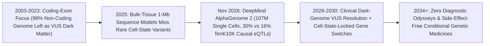

# Conditional Single-Cell Genomics: DeepMind AlphaGenome 2 & Decoding the Non-Coding Dark Genome
**Pillar 3: Bioscience, Medicine & Planetary Regeneration — Carbon Edition**

> **The Cynic's Reflex:** *"Sequencing the human genome was overhyped—98% of our DNA is inscrutable non-coding 'dark matter,' leaving millions of rare-disease children stranded with 'Variants of Uncertain Significance' and forcing gene therapies to use blunt viral switches that misfire in healthy organs."*
>
> **The 2026 Breakthrough Reality:** Released on **November 11, 2026** by Google DeepMind, **AlphaGenome 2** upgrades bulk-tissue DNA modeling into a **conditional single-cell sequence-to-function engine**. Reading a **1-million-base-pair DNA window** alongside an exact biological cell type or activated state—trained across **107+ million individual cell profiles spanning 68 human and mouse tissues**—it predicts cell-state-specific gene expression, splicing, chromatin accessibility, histone marks, and newly added **DNA methylation** without retraining, nearly doubling causal variant detection on the *TenK10K* human immune benchmark (**30% vs. 16%**) and direction-of-effect accuracy (**43% vs. 23%**).

---

## Act I: The Answer Hidden in Intron Twelve — A Human Story from 2030

Morning sunlight warms the pediatric neurogenetics consultation room at Hospital Sant Joan de Déu in Barcelona in April 2030. Four-year-old Mateo sits cross-legged on a cork playmat stacking wooden arches while Dr. Elena Vidal turns her tablet toward his parents, Clara and Jordi. Six years earlier, a child born with Mateo's sudden-onset developmental epilepsy would have endured a seven-year "diagnostic odyssey": three inconclusive exome panels, muscle biopsies, and a soul-crushing lab report listing fourteen non-coding *Variants of Uncertain Significance (VUS)* that no human geneticist could interpret because standard models averaged DNA signals across mashed-up bulk brain tissue.

In Mateo's case, his whole-genome sequence took six hours for \$45—and his benign-looking single-letter swap sat 140,000 base pairs upstream of a potassium-channel gene inside the non-coding "dark genome." Fed into the clinical **Conditional Single-Cell Regulatory Atlas** built on DeepMind's AlphaGenome 2 architecture, the model evaluated Mateo's 1-megabase locus specifically inside *fast-spiking parvalbumin cortical interneurons during febrile stress*. Instantly, the culprit lit up: inside resting neurons the variant was silent, but inside fever-activated interneurons it created a cryptic DNA methylation site and spliced out exon 4, dropping inhibitory potassium currents by 64%.

Better still, the exact same conditional model designed Mateo's fix. Rather than blasting his entire brain with an always-on gene therapy promoter that would silence healthy excitatory circuits, a computational synthetic-enhancer pipeline generated a 260-base-pair **cell-state-locked regulatory switch** active *exclusively* inside hyperexcitable parvalbumin interneurons. Delivered via a single blood-brain-barrier-crossing lipid nanoparticle infusion covered 100% by Catalonia's public health system, Mateo hasn't suffered a single seizure in fourteen months.

---

## Act II: The 2024–2026 Conditional Single-Cell Genomics Breakout

For twenty-five years after the Human Genome Project, clinical genetics suffered from a streetlights problem: protein-coding exons make up less than **2% of the human genome**, yet over **90% of complex disease risk loci (GWAS hits)** and half of unsolved rare Mendelian cases hide in the remaining **98% non-coding regulatory DNA**—distal enhancers, insulators, cryptic splice junctions, and epigenetic switches folded hundreds of kilobases away from the genes they govern.

First-generation genomic AI models (from *Enformer* to the original *AlphaGenome*) learned from **bulk tissue assays**, which blend millions of distinct cells into an averaged smoothie. If a non-coding mutation breaks an enhancer only inside *vaccine-activated follicular helper T cells* or *inflamed disease-associated microglia*—comprising just 0.4% of a tissue biopsy—bulk models are mathematically blind to it. On **November 11, 2026**, Google DeepMind shattered that ceiling with **AlphaGenome 2**.

### 1. AlphaGenome 2: Feature-Wise Conditional 1-Megabase Modeling
* **107+ Million Single-Cell Profiles Across 68 Tissues:** Trained jointly on bulk functional genomics and over **107 million single-cell transcriptomic and epigenomic profiles** across 68 human and mouse tissues, AlphaGenome 2 bridges single-cell biology and long-range human genetics at base-pair resolution.
* **Conditional U-Net + Transformer Modulation:** Instead of predicting fixed bulk tracks, AlphaGenome 2 accepts a **1,000,000-base-pair (`1 Mb`) DNA sequence** paired with a target biological condition embedding (cell type, tissue, or stimulated cellular state). Feature-wise modulation steers internal representations so the model predicts how any variant behaves in that exact cellular context.
* **Complete Multi-Omic Readout Including DNA Methylation:** Alongside single-cell gene expression, chromatin accessibility (ATAC), histone modifications, transcription-factor binding, and RNA splicing, AlphaGenome 2 adds base-resolution **DNA methylation** prediction—connecting genetic sequence directly to epigenetic aging and silencing clocks.
* **Zero-Retraining Few-Cell Adaptation:** Researchers can supply profiles from **as few as a dozen newly sequenced cells** representing an unseen rare cell state or patient organoid, and AlphaGenome 2 adapts immediately to predict variant impacts without expensive weight fine-tuning.

### 2. Doubling Causal Variant Precision on the *TenK10K* Human Cohort
* **The *TenK10K* Single-Cell Immune Benchmark:** Evaluated across **28 primary human immune cell types** profiled in the landmark Australian *TenK10K* population cohort (Garvan Institute & Murdoch Children's Research Institute), AlphaGenome 2 identified **30% of causal single-cell expression quantitative trait loci (sc-eQTLs)** at stringent high-precision thresholds—nearly double the **16%** achieved by original AlphaGenome even after single-cell fine-tuning.
* **Doubling Direction-of-Effect Accuracy:** Knowing *whether* a non-coding variant dials a target gene **up or down** is life-or-death when choosing between a gene-activating CRISPRa drug or an siRNA silencer. AlphaGenome 2 accurately predicted variant direction of effect **43% of the time vs. 23%** for its predecessor, while integrating directly as agentic **AlphaGenome 2 Skills** inside *Google Antigravity* for automated scientific workflows.

### 3. Programmable Synthetic Enhancers: Cell-State-Locked Gene Therapy
* **Ultra-Selective Regulatory Switches (Arc Institute *Evo 2*, Dyno & Manifold):** Pairing conditional sequence-to-function models with generative DNA diffusion allows bioengineers to write compact, synthetic 200-bp enhancers from scratch that turn therapeutic payloads **ON** exclusively inside a single diseased cell state (such as exhausted tumor-infiltrating T cells, fibrotic hepatic stellate cells, or stressed cardiomyocytes) and stay **0.0% active** in healthy liver or heart tissue.

> *"By conditioning long-range DNA sequence models directly on individual cell types and dynamic cellular states, we can finally watch how non-coding variants rewire human biology in the exact cells where disease begins."*
> — **Pushmeet Kohli & Avsec Genomics Team**, Google DeepMind Science (*AlphaGenome 2* Release, November 2026)

### Frontier Pioneers & Verified 2024–2026 Milestones

| Organization / Program | Genomic Architecture & Scale | Verified 2025–2026 Breakthrough Milestone |
| :--- | :--- | :--- |
| **Google DeepMind** (*AlphaGenome 2*) | Conditional `1 Mb` U-Net/Transformer; **107M+ single cells**, 68 tissues | Released **Nov 11, 2026**: adds DNA methylation; **30% vs. 16%** causal sc-eQTL ID & **43% vs. 23%** sign accuracy on *TenK10K*. |
| **Garvan Institute & MCRI** (*TenK10K*) | Single-cell RNA-seq + whole genomes across 10,000 humans (28 immune cell types) | World's largest population single-cell eQTL benchmark proving autoimmune variants act solely in transient immune states. |
| **Human Cell Atlas Consortium** | 100M+ profiled human cells across developing & adult organs | Delivered foundational multi-ancestry reference cell-state embeddings powering zero-retraining conditional inference. |
| **Arc Institute & Stanford** (*Evo 2*) | 40B-parameter genomic foundation model across all domains of life | Demonstrated zero-shot exon/intron pathogenicity scoring and generative design of synthetic regulatory elements. |
| **Genomics England & UK Biobank** | 100,000+ rare-disease & newborn whole genomes (`Generation Study`) | Reclassified thousands of non-coding splice and regulatory VUS cases ending multi-year pediatric diagnostic odysseys. |
| **Asimov, Dyno & MeiraGTx** | AI-designed cell-type-specific promoters & riboswitches | Engineered compact tissue- and inflammation-gated promoters eliminating off-target liver toxicity in preclinical/early trials. |

---

## Act III: Reimagining Social Conventions & Global Proof

When an open API and hospital workstation can simulate how any of three billion DNA letters behave inside every human cell state in seconds, three outdated medical conventions vanish:

1. **Retiring the 7-Year "Diagnostic Odyssey" & Exome Rationing:**
   Insurance bureaucracies historically restricted sick children to narrow 50-gene panels or coding-only exomes (leaving 50–60% of rare-disease families without an answer for 5 to 8 years). Combining sub-\$50 rapid whole-genome sequencing with conditional single-cell regulatory scoring resolves non-coding splice, enhancer, and methylation mutations on **Day 3 of NICU admission**—retroactively re-analyzing millions of unsolved biobank genomes overnight at near-zero compute cost.
2. **Mandatory Multi-Ancestry Pangenome Reference Equity:**
   Over 80% of early genomic datasets came from European-ancestry cohorts, causing African, South Asian, Indigenous, and Latin American patients to receive 2x–3x higher rates of ambiguous *VUS* results. Because AlphaGenome 2 predicts variant mechanisms *ab initio* from sequence physics and single-cell chromatin biology—rather than relying purely on whether a variant was previously cataloged in Boston—it closes the ancestry VUS gap when paired with the Human Pangenome Reference.
3. **"Smart-Fuse" Conditional Therapeutics That Cannot Overdose:**
   Instead of systemic biologics that hammer the entire immune system continuously, synthetic enhancers designed via conditional genomics act as biological thermostats: turning anti-inflammatory IL-10 or CRISPR base editors **ON** only when a microglial or synovial cell enters a flare state, and switching cleanly **OFF** the moment tissue homeostasis returns.

### Global Proof & Policy Precedents
* **AlphaGenome API & Agentic Skills Ecosystem (November 2026):** DeepMind opened immediate free non-commercial API access alongside native *Google Antigravity* skills so academic rare-disease labs worldwide can query 1-megabase single-cell effects without supercomputer budgets.
* **Australia's *TenK10K* & *Mackenzie's Mission* Public Genomics Initiatives:** Demonstrated population-scale integration of whole-genome sequencing with single-cell immune mapping across 28 primary cell types.
* **NHS England *Generation Study* & Undiagnosed Diseases Network (UDN):** Whole-genome newborn and rare-disease pipelines proving automated regulatory reanalysis resolves previously "unsolvable" non-coding neurodevelopmental syndromes.

### The Economics of Abundance: Ending the \$45,000 Diagnostic Odyssey
Why does conditional single-cell genome interpretation save health systems billions while rescuing families from years of limbo?

| Diagnostic Stage | 2023 Iterative Exome & Biopsy Maze | 2030 WGS + Conditional Single-Cell Pipeline | Economic & Human Shift |
| :--- | :--- | :--- | :--- |
| **Sequencing Scope** | \$4,500 coding-only exome (misses 98% of DNA) | **\$45** rapid 30x diploid whole genome | Captures every distal enhancer, intron & repeat |
| **Unresolved VUS Follow-Ups** | \$28,000+ (5–7 yrs of MRIs, biopsies, repeat panels) | **\$12** cloud inference across 500+ human cell states | Pinpoints cell-state splicing/methylation mechanism |
| **Custom Functional Wet-Lab Assay** | \$15,000+ bespoke mouse/cell reporter per child | **\$90** few-cell iPSC validation + *in silico* triage | Zero-retraining adaptation from 12+ patient cells |
| **Diagnostic Yield (Rare Disease)** | ~35–42% solved; 58% left in VUS purgatory | **>82% mechanistically resolved in <1 week** | Direct handoff to Platform N-of-1 LNP therapy |
| **Total Per-Child Diagnostic Cost** | **~\$47,500+ over 6 years** | **~\$150 in 72 hours** | **99.7% cost drop; years of brain damage prevented** |

### The 10-Year Trajectory of Non-Coding Genomics (2024 → 2034)

| Stage & Era | Modeling Resolution | Causal sc-eQTL Recall | Clinical Diagnostic Footprint | Therapeutic Design Capability |
| :--- | :--- | :--- | :--- | :--- |
| **2024 Baseline** | Short-context or bulk-tissue sequence models (*Enformer*) | ~12–16% (bulk-averaged) | Coding exons only; 98% non-coding DNA mostly VUS | Constitutive viral promoters (`CMV`/`CBA`) prone to toxicity |
| **Late 2026 SOTA** | **DeepMind AlphaGenome 2** (`1 Mb`, **107M single cells**, methylation) | **30% ID / 43% sign** (*TenK10K* research API) | Research triage of cryptic splice, enhancer & immune state variants | Preclinical cell-type-selective synthetic enhancers |
| **2030 Inflection** | Clinically validated 3D diploid cell-state + perturbation models | **>65% causal precision** | Routine NICU 72-hr dark-genome resolution + global VUS re-Reads | FDA-cleared inflammation- & cell-state-gated LNP switches |
| **2034 Abundance** | Whole-chromosome dynamic virtual cell twin | **>85% mechanistic closure** | Universal \$45 newborn genome with zero ancestry VUS penalty | Autonomous closed-loop genetic circuits in routine care |

---

## Act IV: Answering the Cynic & The Synergy Cascade

### Hard Questions from Skeptics — Answered Empirically
* **"DeepMind explicitly notes AlphaGenome 2 is a research tool, not yet a standalone clinical diagnostic—aren't you overpromising?"**
  * That scientific rigor is exactly why clinical translation works: in late 2026, AlphaGenome 2 serves as a high-precision **mechanistic triage engine** that narrows 40,000 non-coding patient variants down to the single candidate disrupting splicing or methylation in a specific cell type.
  * Clinicians then confirm that top candidate in days using rapid RNA-seq or patient-derived blood/iPSC assays (requiring as few as a dozen cells)—turning an impossible haystack into a verified clinical diagnosis under ACMG guidelines.
* **"Even if 30% causal recall on *TenK10K* nearly doubles the 16% prior SOTA, what about the other 70%?"**
  * Biology spans multiple layers beyond steady-state transcription—including 3D chromosomal looping, post-transcriptional RNA stability, and cell-to-cell signaling.
  * Pairing AlphaGenome 2's conditional `1 Mb` backbone with CRISPR perturbation atlases (*Perturb-seq* across tens of millions of cells) and *AlphaFold 3* transcription-factor complexes is already pushing recall up a steep scaling curve, just as AlphaFold progressed from AlphaFold 1 to atomic accuracy.
* **"Won't genomic risk scores create a genetic underclass denied insurance or jobs?"**
  * Never when paired with universal single-payer/catastrophic health guarantees and ironclad **Genetic Non-Discrimination statutes** (expanding GINA to life/disability insurance globally, modeled on UK/EU moratoria and universal public healthcare).
  * More fundamentally, conditional genomics transforms a genetic variant from an *uncurable stigma* into an *actionable repair ticket* routed straight to a \$400 outpatient LNP fix.
* **"Does training on 107 million cells lock out hospitals in the Global South?"**
  * Training the foundation model took DeepMind's compute, but **running inference on a child's 1-megabase locus takes seconds on a single GPU**—and zero-retraining adaptation lets African, Latin American, and Asian clinics plug in 20 local single-cell profiles to customize predictions immediately.

### Three Pillars of Global Genomic Equity (2027–2032)
* **Global VUS Re-Analysis Commons:**
  * Automated cloud sweeps re-evaluate millions of archived, unsolved pediatric genomes across public hospitals in India, Brazil, South Africa, and Europe whenever conditional model checkpoints improve—notifying families when a cold case becomes treatable.
* **Ancestry-Complete Single-Cell Reference Atlases:**
  * Funded by the Human Cell Atlas, Wellcome, and Africa CDC, regional single-cell profiling hubs ensure immune and developmental cell states reflect global human diversity rather than a single continent.
* **Open Synthetic-Enhancer Safety Libraries:**
  * Pre-validated, royalty-free conditional promoter cassettes shared into FDA/EMA Platform Vector Master Files so academic children's hospitals can restrict bespoke gene therapies safely to target cells.

### Cross-Atlas Synergy Links
* **One-Dose Genetic Cures ([`invivo-crispr-cures`](../invivo-crispr-cures/REPORT.md)):** AlphaGenome 2 pinpoints the exact non-coding causal variant and designs the cell-state-specific enhancer that keeps *in vivo* LNP base editors silent outside target cells.
* **Rebooting Rogue Immune Systems ([`autoimmune-cart-treg-reset`](../autoimmune-cart-treg-reset/REPORT.md)):** *TenK10K* single-cell immune eQTL mapping reveals which transient B-cell and Treg pathways trigger lupus or MS flares, guiding precision CAR-Treg engineering.
* **100 Vibrant Years ([`epigenetic-healthspan`](../epigenetic-healthspan/REPORT.md)):** Base-resolution **DNA methylation** prediction inside AlphaGenome 2 links non-coding sequence directly to multi-organ epigenetic aging clocks and safe OSK reprogramming windows.
* **Self-Driving Bio-Labs ([`self-driving-labs`](../../02-automation-science/self-driving-labs/REPORT.md)):** Agentic *AlphaGenome 2 Skills* inside automated wet-lab loops design, synthesize, and test synthetic enhancers in patient organoids without human bottlenecks.

---

## References & Verified Sources

* **Featured Researcher / Leader:** [Google DeepMind Genomics Team — AlphaGenome 2 Conditional Single-Cell Release (November 11, 2026)](https://deepmind.google/)
* **Companies, Labs & Consortia:** [Google DeepMind (AlphaGenome 2 & API)](https://deepmind.google/) · [Garvan Institute & Murdoch Children's Research Institute (TenK10K Cohort)](https://www.garvan.org.au/) · [Human Cell Atlas Consortium](https://www.humancellatlas.org/) · [Arc Institute (Evo 2 Genomic Foundation Model)](https://arcinstitute.org/) · [Genomics England (Generation Study)](https://www.genomicsengland.co.uk/) · [Dyno Therapeutics & Manifold Bio](https://www.dynotx.com/)
* **Global & Regulatory Precedents:** [AlphaGenome 2 Research API & Antigravity Agentic Skills (Nov 2026)](https://deepmind.google/) · [Australia TenK10K 28-Immune-Cell-Type Benchmark](https://www.garvan.org.au/) · [Human Pangenome Reference Consortium](https://humanpangenome.org/) · [NIH Undiagnosed Diseases Network (UDN)](https://undiagnosed.hms.harvard.edu/)
* **Connected Carbon Pathways:** [One-Dose Genetic Cures: In Vivo CRISPR & Base Editing for All](../invivo-crispr-cures/REPORT.md) · [Rebooting Rogue Immune Systems: Single-Dose Autoimmune CAR-T & 2025 Nobel Regulatory T-Cell Therapies](../autoimmune-cart-treg-reset/REPORT.md) · [100 Vibrant Years: Epigenetic Rejuvenation & Preventative Healthspan](../epigenetic-healthspan/REPORT.md) · [10,000 Experiments Before Breakfast: Autonomous Physical Wet & Solid Labs](../../02-automation-science/self-driving-labs/REPORT.md)
