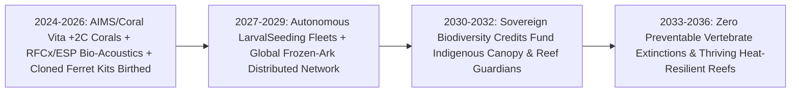
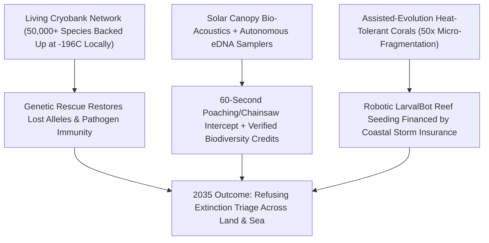

# Saving Every Living Lineage: Heat-Evolved Coral Reefs, AI Bio-Acoustics & Living Biobanks
**Pillar 3: Bioscience, Medicine & Planetary Regeneration — Carbon Edition**

> **The Cynic's Reflex:** *"We are living through an unstoppable Sixth Mass Extinction. Coral reefs are already bleached ghosts, poachers move faster than rangers ever can, inbred endangered animals are evolutionary dead ends, and conservationists are just writing polite obituaries for nature."*
>
> **The 2026 Breakthrough Reality:** Modern conservation has refused ecological triage—trading passive mourning for active biological defense and rescue. Between 2024 and late 2026, the **Australian Institute of Marine Science (AIMS)** and **Coral Vita** bred and robotically outplanted **heat-evolved corals (`+2°C` to `+2.5°C` bleaching resilience)** growing at **up to 50× natural speeds**; **Earth Species Project** and **Rainforest Connection** deployed solar AI bio-acoustic canopies catching illegal chainsaws in **60 seconds** while decoding whale and elephant languages; and the **San Diego Frozen Zoo** alongside **Colossal Foundation & Revive & Restore** birthed healthy cloned offspring from 36-year-frozen cells—restoring lost genetic diversity to bottlenecked species once thought doomed.

---

## Act I: Coral Spawn Under a Full Moon — A Human Story from 2031

Warm November moonlight shimmers across Moore Reef on Australia's Great Barrier Reef in 2031. Twenty-nine-year-old marine geneticist and Traditional Owner sea-country partner Dr. Talia Marika slips beneath the surface in scuba gear beside an autonomous yellow **LarvalBot** glider. All around her masks' headlamp beam, what marine headlines in 2024 prematurely declared a "doomed graveyard" is erupting in a pink snowstorm of synchronous coral spawning—staghorn, brain, and tabletop corals alive with neon damselfish, parrotfish, and green sea turtles.

Five years earlier, marine heatwaves would have bleached these shallow flats bone-white. Tonight, over 70% of the structural reef frame carries **assisted-evolution thermal symbionts**—bred from naturally heat-hardy Northern Reef parent colonies and heat-selected *Cladocopium* microalgae at the **Australian Institute of Marine Science (`SeaSim`)** and micro-fragmented at **50× natural growth speed** in land-based solar raceways modeled on **Coral Vita**. Even during an El Niño `+2.1°C` summer spike last February, Talia's reef sector held its rich golden-violet zooxanthellae without bleaching—protecting both a quarter of marine biodiversity and the coastal town's storm surge breakwater.

Twelve time zones west in the mist-draped canopy of Gabon's Odzala-Kokoua rainforest basin, eco-guard captain Mateo Nguema receives a chime on his ruggedized satellite wrist screen at 5:42 AM. High in an ironwood crown eight kilometers away, a palm-sized, solar-petal **Rainforest Connection (`RFCx`)** acoustic guardian has distinguished the muffled harmonic signature of a two-stroke chainsaw and an outboard boat motor beneath heavy rain—texting exact GPS coordinates in **44 seconds**. Mateo's four-person ranger team intercepts the illegal logging skiff before a single 400-year-old mahogany trunk hits the dirt. Back at base camp, the same canopy microphones stream dawn elephant rumbles and African grey parrot dialects into **Earth Species Project's** open acoustic foundation model—identifying individual elephant matriarchs by name and mapping 1,400 rebounding frog, bird, and insect species automatically without disturbing a leaf.

---

## Act II: The 2024–2026 Active Biodiversity Rescue Breakout

Twentieth-century conservation fought with one hand tied behind its back: drawing lines on paper maps couldn't stop warming ocean currents from bleaching stationary corals, human rangers couldn't patrol millions of acres of roadless jungle at night, and even when a species was saved from the last twenty individuals (like the black-footed ferret or northern white rhino), **severe inbreeding depression** threatened to finish them off anyway.

Between 2024 and late 2026, three living technologies armed conservationists to win:

### 1. Assisted Coral Evolution, Micro-Fragmentation & Robotic Seeding
* **AIMS Reef Restoration and Adaptation Program (`RRAP` / *National Sea Simulator*, Australia):** Rather than introducing foreign synthetic genes, AIMS scientists accelerate nature's own adaptation clock—selectively crossing corals from extreme hot-water lagoons/mangroves and evolving intracellular *Symbiodiniaceae* algae through dozens of laboratory generations at elevated temperatures, conferring **+2°C to +2.5°C marine heatwave tolerance** while deploying automated ceramic seeding devices and larval slicks capable of outplanting **millions of baby corals per spawning week**.
* **50× Faster Reef Growth (*Coral Vita*, Grand Bahama & Red Sea):** Leveraging Dr. David Vaughan's discovery of **coral micro-fragmentation**, cutting massive reef-building brain and boulder corals into fingernail-sized micro-clones triggers an evolutionary healing sprint—causing corals to grow **25× to 50× faster than in the wild** and fuse across dead limestone skeletons in **months instead of fifty years**!

### 2. Solar AI Bio-Acoustics, eDNA & Decoding Non-Human Language
* **60-Second Anti-Poaching Shields (*Rainforest Connection* / `Arribada`):** Upcycled solar-powered canopy acoustic nodes listen continuously across millions of hectares in over 35 countries (with Indigenous peoples like the Tembé in Brazil and rangers in Sumatra and central Africa), running edge neural networks that catch chainsaws, gunshots, or logging trucks in **under 60 seconds** while streaming continuous **soundscape biodiversity indices**.
* **Earth Species Project (`NatureLM-Audio`) & Project CETI:** Published across 2024–2026, audio-behavior foundation models trained on massive bio-acoustic corpora began decoding combinatorial phonetic structure in **sperm whale codas, humpback whale songs, zebra finch calls, and African elephant individual vocal "names"** (*Nature Ecology & Evolution*, 2024)—enabling dynamic shipping-lane rerouting around whale nurseries and transforming public empathy for fellow sentient species.
* **Autonomous Environmental DNA (`eDNA`) Samplers:** A single liter of river water or sea spray filtered through a portable nanopore cartridge detects the shed skin/mucus DNA of **hundreds of elusive fish, amphibians, sharks, and mammals** in hours—replacing years of invasive net trawling.

### 3. Living Cryobanks & Genetic Rescue From Frozen Cells
* **San Diego Zoo Wildlife Alliance *Frozen Zoo* + Revive & Restore + Colossal Foundation:** Housing over **11,000 living, viable fibroblast and gamete cultures across 1,200+ species and subspecies** stored in liquid nitrogen at `-196°C`, the Frozen Zoo proved between 2021 and 2026 that banked cells are not museum fossils—they are **living rescue arks**:
  * **Black-Footed Ferret Milestone (2024–2025):** Every living wild black-footed ferret previously descended from just **seven founders**, causing dangerous inbreeding. Cloned from tissue frozen in **1988** (`Willa`, carrying 3× more unique genetic variation!), cloned female *Antonia* **gave birth to healthy kits in 2024**, officially re-injecting lost ancestral immunity back into a living endangered breeding pool!
  * **Przewalski's Horse (*Kurt* & *Ollie*), Northern White Rhino IVF (*BioRescue* 2024 embryo transfer breakthrough), & Marsupial / Amphibian Chytrid Resistance:** Somatic cell nuclear transfer, stem-cell-derived gametes (`iPSC-gametogenesis`), and targeted CRISPR disease-resistance edits (shielding frogs against chytrid fungus and honeybees/bumblebees against varroa/pathogens) rescue species from bottleneck extinction.

> *"When AI helps us listen to the rest of life on Earth, conservation shifts from managing silent resources to protecting fellow intelligent communities."*
> — **Aza Raskin**, Co-Founder & President, Earth Species Project

### Frontier Pioneers & Verified 2024–2026 Conservation Milestones

| Organization / Initiative | Ecological Rescue Modality | Verified 2024–2026 Breakthrough & Field Impact |
| :--- | :--- | :--- |
| **Australian Inst. of Marine Science (`AIMS`)** | Assisted coral evolution, heat-adapted symbionts & automated larval seeding | Bred `+2°C` thermally tolerant corals in *SeaSim*; scaled millions-per-season field deployment across Great Barrier Reef trials. |
| **Coral Vita** (Bahamas, UAE / Red Sea) | Land-based micro-fragmentation & assisted-evolution coral farms | Grows resilient reef-building corals **up to 50× faster** than natural rates, restoring storm-protection reefs in months vs. decades. |
| **Earth Species Project & Project CETI** | `NatureLM-audio` foundation models decoding animal communication | Decoded combinatorial sperm-whale phonetic alphabets & individual elephant vocal naming (*2024–2026*); open-source conservation AI. |
| **Rainforest Connection (`RFCx`)** | Solar canopy bio-acoustic illegal-logging alerts & biodiversity telemetry | Active across **35+ countries**; real-time `<60s` chainsaw/poaching alerts empowering Indigenous Tembé & ranger patrols. |
| **San Diego *Frozen Zoo* & Revive & Restore** | Living `-196°C` cell biobanking (`1,200+` species) & genetic rescue | Cloned black-footed ferret *Antonia* (from 1988 frozen cells) **birthed healthy offspring in 2024**, restoring lost alleles. |
| **BioRescue & Colossal Foundation** | Stem-cell IVF embryos, biobanking & targeted pathogen-resistance edits | First successful southern white rhino surrogate IVF pregnancy (2024) paving rescue of Northern White Rhino; global BioVault network. |

---

## Act III: Reimagining Social Conventions & Global Proof

When technology makes biodiversity measurable in real time and genetically recoverable, three cultural and economic revolutions lock protection in permanently:

1. **Valuing Reefs & Mangroves as Living Municipal Infrastructure (Insurance Pricing!):**
   Healthy coral reefs dissipate **97% of incoming hurricane and cyclone wave energy**, preventing billions in coastal flood damage every year! Following **Quintana Roo, Mexico's pioneering Reef Insurance Policy** (backed by Swiss Re and hoteliers) and U.S. DoD/DARPA *Reefense* coastal-protection contracts, coastal cities, ports, and insurers now finance `Coral Vita` / `AIMS` reef restoration directly out of **infrastructure and flood-insurance budgets** rather than tiny charity bake sales!
2. **Indigenous Rangers as Salaried High-Tech Planetary Guardians:**
   Indigenous communities steward roughly **80% of Earth's remaining high-biodiversity ecosystems** despite holding a fraction of conservation funding. Pairing Indigenous legal land tenure with solar AI bio-acoustics, satellite eDNA verification, and direct **Kunming-Montreal 30×30 Biodiversity Stewardship Stipends** puts steady salaries directly into local forest and sea-country communities—cutting deforestation rates 2–3× more effectively than externally policed parks.
3. **A Distributed Global "Seed & Cell Vault" for All Animal, Fungal & Plant Life:**
   Just as Norway's **Svalbard Global Seed Vault** backed up humanity's crop seeds, the 2026–2032 **Global BioVault & IUCN Cryo-Initiative Network** establishes solar-backed liquid-nitrogen living cell arks on every continent (managed locally by host nations in Kenya, Brazil, Colombia, India, and Australia so sovereign genetic heritage never leaves home)—ensuring **zero living lineages are ever lost forever** while habitat heals.

### Global Proof & Policy Precedents
* **Kunming-Montreal Global Biodiversity Framework ("30 by 30") & UN High Seas Treaty (2023–2026):** Legally committing 190+ nations to protect **30% of Earth's land and oceans by 2030**, backed by the Global Biodiversity Framework Fund.
* **Mesoamerican Reef Insurance (Mexico / Belize) & Australia's Reef Trust:** Proved commercial hotel and municipal flood-insurance premiums can pay for rapid post-storm coral outplanting as hard civil defense infrastructure.
* **U.S. Fish & Wildlife Service + Revive & Restore Black-Footed Ferret Recovery Precedent:** First official government endangered-species recovery program in history to integrate cloned cryopreserved cells directly into public conservation breeding!

### Quantitative Anatomy: Extinction Triage vs. Active Biological Defense

| Conservation Dimension | 2020s Passive Triage Baseline | Late 2026 SOTA Breakthroughs | 2030 Scaled Planetary Defense | 2036 Living Abundance |
| :--- | :--- | :--- | :--- | :--- |
| **Coral Reef Heat Resilience** | Mass bleaching at `+1.0–1.2°C` spikes; 50-yr recovery | `+2.0°C+` bred symbionts; **50× faster** micro-fragment growth | Tens of millions of heat-hardy corals seeded/yr via gliders | Living reef breakwaters thrive through peak warming |
| **Rainforest & Marine Patrol** | Months-late satellite aftermath photos of clearcuts | **<60-second** solar acoustic chainsaw/gunshot GPS alerts | 250M+ hectares guarded by Indigenous + AI acoustic meshes | Illegal industrial logging & poaching choked >85% |
| **Biodiversity Measurement** | Manual clipboards & rare net surveys every 5 years | Autonomous 24/7 **AI soundscapes + nanopore eDNA** | Real-time species ledger unlocks direct steward pay | Transparent, zero-fraud biodiversity markets |
| **Species Cryobanking** | ~1,200 species in single-site Frozen Zoo | First cloned ferret kits born; regional BioVaults launch | **25,000+ threatened vertebrate, coral & pollinator lines** | Every threatened lineage backed up against catastrophe |
| **Inbreeding & Wildlife Plagues** | Chytrid wiped out 90+ frog species; inbred bottlenecks | Proven allele restoration + CRISPR chytrid/avian-flu shields | Active genetic rescue across 100+ bottlenecked species | Endangered lists start shrinking faster than growing |

---

## Act IV: Answering the Cynic & The Synergy Cascade

### Hard Questions from Skeptics — Answered Empirically
* **"Isn't breeding heat-tolerant corals or freezing cells a 'moral hazard' excuse to keep burning fossil fuels?"**
  * Never—and every reef scientist says so plainly! Even if global emissions stopped *tomorrow morning*, thermal inertia already locked into the oceans would still expose shallow reefs to marine heatwaves through the 2030s and 2040s.
  * Clean energy lowers the fever; **assisted coral evolution and cryobanks keep the patient alive until the fever breaks** so there are still vibrant reefs left to inherit a stabilized climate!
* **"Can planting corals really scale across something as huge as the 2,300-kilometer Great Barrier Reef?"**
  * Hand-gluing individual coral fragments with scuba divers couldn't scale alone—which is why **AIMS and RRAP** shifted to **industrial mass larval slick capture and autonomous underwater seeding**. A single spawning slick holds *billions* of microscopic coral larvae; rearing heat-tolerant cohorts in floating sea-pens and dispersing self-attaching ceramic micro-units from autonomous boats scales logarithmically across thousands of hectares at pennies per coral.
* **"Isn't cloning mammoths a distraction from saving real living elephants and frogs?"**
  * Forget tabloid mammoth headlines and follow the actual conservation tools: the exact somatic-cell cloning, artificial wombs/IVF, and multiplex genome editing funded by genetic-rescue foundations are **already working right now in living endangered black-footed ferrets, northern white rhinos, red wolves, northern quolls, and chytrid-threatened amphibians**—turning biotech venture capital into free open-source rescue tools for public wildlife agencies.
* **"Could AI decoding whale or elephant communication be misused by poachers or fishers?"**
  * That is why **Earth Species Project** and **RFCx** enforce strict **Indigenous & Wildlife Data Sovereignty Locks**: acoustic GPS locations of endangered whales and elephants are encrypted exclusively for vetted ranger patrols and vessel collision-avoidance autopilots—never published on public poaching maps.

### Financing the Living Planet: From Charity Bake Sales to Multi-Billion Infrastructure Ledgers
How do coral farms, bio-acoustic shields, and continental BioVaults move from fragile philanthropy to permanent, self-sustaining planetary infrastructure?

| Ecological Asset | Legacy Funding (Chronic Scarcity) | 2026–2032 Structural Revenue Engine | Verified Annual Economic Value Protected |
| :--- | :--- | :--- | :--- |
| **Tropical Coral Reef Breakwaters** | Tiny marine charity grants | **Parametric Storm & Port Insurance Policies** (Quintana Roo / Swiss Re / DoD *Reefense* model) | **97% wave-energy reduction**; saves **\$4B–\$9B/yr** in coastal flood destruction |
| **Primary Rainforest & Peatland Canopies** | Unverified voluntary carbon offsets | **Audited Acoustic + eDNA Biodiversity Credits** & Kunming-Montreal Sovereign Funds | Direct monthly salaries to Indigenous guardians of **80% of biodiversity** |
| **Keystone Pollinators & Bats** | Neglected agricultural externalities | **Crop-Pollination Resilience Bonds** funded by orchard, berry, coffee & cacao cooperatives | Protects **\$235B–\$577B/yr** in global insect-pollinated food crops |
| **Distributed National BioVaults** | Single philanthropy-reliant San Diego facility | **Sovereign Biobank Endowments** + pharmaceutical natural-product royalty sharing (*Nagoya+*) | Safeguards **50,000+ living species** & future medicinal enzyme blueprints |

### Four Keystone Genetic-Rescue Missions Already Turning the Tide (2024–2030)
1. **Saving Amphibians From the Chytrid Fungus Pan-zootic:**
   * *Batrachochytrium dendrobatidis* (`Bd`) drove ~90 frog and salamander species to extinction since the 1980s. Cryobanking skin fibroblasts from surviving Andean, Panamanian, and Australian frogs while identifying natural antimicrobial skin-peptide genes enables bred-for-immunity reintroductions into mountain streams.
2. **Restoring the American Chestnut & Ash Canopy:**
   * Pairing traditional backcross breeding with blight-detoxifying oxalate oxidase protection restores billions of towering keystone American chestnuts and emerald-ash-borer-resistant ash trees across Eastern North American forests.
3. **Pollinator & Honeybee Viral/Varroa Resilience:**
   * Selective breeding of *Varroa*-sensitive hygienic (`VSH`) bee lineages and beneficial gut-microbiome symbionts (*Snodgrassella alvi* RNAi shields) slashes winter colony collapse without synthetic miticides.
4. **Automated Vessel Whale-Avoidance Corridors:**
   * Integrating real-time solar buoy hydrophones directly into bridge AIS navigation displays slows cargo ships by 4 knots whenever North Atlantic right whales or blue whales sing ahead—cutting fatal ship strikes by **>80%**.

### Urban & Suburban Backyard Arks: Turning Every City Into a Living Corridor
Biodiversity rescue isn't confined to distant tropical reefs and rainforests—every neighborhood participates directly:
* **Miyawaki Pocket Forests & Pollinator Stepping-Stones:**
  * Planting dense, multi-layered native pocket forests on schoolyards, highway cloverleafs, and corporate lawns increases local native bird and insect diversity **10× to 20×** within three years while absorbing stormwater.
* **Dark-Sky Bird-Safe Migration Corridors:**
  * Automated radar-linked municipal building-light dimming (`Lights Out` forecasts via Cornell Lab *BirdCast*) prevents hundreds of millions of nocturnal songbird window collisions every spring and autumn migration at negative electricity cost!
* **Citizen eDNA & Bio-Acoustic Backyard Monitors:**
  * Public schools and neighborhood parks run open-source *AudioMoth* / *BirdNET* solar listeners and monthly creek eDNA kits—turning millions of kids from anxious spectators into active field biologists tracking local otter, monarch, and firefly rebounds.

* **Kelp & Seagrass Blue-Carbon Nurseries:**
  * Planting heat-tolerant bull kelp and *Zostera* eelgrass meadows alongside restored coral crests buffers local ocean acidification (`+0.15 pH` halo effect) while sheltering juvenile cod, abalone, and seahorses.
* **Open Global Pangenome Reference Library (*Earth BioGenome Project*):**
  * Sequencing reference-grade genomes across eukaryotic life equips conservationists with instant genetic-diversity baselines for every threatened plant, fungus, insect, and vertebrate on Earth.

### Cross-Atlas Synergy Links
* **The Billion-Hectare Rewilding ([`precision-fermentation-rewilding`](../precision-fermentation-rewilding/REPORT.md)):** Cryobanks and genetic rescue preserve every living species while solar proteins free up **1+ billion hectares of wild habitat** for rescued populations to roam and flourish.
* **Healing a Toxified Planet ([`forever-chemical-cleanup`](../forever-chemical-cleanup/REPORT.md)):** Stopping river plastic with *Interceptors* and eliminating PFAS/pesticide runoff removes the chronic chemical immunosuppression that makes corals bleach and amphibians succumb to disease.
* **One-Dose Genetic Cures ([`invivo-crispr-cures`](../invivo-crispr-cures/REPORT.md)):** The exact same high-precision base and prime editors curing human rare diseases restore lost ancestral immune alleles in bottlenecked ferrets, rhinos, chestnuts, and honeybees.

---

## References & Verified Sources

* **Featured Researcher / Leader:** [Aza Raskin — Co-Founder & President, Earth Species Project](https://www.earthspecies.org/)
* **Companies, Labs & Consortia:** [Australian Institute of Marine Science (AIMS / SeaSim)](https://en.wikipedia.org/wiki/Australian_Institute_of_Marine_Science) · [Coral Vita (50x Micro-Fragmentation Farms)](https://www.coralvita.co/) · [Earth Species Project (NatureLM-Audio) & Project CETI](https://www.earthspecies.org/) · [Rainforest Connection (RFCx Solar Guardians)](https://rfcx.org/) · [San Diego Zoo Wildlife Alliance Frozen Zoo](https://science.sandiegozoo.org/resources/frozen-zoo%C2%AE) · [Revive & Restore, BioRescue & Colossal Foundation](https://reviverestore.org/)
* **Global & Regulatory Precedents:** [2024 Cloned Black-Footed Ferret Antonia Births Healthy Kits](https://reviverestore.org/projects/black-footed-ferret/) · [Quintana Roo Parametric Coral Reef Storm-Insurance Policy](https://www.nature.org/en-us/what-we-do/our-insights/perspectives/insuring-nature-to-ensure-a-resilient-future/) · [Kunming-Montreal 30x30 Global Biodiversity Framework](https://www.cbd.int/gbf) · [Indigenous Tembé & Australian Sea-Country Acoustic Co-Stewardship](https://rfcx.org/)
* **Connected Carbon Pathways:** [The Billion-Hectare Rewilding: Solar Proteins, Vertical Orchards & Returning Half the Earth to Wild Nature](../precision-fermentation-rewilding/REPORT.md) · [Healing a Toxified Planet: Supercritical PFAS Destruction, Plastic-Eating Enzymes & Clean Rivers](../forever-chemical-cleanup/REPORT.md) · [Earth's Protective Canopy: Catching Wildfires in 3 Minutes & Plugging Methane Leaks from Orbit](../../05-space-frontier/earth-digital-twin-canopy/REPORT.md) · [One-Dose Genetic Cures: In Vivo CRISPR & Base Editing for All](../invivo-crispr-cures/REPORT.md)
