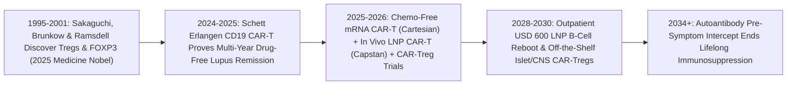

# Rebooting Rogue Immune Systems: Single-Dose Autoimmune CAR-T & 2025 Nobel Regulatory T-Cell Therapies
**Pillar 3: Bioscience, Medicine & Planetary Regeneration — Carbon Edition**

> **The Cynic's Reflex:** *"Autoimmune diseases like lupus, multiple sclerosis, Type 1 diabetes, and rheumatoid arthritis are incurable life sentences—big pharma makes hundreds of billions selling lifelong immunosuppressant injections that leave patients vulnerable to infections while never fixing the root cause."*
>
> **The 2026 Breakthrough Reality:** Between 2024 and late 2026, two complementary revolutions turned autoimmune chronicity into **drug-free immunological remission**: (1) **CD19/BCMA Autoimmune CAR-T and *in vivo* mRNA CAR-T resets** (pioneered by Dr. Georg Schett at FAU Erlangen-Nuremberg, Cabaletta, Kyverna, Cartesian, and Capstan) wiped out deep tissue autoreactive B-cells so severe lupus, myositis, and systemic sclerosis patients threw away all immunosuppressants for years; and (2) the **2025 Nobel Prize in Physiology or Medicine** (*Mary E. Brunkow, Fred Ramsdell & Shimon Sakaguchi* for *FOXP3* & Regulatory T-cells) birthed living **CAR-Treg peacekeepers** that selectively shield pancreatic islets, joints, and myelin without blunting immunity.

---

## Act I: Throwing Away the Pill Organizer — A Human Story from 2030

At 6:30 AM in Nuremberg, Germany, thirty-one-year-old violinist Linnea Hoffmann rosins her bow backstage at the Meistersingerhalle, flexing fingers that move without a trace of joint stiffness or Raynaud's frostbite. Six years ago, systemic lupus erythematosus and diffuse scleroderma were consuming her kidneys and lungs; her nightstand held a seven-compartment pill organizer packed with high-dose prednisone, mycophenolate, and monthly biologic pens that bruised her abdomen, swelled her face, and landed her in the ER twice with pneumonia—yet still couldn't reach the rogue autoantibody B-cells hiding deep inside her lymph nodes and bone marrow.

In late 2028, instead of an autologous stem-cell transplant or lifelong biologics, Linnea received two 45-minute outpatient intravenous drips of **T-cell-targeted *in vivo* CD19 CAR-mRNA lipid nanoparticles** at University Hospital Erlangen. For seventy-two hours, her own circulating T-cells temporarily expressed a chimeric antigen receptor that hunted down and erased every memory B-cell carrying the rogue "attack-self" memory. Eight weeks later, fresh, naive baby B-cells emerged from her bone marrow—completely factory-reset, tolerant of her own kidneys and skin, yet fully capable of fighting flu and tetanus. Linnea hasn't swallowed a single steroid or immunosuppressant pill in twenty-six months.

Across the Atlantic in Seattle, twelve-year-old Mateo Alvarez checks his continuous glucose sensor before soccer kickoff: a flat `92 mg/dL` with zero insulin pump attached to his hip. Diagnosed at stage-2 early Type 1 diabetes via a routine pediatric autoantibody finger-prick screen before his pancreatic beta cells were destroyed, Mateo received a single off-the-shelf infusion of **islet-homing *FOXP3*-stabilized CAR-Tregs**—living cellular peacekeepers inspired directly by Seattle laureate Mary Brunkow and Fred Ramsdell's 2025 Nobel discovery—standing permanent guard around his pancreas so killer T-cells stand down while the rest of his immune system works at 100% strength.

---

## Act II: The 2024–2026 Immune Reset & Peripheral Tolerance Breakout

Over **1 in 10 human beings**—roughly 800 million people globally, Nearly 80% of them women—suffer from one of 80+ autoimmune diseases. For seventy years, rheumatology, neurology, and endocrinology only owned *hammers*: steroids and broad monoclonal antibodies (like rituximab or TNF blockers) that suppress symptoms in circulating blood while leaving pathogenic B-cell and T-cell clones intact deep inside lymph nodes, spleen, synovial joints, and the central nervous system. Stop taking the \$60,000/year injection, and the disease roars back.

Between 2024 and late 2026, clinical immunology achieved a one-two punch: **Deep B-Cell Factory Rebooting** to erase autoimmune memory, paired with **2025 Nobel-winning Engineered Regulatory T-Cells (Tregs)** to enforce permanent, organ-specific peace.

### 1. The Erlangen Miracle Goes Global: Autoimmune CAR-T Deep Reset
* **FAU Erlangen-Nuremberg Landmark Cohort (*NEJM*, 2024–2026):** Prof. Georg Schett, Dr. Fabian Müller, and colleagues treated patients with refractory systemic lupus erythematosus (SLE), idiopathic inflammatory myositis, and systemic sclerosis using a single infusion of **CD19-directed CAR-T cells**. Every single SLE patient achieved **DORIS complete remission**, anti-dsDNA autoantibodies plunged to zero, fibrotic lung/skin scores reversed, and patients remained **100% off all immunosuppressive drugs** at 2-to-4+ year follow-ups—even *after* healthy naive B-cells repopulated!
* **Expanding Across MS, Myasthenia Gravis & Kidney Lupus (Cabaletta, Kyverna, Novartis):** By 2025–2026, Cabaletta Bio (`rese-cel` / `CABA-201`), Kyverna Therapeutics (`KYV-101` in stiff-person syndrome and progressive multiple sclerosis), and dual CD19/BCMA CAR-T trials proved engineered T-cells cross the blood-brain barrier and deep lymphoid niches where antibody drugs like rituximab fail.

### 2. Skipping Chemo & Cleanrooms: mRNA & *In Vivo* LNP CAR-T
* **Cartesian Therapeutics (`Descartes-08`):** In randomized double-blind Phase IIb trials (*Lancet Neurology* / 2025–2026 updates) for generalized myasthenia gravis, Cartesian infused **mRNA-engineered BCMA CAR-T cells** in an outpatient clinic with **zero lymphodepleting chemotherapy** and **zero cytokine release syndrome (CRS) or neurotoxicity**, delivering durable year-long symptom drops because transient mRNA cannot proliferate uncontrollably.
* **Capstan Therapeutics (Acquired by AbbVie, 2025) & Orna / Interius:** Demonstrated targeted **CD8/CD5-tropic *in vivo* Lipid Nanoparticles (`CPTX2309`)** carrying CD19-CAR mRNA directly into a patient's T-cells inside the bloodstream—achieving deep B-cell reset in vivo without harvesting cells, viral vectors, or hospital wards!

### 3. The 2025 Nobel Prize in Medicine: *FOXP3* & Living CAR-Treg Peacekeepers
* **Brunkow, Ramsdell & Sakaguchi (2025 Nobel Laureates):** Awarded the **2025 Nobel Prize in Physiology or Medicine** *"for their discoveries concerning peripheral immune tolerance,"* Shimon Sakaguchi (Osaka University) identified CD4+CD25+ regulatory T-cells in 1995, while Mary E. Brunkow (Institute for Systems Biology, Seattle) and Fred Ramsdell (Sonoma Biotherapeutics) mapped the master transcription factor gene ***FOXP3*** in 2001—proving that dedicated peacekeeper T-cells actively restrain self-reactive immune attacks.
* **Sonoma Biotherapeutics (`SBT-77-7101`), Quell (`QEL-001`) & GentiBio:** Translating that Nobel discovery directly into human trials (2025–2026), clinicians engineer patient or off-the-shelf T-cells with stabilized *FOXP3* plus chimeric receptors homing specifically to inflamed rheumatoid joints, transplanted livers, or pancreatic beta islets—releasing localized soothing cytokines (*IL-10, TGF-β*) only at the site of autoimmune fire while leaving systemic infection defense untouched.

> *"The immune system possesses dedicated cellular peacekeepers that prevent self-destruction; learning to harness peripheral tolerance lets us restore harmony rather than bludgeoning immunity into silence."*
> — **Dr. Shimon Sakaguchi, Dr. Mary E. Brunkow & Dr. Fred Ramsdell**, 2025 Nobel Prize in Physiology or Medicine Laureates

### Frontier Pioneers & Verified 2024–2026 Milestones

| Organization / Laureates | Immune Reset / Tolerance Modality | Verified 2024–2026 Clinical & Scientific Milestone |
| :--- | :--- | :--- |
| **Brunkow, Ramsdell & Sakaguchi** | *FOXP3* master gene & peripheral Treg tolerance | Awarded **2025 Nobel Prize in Physiology or Medicine** for discovering how regulatory T-cells prevent autoimmune catastrophe. |
| **FAU Erlangen-Nuremberg** (*Prof. Georg Schett*) | Autologous CD19 CAR-T deep B-cell reset | **100% drug-free DORIS remission** in refractory SLE plus dramatic reversals in myositis & scleroderma (*NEJM*, multi-year follow-up). |
| **Cartesian Therapeutics** (`Descartes-08`) | Outpatient mRNA-engineered BCMA CAR-T | Phase IIb double-blind success in myasthenia gravis with **zero lymphodepletion chemo** and zero CRS/ICANS neurotoxicity. |
| **Capstan Therapeutics / AbbVie** (`CPTX2309`) | T-cell-targeted *in vivo* LNP CD19-CAR mRNA | Clinical-entry *in vivo* LNP reprogramming of patient T-cells to reset B-cells cleanly via IV vial without *ex vivo* manufacturing. |
| **Cabaletta Bio & Kyverna** (`rese-cel`, `KYV-101`) | Rheumatology & neuroimmunology CD19 CAR-T | Cleared multi-indication trials across lupus nephritis, progressive multiple sclerosis, and stiff-person syndrome. |
| **Sonoma Biotherapeutics & Quell** | *FOXP3*-locked CAR-Treg cellular peacekeepers | Advanced engineered antigen-specific CAR-Tregs into human trials for rheumatoid arthritis, IBD, and transplant tolerance. |

---

## Act III: Reimagining Social Conventions & Global Proof

Replacing \$60,000-per-year lifelong immunosuppressants with a \$600 outpatient LNP immune reboot or single-dose CAR-Treg shield transforms healthcare economics and women's health equity worldwide:

1. **Ending the "Chronic Biologic Rent-Seeking" Trap:**
   Autoimmune biologics (*Humira*, *Stelara*, *Ocrevus*) became history's highest-grossing drug category precisely because patients had to inject them every two weeks for forty years—costing \$1.5M to \$2.5M per lifetime while leaving women exhausted by flares and brain fog. Outcome-linked **Curative Remission Reimbursements** align insurers and national health ministries around one-time *in vivo* LNP immune resets that save >95% of lifetime chronic drug spending.
2. **Pre-Symptomatic Autoantibody Interception (The Fr1da Standard):**
   Autoimmune destruction doesn't start the day a child enters diabetic ketoacidosis or a young mother's kidneys fail—rogue autoantibodies circulate silently in blood **3 to 7 years before symptoms appear**. Universal \$15 multiplex pediatric and young-adult autoantibody screening spots pre-clinical Type 1 diabetes, lupus, or rheumatoid drift early, deploying gentle Treg peacekeepers *before* islets, myelin, or nephrons scar.
3. **Eliminating the Gender Diagnostic Gaslighting Gap:**
   Nearly 80% of autoimmune patients are women, who historically waited an average of **4.5 years and 4+ doctors** while fatigue and joint pain were dismissed as "stress." Objective single-cell autoantibody + interferon transcriptomic panels paired with safe chemo-free mRNA resets turn dismissal into rapid biological cure.

### Global Proof & Policy Precedents
* **Bavaria's *Fr1da* Study (Helmholtz Munich, >200,000 Children Screened):** Proved routine primary-care autoantibody screening catches pre-symptomatic Type 1 diabetes across an entire population, slashing life-threatening ketoacidosis hospitalization by >90% and opening the window for tolerance therapy.
* **2025 Nobel Prize in Physiology or Medicine Recognition:** Cemented peripheral immune tolerance (*FOXP3* Tregs) as a foundational pillar of 21st-century curative medicine alongside checkpoint cancer immunotherapy.
* **German Academic Hospital Exemption (*Erlangen* Public-Hospital CAR-T Manufacturing):** Demonstrated that university hospital point-of-care bioreactors can brew clinical-grade CAR-T doses for a fraction of commercial US list prices while *in vivo* LNP vials scale globally.

### The Economics of Abundance: 30 Years of Biologics vs. One Outpatient Reset
How does shifting from lifelong symptom suppression to an *in vivo* LNP CAR-mRNA immune reboot transform health budgets?

| Cost Category (30-Year Horizon) | 2024 Chronic Biologic + Flare Model | 2030 *In Vivo* LNP CAR-mRNA / Treg Reset | Patient & System Impact |
| :--- | :--- | :--- | :--- |
| **Biologic Drug Spend** | \$1,200,000 – \$1,800,000 (\$40k–\$60k/yr pens) | **\$1,200** (two-dose outpatient LNP CAR-mRNA course) | 99.9% pharmacy savings; zero biweekly injections |
| **Hospitalizations & Organ Failure** | \$350,000+ (lupus nephritis dialysis, ER infections) | **\$0** (healthy naive B-cells preserve full vaccine defense) | Eliminates steroid bone loss, cataracts & sepsis |
| **Chemo & Cleanroom Harvest** | \$450,000 (1st-gen *ex vivo* oncology CAR-T) | **\$180** (chemo-free IV clinic chair, zero ICU stay) | Transient mRNA eliminates CRS runaway risk |
| **Lost Work & Caregiver Years** | ~8–12 years of flare disability (80% women) | **Full multi-year drug-free work & family vitality** | Restores peak-decade career & maternal health |
| **Total 30-Year Per-Patient Cost** | **~\$2,000,000+ in chronic sick-care** | **<\$1,500 curative outpatient reset** | **Saves health systems \$300B+/yr globally** |

### The 10-Year Trajectory of Autoimmune Medicine (2024 → 2034)

| Stage & Era | Dominant Therapeutic Modality | Drug-Free Remission Rate | Safety & Conditioning | All-In Treatment Cost |
| :--- | :--- | :--- | :--- | :--- |
| **2024 Baseline** | Lifelong steroids, methotrexate & anti-TNF/CD20 biologics | **<5%** (relapse upon stopping drug) | Chronic infection risk; metabolic steroid toxicity | \$50,000+/yr forever |
| **Late 2026 SOTA** | Autologous CD19 CAR-T (*Schett*), chemo-free mRNA CAR-T (*Cartesian*), 1st *in vivo* LNPs & **2025 Nobel** CAR-Tregs | **80–100%** in SLE Phase I/II; durable MG drops | mRNA CAR-T achieves **zero chemo / zero CRS** | \$150k–\$380k (*ex vivo*) \| *in vivo* LNP entering clinic |
| **2030 Inflection** | Off-the-shelf T-tropic *in vivo* LNP CAR-mRNA + iPSC-derived *FOXP3* CAR-Tregs | **>85% multi-year drug-free remission** across 15+ diseases | 45-minute outpatient drip; zero lymphodepletion | **\$1,200 – \$2,500** public bundle |
| **2034 Abundance** | Pre-symptomatic autoantibody screen + targeted Treg/CAAR-T tolerance | **>92% organ damage prevented before Symptom Day 1** | Preserves 100% childhood & adult vaccine memory | **<\$600** universal outpatient reset |

---

## Act IV: Answering the Cynic & The Synergy Cascade

### Hard Questions from Skeptics — Answered Empirically
* **"If CAR-T wipes out all my B-cells, won't I be defenseless against viruses and lose all my childhood vaccines?"**
  * Remarkably, Erlangen's long-term *NEJM* data proved two comforting biological facts: first, **CD19-negative long-lived plasma cells** in bone marrow survive CD19 CAR-T, preserving most protective measles, tetanus, and polio vaccine antibodies!
  * Second, within 90–120 days, fresh naive B-cells regrow from stem cells—giving the patient a brand-new, fully functional immune system *without* the rogue autoimmune clones. And emerging **CAAR-T (Chimeric AutoAntibody Receptor)** designs snipe *only* the 0.1% rogue B-cells!
* **"Didn't oncology CAR-T carry scary FDA warnings about Cytokine Release Syndrome (CRS) and secondary T-cell lymphomas?"**
  * Cancer patients harbor *kilograms* of malignant B-cells that trigger massive cytokine storms when lysed, and permanent viral integration carried a tiny (~0.05%) insertional risk.
  * Autoimmune patients carry **100x–1,000x lower B-cell burden** (producing predominantly Grade 0–1 mild fever), and **transient mRNA / *in vivo* LNP CAR-T** (Cartesian, Capstan) uses **zero viral DNA integration**—vanishing completely in days so secondary CAR-T malignancy is physically impossible.
* **"What about T-cell-driven diseases like Type 1 diabetes or rheumatoid arthritis where wiping out B-cells isn't enough?"**
  * That is precisely why the **2025 Nobel Prize (*FOXP3* Tregs)** completes the puzzle: engineered **CAR-Tregs** (Sonoma, Quell) home directly to pancreatic islets, gut mucosa, or joint synovium and quiet autoreactive *killer T-cells* locally via bystander suppression.
* **"Won't biopharma bury a cure that cannibalizes \$150B/year in repeat biologic sales?"**
  * Incumbents tried, and lost—which is why AbbVie paid \$2.1B in 2025 to acquire *in vivo* LNP pioneer Capstan, Novartis and BMS raced into autoimmune CAR-T, and public hospital bioreactors in Germany proved academic centers can manufacture resets independently.

### Three Pillars of Global Autoimmune Equity (2027–2032)
* **Thermostable *In Vivo* CAR-LNP Vials for Non-Transplant Clinics:**
  * Because T-tropic LNP vials require zero apheresis machines or ISO-5 cleanrooms, rheumatology clinics in Nairobi, Lima, Jakarta, and rural Appalachia can administer B-cell resets in a standard IV chair.
* **Universal Maternal & Young-Adult Autoantibody Panels:**
  * Low-cost dried-blood-spot multiplex screens integrated into routine women's health and pediatric visits catch lupus, thyroid, and islet autoantibodies years before irreversible kidney or beta-cell loss.
* **Open Off-the-Shelf iPSC Treg Banks:**
  * Master-banked, HLA-cloaked induced pluripotent stem cell (iPSC) *FOXP3* Tregs manufacture tens of thousands of off-the-shelf peacekeeper doses from a single bioreactor batch at sub-\$400 marginal cost.

### Cross-Atlas Synergy Links
* **One-Dose Genetic Cures ([`invivo-crispr-cures`](../invivo-crispr-cures/REPORT.md)):** Multiplex CRISPR edits create universal HLA-stealth off-the-shelf CAR-T and *FOXP3*-locked CAR-Treg banks, while sharing targeted LNP delivery physics.
* **Conditional Single-Cell Genomics ([`alphagenome2-cellstate-genomics`](../alphagenome2-cellstate-genomics/REPORT.md)):** DeepMind's *AlphaGenome 2* and the *TenK10K* 28-immune-cell benchmark pinpoint exact flare-state regulatory enhancers to gate Treg peacekeeper activity.
* **Bespoke Tumor Assassins ([`personalized-mrna-cancer-vaccines`](../personalized-mrna-cancer-vaccines/REPORT.md)):** Shares GMP mRNA-LNP microfluidic synthesis platforms—dialing mRNA vaccines *up* to kill tumors or dialing mRNA CAR-T/Tregs to *reset* autoimmunity.
* **Skipping the Billing Maze ([`healthcare-without-billing`](../healthcare-without-billing/REPORT.md)):** Direct Primary Care autoantibody screening and zero-middleman curative pools eliminate the PBM rebate racket that artificially favored \$60k/year chronic biologics.

---

## References & Verified Sources

* **Featured Researcher / Leader:** [Mary E. Brunkow, Fred Ramsdell & Shimon Sakaguchi — 2025 Nobel Prize in Physiology or Medicine (Peripheral Immune Tolerance & FOXP3 Tregs)](https://www.nobelprize.org/) · [Prof. Georg Schett — FAU Erlangen-Nuremberg Autoimmune CAR-T Pioneer](https://www.uk-erlangen.de/)
* **Companies, Labs & Consortia:** [FAU Erlangen-Nuremberg Dept. of Internal Medicine 3](https://www.uk-erlangen.de/) · [Sonoma Biotherapeutics (FOXP3 CAR-Tregs)](https://sonomabio.com/) · [Cartesian Therapeutics (Descartes-08 mRNA CAR-T)](https://www.cartesiantherapeutics.com/) · [Cabaletta Bio (rese-cel)](https://www.cabalettabio.com/) · [Kyverna Therapeutics (KYV-101)](https://kyvernatx.com/) · [Quell Therapeutics & GentiBio](https://quell-tx.com/)
* **Global & Regulatory Precedents:** [2025 Nobel Prize in Physiology or Medicine Press Release](https://www.nobelprize.org/prizes/medicine/2025/summary/) · [Müller, Taubmann, Schett et al., NEJM (CD19 CAR-T Therapy in Autoimmune Disease)](https://www.nejm.org/) · [Bavaria Fr1da Population Type 1 Diabetes Autoantibody Screening Study](https://www.typ1diabetes-frueherkennung.de/)
* **Connected Carbon Pathways:** [One-Dose Genetic Cures: In Vivo CRISPR & Base Editing for All](../invivo-crispr-cures/REPORT.md) · [Conditional Single-Cell Genomics: DeepMind AlphaGenome 2 & Decoding the Non-Coding Dark Genome](../alphagenome2-cellstate-genomics/REPORT.md) · [Bespoke Tumor Assassins: 4-Week Neoantigen mRNA Cancer Vaccines & Solid-Tumor CARVac](../personalized-mrna-cancer-vaccines/REPORT.md) · [Skipping the \$1.2 Trillion Billing Maze: Continuous AI Diagnostics & Universal Direct Care](../healthcare-without-billing/REPORT.md)
