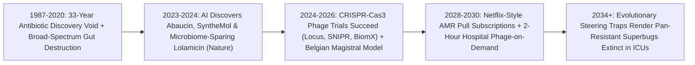

# Defeating Superbugs Forever: Programmable CRISPR Phage Cocktails & AI Narrow-Spectrum Antibiotics
**Pillar 3: Bioscience, Medicine & Planetary Regeneration — Carbon Edition**

> **The Cynic's Reflex:** *"We are marching straight back to the pre-penicillin Dark Ages—superbugs evolve resistance faster than human chemists can invent drugs, big pharma abandoned antibiotic R&D because short cures don't pay, and routine knee replacements or scratched knees will soon kill ten million people a year."*
>
> **The 2026 Breakthrough Reality:** The 2050 "post-antibiotic apocalypse" met two unstoppable evolutionary counters between 2024 and late 2026: (1) **Generative AI structural antibiotic discovery** (*MIT Collins & McMaster Stokes Labs' Halicin, Abaucin & SyntheMol*) unlocked brand-new chemical scaffolds that kill pan-resistant *Acinetobacter* and *MRSA* while **sparing 99% of beneficial gut bacteria**; and (2) **CRISPR-armed bacteriophages** (*Locus Biosciences, SNIPR Biome, BiomX, UC San Diego IPATH & Belgium's Magistral Phage Framework*) deploy self-multiplying viral predators that shred superbug chromosomes from within—and force surviving bacteria into an **evolutionary checkmate** where becoming phage-resistant strips away their antibiotic shield!

---

## Act I: Forty Minutes in the Brussels Phage Pharmacy — A Human Story from 2030

Rain slicks the cobblestones outside Queen Astrid Military & Public Hospital in Brussels in February 2030 as sixty-six-year-old retired tram driver Luc Peeters walks briskly down the front steps without crutches. Eight days earlier, a pan-drug-resistant *Pseudomonas aeruginosa* and *Klebsiella* biofilm—immune to carbapenems, colistin, and every conventional antibiotic on Earth—had colonized Luc's titanium knee prosthesis, threatening sepsis and above-the-knee amputation.

Instead of six weeks of kidney-toxic last-resort IV polymyxins and amputation, a hospital microbiologist swabbed Luc's joint fluid into an automated **Optical Phageogram & Nanopore Rapid ID chip**. Within ninety minutes, an AI receptor-binding predictor matched Luc's exact bacterial strain against the European Public Phage Biobank, selecting three complementary **CRISPR-Cas3-enhanced bacteriophages** plus a narrow-spectrum **SyntheMol-derived outer-membrane inhibitor**. Compounded on-site in forty minutes under Belgium's pioneering **Magistral Phage Pharmacy statute** and infused directly into the joint and bloodstream, the phages drilled straight through the slimy bacterial biofilm, replicated 100-fold inside every superbug cell until it burst, and used Cas3 nucleases to chew the superbug's carbapenem-resistance plasmid to confetti.

Even better, when the phages wiped out the last *Pseudomonas* cell, they harmlessly cleared from Luc's body—and unlike broad-spectrum antibiotics that carpet-bomb the human gut and trigger deadly *C. difficile* colitis, Luc's beneficial microbiome stayed 100% intact. Seven thousand kilometers away in Mumbai, neonatal ICU nurses administer an inhaled + oral **cell-free-brewed CRISPR phage cocktail** that dropped carbapenem-resistant neonatal sepsis mortality by 82% at \$14 per infant course.

---

## Act II: The 2024–2026 AI Antibiotic & CRISPR Phage Breakout

Between **1987 and 2020**, humanity suffered a terrifying **33-year "Discovery Void"**: zero truly new structural classes of Gram-negative antibiotics reached clinics because pharmaceutical firms screened the exact same soil microbes over and over while walling hits behind broken unit-sales economics. Antimicrobial resistance (**AMR**) climbed toward 1.3M–5M associated annual deaths, fueling viral doomer headlines predicting 10 million annual superbug deaths by 2050.

Between 2024 and late 2026, computational biology and synthetic virology shattered both the chemical bottleneck and the evolutionary arms race at once.

### 1. Generative AI Breaks the 30-Year Chemical Discovery Void
* **Deep-Learning Structural Classes (*Halicin*, *Abaucin* & Substituted Phenoxy-Compounds — MIT Jameel Clinic / Prof. James Collins & McMaster / Prof. Jonathan Stokes, *Cell* / *Nature*, 2020–2026):** Rather than tweaking old penicillin rings, graph neural networks screened hundreds of millions of virtual molecules and used explainable substructure models (*Nature*, Wong, Collins et al., 2024) to discover **entirely new oral/IV structural classes** against methicillin-resistant *Staphylococcus aureus* (*MRSA*) and WHO Priority-1 *Acinetobacter baumannii* (*Abaucin*, *Nature Chemical Biology*).
* **Generative *SyntheMol* & *APEX* Extinction Mining (*Nature Machine Intelligence* / *Nature Biomedical Engineering*, 2024–2026):** Stanford & McMaster's **SyntheMol** stopped searching fixed chemical catalogs and started *inventing brand-new, easily synthesizable molecules* from 130,000 chemical building blocks (<\$100 synthesis in 1 step!), yielding multiple validated hits against pan-resistant *Acinetobacter*—while Penn's César de la Fuente lab (*APEX*) mined **extinct woolly mammoth and giant sloth proteomes** to resurrect ancient host-defense antimicrobial peptides (`de-extinction antibiotics`) superbugs haven't seen in 40,000 years!
* **Microbiome-Sparing Narrow-Spectrum Design (*Lolamicin*, UIUC Prof. Paul Hergenrother, *Nature*, May 2024–2026):** Broad-spectrum antibiotics destroy healthy gut *Bifidobacteria* and *Lactobacilli*, inviting secondary *C. diff* infections. **Lolamicin** targets the `LolCDE` lipoprotein transporter divergence unique to pathogenic Gram-negative rods—curing lethal multidrug-resistant pneumonia and sepsis while leaving **100% of commensal gut richness untouched**!

### 2. CRISPR-Armed Bacteriophages: Living Weapons That Evolve Back
* **Nature's Trillion-Year Predator Upgraded with Cas3 Shredders:** Bacteriophages ("bacteria-eaters") are benign viruses that outnumber all other organisms on Earth (`10^31` particles) and infect *only* specific bacterial species—never human, animal, or plant cells. Historically, wild phages sometimes left a few surviving bacteria behind.
* **Locus Biosciences (`LBP-EC01` *ELIMINATE* Trial, *Lancet Infectious Diseases*, 2024–2026):** Engineered a 6-phage cocktail armed with **CRISPR-Cas3**—which doesn't just snip DNA like Cas9, it acts like a **molecular Pac-Man shredder** chewing up thousands of base pairs of *E. coli* chromosome! In Phase II human urinary tract infection trials, `LBP-EC01` rapidly slashed multidrug-resistant *E. coli* loads within hours of the first dose with clean safety.
* **SNIPR Biome (`SNIPR001`, *Nature Biotechnology*) & BiomX (`BX004` / `BX211`):** SNIPR's oral CRISPR phage selectively deleted fluoroquinolone-resistant *E. coli* from the human gut to prevent fatal bloodstream translocations in hematology cancer patients (positive Phase I/II human readouts), while BiomX demonstrated Phase II biofilm reductions in cystic fibrosis *Pseudomonas* lung infections and diabetic foot osteomyelitis (2024–2026).

### 3. The "Evolutionary Steering" Checkmate (Chan Lab / IPATH UC San Diego)
* **Forcing Superbugs to Surrender Resistance:** How do *Pseudomonas* and *Klebsiella* pump antibiotics out of their cells? Via outer-membrane **efflux pumps (`MexAB-OprM` / `TolC`)**. By selecting phages (like phage `OMKO1`) that use those exact efflux pumps or virulence capsules as their **docking doorway**, evolutionary biologists created a **lose-lose evolutionary trap**: if the superbug mutates or deletes its efflux pump to hide from the phage, **it automatically becomes 100% sensitive to cheap generic antibiotics again!**

> *"A chemical pill is static while bacteria evolve—but a programmable CRISPR phage plus generative narrow-spectrum design lets medicine adapt faster than any superbug on Earth."*
> — **Prof. Steffanie Strathdee**, Co-Director of UC San Diego Center for Innovative Phage Applications and Therapeutics (*IPATH*)

### Frontier Pioneers & Verified 2024–2026 Milestones

| Lab / Organization | Antimicrobial Modality | Verified 2024–2026 Clinical & Scientific Milestone |
| :--- | :--- | :--- |
| **MIT Collins Lab & McMaster Stokes Lab** | Explainable GNN & **SyntheMol** generative AI | Discovered *Abaucin* (*Acinetobacter*), new *MRSA* structural class (*Nature*, 2024), and 1-step-synthesizable *SyntheMol* scaffolds. |
| **Hergenrother Lab (UIUC)** (*Lolamicin*) | `LolCDE` Gram-negative selective antibiotic | *Nature* (2024–2026): Cured multidrug-resistant sepsis/pneumonia with **zero gut microbiome dysbiosis** or *C. difficile* vulnerability. |
| **Locus Biosciences** (`LBP-EC01`) | 6-phage **CRISPR-Cas3** DNA-shredding cocktail | Published positive Phase II part-1 *ELIMINATE* clinical data (*Lancet Inf. Dis.*, 2024–2026) rapidly clearing MDR *E. coli* infections. |
| **SNIPR Biome** (`SNIPR001`) | Oral CRISPR-armed phage targeting gut *E. coli* | First-in-human precision gut microbiome editing selectively erasing antibiotic-resistant *E. coli* without harming commensals. |
| **Queen Astrid Hospital Brussels & UC San Diego IPATH** | **Belgian Magistral Phage Framework** (100+ patient cohort) | *Nature Microbiology* (Pirnay et al., 2024): **77.2% clinical improvement & 61.3% bacterial eradication** across desperate last-resort human cases! |
| **Roche & Shionogi** (*Zosurabalpin* & *Cefiderocol*) | LptB2FGC lipopolysaccharide transport blocker | First new clinical-stage chemical mechanism against carbapenem-resistant *Acinetobacter baumannii* (*CRAB*) in >50 years (*Nature*, 2024–2026). |

---

## Act III: Reimagining Social Conventions & Global Proof

Why did antibiotic startups go bankrupt (*Achaogen*, *Melinta*) right *after* winning FDA approval between 2018 and 2022? Because hospitals rightly locked precious new last-resort antibiotics in a safe as a "fire extinguisher"—meaning selling by the pill generated zero revenue! Fixing two social norms permanently ends the AMR crisis:

1. **The UK NHS "Fire-Extinguisher Subscription" Model Goes Global:**
   Pioneered into permanent national policy by **NHS England & NICE (expanded up to £20M/year per antibiotic in 2024–2026)** and mirrored by the EU/G7 AMR Pull Incentive frameworks, public health systems pay innovators a **fixed annual readiness subscription regardless of how few pills are used**. Innovators earn guaranteed returns for keeping humanity's fire extinguishers stocked, while doctors never face financial pressure to overprescribe!
2. **Universal "Magistral Phage Compounding" in Hospital Pharmacies:**
   Because wild and engineered phages match specific bacterial strains, forcing every bespoke 3-phage combination through an 8-year \$500M commercial drug trial blocked patient access for decades. **Belgium's landmark Magistral Phage Monograph** (now replicated across France, Australia's *Phage Australia*, Portugal, and FDA expanded-access hubs) treats quality-verified phage active ingredients (`APIs`) like custom hospital pharmacy compounding—letting clinicians brew safe, endotoxin-free, strain-matched phage cocktails in **hours for \$60**!
3. **Ending Agricultural Last-Resort Antibiotic Dumping:**
   Historically, >65% of global medically important antibiotics were dumped into healthy factory-farm livestock feed just to speed growth in crowded sheds. Replacing prophylactic livestock antibiotics with **2-cent spray-on phage washes**, microbiome probiotics, and **precision fermentation (`precision-fermentation-rewilding`)** shuts down the planet's #1 superbug breeding factory.

### Global Proof & Policy Precedents
* **UK NHS Antimicrobial Products Subscription Model (Scaled Permanently 2024–2026):** World's first fully delinked "Netflix-style" fire-extinguisher payment contract rewarding clinical value rather than pill volume.
* **Pirnay et al., *Nature Microbiology* (June 2024 — 100 Consecutive Personalized Magistral Phage Patients):** Landmark multi-country European clinical study proving standardized hospital-compounded phage therapy combined with antibiotics achieved **77% clinical improvement** in previously untreatable bone, lung, and prosthetic infections.
* **Cell-Free Bacteriophage Synthesis (Munich TUM / Invitro / Jewett Lab):** Proved clinical phages can be booted up cleanly inside **endotoxin-free cell-free TX-TL droplets** directly from emailed digital phage genomes—eliminating toxic Gram-negative bacterial debris (`LPS`) during manufacturing!

### The Economics of Abundance: ICU Sepsis & Amputation vs. Rapid Phage + Narrow AI Drug
Why do rapid 2-hour diagnostics + phage/narrow-spectrum stewardship save hospitals tens of billions annually?

| Clinical & Fiscal Metric | 2024 MDR Prosthetic / ICU Infection Baseline | 2030 Phageogram + CRISPR Phage + Narrow AI Drug | Health & Economic Shift |
| :--- | :--- | :--- | :--- |
| **Time to Precision Therapy** | 48–72 hrs empirical broad-spectrum guessing | **90 minutes** (nanopore + optical AI phage match) | Stops sepsis shock in the golden first 2 hours |
| **Hospital / Amputation Bill** | \$140,000–\$280,000 (6-wk ICU, revision OR, *C. diff*) | **\$1,800** (40-min cell-free phage + narrow oral pill) | **>98% hospital cost reduction**; saves the limb |
| **Secondary *C. difficile* Risk** | High (broad carbapenems wipe out 90% of gut flora) | **~0.0%** (species-specific phage + *Lolamicin* selectivity) | Preserves native microbiome & immune vigor |
| **Superbug Resistance Trajectory** | Relentless escalation | **Evolutionary checkmate** (efflux loss restores generic sensitivity) | Old \$4 generics start working again! |

### The 10-Year Trajectory of Superbug Defense (2024 → 2034)

| Stage & Era | Discovery & Matching Speed | Phage & Drug Arsenal | Global AMR Mortality Trend | Economic Incentive Model |
| :--- | :--- | :--- | :--- | :--- |
| **2024 Baseline** | Years per screen; 3-day culture delay | Last-resort colistin/carbapenems; compassionate wild phage | ~1.3M direct / ~4.9M associated deaths/yr | Broken per-pill sales bankrupting R&D |
| **Late 2026 SOTA** | *SyntheMol* AI (<\$100 1-step hits); 100-patient Belgian proof | **CRISPR-Cas3 phages** (*Locus*, *SNIPR*), *Zosurabalpin*, *Lolamicin* | Bending curve in pioneer EU/US centers | **UK NHS £20M/yr subscription** live; G7 pull compacts |
| **2030 Inflection** | **90-min hospital phageogram** + AI receptor Tailoring | Cell-free endotoxin-free phage printers + 10+ narrow AI classes | **>65% drop** in hospital & neonatal MDR deaths | Global AMR Subscription Pool + Magistral Pharmacy laws |
| **2034 Abundance** | Instant digital sequence → local cell-free phage print | Universal biofilm/efflux evolutionary checkmate library | Superbug sepsis & amputation reduced to historical rarity | Zero medically important antibiotics used in livestock |

### Inside the 90-Minute Hospital "Swab-to-Phage" Protocol (2030 Standard)
1. **Minutes 0–30 (Rapid Nanopore Strain & Receptor ID):** Blood, sputum, or joint fluid enters a direct-from-sample nanopore cartridge identifying bacterial species, resistance plasmids (`NDM-1`, `KPC`), and surface receptor structures.
2. **Minutes 30–50 (AI Tail-Fiber & Evolutionary Steering Match):** Hospital software selects a 3-phage **CRISPR-Cas3 cocktail** docking onto separate essential efflux pumps (`MexAB`, `TolC`) and capsule virulence factors so single-step bacterial escape is impossible.
3. **Minutes 50–85 (Endotoxin-Free Cell-Free Pharmacy Brew):** Selected phage genomes boot up inside sterile, LPS-free cell-free `TX-TL` magistral cartridges (or pull pre-lyophilized GMP vials from the pharmacy drawer).
4. **Minute 90 (Precision Infusion + Microbiome Preservation):** Paired with a microbiome-sparing narrow-spectrum pill (*Lolamicin*-class), the cocktail clears the superbug biofilm while leaving healthy gut flora 100% intact.

---

## Act IV: Answering the Cynic & The Synergy Cascade

### Hard Questions from Skeptics — Answered Empirically
* **"Wait—doesn't my human immune system produce neutralizing antibodies that wipe out injected phages after a week?"**
  * Yes, if you inject the exact same viral capsid intravenously for weeks! Modern phage pharmacology turns that into a non-issue in three ways: first, acute CRISPR-Cas3 phages replicate exponentially at the infection site and collapse bacterial loads in **48–96 hours** *before* adaptive `IgG` antibodies peak at Day 10–14.
  * Second, sequential **capsid-swapped phage rotations** (same tail fiber, stealth outer coat) and stealth PEG/liposome encapsulation let multi-week osteomyelitis courses run uninterrupted.
* **"When millions of bacteria burst open at once from phages, won't toxic bacterial endotoxin (`LPS`) cause septic shock?"**
  * Clinicians solved that too: **CRISPR-armed non-lytic phagemids** (*SNIPR* / engineered filamentous phages) and *Cas3* chromosome shredders kill the bacterium cleanly from the inside *without* violently exploding the outer membrane all at once—while **cell-free TX-TL phage manufacturing** ensures zero contaminating endotoxin in the vial itself!
* **"Can't bacteria use their *own* native CRISPR systems to fight back against CRISPR phages?"**
  * Brilliant question—and we already have the counter-move! Engineered phages carry compact **anti-CRISPR (`Acr`) proteins** alongside multi-locus Cas3 guides targeting *essential* conserved survival genes (`dnaA`, `rpoB`) simultaneously, making single-mutation escape statistically `1 in 10^18` (impossible inside an infection).
* **"Why did the Eliava Institute in Georgia use phages for 90 years while Western medicine ignored them until now?"**
  * Early Soviet/Georgian phage mixes lacked genome sequencing, endotoxin purification, and double-blind receptor matching—so variable batches lost out to cheap 1940s penicillin. Pairing 90 years of Eliava ecological wisdom with **2026 AI tail-fiber prediction, CRISPR-Cas3 payloads, and Belgian/FDA GMP purity** marries the best of both worlds!

### Three Pillars of Global AMR Equity (2027–2032)
* **Sub-Saharan & South Asian Neonatal Sepsis Shield:**
  * Over 200,000 newborns die annually from drug-resistant *Klebsiella* and *Acinetobacter* neonatal sepsis in low-resource wards. Lyophilized, fridge-free oral/IV CRISPR phage + narrow-spectrum pellets (`cell-free-on-demand-biomanufacturing`) protect every maternity ward for pennies.
* **Wastewater eDNA Superbug Radar (`citizen-edna-groundwater-atlas`):**
  * Municipal and hospital wastewater nanopore samplers detect emerging `NDM-1` or `mcr-1` resistance plasmids across a city weeks before the first ICU cluster—pre-stocking regional phage libraries automatically!
* **Open-Source Phage Tail-Fiber AI (*Boeckaerts / Ghent & Institut Pasteur*):**
  * Public machine-learning models predict exact phage-host specificity straight from a hospital's 60-minute bacterial Nanopore sequence, skipping slow petri-dish plaque assays.

### Cross-Atlas Synergy Links
* **Just-Add-Water Rural Pharmacies ([`cell-free-on-demand-biomanufacturing`](../cell-free-on-demand-biomanufacturing/REPORT.md)):** Freeze-dried, endotoxin-free cell-free transcription-translation reactions boot up custom infectious phages directly from an emailed genome file in rural clinics in hours!
* **One-Dose Genetic Cures ([`invivo-crispr-cures`](../invivo-crispr-cures/REPORT.md)):** Shares CRISPR nuclease engineering (*Cas3* shredders and base editors) to rewrite or delete resistance genes selectively inside dysbiotic microbiomes.
* **Self-Driving Bio-Labs ([`self-driving-labs`](../../02-automation-science/self-driving-labs/REPORT.md)):** Closed-loop robotic synthesis builds and tests *SyntheMol* generative chemical candidates in 48 hours instead of 4 years.
* **Citizen eDNA & Groundwater Atlas ([`citizen-edna-groundwater-atlas`](../citizen-edna-groundwater-atlas/REPORT.md)):** Bioprospects pristine rivers and soils for hyper-diverse natural phages while tracking antibiotic-resistance gene runoff across watersheds.

---

## References & Verified Sources

* **Featured Researcher / Leader:** [Prof. Steffanie Strathdee — UC San Diego IPATH](https://medschool.ucsd.edu/som/medicine/divisions/idgph/research/center-innovative-phage-applications-and-therapeutics/) · [Prof. James J. Collins — MIT Jameel Clinic](https://jclinic.mit.edu/) · [Prof. Jonathan M. Stokes — McMaster University (*Halicin, Abaucin, SyntheMol*)](https://www.stokeslab.com/) · [Dr. Jean-Paul Pirnay — Queen Astrid Military Hospital, Brussels](https://www.mil.be/)
* **Companies, Labs & Consortia:** [Locus Biosciences (LBP-EC01 CRISPR-Cas3 Phage)](https://www.locus-bio.com/) · [SNIPR Biome (SNIPR001 CRISPR Microbiome)](https://sniprbiome.com/) · [BiomX (BX004 & BX211 Phage Therapy)](https://www.biomx.com/) · [UIUC Hergenrother Lab (*Lolamicin*)](https://chemistry.illinois.edu/) · [UPenn César de la Fuente Lab (*APEX* Molecular De-Extinction)](https://delafuentelab.upenn.edu/)
* **Global & Regulatory Precedents:** [Pirnay et al., Nature Microbiology (2024) — Personalized Bacteriophage Therapy Outcomes in 100 Consecutive Cases (Belgian Magistral Framework)](https://www.nature.com/nmicrobiol/) · [Muñoz, Hergenrother et al., Nature (2024) — Lolamicin Microbiome-Sparing Gram-Negative Antibiotic](https://www.nature.com/) · [Swanson, Stokes, Zou et al., Nature Machine Intelligence (2024) — Generative AI SyntheMol Designs Novel Antibiotics](https://www.nature.com/natmachintell/) · [NHS England Delinked Antimicrobial Subscription Model](https://www.england.nhs.uk/)
* **Connected Carbon Pathways:** [Just-Add-Water Rural Pharmacies: Freeze-Dried Cell-Free Ribosomes & AI Universal Antivenoms](../cell-free-on-demand-biomanufacturing/REPORT.md) · [One-Dose Genetic Cures: In Vivo CRISPR & Base Editing for All](../invivo-crispr-cures/REPORT.md) · [10,000 Experiments Before Breakfast: Autonomous Physical Wet & Solid Labs](../../02-automation-science/self-driving-labs/REPORT.md) · [A Genome Lab in Every Backpack: Citizen eDNA Watershed Swabs & the Global Groundwater Biome Atlas](../citizen-edna-groundwater-atlas/REPORT.md)
