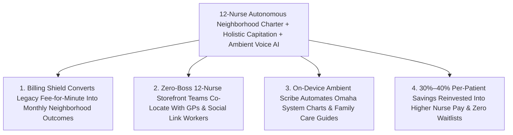

# CARBON EDITION — PILLAR 3: 15,000 NURSES, ZERO BOSSES & AMBIENT CARE
## How Dutch "Buurtzorg" & Zero-Keyboard Voice AI Cut Home-Care Costs 40% Through Unhurried Human Warmth

> **Executive Framing & Reimagining How Societies Care for Aging Neighbors:**
> * **The Cynic's Belief:** *"As populations age, home healthcare can only survive by running like a fast-food assembly line—splitting nursing into stopwatch-timed 6-minute billing codes, barcode-scanning visits, low-wage task aides, and layers of corporate compliance managers. Unhurried human warmth is a nostalgic luxury modern budgets simply cannot afford."*
> * **The Empirical Counter-Reality:** In the 1990s, when policymakers industrialized Dutch home care into fragmented minute-by-minute "product codes," costs *exploded*, elders grew lonelier and sicker, and nurses fled in tears. Then in late 2006, community nurse **Jos de Blok** sat around a kitchen table in **Almelo** with **four nurses** and launched **Buurtzorg Nederland** (*"neighborhood care"*) under one radical rule: ***"Humanity over bureaucracy."*** Today, **15,000+ nurses and nurse assistants** work across **~950 completely self-managing 12-nurse neighborhood teams** supported by **fewer than 50 back-office staff**, **~20 non-boss coaches**, and **zero middle managers**. Independent audits by **Ernst & Young (EY)**, **KPMG**, and the **Commonwealth Fund** proved Buurtzorg uses **~50% fewer billed hours per patient**, cuts per-patient care costs **30%–40%**, reduces emergency hospital admissions by **33%**, cuts nurse sick leave in half, ranks **#1 in Dutch patient satisfaction**, and won **Dutch Best Employer of the Year five times**!
> * **The Social Norm Shift:** Health systems abolish fee-for-minute stopwatch billing in favor of **autonomous 12-nurse neighborhood outcomes teams** paired with **minimalist open nursing networks (*BuurtzorgWeb / Omaha System*)** and **on-device ambient clinical voice AI scribes**—proving technology's highest job in medicine is vaporizing administrative bureaucracy so two human beings can start every visit over a warm cup of coffee.
> * **Anchor Voice:** *"Start always from the perspective of the patient, keep things small and simple, and trust professionals to do what they were trained to do: build human relationships that restore independence rather than feed a bureaucracy."* — **Jos de Blok**, Community Nurse & Founder, *Buurtzorg Nederland*

---

## ACT I: THE LIVED HUMAN REALITY — TUESDAY MORNING COFFEE IN UTRECHT & DULUTH (2028)
### Why Pouring Coffee First Solves What Thirty Barcode-Scanned Visits Never See

It is 9:10 AM on a drizzly Tuesday morning in Utrecht—and across sister neighborhood nursing teams from Glasgow and Tokyo to Duluth, Minnesota. Eighty-one-year-old retired master baker **Hendrik Vermeer**, widowed seven months ago after fifty-four years of marriage, opens his front door not to his fourth hurried stranger of the week, but to **Anouk van Dijk**, the neighborhood *Buurtzorg* community nurse whose small 11-nurse storefront office sits three streets away beside the corner greengrocer.

Under the old "industrialized care" convention that still dominates most Western health agencies in 2026, Hendrik's post-hospital discharge would have triggered a surreal bureaucratic parade: a minimum-wage aide arriving at 7:40 AM with a smartphone timer allotted **6 minutes** (`Code H-14`) to pull on Hendrik's compression stockings; a second worker arriving at 11:15 AM allotted **4 minutes** (`Code M-08`) to verify his heart and blood-pressure tablets; and a third wound-care contractor rushing in on Thursday afternoon—all routed by a distant regional call-center algorithm, supervised by three tiers of district managers, and leaving Hendrik staring at silent walls for twenty-three hours a day until an unnoticed dizzy spell sent him crashing down his front steps into a **\$42,000 hip-fracture hospitalization**.

Inside Anouk's self-governing Utrecht team, **there are no stopwatches, no call-center dispatchers, and zero bosses**. Watch what happens instead during Anouk's unhurried 45-minute Tuesday visit:

1. **Coffee Before Clinical Checklists (*"First Coffee, Then Care"*):**
   Anouk hangs up her rain jacket, sits across from Hendrik at his oak kitchen table, and shares a pot of filter coffee for twenty unhurried minutes before touching a blood-pressure cuff. Because Hendrik trusts Anouk—the same nurse who dressed his leg ulcer on Saturday and knows his late wife's name—he confesses something he never told a six-minute stranger: he has stopped walking to the corner bakery every morning because his 8:00 AM diuretic pill makes the room spin right when he steps onto his slick brick stoop, so he has barely eaten solid meals all week.
2. **Whole-Life Root-Cause Problem Solving Across the Neighborhood Web:**
   Anouk doesn't file a 14-page prior-authorization request with a regional manager to get permission to think. Before leaving Hendrik's kitchen, she texts Hendrik's neighborhood GP directly to shift his diuretic timing and halve an overlapping antihypertensive dose, checks his fridge, calls Hendrik's daughter Lotte to set up a color-coded Sunday supper & pill-organizer ritual, and knocks next door to ask Hendrik's longtime neighbor Bram—a retired carpenter who shares the garden hedge—if he can bolt a sturdy brass grab-rail beside the front doorframe that afternoon and invite Hendrik along on his 10:00 AM walk for fresh rye bread.
3. **Ambient Voice AI Vaporizes the Final Clerical Friction:**
   Clipped discreetly to Anouk's lapel—with Hendrik's explicit consent—a local, zero-cloud-leakage **ambient clinical voice AI scribe** translates the clinical findings from their warm conversation and her quick handheld vital-sign check directly into a structured **Omaha System** holistic care plan inside **BuurtzorgWeb** in twelve seconds. Anouk never opens a laptop between their faces. Within six weeks, Hendrik's leg wound heals, his balance steadies, he walks to the bakery four mornings a week with Bram, and he graduates down to a cheerful biweekly check-in—requiring **54% fewer total billed nursing hours** than the stopwatch agency down the road while keeping him out of the hospital all winter!

---

## ACT II: REIMAGINING THE RULES — HOW "EFFICIENCY" MANAGERS BROKE CARE & HOW 4 NURSES FIXED IT
### The Counter-Intuitive Math of Trust: Why High-Autonomy Nurses Cost 40% Less Than Cheap Task-Timers

```mermaid
flowchart LR
    subgraph StopwatchTrap["1990s–2026 Industrialized Stopwatch Home Care"]
        I1["Care Sliced Into 6-Min Barcode Billing Codes & Low-Skill Silos"]
        I2["30–40 Different Strangers Visit One Elder; Root Causes Missed"]
        I3["25%+ Corporate Overhead, Burned-Out Nurses & High ER Readmissions"]
    end
    subgraph BuurtzorgEngine["Buurtzorg Model + Ambient Clinical Voice AI"]
        B1["Autonomous 12-Nurse Neighborhood Team (Max 50–60 Patients, Zero Bosses)"]
        B2["First-Visit Coffee + Family, Neighbor & GP Root-Cause Mobilization"]
        B3["BuurtzorgWeb Omaha System + Ambient Voice Scribe (<8% Overhead)"]
    end
    subgraph HumaneDividend["EY, KPMG & Dutch Health Ministry Verified Outcomes"]
        D1["~50% Fewer Billed Hours Needed as Elders Regain Independence Fast"]
        D2["-30% to -40% Lower Per-Patient Cost & -33% Emergency Admissions"]
        D3["5x Best Employer Winner, -55% Nurse Sick Leave & #1 Satisfaction"]
    end
    StopwatchTrap ==> BuurtzorgEngine ==> HumaneDividend
```

### 1. How 1990s "New Public Management" Accidentally Created a Bureaucratic Monster
Why do home-care nurses in the United States, Britain, and much of Europe weep in their cars between shifts? Because in the early 1990s, well-meaning health economists imported factory Taylorism (*New Public Management*) into human caregiving. Assuming nurses couldn't be trusted without corporate oversight, payers merged small town nursing guilds into massive regional conglomerates, separated "care assessment" from "care delivery," and priced every human act like a hardware-store bolt: five minutes to apply eye drops, seven minutes to change a bandage, eleven minutes to assist with bathing—sending the cheapest legally permitted worker for each isolated sub-task.

Jos de Blok watched this tragedy unfold from the inside, both as a district nurse and later as an innovation director who quit in disgust when he realized **administrators were measuring cost per minute while completely ignoring total hours per episode**. When four hurried strangers rush in and out of a frightened 84-year-old's apartment, *nobody* notices early heart-failure fluid retention, medication confusion, malnutrition, or crushing grief—so patients deteriorate into chronic dependency, stay on agency billing rolls indefinitely, and bounce into **\$25,000 ICU admissions**. Worse, paying schedulers, quality-compliance auditors, HR directors, marketing departments, and executive suites devoured **25 cents of every public care dollar** before a single hand touched a patient!

### 2. Inside Buurtzorg's Radical Operating Architecture: 15,000 Professionals, <50 Back-Office Staff
When Jos de Blok, Gonnie Kronenberg, and Ard Leferink founded **Buurtzorg** in Almelo in late 2006, they didn't invent a futuristic medical device—they **deleted the entire corporate pyramid** and rebuilt around how human trust actually works:
* **The Hard 12-Nurse Team Cap (Dunbar-Scale Self-Governance):** Every Buurtzorg team serves a specific walkable neighborhood of 10,000–15,000 residents and caps strictly at **10 to 12 nurses**. The moment a neighborhood's demand grows past 12 nurses, the team splits like a living cell into two 6-nurse teams rather than appointing a team boss! Inside each team, nurses rent their own modest street-front office, schedule their own shifts, hire new colleagues, manage their own continuing-education budget, divide roles consensually (team mentor, planner, municipality liaison), and use structured *Solution-Driven Interaction* meetings where no single voice dominates.
* **Coaches, Never Managers:** Across all ~950 teams and 15,000+ nurses, Buurtzorg employs **zero middle managers, zero regional VPs, and ~20 regional coaches** (~1 coach per 45–50 teams). Crucially, a Buurtzorg coach has **zero formal authority**: they cannot fire anyone, impose targets, or overrule a clinical care plan—they exist purely as wise sounding boards when a team asks for help resolving a tricky interpersonal knot or workload spike.
* **The Back Office That Fits in One Small Building:** Fewer than **50 central back-office staff** in Almelo handle payroll, statutory municipal/insurer invoicing, and clean IT maintenance for 15,000+ clinicians—keeping administrative overhead below **8%** (compared to **25%–32%** in conventional home-health corporations).
* **The EY & KPMG Paradox Resolved:** Critics initially cried foul when early figures showed Buurtzorg's *hourly* rate was slightly higher because it employed fully qualified generalist community RNs rather than fragmented minimum-wage task aides. Then **Ernst & Young (2009)** and **KPMG / The Commonwealth Fund (2015)** audited full-year Dutch national insurer claims (adjusting rigorously for patient age, morbidity, and case-mix): Buurtzorg patients needed **~50% fewer total hours of care**, recovered self-reliance twice as fast, had **33% fewer emergency hospital admissions**, and cost taxpayers **30%–40% less per patient overall**—projecting **€2 billion per year in national savings** if every Dutch provider matched Buurtzorg's holistic autonomy!

### 3. The Technical × Social Secret: *BuurtzorgWeb* + 2026 Ambient AI Against "Robotic Nursing"
Most outsiders miss that Jos de Blok co-built a custom software company (**Ecare / BuurtzorgWeb**) alongside the very first nursing teams. Why? Because commercial Electronic Health Records are built *for billing auditors to police clinicians*, whereas **BuurtzorgWeb** was built *by nurses for nurses*:
1. **Open Peer Transparency Without Bosses:** Built on the open-standard **Omaha System** (covering environmental, psychosocial, physiological, and health-related behaviors), every team sees real-time peer dashboards of holistic patient progress, neighborhood hours, and financial sustainability—creating healthy, supportive peer pride without a single corporate whip.
2. **2025–2026 Ambient Clinical Voice AI & Gentle Home Telemetry:** In conventional 2026 agencies, AI was weaponized to tighten route algorithms by 90 seconds per traffic light. In the Carbon Neighborhood Care model, **on-device, privacy-locked ambient voice scribes** draft Omaha System assessments, GP handoff notes, and plain-language family care summaries automatically from natural kitchen-table conversation—cutting remaining nurse keyboard time from ~45 minutes/day down to **<6 minutes/day**! Paired with optional, non-camera **passive radar gait sensors and cuffless smart-mattress heart/respiratory strips** alerting the neighborhood nurse team gently if an elder's night breathing shifts, **automation protects human stillness rather than stealing it**.

| Care Dimension | Industrial Stopwatch Agency (Legacy Status Quo) | Buurtzorg Autonomous Team + Ambient Voice AI (Carbon Standard) | Verified Empirical Shift |
| :--- | :--- | :--- | :--- |
| **Who Visits the Patient?** | **15–35 rotating task strangers** per quarter scanning minute-codes | **2–3 trusted neighborhood nurses** who know family, GP & neighbors | **#1 Patient Satisfaction** across the Netherlands |
| **Management & Admin Overhead** | **25%–32% of budget** (CEOs, VPs, dispatchers, coders, HR layers) | **<8% overhead** (<50 back-office staff & ~20 coaches for 15,000+ nurses) | **3×–4× leaner overhead**; zero middle bosses |
| **Nurse Charting & IT Experience** | Surveillance GPS trackers + 90 min/day clicking defensive billing boxes | **BuurtzorgWeb (Omaha System)** + **Ambient Voice Scribe** (<6 min review) | **89%–94% of shift** spent in direct human care |
| **Total Hours & Cost per Patient** | High chronic dependency; 100% of authorized hours billed to max revenue | **~50% fewer hours billed** via early root-cause independence coaching | **-30% to -40% total cost** per patient (EY / KPMG) |
| **Hospitalizations & Staff Burnout** | Frequent missed warning signs; **7%–9% sick leave** & >25% annual turnover | **-33% unplanned ER admissions**; **~3% sick leave** & <10% turnover | **5× Dutch Best Employer** of the Year winner |

---

## ACT III: GLOBAL ADAPTATION & PHASED ROLLOUT ROADMAP (2026–2032)
### Translating Dutch Kitchen-Table Autonomy Across Medicare, the NHS, Japan & Municipal Trusts

Whenever American, British, or Asian health leaders visit Almelo, their first worry is identical: *"That works in the Netherlands, where home care is paid under an integrated community-nursing tariff—our insurers and Medicare still force 15-minute CPT/billing codes!"* Yet across **24+ countries**—including **Japan (*Buurtzorg Kawagoe & Miyazaki* community hubs)**, **Sweden (*Grannvård*)**, **Germany**, **Taiwan**, **UK NHS neighborhood pilots (*Buurtzorg Britain & Ireland*, Guy's and St Thomas' / Cambridgeshire)**, and **Minnesota / US Medicare Advantage & PACE capitated pilots**—pioneers discovered the exact regulatory bridge: **keep a ultra-thin back-office "billing shield" in Almelo style** that translates holistic neighborhood care into whatever legacy insurer codes payers still demand on the outside, while shielding nurses 100% from stopwatch codes on the inside—until payers inevitably switch to **capitated neighborhood outcomes bundles**!

| Implementation Horizon | Regulatory & Payment Unlock | Clinical & Technical Deployment | Audited Community & Fiscal Outcome |
| :--- | :--- | :--- | :--- |
| **Phase 1 (Months 1–9): "Billing Shield" Neighborhood Pilots** | State Medicaid waivers, Medicare Advantage / PACE plans, and NHS Trusts authorize **flat monthly episode/neighborhood bundles** (or back-office code translation shields) for 10 pioneer 12-nurse teams per metro. | Launch walkable storefront nursing offices; deploy open **Omaha System + on-device Ambient Voice Scribe**; train coaches in non-hierarchical *Solution-Driven Interaction*. | Nurse clerical "pajama time" drops **80% immediately**; nurse recruitment waitlists flip positive within 90 days as burned-out RNs return to practice. |
| **Phase 2 (Years 1–3): Metro Scaling via Cellular Team Splitting** | Public payers abolish fragmented minute-code tenders wherever holistic teams demonstrate ≥20% total medical-expense reduction (home care + ER + rehab combined). | Scale organically via Buurtzorg's **12-nurse cell-division rule**; link storefront teams directly to **[`healthcare-without-billing`](../healthcare-without-billing/REPORT.md)** Direct Care GPs and **[`social-prescribing-loneliness-cure`](../../04-social-norms/social-prescribing-loneliness-cure/REPORT.md)** Link Workers. | Unplanned elder ER admissions drop **30%+**; premature nursing-home placements fall **25%–35%**; administrative overhead plunges from **28% to <8%**. |
| **Phase 3 (Years 3–6): Universal Neighborhood Care Standard** | National statutory parity makes holistic, self-managed neighborhood nursing the default home-health contract across urban and rural counties alike. | Integrate optional zero-camera **passive home gait/cardiopulmonary strips** and **[`epigenetic-healthspan`](../epigenetic-healthspan/REPORT.md)** frailty-reversal protocols into every neighborhood hub. | Saves **\$35B–\$60B/yr** across U.S. Medicare/Medicaid equivalents while turning community nursing back into one of society's most joyful, respected callings. |

---

## ACT IV: ANSWERING THE SKEPTIC & THE HUMANE HORIZON
### Why Trusting Skilled Humans Beats Policing Them Every Single Time

### Addressing the Top 3 Institutional Objections
1. **"Without middle managers or KPI supervisors, how do you stop a rogue 12-nurse team from slacking off, cutting corners, or committing clinical errors?"**
   * *Empirical Answer:* Twenty years across **950+ Buurtzorg teams** proved that **transparent peer accountability inside a 12-person human circle is infinitely stricter and kinder than distant corporate policing**. Every team's patient satisfaction scores, clinical Omaha System outcomes, and self-sustaining 60%–65% billable-care-ratio target are visible to peers on *BuurtzorgWeb*. Nobody wants to let down ten close teammates sitting around the same table—and if a team ever hits clinical or financial turbulence, peer teams and a regional coach step in within days to mentor, never to punish.
2. **"We already face a severe nursing shortage—how can we staff generalist RN teams instead of relying on minimum-wage task aides?"**
   * *Empirical Answer:* The "nursing shortage" is largely a **moral-injury exodus**: millions of licensed nurses still hold active credentials globally, having fled hospital and home-care agencies solely because stopwatch micromanagement broke their hearts! When Buurtzorg opened teams across the Netherlands, **thousands of departed nurses returned enthusiastically**—cutting sick leave by more than half—and because each patient needs **~50% fewer total care hours** once independence is restored, **one autonomous nurse serves nearly twice as many neighbors per year** without ever rushing a single cup of coffee!
3. **"Why failed copycats struggled when big hospitals tried to 'partially' copy Buurtzorg—and how to avoid their trap?"**
   * *Empirical Answer:* Several corporate agencies tried creating "self-managing teams" *while keeping their middle managers, HR rules, and KPI spreadsheets intact*—and failed within months because fake autonomy breeds cynicism. Jos de Blok's golden rule is non-negotiable: **you cannot graft trust onto a control hierarchy**. Public health commissioners must charter genuinely flat, zero-boss cooperatives or separate autonomous divisions protected by an Almelo-style lightweight back office.

### Fast-Track Health Commissioner & Payer Activation Checklist

| Sprint Reform Step | Proven Real-World Precedent | Months to Launch | Quality & Autonomy Guardrail |
| :--- | :--- | :--- | :--- |
| **1. Charter 12-Nurse Autonomous Pilots** | Buurtzorg Nederland (950+ teams) | **3 Months** | Strict 12-nurse cell-division rule; zero middle bosses permitted |
| **2. Thin Back-Office "Billing Shield"** | Almelo Back Office (<8% overhead) | **4 Months** | Shields nurses 100% from 6-minute codes while translating payer claims |
| **3. Open Omaha System + Ambient Scribe** | *BuurtzorgWeb* + Local Voice AI | **2 Months** | On-device HIPAA/GDPR voice-to-note cuts daily typing below 6 minutes |
| **4. Regional Non-Boss Coach Training** | ~20 Coaches per 15,000 Clinicians | **3 Months** | Coaches hold zero firing/budget power; *Solution-Driven Interaction* |
| **5. Holistic Episode Capitation Parity** | Dutch Community Nursing Tariff / PACE | **9 Months** | Rewards early elder independence rather than maximizing billed hours |

### Why Both Fiscal Conservatives and Caregiver Unions Cheer This Exact Model
* **Why Nurses & Families Love It:** Restores unhurried kitchen-table dignity, keeps 2–3 familiar faces per household, cuts nurse sick leave over 50%, and puts laptops away so human eyes meet again.
* **Why Budget Directors & Taxpayers Love It:** Slashes administrative overhead from **28% down to <8%**, cuts unplanned emergency admissions **33%**, and lowers per-patient costs **30%–40%** (EY & KPMG verified).

### Cross-Pillar Synergies & The Bottom Line
Woven together with **[`healthcare-without-billing`](../healthcare-without-billing/REPORT.md)**, **[`intergenerational-villages`](../../04-social-norms/intergenerational-villages/REPORT.md)**, **[`social-prescribing-loneliness-cure`](../../04-social-norms/social-prescribing-loneliness-cure/REPORT.md)**, and **[`epigenetic-healthspan`](../epigenetic-healthspan/REPORT.md)**, **Buurtzorg + Ambient AI** shatters one of modernity's ugliest myths: **we never had to treat elders like assembly-line parcels or nurses like barcode scanners to balance the budget**. When software quietly handles the paperwork and society trusts twelve neighbors in nursing shoes to care with their whole hearts, **human warmth turns out to be 40% cheaper than cold bureaucracy**.

---

## References & Verified Sources

* **Featured Pioneer & Founding Model:** [Jos de Blok — Founder of Buurtzorg Nederland (*Humanity Over Bureaucracy*)](https://www.buurtzorg.com/about-us/) · [Buurtzorg Model Architecture & Self-Management Principles](https://www.buurtzorg.com/about-us/buurtzorg-model/)
* **Independent Actuarial, Clinical & Policy Audits:** [The Commonwealth Fund & KPMG Case Study — *Home Care by Self-Governing Nursing Teams: The Netherlands' Buurtzorg Model* (Gray, Sarnak & Burgers, 2015)](https://www.commonwealthfund.org/publications/case-study/2015/may/home-care-autonomous-teams-netherlands-buurtzorg-model) · [The King's Fund (UK NHS) — *Buurtzorg: Models of Care & Workforce Autonomy Review*](https://www.kingsfund.org.uk/) · [Corporate Rebels Field Investigation — *Inside Buurtzorg's 15,000-Nurse Zero-Boss Organization*](https://corporate-rebels.com/blog/buurtzorg)
* **Technical & International Replication Networks:** [The Omaha System — Open Standardized Holistic Nursing Taxonomy](https://www.omahasystem.org/) · [Ecare Healthcare IT (*BuurtzorgWeb* Co-Designed Platform)](https://www.ecare.nl/) · [Buurtzorg International & Buurtzorg Britain & Ireland](https://buurtzorgbritainandireland.org/)
* **Connected Carbon Pathways:** [Skipping the \$1.2 Trillion Billing Maze: Continuous AI Diagnostics & Universal Direct Care](../healthcare-without-billing/REPORT.md) · [Living Connected: Multi-Generational Courtyards & Co-Located Care](../../04-social-norms/intergenerational-villages/REPORT.md) · [Prescribing Choirs, Rowing & Gardens: Neighborhood Link Workers Healing Loneliness](../../04-social-norms/social-prescribing-loneliness-cure/REPORT.md) · [100 Vibrant Years: Epigenetic Rejuvenation & Preventative Healthspan](../epigenetic-healthspan/REPORT.md)
