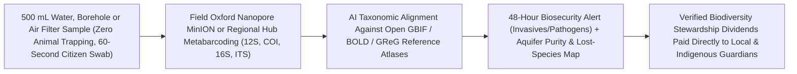

# A Genome Lab in Every Backpack: Citizen eDNA Watershed Swabs & the Global Groundwater Biome Atlas
**Pillar 3: Bioscience, Medicine & Planetary Regeneration — Carbon Edition**

> **The Cynic's Reflex:** *"We are sleepwalking through the Sixth Mass Extinction completely blind—cataloging an ecosystem takes years of underfunded PhD expeditions, electrofishing, and animal trapping, while subterranean aquifers and remote rivers collapse before anyone even counts what lived there."*
>
> **The 2026 Breakthrough Reality:** Every living creature continuously sheds microscopic traces of **environmental DNA (eDNA)**—skin cells, mucus, spores, and pollen—into the water, soil, and air around it. Between 2024 and late 2026, **syringe-filter citizen eDNA kits**, palm-sized **Oxford Nanopore *MinION* field sequencers**, UNESCO & NatureMetrics global expeditions, and the **Global Groundwater eDNA Initiative (`GReG`)** turned a single 500-milliliter cup of creek or well water into a complete census of **hundreds of fish, amphibian, mammal, fungal, and microbial species**—catching invasive pests two years earlier, rediscovering "extinct" species with zero animal harm, and mapping Earth's dark subterranean aquifer biome for the first time!

---

## Act I: Five Hundred Milliliters at Dawn — A Human Story from 2030

Mist rises off the Río Marañón tributary in northern Peru at 6:15 AM in May 2030 as fourteen-year-old high-school naturalist Valentina Quispe and Awajún Indigenous river guardian Mateo Wampís kneel on a mossy boulder. Neither carries a gill net, a cyanide stunner, a shotgun, or a specimen jar. Instead, Valentina draws 500 milliliters of cool river water into a sterile reusable syringe and pushes it gently over sixty seconds through a palm-sized `0.45-micron` encapsulated filter disk—trapping invisible shed skin cells and gill mucus from every creature swimming five kilometers upstream.

Back under the tin roof of their solar-powered village schoolhouse, Mateo snaps eight river filters and four village drinking-well filters onto a pocket-sized **Oxford Nanopore `MinION Mk1D`** plugged into a ruggedized tablet. By lunchtime, real-time metabarcoding matches 1.4 million DNA reads against Peru's sovereign **GBIF / BOLD Biodiversity Canopy**: **142 native fish species**, a critically endangered harlequin frog feared extinct since 2014, **zero invasive bullfrogs**, and clean subterranean stygofauna inside the village aquifer confirming zero heavy-metal tailing seepage from an upstream mine.

Because their verified eDNA diversity upload automatically unlocks quarterly **Biodiversity Stewardship Dividends** deposited directly into the Awajún community trust and local school budget, keeping that tributary wild and crystal-clear pays local families three times more every year than illegal logging or alluvial gold dredging ever could.

---

## Act II: The 2024–2026 Citizen & Subterranean eDNA Breakout

For two hundred years, ecology relied on *eyes and traps*: dragging bottom trawls across fragile seabeds, shocking trout streams, setting pitfall traps, and counting beetles under microscopes—missing nocturnal, microscopic, and cryptic species 80% of the time.

Environmental DNA (**eDNA**) flipped the physics of observation: **water, air, and soil are living genomic tape recorders**. A single liter of stream, ocean, or borehole water carries shed mitochondrial and ribosomal barcode fragments (`12S`, `16S`, `COI`, `ITS`) from everything from microscopic nitrifying archaea to elusive river dolphins. Between 2024 and late 2026, rapid field kits and global consortia scaled eDNA from niche academic papers into a **planetary nervous system**.

### 1. Illumination Beneath Our Feet: The Global Groundwater eDNA Atlas (`GReG`)
* **Earth's Largest Liquid Freshwater Habitat Was Unmapped:** Over **97% of Earth's unfrozen freshwater** sits underground in aquifers, sustaining >2 billion people's drinking water and half of global irrigation—yet its living subterranean ecosystems (*stygofauna*—blind translucent crustaceans, ancient biofilms, and pollutant-degrading microbes that actively purify our drinking water) remained biological terra incognita.
* **The Global Groundwater eDNA Initiative (`GReG`, ETH Zurich / Eawag / Global Consortium, 2024–2026):** Mobilizing hydrogeologists, water utilities, and citizen well-stewards across six continents to filter borehole and spring water through standardized eDNA capsules, `GReG` uncovered thousands of previously unknown subterranean lineages, proving **groundwater biodiversity serves as an ultra-sensitive living canary** for aquifer depletion, nitrate/pesticide intrusion, and geothermal health years before chemical wells fail!

### 2. UNESCO, NatureMetrics & Schoolkids Mapping the Ocean (`eDNA Expeditions`)
* **UNESCO IOC & OBIS Global Citizen Marine Census (2023–2026):** Across **20+ UNESCO Marine World Heritage sites** from Coiba (Panama) to Shark Bay (Australia) and the Wadden Sea, hundreds of schoolchildren and local rangers using kid-friendly syringe filters cataloged **thousands of marine vertebrate species**—flagging tropical range shifts from ocean warming in real time without harming a single fish.
* **NatureMetrics (2024 Earthshot Prize Finalist) & Standardized Nature Reporting:** Scaled simple mail-in and field eDNA kits across **100+ countries**, translating chaotic ecological surveys into auditable **Species Richness & Ecosystem Integrity metrics** linked to the Kunming-Montreal Global Biodiversity Framework (`30x30`) and TNFD corporate nature disclosures.

### 3. Backpack Nanopore Labs & Airborne eDNA Vacuum Samplers
* **Oxford Nanopore `MinION` + lyophilized ambient-temperature PCR (`LAMP`/amplicon kits):** Battery-powered sequencers smaller than a chocolate bar let Indigenous rangers in the Amazon, Borneo, and Canadian Arctic sequence wildlife pathogens (avian flu `H5N1`, amphibian *chytrid* fungus), illegal bushmeat/timber species IDs, and river health **entirely offline in the field** in under four hours—respecting **Indigenous Data Sovereignty (CARE Principles)** so biological samples never have to be exported abroad.
* **Airborne eDNA ("Vacuuming the Forest Air," *Current Biology* / Queen Mary London & ETH, 2024–2026):** Simple solar air-quality filters originally built to trap particulate dust (`PM10`) turned out to capture **airborne bird, bat, insect, mammal, and fungal spore eDNA** passively across entire landscapes—turning existing national air-pollution stations into 24/7 continental biodiversity radars!

### 4. Rediscovering "Lost" Species & Stopping Invasives Two Years Early
* **Re:wild Search for Lost Species & USGS Biosecurity:** Between 2024 and 2026, eDNA swabs rediscovered De Winton's golden mole (unseen for 87 years in South African sand dunes!) and elusive salamanders/sharks, while automated river/port eDNA samplers detected invasive **zebra/quagga mussels, Asian carp, and green crabs** at 1-in-a-billion trace concentrations—**18 to 24 months earlier** than visual divers, when localized eradication costs \$20,000 instead of \$500 million!

> *"With a simple syringe filter in the hands of a child or ranger, every drop of river, ocean, and groundwater speaks the names of the hundreds of creatures that depend on it."*
> — **Dr. Kat Bruce**, Founder of NatureMetrics & Tropical Entomologist

### Frontier Pioneers & Verified 2024–2026 Milestones

| Initiative / Organization | eDNA Sampling & Sequencing Modality | Verified 2024–2026 Planetary Milestone |
| :--- | :--- | :--- |
| **Global Groundwater eDNA Initiative (`GReG`)** | Standardized aquifer borehole & spring eDNA filtration | First global biodiversity map of subterranean stygofauna & purifying microbial biomes across 6 continents. |
| **UNESCO IOC *eDNA Expeditions* & OBIS** | Youth & citizen-scientist marine syringe filters | Surveyed **20+ World Heritage marine reserves**, generating open-access baselines of thousands of fish & marine mammals. |
| **NatureMetrics** (*Earthshot Finalist*) | Turnkey citizen/ranger aquatic & soil eDNA kits | Deployed across **100+ countries**, powering standardized `30x30` biodiversity auditing and lost-species rediscoveries. |
| **Oxford Nanopore Technologies** (`MinION`) | Pocket-sized USB/tablet real-time nanopore sequencing | Enabled 4-hour **in-country/in-forest sequencing** of biodiversity, illegal timber/wildlife trade, and `H5N1`/chytrid threats. |
| **National Air-Quality Station eDNA Networks** | Repurposed ambient `PM10` air filters (UK/Europe, 2024–2026) | Proved routine city & rural air-pollution filters passively track **180+ vertebrate, insect & plant species** year-round. |
| **GBIF, iNaturalist & BOLD Systems** (`BIOSCAN`) | Open global DNA barcode library (>2.5B+ occurrence records) | Linked visual citizen smartphone sightings with 15M+ DNA barcode reference vouchers to eliminate "dark taxa." |

---

## Act III: Reimagining Social Conventions & Global Proof

When a fourteen-year-old with a \$12 syringe filter can audit an entire watershed faster and more accurately than an army of consultants, conservation and environmental law undergo three profound shifts:

1. **Outcome-Verified Biodiversity Dividends Over "Paper Parks":**
   For decades, carbon and conservation offsets failed because satellites could count green tree canopies even inside "empty forests" stripped of all wildlife—or worse, funded "fortress conservation" that evicted Indigenous stewards. Pairing satellite canopy sensors (`earth-digital-twin-canopy`) with quarterly **tamper-evident citizen/ranger eDNA richness audits** verifies that jaguars, tapirs, amphibians, mycorrhizal fungi, and clean river fish are *actually thriving*, triggering direct smart-contract **Stewardship Dividends to Indigenous and farming communities**.
2. **Citizen Right-to-Audit Watersheds & Aquifers:**
   Upstream mines, factory farms, and chemical plants once hid river degradation behind sporadic annual self-reports. Open \$15 school and angling-club eDNA swabs create a continuous, legally admissible public baseline of aquatic macroinvertebrates, nitrifiers, and sensitive trout/amphibian populations—catching silent pollution spikes within days.
3. **Biosecurity Shield Saving \$420 Billion/Year in Invasive Damage:**
   Invasive alien species cost the global economy over **\$423 billion annually** (IPBES Assessment) and drive 60% of recorded species extinctions. Autonomous solar eDNA autosamplers in shipping ports, canals, and irrigation intakes spot the first five invasive mussel larvae or fungal spores upon arrival—moving biosecurity from hopeless regret to surgical prevention.

### Global Proof & Policy Precedents
* **Kunming-Montreal Global Biodiversity Framework (`30x30`) & UK Statutory Biodiversity Net Gain (2024–2026):** Legally mandated measurable biodiversity baselines for infrastructure and land restoration, creating massive institutional demand for standardized eDNA verification.
* **US Geological Survey (USGS) & Monterey Bay Aquarium Research Institute (`MBARI` *ESP* Robots):** Deployed autonomous underwater Environmental Sample Processors continuously sipping river and ocean water for invasive carp, harmful algal blooms, and salmon runs.
* **CARE Principles for Indigenous Data Governance & Nagoya Digital Sequence Compacts:** Established community-controlled governance so Indigenous nations own, sequence on-site, and benefit economically from biodiversity data on their ancestral territories.

### The Economics of Abundance: Traditional Expedition vs. Citizen eDNA Swab
Why does eDNA democratize planetary ecology by 100x in speed and 98% in cost?

| Survey Metric (Per Watershed Site) | 2018 Traditional Trapping & Taxonomic Survey | 2030 Citizen Filter + Nanopore/Cloud Pipeline | Transformation Factor |
| :--- | :--- | :--- | :--- |
| **Field Labor & Equipment** | \$12,000–\$25,000 (electrofishing boat, permits, 5 specialists) | **\$14** sterile syringe filter + **15 mins** by student/ranger | **>99% field cost reduction**; scales to 100,000 schools |
| **Animal Mortality / Disturbance** | High (gill nets, pitfall kills, electro-shock stress) | **0.0% harm** (cups of water, well pump or air dust) | 100% non-invasive for critically endangered wildlife |
| **Taxonomic Breadth Captured** | 1–2 target groups (e.g., adult fish only); misses microbes/cryptics | **All kingdoms at once** (fish, frogs, mammals, fungi, stygofauna) | Captures subterranean & nocturnal dark biodiversity |
| **Lab-to-Map Turnaround** | 6 to 18 months of manual microscope sorting | **4 hours** (field `MinION`) to **48 hours** (multiplex hub) | Catches invasive pests & `H5N1` outbreaks in real time |
| **All-In Per-Sample Cost** | **~\$18,000 per multi-taxa site** | **\$35 all-in sequenced multi-kingdom census** | **500x cheaper; turns every school into a biosphere node** |

### The 10-Year Trajectory of Planetary Biosensing (2024 → 2034)

| Stage & Era | Sampling Footprint | Barcode Reference Completeness | Turnaround & Hardware | Civic & Policy Integration |
| :--- | :--- | :--- | :--- | :--- |
| **2024 Baseline** | Academic river/marine pilots; mail-in commercial labs | ~35–50% global eukaryotes barcoded; aquifers unmapped | 2–4 weeks central Illumina lab; \$150–\$300/sample | Voluntary corporate ESG & research grants |
| **Late 2026 SOTA** | **UNESCO 20+ marine sites**, **`GReG` aquifer atlas**, air-station eDNA & portable `MinION` | Rapid *BIOSCAN* expansion; stygofauna baselines launched | **4-hr field Nanopore** / 72-hr hub; \$60–\$120/sample | Statutory Biodiversity Net Gain + port invasive shields |
| **2030 Inflection** | **250,000+ schools, wells & air stations** sampling monthly | >85% regional vertebrate/invertebrate reference coverage | **\$35/sample**; autonomous solar port/river sippers | Direct **Indigenous & Farmer Stewardship Dividends** |
| **2034 Abundance** | Real-time planetary biological weather map (water + air + soil) | Near-complete living tree-of-life barcode commons | **<\$12** lab-on-a-chip CRISPR/nanopore field strips | Zero undetected extinctions; invasive pests stopped at Day 1 |

---

## Act IV: Answering the Cynic & The Synergy Cascade

### Hard Questions from Skeptics — Answered Empirically
* **"If a hawk drops a dead fish into a lake—or sewage carries salmon DNA from someone's dinner—won't eDNA produce false positives?"**
  * Early 2015 protocols worried about that; modern 2026 eDNA pipelines filter it out cleanly using **multi-locus metabarcoding + environmental RNA (`eRNA`, which degrades within hours and proves living metabolic activity right now)** + hydrological plume modeling and replicate spatial occupancy controls!
  * When dinner-salmon alleles appear alongside human gut *Bacteroides* markers near an outfall, AI classifiers automatically flag food-waste noise versus wild upstream populations.
* **"Can eDNA actually count *how many* fish live in a river, or just presence/absence?"**
  * Between 2024 and 2026, spiking samples with **synthetic internal DNA concentration standards** alongside allometric shedding corrections and **nuclear microhaplotype eDNA** (which counts distinct individual genotypes in a pool!) brought eDNA biomass correlation within tightly calibrated bounds of traditional trawl/sonar surveys—at 1% of the cost.
* **"Won't open public maps of rare orchids, pangolins, or harlequin frogs lead poachers straight to them?"**
  * Never: GBIF, iNaturalist, UNESCO OBIS, and Indigenous data portals enforce **automatic coordinate fuzzing / geofenced encryption** for all CITES-listed, endangered, and culturally sensitive species—displaying watershed-level health publicly while restricting exact GPS coordinates strictly to vetted local rangers and Indigenous guardians.
* **"What about 'biopiracy'—corporations mining Indigenous jungle eDNA for profitable enzymes without paying?"**
  * Only short non-coding taxonomic **barcode snippets** (`150–650 bp` of `12S` or `COI`—useless for synthesizing functional commercial enzymes!) are uploaded to open biodiversity maps, while full metagenomic sequences remain locked inside sovereign community servers governed by **CARE Principles** and multilateral Digital Sequence Information (`DSI`) benefit-sharing funds!

### Three Pillars of Global Biodiversity Equity (2027–2032)
* **In-Country Field Sequencing (Ending "Parachute Science"):**
  * Subsidized `MinION` kits and freeze-dried reagents (`cell-free-on-demand-biomanufacturing`) let universities and Indigenous ranger cooperatives in Peru, Congo Basin, Madagascar, and Indonesia sequence their own ecosystems locally without waiting on Western customs permits.
* **Every Rural Drinking Well Protected (`GReG` Open Standard):**
  * Pairing routine rural borehole maintenance across India, East Africa, and the American Midwest with annual aquifer eDNA + pathogen checks safeguards village drinking water and ancient underground ecosystems together.
* **Civic Wonder Replacing Eco-Doomerism in Classrooms:**
  * Instead of teaching ten-year-olds solely to mourn dying rainforests on a screen, every biology class adopts its own local creek, park air filter, or estuary—turning anxious kids into active discoverers of real neighborhood life.

### Cross-Atlas Synergy Links
* **Saving Every Living Lineage ([`assisted-coral-cryobanks`](../assisted-coral-cryobanks/REPORT.md)):** Citizen eDNA swabs spot surviving "lost" amphibians, corals, and rare plants in remote refugia so living cryobanks and acoustic guardians can protect them before extinction.
* **Healing a Toxified Planet ([`forever-chemical-cleanup`](../forever-chemical-cleanup/REPORT.md)):** Subterranean `GReG` aquifer eDNA tracks native pollutant-degrading microbes and flags chemical/PFAS plumes before municipal drinking wells turn toxic.
* **Crops That Fertilize Themselves ([`nitrogen-fixing-perennial-crops`](../nitrogen-fixing-perennial-crops/REPORT.md)):** Soil eDNA metabarcoding verifies mycorrhizal fungal richness and confirms zero nitrate runoff into downstream creeks as farmers switch to microbial nitrogen fixation.
* **Planetary Digital Twin Canopy ([`earth-digital-twin-canopy`](../../05-space-frontier/earth-digital-twin-canopy/REPORT.md)):** Fuses hyperspectral orbital satellite canopy maps with ground-truth citizen eDNA species counts to power fraud-proof Biodiversity Stewardship Dividends.

---

## References & Verified Sources

* **Featured Researcher / Leader:** [Dr. Kat Bruce — Founder, NatureMetrics](https://www.naturemetrics.com/) · [Prof. Florian Altermatt & Subterranean Ecology Consortium — Eawag / ETH Zurich & Global Groundwater eDNA (`GReG`)](https://www.eawag.ch/)
* **Companies, Labs & Consortia:** [Global Groundwater eDNA Initiative (`GReG`) / Subterranean Biology](https://www.eawag.ch/) · [UNESCO IOC eDNA Expeditions & Ocean Biodiversity Information System (OBIS)](https://obis.org/) · [NatureMetrics](https://www.naturemetrics.com/) · [Oxford Nanopore Technologies (`MinION` Field Sequencing)](https://nanoporetech.com/) · [Global Biodiversity Information Facility (GBIF)](https://www.gbif.org/) · [International Barcode of Life (`iBOL` / `BIOSCAN`) & iNaturalist](https://ibol.org/)
* **Global & Regulatory Precedents:** [UNESCO World Heritage Marine eDNA Citizen Science Report (2023–2026)](https://www.unesco.org/en/edna-expeditions) · [Littlefair, Clare et al., Current Biology — Air-Quality Monitoring Networks Passively Capture Continental Vertebrate & Plant eDNA](https://www.cell.com/current-biology/home) · [CARE Principles for Indigenous Data Governance (`GIDA`)](https://www.gida-global.org/care) · [Re:wild Search for Lost Species Rediscoveries via eDNA](https://www.rewild.org/)
* **Connected Carbon Pathways:** [Saving Every Living Lineage: Heat-Evolved Coral Reefs, AI Bio-Acoustics & Living Biobanks](../assisted-coral-cryobanks/REPORT.md) · [Healing a Toxified Planet: Supercritical PFAS Destruction, Plastic-Eating Enzymes & Clean Rivers](../forever-chemical-cleanup/REPORT.md) · [Crops That Fertilize Themselves: Nitrogen-Fixing Root Microbes & Deep-Rooted Perennial Grains](../nitrogen-fixing-perennial-crops/REPORT.md) · [Every Hectare Visible: Orbital Hyperspectral Twins & Fraud-Proof Planetary Stewardship](../../05-space-frontier/earth-digital-twin-canopy/REPORT.md)
