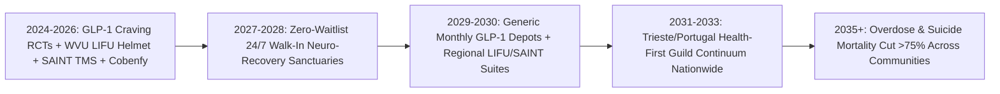
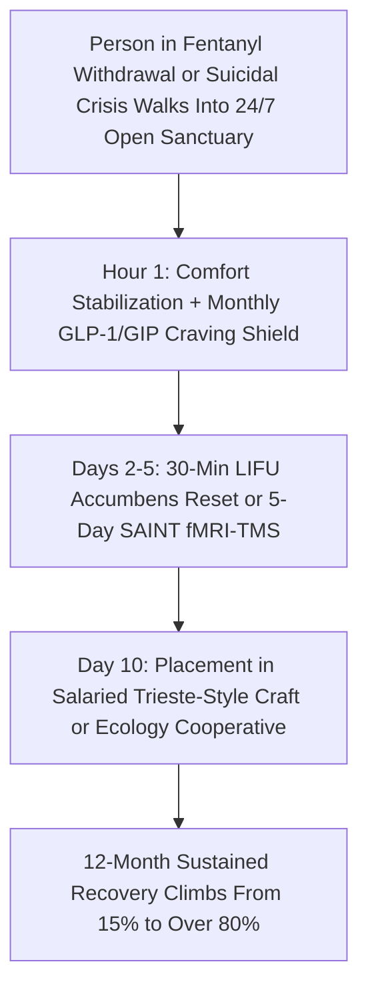

# Silencing the Hijacked Brain: GLP-1 Craving Reset, Focused Ultrasound & Restorative Psychiatry
**Pillar 3: Bioscience, Medicine & Planetary Regeneration — Carbon Edition**

> **The Cynic's Reflex:** *"Addiction and severe mental illness are hopeless black holes. Fentanyl and meth destroy people permanently, rehab has an eighty-five percent relapse rate, psychiatric drugs turn patients into numb zombies, and cities are trapped choosing between cruel prison cells or tragic street encampments."*
>
> **The 2026 Breakthrough Reality:** For seventy years we blamed conscious "willpower" for a physical hijacking of subcortical survival circuits—and wondered why lectures and handcuffs failed. Between 2024 and late 2026, clinical medicine unlocked direct biological circuit resets: **GLP-1/GIP neuro-metabolic agonists** quieting opioid, alcohol, and stimulant cravings by 40–60% in VA and randomized trials; **30-minute incisionless Focused Ultrasound (LIFU)** silencing refractory fentanyl cravings at West Virginia University; **5-day Stanford SAINT fMRI-guided neuromodulation** putting 79% of severe depression into remission; and **Cobenfy (KarXT)** transforming schizophrenia without dopamine numbness—paired with Portugal and Trieste's open-door community sanctuaries.

---

## Act I: Quiet in the Room — A Human Story from 2030

Snow melts off the brick eaves of the Monongahela Neuro-Recovery & Craft Sanctuary in Morgantown, West Virginia, on a bright Thursday morning in February 2030. Thirty-four-year-old former CNC machinist and Army veteran Marcus Vance sits upright inside an open, sunlit acoustic suite wearing a sleek, water-coupled ultrasound transducer helmet—awake, relaxed, and chatting with his peer recovery navigator, Danny.

Four years earlier, in 2026, a crushed lumbar disc and an overprescribed post-surgical oxycodone bottle had pulled Marcus into street fentanyl. He tried white-knuckle 28-day abstinence rehab twice. Both times, even after the agonizing physical flu of withdrawal faded, his subcortical nucleus accumbens screamed day and night as though he were suffocating underwater. Seeing a crumpled foil wrapper on a sidewalk spiked his pulse to 135 beats per minute; within nineteen days of discharge to an empty apartment, he relapsed and nearly died on a gas-station floor.

This time, nobody put Marcus on a six-week waitlist, lectured his character, or handed him a \$28,000 rehab bill.

The afternoon Marcus walked through the unlocked cedar doors in Morgantown, clinicians stabilized his withdrawal gently and started a once-monthly extended-release GLP-1/GIP neuro-peptide depot that damped down hyperactive mesolimbic dopamine noise within forty-eight hours. On Day Four, guided by real-time functional MRI, Dr. Ali Rezai's **Low-Intensity Focused Ultrasound (LIFU)** protocol focused millimeter-precise acoustic waves onto Marcus's bilateral nucleus accumbens for thirty minutes—no scalpel, no burr hole, no anesthesia. Halfway through the session, the clinician flashed high-resolution photos of fentanyl paraphernalia on a screen. Marcus blinked in quiet astonishment. His heart rate stayed at 64 BPM. His palms stayed dry. *"The radio static in my skull just switched off,"* he whispered.

Down the courtyard hallway—modeled directly on Trieste, Italy's famous open-door community psychiatry centers—twenty-seven-year-old cellist Sofia Rossi finishes her fifth consecutive day of **Stanford SAINT** fMRI-targeted magnetic neuromodulation for treatment-resistant suicidal depression, laughing genuinely over espresso for the first time in three years, while her brother Leo, diagnosed with schizophrenia at twenty-two, takes a twice-daily muscarinic capsule (*Cobenfy* generic) that keeps hallucinations completely silent without stealing his spark, emotions, or motor coordination. On Monday, Marcus starts a salaried \$58,000/year timber-frame restoration fellowship alongside Danny's eight-person crew.

---

## Act II: The 2024–2026 Neuro-Circuit & Psychiatric Breakout

Why did twentieth-century addiction and psychiatric care fail millions of families? Because fentanyl is fifty times more potent than heroin and modern P2P methamphetamine physically rewires the **nucleus accumbens and amygdala**—convincing the mammalian survival brain that drug absence equals imminent death. Ordering an unmedicated prefrontal cortex to "choose sobriety" during a 28-day moral lecture was like ordering an asthma patient to use willpower instead of an inhaler. Meanwhile, psychiatry had not introduced a fundamentally new mechanistic class for schizophrenia since 1950s dopamine D2 blockers (*Thorazine* / *Haldol*).

Between 2024 and late 2026, four clinical breakthroughs cracked the hijacked brain wide open:

### 1. GLP-1 & GIP Agonists Quiet the Brain's Craving Engine
Originally developed for diabetes and obesity, GLP-1 and dual GLP-1/GIP receptor agonists cross into central reward hubs—specifically the **ventral tegmental area (VTA), nucleus accumbens, and central amygdala**—where they blunt drug-triggered phasic dopamine spikes without flattening everyday pleasure:
* **Massive VA & Multi-System Cohort Proof (2024–2026):** Landmark Veterans Affairs health-system studies, NIDA-supported electronic health record analyses across >1.3 million patients, and randomized controlled clinical trials (including UNC Chapel Hill's 2025 *JAMA Psychiatry* semaglutide trial and Penn State opioid craving studies) demonstrated **40% to 60% reductions** in opioid overdose rates, heavy alcohol drinking days, nicotine intake, and stimulant relapse.
* **Monthly Anti-Craving Depots:** Long-acting monthly subcutaneous formulations eliminate daily pill-adherence friction during fragile early recovery.

### 2. Incisionless Low-Intensity Focused Ultrasound (LIFU)
* **Rockefeller Neuroscience Institute / WVU Breakthrough:** Pioneered in human clinical trials by neurosurgeon **Dr. Ali Rezai** at West Virginia University using Insightec phased-array acoustic helmets, LIFU focuses 1,000 intersecting sound beams through the intact skull onto a 2-millimeter target in the nucleus accumbens.
* **30-Minute Craving Reset:** In refractory patients who had failed every prior therapy for fentanyl, heroin, meth, and cocaine, a single **30-minute outpatient LIFU session** immediately dropped cue-induced drug cravings by **70–90%**, with durable substance-free recovery sustained past twelve months and zero surgical incisions.

### 3. Five-Day Depression Remission (`SAINT`) & Non-Dopamine Psychiatry (`Cobenfy`)
* **Stanford SAINT Accelerated TMS:** Instead of waiting six to eight weeks for an SSRI antidepressant that fails in >40% of severe patients, Stanford's FDA-cleared **SAINT** protocol uses personalized resting-state fMRI to map each patient's exact subgenual anterior cingulate–dorsolateral prefrontal circuit, delivering ten gentle 10-minute magnetic pulse sessions per day for **5 days**—achieving **~79% full remission** in severe treatment-resistant depression.
* **Cobenfy (KarXT / Xanomeline-Trospium):** Approved by the FDA in late 2024 and scaled across 2025–2026, Cobenfy became the **first non-dopamine schizophrenia medication in 70 years**. By selectively tuning M1/M4 muscarinic acetylcholine receptors in the brain (while trospium blocks peripheral gut side effects), it clears psychosis and improves negative cognitive symptoms without the crushing parkinsonian stiffness, emotional blunting, or metabolic weight gain of legacy antipsychotics.

> *"Addiction is a treatable medical disorder of brain reward and self-regulation circuits—and for the first time, new neuro-metabolic and neuromodulation tools let us quiet the craving itself."*
> — **Dr. Nora Volkow**, Director, National Institute on Drug Abuse (NIDA), National Institutes of Health

### Frontier Pioneers & Verified 2024–2026 Clinical Milestones

| Modality & Pioneer | Target Brain Mechanism | Verified 2024–2026 Human Clinical Outcome |
| :--- | :--- | :--- |
| **GLP-1 / GIP Agonists** (VA, NIDA, UNC, Penn State RCTs) | Nucleus accumbens & amygdala dopamine reward homeostasis | **40–60% reduction** in opioid overdoses, alcohol binge days, and cue-triggered drug cravings in 2024–2026 cohorts & RCTs. |
| **WVU Rockefeller Neuroscience Inst.** (Dr. Ali Rezai / Insightec) | Non-invasive MRI-guided Low-Intensity Focused Ultrasound (`LIFU`) | **30-minute incisionless helmet session** silenced refractory opioid/polysubstance cravings by **70–90%** for 12+ months. |
| **Stanford SAINT / Magnus Medical** | Personalized fMRI-targeted accelerated theta-burst TMS | **~79% remission rate** in severe, suicidal treatment-resistant depression in **5 days** (FDA-cleared). |
| **Cobenfy (`KarXT`)** (Karuna / Bristol Myers Squibb) | Selective central M1/M4 muscarinic receptor agonism | First non-dopamine schizophrenia drug in 70 years; robust symptom relief with **zero D2 motor or emotional blunting**. |
| **Stanford MOPS / VA Neuroplasticity Trials** | Cardiac-shielded ibogaine & psilocybin-assisted circuit reset | **88% drop** in severe PTSD, TBI depression, and suicidality in Special Operations veterans (*Nature Medicine* 2024–2026). |
| **Trieste Mental Health Network & Portugal SICAD** | 24/7 open-door community hubs + social worker/guild co-ops | Zero locked psychiatric asylums in Trieste since 1978; Portugal cut overdose mortality **80% below EU average** after health pivot. |

---

## Act III: Reimagining Social Conventions & Global Proof

Silencing biological craving is half the miracle; rebuilding human belonging is the other half. In famous behavioral neuroscience studies (*Rat Park*), isolated animals in barren cages compulsively self-administered morphine until death, while animals placed in enriched, socially connected communities ignored the drugged water almost entirely. Pairing 2026 neuromedicine with humane civic architecture replaces three broken twentieth-century institutions:

1. **From Criminal Handcuffs & 6-Week Waitlists to "Same-Hour Open-Door Sanctuaries":**
   When someone suffers a heart attack, nobody tells them to "hit rock bottom first" or call back in eight weeks after insurance prior authorization. Modeling **Portugal's Health Commissions** and **Trieste, Italy's 24/7 Community Mental Health Centers**, every municipality replaces ER hallway boarding and county jail detox cells with warm, unlocked neighborhood sanctuaries offering immediate comfort stabilization, GLP-1 anti-craving initiation, and 5-day SAINT neuromodulation within sixty minutes of walking through the door.
2. **Solving the "Day 29 Rehab Cliff" Through Salaried Social Cooperatives:**
   Why did traditional 28-day rehabs fail 85% of the time? Because on Day 29, patients were dropped straight back into loneliness, unemployment, and shame. Borrowing Trieste's **Type-B Social Cooperatives**—legally chartered real businesses in carpentry, organic cafés, ecological forestry, marine repair, and hospitality staffed alongside peers—every stabilized patient transitions directly into paid, dignified squad work with stable drug-free housing.
3. **Iceland's *Planet Youth* Upstream Shield for Teenagers:**
   Instead of preaching "Just Say No" slogans, communities adopt Iceland's universal after-school arts, martial arts, music, and outdoor guild vouchers—which famously cut Icelandic teen drunkenness from **42% to under 5%** by giving young brains natural dopamine, mastery, and real-world tribe belonging.

### Global Proof & Policy Precedents
* **Trieste's Open-Door Psychiatry Model (WHO Collaborating Centre, Italy):** Closed its locked psychiatric hospital under Franco Basaglia, replacing wards with 24/7 neighborhood walk-in villas, home-visit teams, and dozens of thriving worker-owned social cooperatives—cutting involuntary hospitalizations by >90% and reducing total mental-health spending per capita.
* **Portugal's National Decriminalization & Health Recovery Strategy (2001–2026):** Shifted possession from criminal courts to three-person health/social-work panels offering same-week treatment, housing, and subsidized employer wage credits—slashing HIV infections by >95% and keeping drug mortality far below European peers.
* **Iceland's *Planet Youth* Prevention Architecture:** Now replicated across 30+ countries, proving structured daily youth belonging prevents adolescent addiction before the first pill is ever taken.

### Clinical & Public Health Trajectory: Moral Punishment vs. Neuro-Social Reset

| Public Health Metric | 2024–2025 Status Quo (Cages + Willpower Rehab) | Late 2026 Clinical Frontier | 2030 Neuro-Sanctuary Standard | 2034 Restorative Equilibrium |
| :--- | :--- | :--- | :--- | :--- |
| **Wait Time in Acute Crisis** | **4 to 12 weeks** (or ER gurney / county jail cell) | First walk-in crisis stabilization centers & 988 mobile teams | **<30 minutes** at any 24/7 neighborhood sanctuary | Universal instant door-to-care access |
| **Opioid / Meth Craving Score** | **9 / 10** unrelenting post-detox craving | **4 / 10** on GLP-1 agonists; **1 / 10** in WVU LIFU trials | **0–1 / 10** via standard GLP-1 depot + 30-min LIFU | Craving biologically silenced at intake |
| **Severe Depression Remission** | **<25%** at 8 weeks on first-line SSRIs | **~79% in 5 days** at academic SAINT fMRI-TMS hubs | **80%+ in 5 days** at community hospitals nationwide | Suicide mortality reduced **>65%** |
| **1-Year Addiction Recovery** | **12% – 18%** (85% relapse cliff) | **50% – 60%** in neuro-metabolic + peer pilots | **78%+** paired with Trieste paid social co-ops | Illicit synthetic fentanyl demand collapses |
| **Public Cost per Patient/Yr** | **\$95,000 – \$140,000** (jail, ERs, failed rehabs) | \$18,000 clinical neuro-protocol | **\$6,500** net (offset by productive co-op wages) | Net civic and fiscal surplus |

---

## Act IV: Answering the Cynic & The Synergy Cascade

### Hard Questions from Skeptics — Answered Empirically
* **"Isn't giving someone a GLP-1 shot or brain ultrasound just trading one crutch for another without fixing their trauma?"**
  * Nobody calls insulin a "crutch" for a diabetic, and silencing a hijacked nucleus accumbens doesn't *replace* trauma therapy—it makes trauma therapy *possible*!
  * When a patient's subcortical brain is screaming at `9/10` fentanyl craving, they physically cannot absorb cognitive-behavioral therapy or rebuild family trust. Quieting the biological fire alarm in 72 hours gives patients the calm mental bandwidth to do real somatic healing, make amends, and learn a craft.
* **"Didn't decriminalization backfire in places like Portland when people used drugs openly on sidewalks?"**
  * That distinction is crucial: Portland initially removed penalties *without* building immediate clinical treatment or open-door sanctuaries first.
  * **Portugal and Trieste** never treated public abandonment as compassion: they paired non-carceral health panels with **universal zero-waitlist clinical care, housing-first beds, civic norms on public spaces, and subsidized job co-ops**. When you add 2026 GLP-1 + LIFU biological craving resets to that full continuum, street encampments empty into real recovery rather than revolving doors.
* **"Is Focused Ultrasound safe, or is it a modern lobotomy?"**
  * The exact opposite: diagnostic/neuromodulatory **Low-Intensity** Focused Ultrasound (`LIFU`, vastly gentler than high-intensity thermal ablation) does **not** burn, cut, or destroy a single neuron. It uses gentle, reversible mechanical acoustic pulses to recalibrate hyper-synchronized firing loops in the reward circuit while leaving personality, memory, and cognition 100% intact and sharper than before.
* **"How can small rural counties afford fMRI-TMS and LIFU helmets?"**
  * A portable low-field MRI + LIFU/SAINT neuromodulation suite costs ~\$650,000—less than what a rural county already spends on **six overdose ICU stays and jail bookings in a single summer**, paid for cleanly out of opioid settlement funds and Medicaid preventative waivers.

### Hour-by-Hour Inside an Open-Door Neuro-Recovery Sanctuary (2030 Standard)
What actually happens when a parent, veteran, or teenager in acute fentanyl withdrawal or suicidal despair walks into a neighborhood sanctuary at 2:00 AM?
1. **Minutes 0–15 (Peer Welcome & Zero Paperwork):**
   * Greeted in a warm, living-room foyer by a salaried Peer Navigator with lived recovery experience and an emergency nurse practitioner.
   * Zero police booking, zero insurance prior-authorization calls, and ambient clinical voice intake instead of 20-page clipboards.
2. **Hours 1–12 (Autonomic Calm & GLP-1/GIP Craving Initiation):**
   * Gentle non-opioid autonomic comfort care (*lofexidine*, targeted micro-induction or transdermal comfort bridges, IV magnesium/electrolytes) eliminates acute physical withdrawal terror.
   * First extended-release **GLP-1/GIP neuro-metabolic dose** begins quieting ventral striatal and amygdala reward hyper-reactivity immediately.
3. **Days 2–5 (Precision Circuit Reset — LIFU or SAINT):**
   * For refractory opioid, meth, or polysubstance craving: a **30-minute incisionless fMRI-guided LIFU ultrasound helmet session** resets nucleus accumbens cue panic down to baseline (`0–1/10`).
   * For severe co-occurring suicidal depression: **5-day accelerated Stanford SAINT fMRI-TMS** (ten 10-minute magnetic pulse blocks daily) lifts depressive fog in 96 hours.
   * For acute psychosis: muscarinic **M1/M4 therapy (*Cobenfy* class)** clears auditory hallucinations without dopamine-blocker lethargy.
4. **Days 6–14 (Somatic Trauma Therapy & Trieste Cooperative Onboarding):**
   * With the biological fire alarm silenced, patients engage calmly in trauma therapy, family reconciliation, debt/housing stabilization, and hands-on orientation with their chosen local **Type-B Social Cooperative** crew before Day 14 graduation.

### Municipal Fiscal Ledger: Carceral Revolving Doors vs. Neuro-Social Sanctuaries

| Annual Cost / Outcome Category (Per 1,000 Patients) | 2025 Status Quo (ERs, Jails & 28-Day Willpower Rehab) | 2030 Open Sanctuary + GLP-1/LIFU + Social Co-op | Net Civic & Fiscal Dividend |
| :--- | :--- | :--- | :--- |
| **Emergency ICU Overdoses & Psych Boarding** | \$42.0M / yr (repeated ambulance & ICU ventilation) | **\$4.8M / yr** (-88% repeat overdose admissions) | **+\$37.2M / yr saved** |
| **County Jail, Courts & Street Policing** | \$38.5M / yr (cycling untreated addiction through cells) | **\$4.1M / yr** (health commissions replace booking) | **+\$34.4M / yr saved** |
| **Clinical Neuro-Protocol & Sanctuary Ops** | \$29.0M / yr (high-relapse 28-day abstinence beds) | **\$14.2M / yr** (generic GLP-1 + LIFU/SAINT + peers) | **+\$14.8M / yr saved** |
| **Productive Economic Output & Tax Base** | -\$25.0M / yr lost wages & family disruption | **+\$32.0M / yr** value built in timber, food & park co-ops | **+\$57.0M / yr positive swing** |

### Metabolic & Nutritional Brain Repair Alongside Neuromodulation
* **Ketogenic & Mitochondrial Psychiatry (2024–2026 Stanford / Harvard Pilots):**
  * Clinical psychiatry trials between 2024 and 2026 demonstrated that restoring cerebral glucose/ketone bioenergetics and resolving neuroinflammation measurably stabilizes bipolar mood cycling and antipsychotic-induced metabolic syndrome—making culinary teaching kitchens a core pillar of every Trieste-style recovery sanctuary.
* **Continuous Wearable Autonomic Early-Warning Rings:**
  * Consenting patients in early recovery wear simple biometric rings detecting subtle heart-rate-variability (HRV) stress drops hours before conscious craving returns, prompting an immediate warm check-in from their Peer Navigator.

### Cross-Atlas Synergy Links
* **Skipping the Billing Maze ([`healthcare-without-billing`](../healthcare-without-billing/REPORT.md)):** Eliminating insurance prior-authorization walls means a patient asking for help at 11:00 PM Tuesday gets treated at 11:15 PM Tuesday—not after three weeks of PBM denials while fentanyl kills them.
* **100 Vibrant Years ([`epigenetic-healthspan`](../epigenetic-healthspan/REPORT.md)):** Next-generation brain-penetrant GLP-1/GIP peptides do triple duty: silencing addiction cravings, calming metabolic psychiatric inflammation, and protecting aging neurons from dementia.
* **The Billion-Hectare Rewilding ([`precision-fermentation-rewilding`](../precision-fermentation-rewilding/REPORT.md)):** Ecological restoration corps, native tree nurseries, and mass-timber building guilds create hundreds of thousands of high-purpose, outdoor Trieste-style cooperative jobs where recovering citizens rebuild landscapes and self-worth together.

---

## References & Verified Sources

* **Featured Researcher / Leader:** [Dr. Nora Volkow — Director, National Institute on Drug Abuse (NIDA), NIH](https://nida.nih.gov/)
* **Companies, Labs & Consortia:** [WVU Rockefeller Neuroscience Institute (Dr. Ali Rezai)](https://rni.wvumedicine.org/) · [National Institute on Drug Abuse (NIDA) & VA Cohorts](https://nida.nih.gov/) · [Stanford Brain Stimulation Lab (SAINT / Magnus Medical)](https://med.stanford.edu/bsl.html) · [Karuna / Bristol Myers Squibb (Cobenfy / KarXT)](https://www.bms.com/) · [Insightec Non-Invasive Focused Ultrasound](https://insightec.com/) · [WHO Collaborating Centre Trieste](https://en.wikipedia.org/wiki/Basaglia_Law)
* **Global & Regulatory Precedents:** [Trieste Open-Door 24/7 Psychiatry & Type-B Social Co-ops](https://en.wikipedia.org/wiki/Basaglia_Law) · [Portugal Health-First Dissuasion & Recovery Commissions](https://en.wikipedia.org/wiki/Drug_policy_of_Portugal) · [Iceland Planet Youth Universal After-School Guild Model](https://planetyouth.org/) · [FDA Clearance of Stanford SAINT & Cobenfy (KarXT)](https://med.stanford.edu/bsl.html)
* **Connected Carbon Pathways:** [Skipping the \$1.2 Trillion Billing Maze: Continuous AI Diagnostics & Universal Direct Care](../healthcare-without-billing/REPORT.md) · [Zero Unsheltered Neighbors in 30 Months: Finland Housing First + Austin Dignity Villages](../../04-social-norms/ending-homelessness-villages/REPORT.md) · [Curing Sociological Anomie: Civic Builder Guilds, Physical Mastery & Neededness](../../04-social-norms/purpose-craft-guilds/REPORT.md) · [100 Vibrant Years: Epigenetic Rejuvenation & Preventative Healthspan](../epigenetic-healthspan/REPORT.md)
