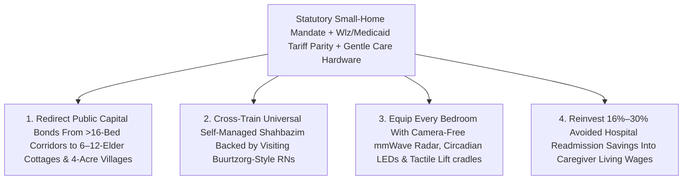

# CARBON EDITION — PILLAR 3: ENDING WAREHOUSE NURSING HOMES
## How Dutch "Hogeweyk" Dementia Villages, U.S. Green House Cottages & Gentle Care Robotics Retire Institutional Corridors on Standard Public Budgets

> **Executive Framing & Reimagining Elderhood Beyond the Locked Corridor:**
> * **The Cynic's Belief:** *"Growing old with Alzheimer's disease or severe frailty inevitably means spending your final years under humming fluorescent tubes along a 120-bed hospital-style corridor—locked behind 4-digit keypad doors, woken at 5:30 AM for assembly-line pill carts, and sedated with chemical antipsychotics because normal, dignified small-home living is a boutique luxury only billionaires could ever afford."*
> * **The Empirical Counter-Reality:** That fatalism has already been falsified on two continents using ordinary public long-term care budgets. In **Weesp, Netherlands**, **De Hogeweyk ("The Dementia Village")** opened in **2009** inside the **exact same Dutch statutory *Wet langdurige zorg (Wlz)* daily nursing-home tariff** as conventional institutional wards—replacing locked hospital halls with a safe, walkable **4-acre neighborhood** of tree-lined brick squares, a real supermarket, bakery, café, theater, gardens, and **27 normal 6-to-7-person households** where caregivers in street clothes cook fresh dinner beside residents, slashing antipsychotic sedation and wandering panic. In **Dax, France**, the publicly funded **Village Landais Alzheimer** replicated this civic *bastide* neighborhood under longitudinal **INSERM** clinical evaluation. Meanwhile across the United States, geriatrician **Dr. Bill Thomas's Green House Project** has scaled to **~400 small 10-to-12-elder hearth cottages across 30+ states** (**~45% Medicaid participation**)—independently verified by ***Health Services Research***, **Brown University**, **UNC**, and ***JAMDA*** to deliver **~16%–30% fewer hospital readmissions**, fewer pressure ulcers and late-loss ADL declines, **more direct daily care hours at comparable Medicaid/Medicare cost**, and **~4×–5× lower COVID-19 infection and mortality rates** than warehouse nursing homes!
> * **The Social Norm Shift:** Health systems stop permitting 100-bed institutional nursing wings and redirect existing public Medicaid/*Wlz* capital into **6-to-12-elder hearth cottages and walkable dementia neighborhoods**—pairing self-managed universal caregivers (*shahbazim*) with **gentle tactile transfer/lift-assist robotics**, **camera-free millimeter-wave radar fall/gait sensors**, and **circadian tunable daylight LEDs** to retire warehouse nursing homes forever.
> * **Anchor Voice:** *"The tragedy of the traditional nursing home is not simply medical complication—it is the institutional plagues of loneliness, helplessness, and boredom. When elders live around a real hearth in a real home, human dignity heals what hospital corridors broke."* — **Dr. Bill Thomas**, Geriatrician & Founder of *The Green House Project*, alongside **Yvonne van Amerongen**, Co-Founder of *De Hogeweyk*

---

## ACT I: THE LIVED HUMAN REALITY — TUESDAY MORNING IN WEESP & TUPELO (2028)
### What Happens When an Elder Wakes to Smell Fresh Bread Instead of a 5:30 AM Steel Pill Cart

It is 8:45 AM on a crisp Tuesday morning in **Weesp**, just southeast of Amsterdam—and simultaneously 8:45 AM inside a red-brick **Green House** cottage tucked beneath magnolia trees in **Tupelo, Mississippi**. Seventy-nine-year-old retired choir teacher **Willem Bakker**, living with stage-six Alzheimer's disease, steps out of his ground-floor bedroom at his own natural waking rhythm—never startled awake at 5:30 AM by overhead fluorescent glare or a rattling stainless-steel medication cart.

Had Willem entered a conventional 120-bed institutional nursing wing—the mid-20th-century "warehouse" blueprint built as a miniature acute-care hospital—his Tuesday would have followed a heartbreaking script familiar to millions of families. Disoriented by three identical linoleum corridors, booming overhead intercom buzzers, and a disguised steel fire exit locked with a keypad he could never solve, Willem would have tugged frantically at the exit handle every afternoon at 4:00 PM trying to "get home to choir practice." Charted by exhausted aides as an "agitated exit-seeking wanderer," he would likely have been prescribed sedating haloperidol or risperidone—accelerating cognitive decline, doubling his hip-fracture risk, and leaving his daughter staring across a plastic tray table in quiet grief despite taxpayers spending **\$110,000+ per year** for that misery.

Step inside **De Hogeweyk** in Weesp—and sister cottages in **Dax, France** and **Tupelo, Mississippi**—and watch how changing the physical and social architecture transforms the exact same neurodegenerative condition:

1. **A Real Front Door Opening Onto a Safe 4-Acre Neighborhood:**
   Willem shares a warm, Dutch-style 7-person house (*woning*) furnished with familiar bookshelves, an upright piano, and an open kitchen where caregiver **Sanne**—wearing a knitted cardigan rather than hospital scrubs—brews morning coffee. Because De Hogeweyk's entire **4-acre perimeter** forms one secure, step-free Dutch village with **zero internal locked corridor doors**, Willem puts on his wool coat after breakfast and strolls freely beneath rustling birch trees past a splashing courtyard fountain to the village supermarket. Using no confusing cash register, he picks out Boskoop apples and cinnamon for tonight's apple crumble, chats with the baker who knows his love of Bach motets, and walks calmly to the 11:00 AM neighborhood choir club—turning "wandering pathology" back into a joyful morning walk!
2. **Circadian Daylight & Camera-Free Bedroom Dignity:**
   Inside both Willem's Weesp home and **Clara Robinson's** 10-elder Medicaid Green House cottage in Tupelo, recessed **circadian tunable LED skylights** track the natural solar spectrum—delivering crisp, melanopsin-stimulating **480 nm sky-blue morning light** over breakfast to anchor daytime alertness, then shifting smoothly after 5:00 PM into warm, zero-blue **2,200 K amber hearth light** that cuts "sundowning" agitation and night-waking nearly in half. Mounted invisibly in each elder's private bedroom ceiling—with **zero lenses, zero microphones, and 100% bathroom and bedroom visual privacy**—a **60-GHz millimeter-wave radar sensor** tracks micro-Doppler respiratory rhythm and nocturnal bed-exit posture, whispering a gentle vibration to Clara's wrist band ten seconds *before* an unsteady 88-year-old tries to cross a dark floor alone.
3. **Gentle Tactile Lift Robotics Ending Caregiver Back Injuries Forever:**
   In Tupelo, 62-year-old certified *shahbaz* **Clara Robinson** has worked joyfully in the same 10-elder cottage for eleven years because she never suffers the lumbar disc injuries that drive **35%–55% annual staff turnover** in warehouse nursing homes. When retired seamstress **Maeve Washington** needs help transferring from bed to shower chair after a stroke, Clara rolls in a whisper-quiet, **soft-tactile robotic transfer cradle** wrapped in warm, washable quilted silicone elastomer with distributed pressure-sensing skin. Guided by two fingers on a force-feedback handle, the soft robotic arms support Maeve's torso in a dignified, hug-like standing pivot while Clara keeps gentle eye contact and conversation—reducing spinal compression on Clara's lower back by **>80%** before the two head out to smell garlic and cornbread simmering around the cottage's central oak hearth table.

---

## ACT II: REIMAGINING THE RULES — DE HOGEWEYK, GREEN HOUSE COTTAGES & GENTLE CARE TECH
### Why Small Homes & Walkable Dementia Villages Outperform 120-Bed Warehouses at the Exact Same Public Cost

### 1. Shattering the "Billionaire Resort" Myth: De Hogeweyk & France's Village Landais
Whenever visitors see photos of **De Hogeweyk** in Weesp—its sunny brick boulevard, café terrace, pub, hair salon, theater, and 25+ interest clubs—journalists reflexively assume it must cost **\$20,000 a month** out of pocket. That assumption is completely false. Conceived in 1992 by nursing-home leadership team **Yvonne van Amerongen**, **Janette Spiering**, and colleagues after asking *"Would we ever want our own parents to die down that hospital hallway?"*, De Hogeweyk opened its rebuilt **4-acre (1.5-hectare) village** in December **2009** for **~152 to 188 residents with severe dementia**—all holding standard Dutch public long-term care (*Wlz*) eligibility:
* **100% Standard Public Operating Tariff:** Every resident at De Hogeweyk is funded under the **exact same government-set Dutch *Wlz* daily care tariff** (plus standard statutory income-adjusted co-pay) as a conventional Dutch institutional nursing ward! How? By stripping out multi-story hospital hallways, centralized industrial tray-food factories, departmental middle-management silos, and reactive emergency crisis staffing—redeploying those exact euros into **27 normal 6-to-7-person households**, fresh groceries cooked daily in each home's kitchen, and ~250 staff and local volunteers woven seamlessly into everyday village life.
* **Radical De-Medicalization Without Losing Clinical Rigor:** Physicians, geriatric nurses, and physical therapists are fully present on-site—they simply make "house calls" through a real front door rather than turning the resident's living room into a hospital ward. Residents walk thousands more steps per week outdoors, eat heartily because they smell onions caramelizing five feet away, require dramatically fewer psychotropic sedatives, and maintain purposeful autonomy until the very end of life.
* **Public Replication in France (*Village Landais Alzheimer*):** Opened in **June 2020** in **Dax** (Nouvelle-Aquitaine) by the *Département des Landes* with **~80%+ public financing**, **Village Landais Henri Emmanuelli** houses **120 residents** across four traditional Southwest French *bastide* quarters nestled in a **5-hectare pine park** with a library, grocery store, restaurant, mini-farm, and auditorium open to Dax townspeople—backed by a multi-year **INSERM** clinical research observatory confirming sustained drops in caregiver distress, neuropsychiatric agitation, and sedative reliance.

### 2. The U.S. Actuarial Proof: 400 Green House Cottages & *JAMDA* / *HSR* Outcomes
Across the Atlantic, Harvard-trained geriatrician **Dr. Bill Thomas**—after founding the Eden Alternative—launched the first **Green House** cottages in **Tupelo, Mississippi** in **2003** to prove that even inside America's notoriously rigid **Medicaid and Medicare** reimbursement rules, warehouse nursing homes could be replaced wholesale. Today, **~400 Green House homes operate across 30+ U.S. states** (with **~45% of residents funded by Medicaid**), built around three non-negotiable structural flips:
1. **10 to 12 Elders, Private Bedrooms & One Shared Hearth:** Every elder has a spacious private bedroom and private full bathroom opening directly onto a sunlit living room, open kitchen, and one shared family dining table (*convivium*)—zero long corridors, zero nurses' stations, zero intercoms, and immediate access to a walled garden.
2. **The *Shahbaz* Self-Managed Care Team:** Mirroring **[`buurtzorg-autonomous-neighborhood-care`](../buurtzorg-autonomous-neighborhood-care/REPORT.md)**, Green House cottages abolish rigid institutional hierarchies in favor of certified universal caregivers called ***shahbazim*** who work in self-managed cottage teams—cooking fresh meals from scratch, managing household rhythms, doing personal care, and collaborating as respected peers with visiting RNs, therapists, and medical directors.
3. **Hard Peer-Reviewed Clinical & Financial Superiority:**
   * **Hospital Readmissions & Clinical Quality (*Health Services Research*, Afendulis et al., [PMC4886352](https://pmc.ncbi.nlm.nih.gov/articles/PMC4886352/)):** Rigorous difference-in-differences Medicare claims evaluations by **University of Michigan, Brown University, and UNC** researchers proved Green House adoption reduced **30-day hospital readmissions by ~16%–30%**, cut **bedfast, catheterized, and high-stage pressure-ulcer rates**, reduced late-loss functional decline, and delivered **~20%–25% more direct front-line caregiver time per resident day** without raising total Medicare/Medicaid system outlays (because avoided **\$15,000+ hospital readmissions** and lower staff-turnover agency fees offset small-home staffing!).
   * **Pandemic Life-and-Death Proof (*JAMDA*, Zimmerman et al., 2021):** When COVID-19 swept through 120-bed institutional nursing homes—where rotating staff walked past 60 shared rooms per shift—peer-reviewed surveillance in the ***Journal of the American Medical Directors Association ([JAMDA](https://jamda.com/))*** found Green House small homes achieved **~4× to 5× lower COVID-19 infection rates and ~4× to 5× lower COVID-19 mortality rates** than comparable traditional nursing homes! Small, self-contained 10-person households with private bathrooms and dedicated staff acted as natural biological firebreaks without locking elders in solitary confinement.

### 3. How Abundant Energy & Gentle Robotics Make Small-Home Care Unstoppable
Why did some mid-century administrators claim 120-bed wings were "necessary for nighttime staffing and heavy lifting"? Because before 2025, one night caregiver in a 10-person cottage lacked safe solo-lifting mechanics and non-intrusive room awareness. Three humane hardware breakthroughs—deployed strictly to serve human dignity, *never* to replace human caregivers with plastic companions—close that final operational gap:
* **Soft-Tactile Transfer & Stand-Assist Robotics:** Back and shoulder injuries from manual two-person Hoyer sling lifts make nursing-home aides suffer higher musculoskeletal injury rates than construction workers and loggers. New **compliant, soft-skin tactile transfer robots** (connected directly to **[`general-purpose-humanoids`](../../02-automation-science/general-purpose-humanoids/REPORT.md)** force-control actuators) let a single *shahbaz* safely assist a frail 210-lb elder from bed to chair or warm bath in 45 unhurried seconds with **zero spinal shear** and **zero indignity**—allowing lifelong caregivers in their 50s and 60s to thrive without injury.
* **Camera-Free 60-GHz Millimeter-Wave Privacy Radar:** Unlike creepy bedroom video cameras—which elders and families rightly reject—low-power solid-state **mmWave radar tiles** reconstruct anonymous 3D point-cloud posture, gait speed, nocturnal bathroom trips, and subtle heart/respiratory trends through blankets with **zero optical imagery**. Early changes in stride variability flag silent urinary tract infections or dehydration **72 hours before a fall**.
* **Circadian Tunable Solid-State Lighting & Acoustic Calm:** Powered by near-zero-marginal-cost clean electricity and heat pumps, high-CRI **circadian daylight luminaires** synchronize suprachiasmatic nucleus melatonin rhythms in elders with Alzheimer's—cutting nocturnal wandering and antipsychotic prescriptions while helping night staff stay gently alert.

| Care & Dignity Metric | 120-Bed Institutional Warehouse Wing (Legacy Status Quo) | De Hogeweyk Village / Green House Cottage + Gentle Tech (Carbon Standard) | Verified Empirical Shift |
| :--- | :--- | :--- | :--- |
| **Household Scale & Architecture** | **60–120 beds** along fluorescent corridors; shared rooms; nurses' station | **6–7 elders** (*Hogeweyk*) or **10–12 elders** (*Green House*); 100% private bedrooms & hearth | **Zero hospital corridors**; real home & safe 4-acre garden/village |
| **Daily Rhythm & Meals** | 5:30 AM wakeups; pre-plated institutional steam trays; locked exit doors | Natural sleep schedule; fresh scratch cooking in open kitchen; free outdoor strolling | Higher caloric intake, preserved mobility & **sharply lower sedatives** |
| **Hospital Readmissions & Ulcers** | High avoidable ER transfers, pressure ulcers & rapid ADL functional loss | Self-managed *shahbazim* + visiting RN spot subtle shifts at the dinner table | **-16% to -30% hospital readmissions** (*Health Services Research*) |
| **Infectious Outbreak Survival** | Shared rooms, central HVAC & 40+ cross-wing staff fuel lethal outbreaks | Self-contained 10-bed cottages, private baths & dedicated universal team | **~4×–5× lower COVID-19 case & death rates** (*JAMDA* verified) |
| **Caregiver Injury & Public Cost** | Severe lumbar injuries; **50%–90% annual aide turnover**; costly agency temps | Soft-tactile transfer robotics + **zero-camera mmWave radar** + same *Wlz*/Medicaid rate | **-75%+ lifting strain**, low turnover & **budget-neutral public cost** |

---

## ACT III: GLOBAL ADAPTATION & PHASED ROLLOUT ROADMAP (2026–2032)
### Retiring Every 100-Bed Nursing Warehouse Without Raising Statutory Per-Diem Budgets

How does a state Medicaid director, NHS Integrated Care Board, Japanese municipal *Kaigo Hoken* insurer, or provincial health ministry transition hundreds of aging 1970s concrete nursing homes into Green House cottages and Hogeweyk-style neighborhoods without breaking capital budgets? Two policy levers already proven in the field unlock rapid conversion: **Certificate-of-Need (CON) Small-Home Rebalancing** (prohibiting public capital bonds for any new >16-bed institutional corridor while granting fast-track zoning and enhanced value-based Medicaid capital add-ons—modeled on state Green House incentives in Arkansas, Ohio, and Washington—for 8-to-12-bed cottages) and **Adaptive Reuse of Surplus Retail, Parish & Office Parcels** into walkable 3-to-5-acre neighborhood care villages co-located with **[`intergenerational-villages`](../../04-social-norms/intergenerational-villages/REPORT.md)** preschools and cafés!

| Implementation Horizon | Regulatory & Medicaid / *Wlz* Financing Unlock | Architectural, Workforce & Gentle-Tech Deployment | Audited Clinical & Fiscal Outcome |
| :--- | :--- | :--- | :--- |
| **Phase 1 (Months 1–12): Small-Home Bond Shift & Corridor Retrofit Kits** | State Medicaid agencies & national long-term care funds pass **Small-Home Capital Parity Rules** (no public bonds for new >16-bed wings; value-based per-diem bonus tied to avoided ER readmissions). | Break existing large wings into sealed 10-person households with open kitchens; deploy **camera-free 60-GHz mmWave fall radar**, **circadian LEDs**, and **1 soft-tactile transfer robot per cottage**. | Caregiver lumbar injuries drop **>75%**; night falls & antipsychotic sedation drop **35%–50%** within two quarters. |
| **Phase 2 (Years 1–3): Vacant Mall / Schoolyard Dementia Village Conversions** | Municipal zoning grants by-right approval for **3-to-5-acre Hogeweyk / Village Landais neighborhoods** on dead strip-malls, church campuses, and surplus municipal parcels under standard public tariffs. | Open 15–25 normal 7-person homes per village around shared neighborhood bakeries, gardens & music clubs open to local neighbors and **[`intergenerational-villages`](../../04-social-norms/intergenerational-villages/REPORT.md)** playgroups. | Avoidable 30-day Medicare/public hospital readmissions drop **16%–30%**; *shahbaz* annual retention exceeds **85%**. |
| **Phase 3 (Years 3–6): Universal Retirement of Warehouse Nursing Wings** | National accreditation standards sunset multi-bed shared institutional wards and chemical-restraint waivers permanently across public payers. | Pair every cottage cluster with **[`buurtzorg-autonomous-neighborhood-care`](../buurtzorg-autonomous-neighborhood-care/REPORT.md)** home teams and **[`epigenetic-healthspan`](../epigenetic-healthspan/REPORT.md)** neuro-protective nutrition & mobility care. | **4×–5× lower respiratory outbreak mortality**; saves **\$12B–\$25B/yr** in avoided hospitalizations and temp-agency churn across OECD/US systems. |

---

## ACT IV: ANSWERING THE SKEPTIC & THE HUMANE HORIZON
### Honest Answers to Zoning Boards, Chief Financial Officers & Geriatric Safety Auditors

### Addressing the Top 3 Institutional Objections
1. **"Isn't De Hogeweyk a 'Truman Show' illusion that tricks people with dementia using fake storefronts?"**
   * *Empirical Answer:* De Hogeweyk's founders address this myth head-on: **nothing inside De Hogeweyk is a cardboard stage set**. The apples in the supermarket are real apples cooked for dinner that evening; the hair salon cuts real hair; the concert hall plays real Vivaldi; and caregivers **never lie or pretend to be someone's spouse**—they simply remove hostile hospital badges, locked corridor doors, and clinical jargon that confuse an injured hippocampus! France's **Village Landais** goes one step further by inviting surrounding Dax neighbors directly into the village square's café, media library, and theater every week so elders remain woven into authentic civic life.
2. **"How can six or ten elders per house possibly match the staffing economics of one nurse watching a 40-bed hallway?"**
   * *Empirical Answer:* In a 40-bed institutional wing, **35%–45% of operating spend leaks into non-care overhead**: industrial food-service kitchens, laundry transport, infection-control lockdowns, middle-management layers, mandatory overtime for **60%+ annual aide turnover**, and **\$18,000 emergency hospital transfers**. In a Green House or Hogeweyk cottage, universal *shahbazim* integrate cooking, light laundry, and personal care smoothly into daily household life while **gentle tactile lift robotics** and **zero-camera mmWave night sensors** let lean overnight staffing stay completely safe—delivering *more* direct human care hours per resident day within standard Dutch *Wlz* and U.S. Medicaid budgets ([PMC4886352](https://pmc.ncbi.nlm.nih.gov/articles/PMC4886352/)).
3. **"Doesn't adding robotics to elder care risk dystopian 'robotic babysitting' where lonely seniors only talk to machines?"**
   * *Empirical Answer:* Carbon draws an **ironclad ethical bright line**: **machines do the heavy biomechanical lifting and invisible ceiling fall-sensing; humans share the soup, the music, and the hand-holding**. Soft-tactile transfer cradles have no chatbot face pretending to love your grandmother—they exist purely so a warm, experienced 60-year-old human caregiver doesn't rupture a spinal disc while helping her into a warm bath!

### Fast-Track State Medicaid & Municipal Elder-Care Activation Checklist

| Sprint Reform Step | Proven Real-World Precedent | Months to Launch | Dignity & Fiscal Guardrail |
| :--- | :--- | :--- | :--- |
| **1. Sunset >16-Bed Public Capital Bonds** | State Green House Medicaid Capital Incentives | **3 Months** | Redirect 100% of new nursing-facility bond authority to 6–12-bed homes |
| **2. Charter *Shahbaz* Universal Care Role** | ~400 U.S. Green Houses & *De Hogeweyk* | **4 Months** | Self-managed cottage teams cook fresh meals; zero hospital scrubs |
| **3. Install Zero-Camera mmWave & Circadian Kits** | Privacy Radar + Tunable Daylight Retrofits | **2 Months** | Hard hardware ban on optical cameras/mics in resident bedrooms |
| **4. Deploy Soft-Tactile Transfer Cradles** | Compliant Lift-Assist Care Robotics | **3 Months** | Eliminates solo manual lifting; cuts workers'-comp back claims >75% |
| **5. Dead-Mall-to-Dementia-Village Zoning** | *De Hogeweyk* (Weesp) & *Village Landais* (Dax) | **9 Months** | Standard public *Wlz*/Medicaid tariff parity; open civic square |

### Why Both Fiscal Conservatives and Elder-Rights Advocates Champion This Shift
* **Why Families, Elders & Care Workers Love It:** Replaces locked hospital halls and chemical sedation with fresh home-cooked meals, private bathrooms, safe garden walks, zero bedroom cameras, and injury-free caregiving careers.
* **Why Medicaid Directors & Taxpayers Love It:** Operates on standard statutory public tariffs while slashing **30-day hospital readmissions 16%–30%**, cutting pandemic mortality **4×–5×**, and collapsing temp-agency turnover costs.

### Cross-Pillar Synergies & The Bottom Line
Linked with **[`buurtzorg-autonomous-neighborhood-care`](../buurtzorg-autonomous-neighborhood-care/REPORT.md)** (which keeps 80%+ of elders thriving in their own apartments first), **[`intergenerational-villages`](../../04-social-norms/intergenerational-villages/REPORT.md)**, **[`general-purpose-humanoids`](../../02-automation-science/general-purpose-humanoids/REPORT.md)** (supplying low-cost compliant tactile actuators for safe lift-assist cradles), and **[`epigenetic-healthspan`](../epigenetic-healthspan/REPORT.md)**, **Dementia Villages + Green House Cottages** prove that **growing frail or forgetful never required exiling our parents to fluorescent corridors**. *(See companion visual production guide: [`STORYBOARD.md`](./STORYBOARD.md).)*

---

## References & Verified Sources

* **Pioneering Dementia Villages (Public Statutory Budgets):** [De Hogeweyk — The Dementia Village, Weesp, Netherlands (Architecture, 27 Lifestyles & Standard Dutch *Wlz* Financing)](https://hogeweyk.dementiavillage.com/) · [Village Landais Alzheimer — Public Civic Dementia Village & INSERM Research Observatory, Dax, France](https://villagelandais.landes.fr/)
* **Small-Home U.S. Medicaid Model:** [The Green House Project — Dr. Bill Thomas's 10–12-Elder Hearth Cottage Network (~400 Homes Across 30+ States)](https://thegreenhouseproject.org/)
* **Peer-Reviewed Clinical, Readmission & Outbreak Evaluations:** [Afendulis et al., *Health Services Research* — "Green House Adoption and Nursing Home Quality & Medicare Hospital Readmissions" (PMC4886352)](https://pmc.ncbi.nlm.nih.gov/articles/PMC4886352/) · [Zimmerman et al., *Journal of the American Medical Directors Association (JAMDA)* — "Nontraditional Small House Nursing Homes Have Fewer COVID-19 Cases and Deaths"](https://jamda.com/)
* **Connected Carbon Pathways:** [15,000 Nurses, Zero Bosses: How Dutch "Buurtzorg" & Ambient AI Cut Care Costs 40%](../buurtzorg-autonomous-neighborhood-care/REPORT.md) · [Living Connected: Multi-Generational Courtyards & Co-Located Care](../../04-social-norms/intergenerational-villages/REPORT.md) · [Helpful Hands Everywhere: Dexterous General-Purpose Humanoids & Tactile Robotics](../../02-automation-science/general-purpose-humanoids/REPORT.md) · [100 Vibrant Years: Epigenetic Rejuvenation & Preventative Healthspan](../epigenetic-healthspan/REPORT.md)
