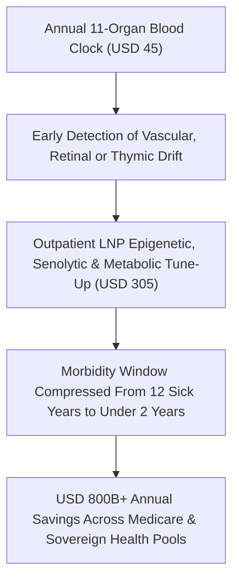

# 100 Vibrant Years: Epigenetic Rejuvenation & Preventative Healthspan
**Pillar 3: Bioscience, Medicine & Planetary Regeneration — Carbon Edition**

> **The Cynic's Reflex:** *"Longevity science is a vanity project for tech billionaires trying to live forever in glass mansions—while ordinary families still watch their parents spend their final twelve years trapped in wheelchairs, memory-care wards, and bankrupting hospital beds."*
>
> **The 2026 Breakthrough Reality:** Modern healthspan science is not about stretching out frailty; it is about **compressing morbidity** so an eighty-five-year-old moves, sees, thinks, and laughs with the cellular resilience of forty-eight. Between 2024 and late 2026, partial Yamanaka epigenetic reprogramming restored lost vision in primates without erasing cell identity, targeted senolytics cleared inflammatory "zombie" cells, thymic regeneration rebuilt aging immune systems, and clinical trials proved metabolic GLP-1 therapies measurably rewind multi-organ DNA methylation clocks—turning preventative rejuvenation into the single greatest rescue package for public health budgets on Earth.

---

## Act I: Dawn on the Kamogawa River — A Human Story from 2031

At 6:15 AM in October 2031, eighty-four-year-old retired botanical illustrator Keiko Takahashi laces up her trail shoes beside Kyoto's Kamogawa River before cycling three miles uphill to her neighborhood woodwork and seed-archiving guild. Six years earlier, in 2025, Keiko's story looked painfully familiar: early glaucoma was dimming her left eye, osteoarthritis stiffened her knees every winter morning, and her annual bloodwork showed creeping insulin resistance alongside an involuted thymus that left her hospitalized twice with winter pneumonia. Her son Kenji had quietly begun pricing assisted-living facilities.

Today, Keiko needs neither a walker nor a nursing home—and her total preventative care costs Japan's municipal health cooperative less than \$420 a year.

Every spring at her neighborhood Active Longevity Hub, a painless micro-vial blood draw runs an eleven-organ proteomic and DNA methylation clock panel. In 2028, when her retinal ganglion clock spiked, an ophthalmologist administered a single localized, transient mRNA lipid-nanoparticle pulse of three Yamanaka factors—*OCT4*, *SOX2*, and *KLF4* (OSK)—derived from Life Biosciences' clinical `ER-100` platform. Within six weeks, decades of epigenetic "static" lifted off her optic nerve without a single cell losing its retinal identity; today she inks millimeter-fine stamen botanical plates without magnifiers.

Twice a year, Keiko receives a muscle-sparing neuro-metabolic peptide depot paired with a short oral senolytic course that flushes senescent inflammatory cells from her synovial joints and arterial walls, plus a low-dose thymic *FOXN1* regenerative pulse that restored her naive T-cell repertoire to that of a forty-seven-year-old. At noon, she shares miso soup and laughter with her six-person *moai* circle—ranging in age from twenty-four to ninety-one—before teaching two twenty-nine-year-old apprentices traditional joinery. Old age has ceased to be a slow warehouse dimming; it is Keiko's boldest, freest creative third act.

---

## Act II: The 2024–2026 Cellular Rejuvenation Breakout

For most of the twentieth century, medicine treated aging like rust on an iron bridge: inevitable, irreversible, and addressable only by welding expensive patches onto one failing organ at a time—a stent for the heart, dialysis for the kidneys, a \$115,000-a-year memory ward for the brain. Consequently, while human life expectancy rose, the average adult still spent their final **10 to 12 years** burdened by three or more chronic diseases, consuming over 75% of national healthcare spending.

Between 2024 and late 2026, molecular biology overturned the "irreversible rust" dogma by proving that aging is largely **epigenetic software drift** rather than permanent hardware deletion. Every old cell still holds a pristine backup copy of its youthful DNA blueprint; over decades, DNA methylation marks and chromatin spools simply get scratched like an old optical disc.

### 1. Partial Epigenetic Reprogramming Without Losing Cell Identity
In 2006, Shinya Yamanaka won the Nobel Prize for showing four transcription factors (*OCT4*, *SOX2*, *KLF4*, *c-MYC*) could rewind an adult cell all the way back to an embryonic stem cell—erasing both its age and its tissue identity. The 2024–2026 breakthrough—spearheaded by **Life Biosciences**, **Altos Labs**, **Retro Biosciences**, **NewLimit**, and **Turn Biotechnologies**—was mastering **transient partial reprogramming**:
* **Restoring Sight in Non-Human Primates (`ER-100`):** Leaving out oncogenic *c-MYC* and pulsing just OSK briefly, Life Biosciences demonstrated in non-human primates with non-arteritic anterior ischemic optic neuropathy (NAION) that partial epigenetic reprogramming restored visual function and axon health without teratomas or loss of neuronal identity, clearing the path into landmark human ocular trials in 2026.
* **AI-Discovered Transcription Factor Cocktails:** Using single-cell multi-omics and machine learning, NewLimit and Retro Biosciences mapped transient mRNA factor combinations that rejuvenate aged human T-cells, hepatocytes, and hematopoietic stem cells by 10–15 epigenetic years in days while keeping lineage locks firmly intact.

### 2. Clearing Zombie Senescent Cells & Regrowing the Thymus
* **Precision Senolytics:** As cells suffer stress, a fraction refuse to die and instead turn into senescent "zombie" cells pumping out a toxic Senescence-Associated Secretory Phenotype (SASP) that inflames neighboring cartilage, arteries, and brain microglia. Clinical candidates from **Rubedo Life Sciences**, **Oisín Biotechnologies**, and **Unity Biotechnology** (whose `UBX1325` showed durable visual gains in diabetic macular edema) selectively clear senescent cells while leaving healthy tissue untouched.
* **Thymic & Immune Rejuvenation:** After age fifty, the human thymus shrinks into fatty tissue, starving the body of fresh naive T-cells to fight new viruses or nascent cancer cells. Building on Intervene Immune's **TRIIM** clinical trials (which reversed GrimAge biological clocks by ~2.5 years alongside thymus regrowth) and 2025–2026 *FOXN1* mRNA LNP regeneration studies, restoring youthful immune surveillance is moving rapidly toward routine outpatient care.

### 3. Metabolic & GLP-1 Trials Reversing Multi-Organ Methylation Clocks
* **Clinical Proof of Clock Reversal:** Across 2024–2026 randomized trials (*SELECT*, *FLOW*, and post-hoc epigenetic clock substudies of semaglutide, tirzepatide, and triple-agonist retatrutide), GLP-1/GIP therapies did far more than lower blood sugar: they slashed major cardiovascular events by 20%+, halted chronic kidney progression by 24%, dampened neuroinflammation, and measurably **reversed pace-of-aging DNA methylation clocks** across vascular, hepatic, and immune systems.
* **Muscle-Sparing Next-Gen Combinations:** Paired with myostatin/activin-pathway shields (*bimagrumab*, *apelin* mimetics, and BioAge programs), second-generation metabolic protocols melt inflammatory visceral fat while preserving 100% of elderly lean skeletal muscle and bone mineral density—eliminating the sarcopenia frailty trap.

> *"Aging is not a one-way street etched in stone; the youthful blueprint remains intact inside old cells, waiting for epigenetic resets to restore tissue health."*
> — **Dr. Juan Carlos Izpisua Belmonte**, Founding Institute Director, Altos Labs San Diego Institute of Science

### 4. Organ-Specific Aging Clocks & Rapid Adaptive Clinical Trials
Why did twentieth-century longevity drug candidates stall for decades? Because waiting ten years to count heart attacks in 20,000 healthy sixty-year-olds cost \$2 billion per trial. Between 2024 and 2026, Stanford's Wyss-Coray lab and international biobank consortia validated **11-organ plasma proteomic and cell-free DNA methylation clocks** capable of reading whether a person's heart, brain, kidney, arteries, liver, or immune system is aging at `0.7×` or `1.5×` chronological speed from a single blood draw:
* **Heart & Vascular Clock:** Flags arterial stiffness and subclinical endothelial senescence eight to twelve years before a myocardial infarction.
* **Brain & Microglial Clock:** Detects neuroinflammatory glial drift a decade before clinical Alzheimer's memory loss begins.
* **Thymic & Immune Clock:** Quantifies naive CD4+/CD8+ T-cell diversity and inflammaging cytokine load (`IL-6`, `CXCL9`) in real time.
* **Adaptive 6-to-12-Month Endpoints:** Paired with living human multi-organoids-on-a-chip (authorized under the FDA Modernization Act 2.0/3.0), researchers verify functional cellular age reversal in months rather than decades.

### Frontier Pioneers & Verified 2024–2026 Milestones

| Organization / Trial | Rejuvenation Modality | Verified 2024–2026 Milestone & Clinical Signal |
| :--- | :--- | :--- |
| **Life Biosciences** (`ER-100`) | Inducible OSK (*OCT4, SOX2, KLF4*) partial epigenetic reprogramming | Restored optic nerve visual acuity and retinal ganglion function in non-human primates without tumors; entered first-in-human ocular program in 2026. |
| **Altos Labs** | Cellular rejuvenation programming & chromatin resilience | Mapped universal methylation rejuvenation trajectories across multiple mammalian organs while preserving strict cell-identity barriers. |
| **Retro Biosciences** | Autophagy restoration, plasma replacement & T-cell reprogramming | Advanced small-molecule brain autophagy enhancers and hematopoietic rejuvenation toward clinical trials to add 10 healthy human years. |
| **NewLimit & Turn Bio** | AI-designed transient mRNA epigenetic cocktails (`ERA`) | Demonstrated functional rejuvenation of aged human T-cells, liver cells, and skin fibroblasts via non-integrating lipid nanoparticles. |
| **Intervene Immune** (`TRIIM` / `TRIIM-XA`) | Thymic regeneration & naive T-cell restoration | Reversed human epigenetic biological age (GrimAge/DunedinPACE) by ~2.5 years while replacing thymic fat with functional immune tissue. |
| **GLP-1 / Multi-Agonist Clock Trials** | Systemic neuro-metabolic & anti-inflammatory signaling | *SELECT*/*FLOW* & 2025–2026 epigenetic substudies confirmed multi-organ biological clock deceleration and 20–24% cardio-renal mortality drops. |
| **Rubedo & Oisín Bio** | Selective senolytic clearance of SASP zombie cells | Advanced selective senolytic small molecules and programmable LNP suicide-gene therapies into human trials for fibrotic and inflammatory aging. |

---

## Act III: Reimagining Social Conventions & Global Proof

When eighty-year-olds retain the eyesight, grip strength, aerobic capacity, and sharp working memory of forty-eight-year-olds, we get to retire one of industrial modernity's bleakest inventions: **the 1930s "shelf-life at 65" cliff**.

1. **Replacing "Geriatric Warehousing" with Multi-Chapter Blue-Zone Lives:**
   Otto von Bismarck picked age 65 for pensions when average life expectancy was under fifty. In a 100-vibrant-year society, life breaks open into nonlinear chapters: an intense building sprint in your thirties, a two-year ecological or craft sabbatical at fifty-two, mentoring neighborhood apprenticeships at seventy-five, and launching a chamber orchestra or botanical nursery at eighty-six—modeled on Okinawa's lifelong *ikigai* (purpose) and *moai* mutual-aid friendships.
2. **Rescuing Medicare & National Pensions from Demographic Insolvency:**
   The terrifying fiscal crisis facing Japan, Europe, and the U.S. Medicare Trust Fund was never caused by chronological birthdays; it was caused by the \$350,000 per-person tsunami of late-life dialysis, strokes, hip fractures, and decade-long dementia care. Compressing morbidity from 12 sick years down to a brief twilight saves **\$800B+ annually** in the U.S. alone, making universal \$350/year preventative rejuvenation self-funding from Day One.
3. **Intergenerational Neighborhoods Over Age-Segregated Sunbelt Enclaves:**
   Instead of isolating seniors in sterile retirement complexes, active elders anchor mixed-age courtyard co-housing, maker guilds, and child-mentorship commons—slashing both youth loneliness and elder cognitive decline in a single stroke.

### Global Proof & Policy Precedents
* **Singapore's *Healthier SG* & Active Ageing Centres (2023–2026):** Singapore shifted national health financing upstream—paying family clinics for preventative metabolic outcomes, deploying neighborhood Active Ageing hubs within walking distance of 80%+ of seniors, and funding healthy-longevity translational institutes at NUS (led by Dr. Brian Kennedy and Prof. Andrea Maier).
* **Okinawa's *Ikigai* & *Moai* Social Architecture (Japan):** Decades of centenarian epidemiology prove that tight five-to-eight-person lifelong social circles (*moai*), walkable gardening, and daily civic usefulness cut dementia and cardiovascular mortality nearly in half even before modern biotech arrives.
* **FDA Modernization Act 2.0/3.0 & Multi-Omic Aging Biomarkers (2025–2026):** Ending mandatory animal testing in favor of human organoids-on-a-chip and qualifying 11-organ plasma proteomic/methylation clocks accelerates healthspan trials from 12 years to adaptive multi-year sprints.

### The 10-Year Trajectory of Human Healthspan (2024 → 2034)

| Era & Milestone | Late-Life Morbidity Window | Typical Annual Preventative Cost | Clinical & Diagnostic Standard | Societal & Fiscal Impact |
| :--- | :--- | :--- | :--- | :--- |
| **2024 Baseline** | **11.5 – 12.5 sick years** at end of life | \$1,000+/mo branded GLP-1s; \$950 clocks | Reactive sick-care after stroke, dialysis, or Stage III cancer | Looming Medicare & pension insolvency |
| **Late 2026 SOTA** | **~10.5 sick years** (early metabolic curve bend) | \$150–\$300/mo peptides; \$250 methylation test | First human ocular OSK trials (`ER-100`); GLP-1 cardio-renal shield | 20%+ drop in MACE heart events in treated cohorts |
| **2030 Inflection** | **~5.5 sick years** (morbidity compression) | **\$350 / yr** bundled public healthspan pass | Outpatient LNP ocular/vascular OSK, senolytics & thymic pulses | Nursing-home admissions plunge 45%; \$500B+/yr saved |
| **2034 Abundance** | **<2.0 sick years** (85 feels like 48) | **<\$150 / yr** universal municipal care | Multi-organ transient mRNA tune-ups + annual Stage-0 blood screen | Vibrant 4-generation neighborhoods; solvent health pools |

### The Public Solvency Rescue Ledger: Sick-Care Warehousing vs. Preventative Healthspan

| Late-Life Chronic Burden | 2025 Reactive Crisis Cost (US Baseline) | 2031 Preventative Healthspan Protocol | Projected Annual Public Savings |
| :--- | :--- | :--- | :--- |
| **Alzheimer's & Vascular Dementia** | \$360B/yr (\$115,000/yr memory-care wards) | Brain-penetrant GLP-1/GIP + microglial senolytic clearance | **+\$210B / yr** + millions of family caregivers freed |
| **Heart Failure, Stroke & Renal Dialysis** | \$480B/yr (\$95,000/yr per dialysis patient) | Multi-agonist metabolic shield + endothelial OSK pulse | **+\$285B / yr**; acute ICU admissions cut in half |
| **Geriatric Blindness, Falls & Osteoarthritis** | \$210B/yr (hip fractures, optic neuropathy, joint disability) | Ocular `ER-100` OSK reset + synovial senolytic + muscle shield | **+\$135B / yr**; independent mobility into late 80s |
| **Elderly Sepsis, Pneumonia & Late Cancer** | \$310B/yr (collapsed post-65 naive T-cell immunity) | Thymic *FOXN1* mRNA regeneration + Stage-0 liquid biopsy | **+\$190B / yr**; 45-year-old immune surveillance at 80 |

---

## Act IV: Answering the Cynic & The Synergy Cascade

### Hard Questions from Skeptics — Answered Empirically
* **"Won't epigenetic reprogramming trigger cancer or turn organs into mushy stem-cell tumors?"**
  * Full four-factor continuous Yamanaka expression (*with c-MYC*) does cause teratomas—which is why nobody uses it clinically.
  * Partial reprogramming excludes *c-MYC*, uses non-integrating transient mRNA lipid nanoparticles that degrade within 72 hours, and stops well short of the pluripotency cliff—buffing methylation noise off chromatin while cell-identity enhancers stay locked.
* **"Won't only billionaires get rejuvenation treatments, creating a biological caste system?"**
  * Only if governments enjoy going bankrupt. An mRNA LNP pulse or off-patent peptide costs **under \$12 to manufacture** in continuous-flow bioreactors, whereas a single year of Alzheimer's nursing care costs taxpayers \$115,000.
  * Sovereign health systems (NHS, Medicare, Singapore, Japan) have an overwhelming fiscal mandate to hand rejuvenation out free at neighborhood clinics like polio vaccines.
* **"Won't older generations hoard jobs and political power forever if they stay vigorous at 85?"**
  * Term limits and nonlinear career norms solve institutional bottlenecks cleanly, while healthy elders shift from defensive scarcity hoarding to generative guild mentorship, civic ecology, grand-parenting, and arts patronage.
* **"If everyone lives healthier longer, won't the planet run out of room and resources?"**
  * Global fertility rates have already fallen below replacement (`<2.1`) across Europe, East Asia, and the Americas; the real 2030s crisis is an aging dependency crunch, not population explosion.
  * Healthy, energetic seventy-five-year-olds stabilize society while solar precision fermentation rewilds over a billion hectares of farmland.

### Anatomy of an Annual Neighborhood Healthspan Visit (2031 Standard)
What does preventative rejuvenation actually look and feel like for a retired postal worker, teacher, or machinist when stripped of Silicon Valley concierge mysticism? It takes forty minutes once a year at any public Direct Primary Care hub:
1. **Minute 0–10 (Capillary Multi-Omic Draw):**
   * A painless upper-arm capillary collector draws 300 microliters of blood into an automated benchtop cartridge measuring **11 organ-specific plasma proteomic clocks**, **DunedinPACE methylation speed**, **cell-free tumor DNA**, and naive-to-memory T-cell ratios.
2. **Minute 10–25 (Functional Biometrics & Human Conversation):**
   * Grip-strength dynamometry, six-minute gait micro-kinematics, non-mydriatic retinal OCT vascular imaging (reading brain microvascular health directly through the eye), and an unhurried twenty-minute conversation about sleep, purpose, and social connection.
3. **Minute 25–40 (Targeted Preventative Tune-Up):**
   * Standard semiannual muscle-sparing metabolic-neuro peptide depot (\$18 public generic cost).
   * If a specific organ clock drifts past +3 years above baseline—say arterial endothelium, optic nerve, or thymus—a targeted 72-hour transient mRNA LNP pulse or three-day oral senolytic course is scheduled that same week, long before scar fibrosis or symptom onset.
4. **Community Guild Prescription ("Social Prescription"):**
   * Borrowing directly from the UK NHS and Singapore Active Ageing playbooks, isolated retirees receive paid stipends or club passes into neighborhood timber workshops, urban orchards, choral ensembles, or youth literacy mentorship circles—treating loneliness with the same clinical seriousness as hypertension.

### Cross-Atlas Synergy Links
* **Skipping the Billing Maze ([`healthcare-without-billing`](../healthcare-without-billing/REPORT.md)):** \$50 annual multi-cancer and 11-organ methylation liquid biopsies inside Direct Primary Care clinics catch cellular drift years before a single symptom appears.
* **One-Dose Genetic Cures ([`invivo-crispr-cures`](../invivo-crispr-cures/REPORT.md)):** The exact same tissue-targeted lipid nanoparticle (LNP) delivery vehicles engineered for *in vivo* CRISPR carry transient OSK and *FOXN1* mRNA safely to the retina, liver, vasculature, and thymus.
* **Silencing the Hijacked Brain ([`craving-reset-mental-health`](../craving-reset-mental-health/REPORT.md)):** Brain-penetrant neuro-metabolic peptides simultaneously shield aging microglia against Alzheimer's dementia and quiet subcortical addiction circuits.
* **General-Purpose Humanoid Teammates ([`general-purpose-humanoids`](../../02-automation-science/general-purpose-humanoids/REPORT.md)):** For the compressed final twilight window when gentle physical assistance is ever needed, soft-body home robotics let every senior remain comfortably in their own home and garden.

---

## References & Verified Sources

* **Featured Researcher / Leader:** [Dr. Juan Carlos Izpisua Belmonte — Founding Institute Director, Altos Labs San Diego Institute of Science](https://altoslabs.com/)
* **Companies, Labs & Consortia:** [Life Biosciences (ER-100)](https://www.lifebiosciences.com/) · [Altos Labs](https://altoslabs.com/) · [Retro Biosciences](https://retrobio.com/) · [NewLimit & Turn Biotechnologies](https://www.newlimit.com/) · [Intervene Immune (TRIIM)](https://www.interveneimmune.com/) · [Rubedo Life Sciences & Oisín Biotechnologies](https://www.rubedolife.com/)
* **Global & Regulatory Precedents:** [Singapore Healthier SG & Active Ageing Centres](https://www.healthiersg.gov.sg/) · [Okinawa Ikigai & Moai Lifelong Mutual-Aid Circles](https://en.wikipedia.org/wiki/Blue_zone) · [FDA Modernization Act 2.0/3.0 Organoid-Chip Pathway](https://www.fda.gov/) · [SELECT & FLOW GLP-1 Epigenetic Clock Substudies](https://www.nejm.org/)
* **Connected Carbon Pathways:** [Skipping the \$1.2 Trillion Billing Maze: Continuous AI Diagnostics & Universal Direct Care](../healthcare-without-billing/REPORT.md) · [One-Dose Genetic Cures: In Vivo CRISPR & Base Editing for All](../invivo-crispr-cures/REPORT.md) · [Curing the Loneliness Epidemic: Turning Dead Strip Malls into Walkable Village Commons](../../04-social-norms/intergenerational-villages/REPORT.md) · [Helpful Mechanical Hands: General-Purpose Humanoid Teammates](../../02-automation-science/general-purpose-humanoids/REPORT.md)
