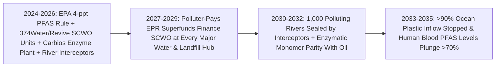
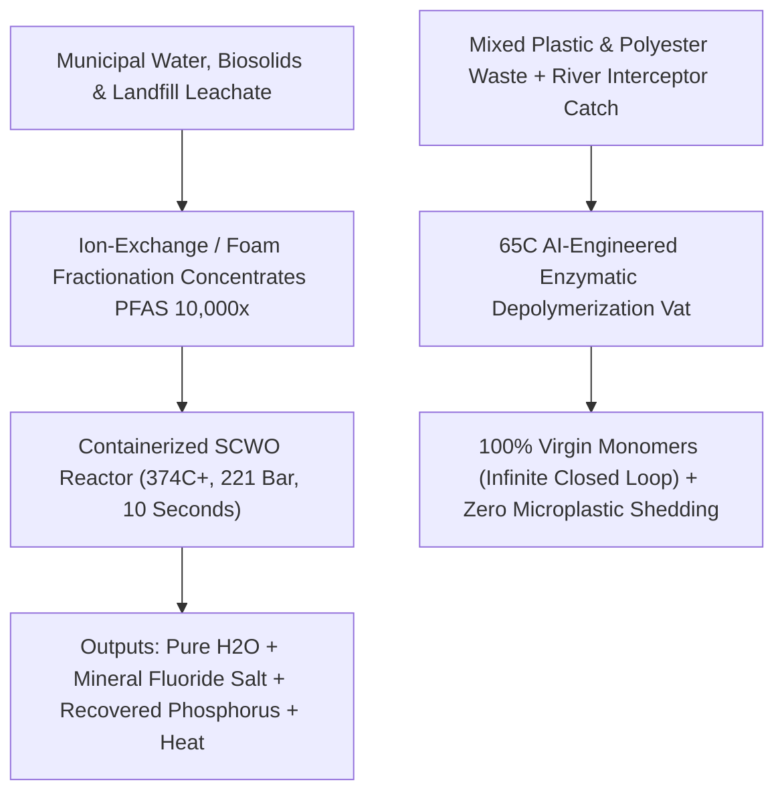

# Healing a Toxified Planet: Supercritical PFAS Destruction, Plastic-Eating Enzymes & Clean Rivers
**Pillar 3: Bioscience, Medicine & Planetary Regeneration — Carbon Edition**

> **The Cynic's Reflex:** *"We have permanently poisoned the Earth. Forever chemicals sit in every drop of rainwater and newborn umbilical cord, microplastics clog human arteries, recycling was always a corporate lie, and cleanup just moves toxic sludge from one poor neighborhood's landfill to another."*
>
> **The 2026 Breakthrough Reality:** "Forever chemicals" were never indestructible laws of physics—they only meant *"too stubborn for 20th-century ambient bacteria."* Between 2024 and late 2026, chemical physics and AI protein design cracked planetary detoxification open: **374Water (*AirSCWO*)** and **Revive Environmental** deployed **Supercritical Water Oxidation** (`374°C+`, `221+ bar`) shattering carbon–fluorine PFAS bonds by **>99.99% in seconds** into harmless water and mineral fluoride salts; **Carbios** scaled AI-engineered enzymes in France unzipping dirty, colored plastics back into 100% virgin monomers infinitely; and **The Ocean Cleanup's *Interceptors*** began choking off trash at the mouths of the 1,000 rivers responsible for 80% of marine plastic.

---

## Act I: Swimming in the Grand River — A Human Story from 2031

July sunlight sparkles across the rapids of the Grand River in Grand Rapids, Michigan, in 2031. Thirty-eight-year-old municipal water engineer Maya Lin-Kowalski watches her nine-year-old twins cannonball off a cedar dock where, a decade earlier, rusty metal signs warned families not to touch foam on the riverbank—legacy per- and polyfluoroalkyl (PFAS) pollution left behind by mid-century leather-tanning and firefighting-foam dumps.

In 2023, utilities faced a heartbreaking trap: granular activated carbon and ion-exchange resins could *filter* PFAS out of drinking water, only to leave behind mountains of toxic, PFAS-soaked spent filters that leaked right back out of landfills or spewed incomplete fluorinated gases from conventional incinerators. Today, parked cleanly inside Grand Rapids' municipal water-resource recovery campus is a shipping-container-sized **Supercritical Water Oxidation (`SCWO`) reactor**.

Inside its insulated titanium-lined core, concentrated PFAS regenerant brine, wastewater biosolids, and old firefighting foam are pressurized past **221 atmospheres and heated above 374°C**—entering water's remarkable fourth physical state, where liquid and gas merge into a dense fluid that dissolves organic toxins and pure oxygen simultaneously. Within **ten seconds**, the strongest carbon–fluorine bonds in organic chemistry snap completely apart in a self-sustaining exothermic reaction: zero smokestack, zero dioxins, zero toxic ash—just clean distilled water, trace CO₂, and benign calcium/sodium fluoride salt identical to natural toothpaste mineral. Maya checks her live public telemetry tablet: effluent PFOA and PFOS read **0.0 parts per quadrillion (non-detect)**.

Across the Atlantic in Longlaville, northeastern France, shift lead Jean-Luc Moreau walks past quiet, warm `65°C` stainless enzymatic vats inside the **Carbios** industrial biorefinery. Bales of scuffed, opaque, multi-layer food trays and discarded polyester athletic jerseys—waste that mechanical recycling used to send straight to incinerators—dissolve cleanly under AI-engineered cutinase enzymes in ten hours, recrystallizing into snow-white, medical-grade virgin monomers ready to spin new jackets without pumping a single barrel of crude oil.

---

## Act II: The 2024–2026 Molecular Destruction & Circularity Breakout

Twentieth-century chemistry excelled at forging ultra-stable bonds—like the `C–F` bond in Teflon/PFAS (`~485 kJ/mol`, the strongest single bond in organic chemistry) and aromatic ester polymers in PET/polyurethane—without ever building an "undo" button. Mechanical plastic recycling failed (>90% of plastics went unrecycled) because melting mixed, dyed plastic shreds together degrades polymer chains into brittle gray downcycled lumber, while landfilling or burning PFAS simply recycled toxins into groundwater and rain.

Between 2024 and late 2026, three engineering revolutions built the planetary **Undo Button**:

### 1. Supercritical Water Oxidation & Electrochemical PFAS Annihilation
* **374Water (`AirSCWO`) & Revive Environmental (`PFAS Annihilator`):** Deployed across municipal wastewater and landfill-leachate sites in Florida (Orlando Iron Bridge), Orange County (California), Michigan, and Ohio between 2024 and 2026, containerized SCWO units exploit supercritical water physics (`>374°C`, `>22.1 MPa`). In supercritical water, dielectric polarity drops so nonpolar PFAS chains and oxygen mix intimately while mineral salts precipitate cleanly—achieving **>99.99% complete mineralization** across both long-chain (PFOS/PFOA) and stubborn short-chain (PFBA/GenX) compounds in **seconds**, while harvesting excess reaction heat to self-power the unit!
* **Electrochemical Oxidation & Plasma Destruction (*Aclarity*, *Claros Technologies*, *Onvector*):** For smaller industrial point-sources and groundwater wells, boron-doped diamond electrodes and UV-sulfite/plasma reactors shatter `C–F` bonds at ambient pressure on-site—paired with the landmark **2024–2026 U.S. EPA National Primary Drinking Water Regulation** capping PFOA/PFOS at **4 parts per trillion (ppt)** and unlocking billions in Bipartisan Infrastructure Law & polluter-superfund cleanup contracts.

### 2. AI-Engineered Plastic-Eating Enzymes (`Carbios`, `Epoch Biodesign`)
* **Carbios Biorefinery Breakthrough (*Nature* & Longlaville Commercial Plant):** Starting from a leaf-branch compost cutinase (`LCC`) enzyme discovered in decaying plant matter, researchers used protein engineering and AI thermostability design (paralleling UT Austin's `FAST-PETase` machine-learning breakthroughs) to evolve hyper-active depolymerases that survive `65–72°C`—where PET plastic softens—unzipping **97% of dirty, colored, opaque, and polyester-textile waste into pure terephthalic acid (PTA) and monoethylene glycol (MEG) in hours**.
* **Expanding to Nylons & Polyurethanes:** Startups like **Epoch Biodesign** and academic generative protein labs (using *ProteinMPNN* / *RFdiffusion*) engineered bespoke enzymatic cascades between 2024 and 2026 to depolymerize nylon-6/66 fishing nets and polyurethane mattress foams at gentle ambient temperatures with zero toxic solvents.

### 3. Stopping 80% of Ocean Plastic at 1,000 Rivers (`The Ocean Cleanup`)
* **The Pareto River Discovery:** Rigorous hydrological modeling by **The Ocean Cleanup** proved a stunning leverage law: **80% of all riverine plastic entering the world's oceans flows out of just ~1,000 urban rivers** (<1% of global rivers!).
* **Autonomous Solar *Interceptors* + Offshore *System 03*:** By late 2026, solar-powered **Interceptor** catamarans, heavy-flood barricades, and Kingston/Jakarta/Rio Motagua/Los Angeles catchment arrays—paired with 2.2-kilometer offshore **System 03** sweeps in the Great Pacific Garbage Patch—had pulled **tens of millions of kilograms of trash** out of water while AI cameras cataloged brand-level producer accountability.

> *"Technology got us into this mess, and smart, scalable engineering—deployed with optimism and persistence—can clean the world's rivers and oceans within our lifetime."*
> — **Boyan Slat**, Founder & CEO, The Ocean Cleanup

### Frontier Pioneers & Verified 2024–2026 Deployments

| Pioneer / Platform | Detoxification / Circular Mechanism | Verified 2024–2026 Real-World Milestone |
| :--- | :--- | :--- |
| **374Water** (`AirSCWO`) | Containerized Supercritical Water Oxidation (`374°C+`, `221 bar`) | Commercial municipal units deployed in Orlando, Orange County & Michigan; **>99.99% PFAS + biosolids microplastic destruction**. |
| **Revive Environmental & Battelle** (`PFAS Annihilator`) | Mobile & hub supercritical water oxidation for AFFF foam & leachate | Destroyed millions of gallons of legacy military/airport PFAS firefighting foam and industrial concentrates to non-detect levels. |
| **Aclarity & Claros Technologies** | Electrochemical oxidation & UV-photochemical `C–F` cleavage | Permanent on-site destruction of short- and long-chain PFAS concentrates at landfills and semiconductor/industrial plants. |
| **Carbios** (France) & **UT Austin** (`FAST-PETase`) | AI/protein-engineered enzymatic PET & polyester textile depolymerization | Unzips colored trays & mixed polyester garments at **97% conversion in hours** into 100% virgin food-grade monomers. |
| **The Ocean Cleanup** (*Interceptors* & *System 03*) | Autonomous solar river catamarans + AI-routed ocean extraction | Active across Jamaica, Indonesia, Guatemala, Thailand, Malaysia & LA; **Great Pacific Garbage Patch cleanup >50% mapped & accelerating**. |
| **PHA Marine-Biodegradable Bioplastics** (*CJ Biomaterials*, *Newlight*) | Microbially fermented polyhydroxyalkanoates (`PHA`) | Naturally digested by cold marine and soil microbes within months—replacing single-use sachets and agricultural mulch films with zero microplastics. |

---

## Act III: Reimagining Social Conventions & Global Proof

Destroying legacy toxins works fastest when paired with smart upstream rules so we stop refilling the bathtub while draining it:

1. **"Polluter-Pays" Extended Producer Responsibility (EPR) Superfunds:**
   Taxpayers should never foot the bill alone for fifty years of corporate fluorochemical profits. Following the **2023–2026 \$14B+ 3M / DuPont / Chemours U.S. municipal water settlements** and **EU Packaging EPR fees**, chemical and virgin-plastic producers pay a direct per-kilogram fee that automatically finances municipal SCWO reactors and enzymatic biorefineries until legacy stockpiles hit zero.
2. **Turning Wastewater Plants into Clean Water, Energy & Phosphorus Mines:**
   Previously, sewage biosolids couldn't safely fertilize farmland because they carried PFAS, pharmaceuticals, and microplastics. Running municipal sludge through an exothermic `AirSCWO` reactor **destroys 99.99% of PFAS, hormones, antibiotic-resistant superbugs, and microplastics simultaneously**—yielding sterile drinking-grade water, net thermal electricity, and pure recoverable **phosphorus mineral** for clean farming!
3. **Denmark & EU Essential-Use Phaseouts + Benign-by-Design Replacements:**
   Denmark led the world in banning PFAS in food-contact paper/cardboard (2020), followed by sweeping EU/state bans on PFAS in firefighting foams, cosmetics, ski waxes, and waterproof textiles—replaced cleanly by fluorine-free plant-wax, silicone-free dendritic, and inverse-AI-designed polymers.

### Global Proof & Policy Precedents
* **Human Blood PFOS/PFOA Drop Already Proven by Biomonitoring (CDC NHANES):** Cynics claim PFAS stays in human populations forever—yet U.S. CDC blood biomonitoring proves that after 3M phased out PFOS/PFOA manufacturing in the early 2000s, **average American blood PFOS levels already dropped by >85% and PFOA by >70%!** Shut off remaining water/food exposure via 4-ppt filtration + SCWO destruction, and human blood clears rapidly across a single generation.
* **Norway's `Infinitum` 92%+ Bottle Deposit-Return System:** Simple barcode deposit-return machines at every grocery store recover >92% of beverage containers cleanly before litter ever reaches a storm drain.
* **UN Global Plastics Treaty Framework & EU Textile EPR (2025–2026):** Mandating minimum monomer-recycled content in apparel and packaging creates guaranteed multi-billion-dollar off-take markets for enzymatic biorefineries.

### Quantitative Anatomy: From "Forever Curse" to Planetary Detoxification

| Planetary Health Metric | 2024 Toxic Baseline | Late 2026 Engineering SOTA | 2030 Municipal Scale | 2035 Clean-Watershed Reality |
| :--- | :--- | :--- | :--- | :--- |
| **PFAS Fate in Treatment** | Landfilled or half-burned (leaks right back into rain) | **>99.99% mineralization** in commercial SCWO units | SCWO standard at top 1,500 wastewater & landfill hubs | **PFAS drinking-water exposure near 0 ppt** |
| **Destruction Cost (Concentrate)** | "Impossible" / hazardous storage liability | \$0.08–\$0.25 / gallon concentrate (falling fast) | **<\$0.02 / gallon** via exothermic heat self-recovery | Paid 100% by Polluter Superfund settlements |
| **PET & Polyester Recycling** | <10% mechanically downcycled; 90% burned/buried | **97% enzymatic monomer recovery** (*Carbios*) | Enzymatic monomers reach **cost parity with virgin oil** | Infinite closed-loop textiles & food packaging |
| **River-to-Ocean Plastic Inflow** | ~1–2 million tons/yr choking marine wildlife | Dozens of high-load rivers sealed by *Interceptors* | **Top 1,000 rivers intercepted** + deposit laws | **>85% cut** in new ocean plastic; GPGP cleared |
| **Sewage Biosolids Microplastics** | Millions of tons spread onto farm soils annually | 99.99% oxidized inside municipal `AirSCWO` pilots | Clean phosphorus recovered; **zero sludge microplastics** | Soil and river microplastic accumulation halted |

---

## Act IV: Answering the Cynic & The Synergy Cascade

### Hard Questions from Skeptics — Answered Empirically
* **"Wait—if PFAS is already diluted across entire oceans and rainwater, isn't it physically impossible to boil the ocean at 374°C?"**
  * You never boil the river or the ocean! Engineers pair **foam fractionation or regenerable ion-exchange resins** (which effortlessly strip PFAS out of millions of gallons of drinking water or leachate at ambient temperature, concentrating the PFAS **10,000-fold into a tiny barrel of liquid**) with a compact SCWO reactor that destroys that concentrated barrel in minutes!
  * Once point-sources (landfills, wastewater plants, airports, factories) stop re-emitting PFAS into air and rivers, atmospheric rainwater deposition drops within weeks and existing environmental stocks flush and dilute out of surface cycles.
* **"Doesn't supercritical water with hydrofluoric acid eat right through steel pipes?"**
  * Early 1990s SCWO prototypes did suffer salt plugging and acid corrosion—which 2020s engineering solved via **transpiring-wall / titanium-liner geometries**, alkaline neutralization injections (immediately binding released fluorine ions into benign `CaF₂` fluorspar or `NaF` salt), and modular replaceable reactor cartridges running thousands of hours continuously.
* **"Won't enzymatic plastic recycling just encourage oil companies to make even more disposable plastic?"**
  * The exact opposite: every ton of enzymatically unzipped monomer **directly displaces a ton of newly cracked fossil petroleum naphtha**, while single-use thin films and agricultural mulches transition to marine-biodegradable **PHA biopolymers** so accidental litter vanishes naturally like a fallen oak leaf.
* **"What about microplastics already inside human blood and tissues?"**
  * Cutting off the three primary human intake vectors—switching tap water to ultrafiltration/RO, replacing microwaved polyolefin food trays with glass/stainless/monomer-safe materials, and replacing shedding synthetic fleece with natural fibers or non-shedding biopolymers—lets the body's hepatobiliary and mucosal clearance pathways steadily reduce internal particle loads, while therapeutic apheresis filtration trials advance for high-exposure industrial workers.

### Municipal Utility Economics: Turning Toxic Liability Into Self-Paying Resource Recovery
Why are city water boards from Florida and California to the Great Lakes eagerly signing up for containerized SCWO and river interception? Because destroying PFAS and biosolids on-site **saves utilities millions every year** compared to hauling wet sewage cake to distant landfills:

| Municipal Waste Stream | 2024 Hauling & Liability Cost | 2030 Containerized `AirSCWO` / Enzymatic Hub | Net Utility & Public Health Benefit |
| :--- | :--- | :--- | :--- |
| **Wastewater Biosolids Cake** | \$90–\$160 / wet ton landfill trucking (rising fast as states ban land spreading) | **\$45–\$65 / ton net** on-site SCWO oxidation | Destroys **>99.99% PFAS + microplastics**; recovers phosphorus & steam heat |
| **Spent Activated Carbon / Ion-Exchange Resin** | Hazardous incineration or long-term Superfund liability | On-site resin regeneration + **10-second SCWO** of concentrated brine | Resins reused for years; **zero secondary air emissions** |
| **Airport & Military AFFF Firefighting Foam** | Hundreds of millions in groundwater plume lawsuits | Mobile **Revive / Battelle** SCWO trailer destruction at base | Permanent `C–F` mineralization to harmless fluoride salt |
| **Mixed Municipal PET & Polyester Textiles** | \$70 / ton tipping fee to bury or burn in waste-to-energy | Sold as feedstock to **Carbios-class** enzymatic biorefineries | Generates **\$1,100+/ton virgin-grade PTA/MEG monomers** |

### Four Everyday Upstream Upgrades Eliminating Microplastic Exposure at Home & Work
1. **Tire-Wear Elastomer Redesign (Solving the Hidden #1 Microplastic Source):**
   * Nearly 30–40% of microplastics entering urban storm drains come from synthetic styrene-butadiene tire dust—plus toxic `6PPD-quinone` rubber antioxidants that killed Pacific Northwest coho salmon! Between 2024 and 2028, tire makers transition to **6PPD-free bio-antioxidants** and biodegradable natural dandelion/guayule + functionalized silica treads, while bioretention rain gardens strip 95% of legacy road particles before creek entry.
2. **Washing-Machine Microfiber Cyclonic Filters (France's 2025 Law Scaled Globally):**
   * Following France's pioneering mandate requiring built-in microfiber traps on all new washing machines starting in 2025, snap-on cyclonic laundry filters capture **90%+ of synthetic fleece fibers** before greywater ever leaves a home.
3. **PFAS-Free Food Packaging & Indestructible Cookware:**
   * Plant-protein/cellulose barrier coatings (*Notpla* seaweed films, molded fiber) and ceramic/cast-iron surfaces permanently retire fluorinated greaseproof burger wrappers and peeling fluoropolymer pans.
4. **Real-Time Public Tap & River Dashboards:**
   * Low-cost graphene/aptamer PFAS biosensors stream hourly water-purity telemetry onto public municipal dashboards—turning clean water into an audited civic guarantee from Flint and Newark to Jakarta.

### Heavy Metals, Mine Tailings & Soil Phytoremediation Alongside PFAS
Planetary detoxification extends beyond fluorochemicals and plastics to legacy industrial soils and waterways:
* **Hyperaccumulator Phytomining (*Metalplant*, *Genomines*, 2024–2026):**
  * Deep-rooted plants (*Odontarrhena*) naturally draw toxic nickel, cobalt, and cadmium out of contaminated serpentine soils and old mine tailings—cleaning poisoned farmland while harvesting battery-grade critical minerals from the harvested biomass ash without open-pit blasting!
* **Engineered Bio-Sorbents for Lead & Arsenic Service Lines:**
  * Paired with accelerated municipal lead-pipe replacement, selective bacterial/fungal bio-chelating filters strip trace lead, hexavalent chromium, and arsenic from rural wellheads at pennies per thousand gallons.
* **Oil-Spill & Solvent Mycoremediation:**
  * Oyster and white-rot fungal ligninolytic enzymes (*Pleurotus*, *Phanerochaete*) rapidly mineralize polycyclic aromatic hydrocarbons (PAHs), diesel spills, and dioxin-contaminated brownfields into fertile urban parkland.

* **Atmospheric Indoor Air Detoxification:**
  * Germicidal far-UVC (`222 nm`) and photocatalytic mineral filters quietly neutralize indoor volatile organic compounds (VOCs), wildfire smoke particulates, and airborne pathogens inside schools and offices without ozone byproducts.
* **Open Chemical Footprint Registries:**
  * Mandatory digital product passports disclose 100% of polymer additives and surface treatments—giving consumers and municipal procurement officers one-scan verification that products are 100% fluorine- and phthalate-free.

### Cross-Atlas Synergy Links
* **Self-Driving Bio-Labs & AI Protein Design ([`self-driving-labs`](../../02-automation-science/self-driving-labs/REPORT.md)):** Generative protein diffusion models and robotic directed-evolution foundries compress the design of new polyurethane-, nylon-, and PVC-eating enzymes from decades to weeks.
* **Abundant Clean Solar & Industrial Heat:** Cheap off-peak renewable electricity powers municipal plasma, electrochemical, and supercritical water reactors at near-zero marginal carbon footprint.
* **Saving Every Living Lineage ([`assisted-coral-cryobanks`](../assisted-coral-cryobanks/REPORT.md)):** Intercepting river plastic and eliminating coastal chemical/sunscreen/PFAS runoff lifts toxic stress off coral reefs and marine nurseries worldwide.

---

## References & Verified Sources

* **Featured Researcher / Leader:** [Boyan Slat — Founder & CEO, The Ocean Cleanup](https://theoceancleanup.com/)
* **Companies, Labs & Consortia:** [374Water (AirSCWO Municipal Reactors)](https://374water.com/) · [Revive Environmental & Battelle (PFAS Annihilator)](https://revive-environmental.com/) · [Carbios (Enzymatic PET Biorefinery) & Epoch Biodesign](https://en.wikipedia.org/wiki/PETase) · [The Ocean Cleanup (Interceptors & System 03)](https://theoceancleanup.com/) · [Aclarity & Claros Electrochemical Destruction](https://www.aclaritywater.com/) · [UT Austin FAST-PETase Protein Engineering Lab](https://www.utexas.edu/)
* **Global & Regulatory Precedents:** [US EPA 4.0 ppt PFAS Drinking Water Standard & \$14B+ Settlements](https://www.epa.gov/sdwa/and-polyfluoroalkyl-substances-pfas) · [CDC NHANES Proof (>85% Human Blood PFOS Drop Post-Phaseout)](https://www.cdc.gov/nchs/nhanes/index.htm) · [Denmark & EU Upstream PFAS Phaseout Mandates](https://echa.europa.eu/hot-topics/perfluoroalkyl-chemicals-pfas) · [Norway Infinitum 92%+ Container Deposit-Return System](https://en.wikipedia.org/wiki/Container-deposit_legislation)
* **Connected Carbon Pathways:** [10,000 Experiments Before Breakfast: Autonomous Physical Wet & Solid Labs](../../02-automation-science/self-driving-labs/REPORT.md) · [De Novo Protein Machines & Atomic-Precision Manufacturing](../../02-automation-science/protein-atomic-nanofabrication/REPORT.md) · [Ending Drought Forever: Sub-Penny Desalination & Continental New Rivers](../../01-abundant-energy/aquifer-rivers-desalination/REPORT.md) · [Saving Every Living Lineage: Heat-Evolved Coral Reefs, AI Bio-Acoustics & Living Biobanks](../assisted-coral-cryobanks/REPORT.md)
