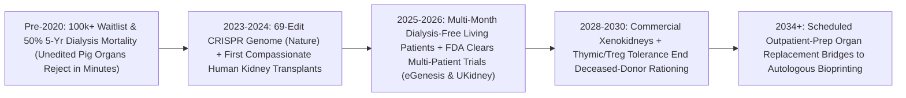

# 69-Edit Donor Kidneys: CRISPR-Humanized Porcine Organs Ending Dialysis Waitlists
**Pillar 3: Bioscience, Medicine & Planetary Regeneration — Carbon Edition**

> **The Cynic's Reflex:** *"Scientists have joked for forty years that 'xenotransplantation is the future of organ transplants—and always will be,' because putting an animal organ inside a human triggers catastrophic immune rejection within minutes and risks unleashing cross-species retroviruses."*
>
> **The 2026 Breakthrough Reality:** Between 2024 and late 2026, **multiplex CRISPR-humanized porcine kidneys** crossed from decades of theory into **FDA-cleared multi-patient human clinical trials**. By simultaneously knocking out **3 hyperacute glycan rejection antigens**, permanently inactivating up to **59 porcine endogenous retroviruses (PERVs)**, and inserting **7 human complement, coagulation, and immune-cloaking transgenes** (**69 precise genomic edits** in *eGenesis EGEN-2784*, alongside *United Therapeutics / Revivicor's 10-edit UKidney*), living patients walked out of Massachusetts General Hospital and NYU Langone completely **off dialysis for months on end**—launching the bridge that ends the 100,000-person organ waitlist forever.

---

## Act I: Silence Where the Dialysis Machine Hummed — A Human Story from 2030

At 5:45 AM in Birmingham, Alabama, forty-nine-year-old postal supervisor Darnell Washington stretches in his sunlit kitchen, pours a full tall glass of cold orange juice, and drinks the whole thing without measuring milliliters. Five years earlier, end-stage hypertensive kidney disease—which strikes Black Americans at more than three times the rate of white Americans—had chained Darnell to a dialysis recliner for four hours every Monday, Wednesday, and Friday. Every session left him wrung out with crashing blood pressure, strict fluid rationing, and a brutal statistical reality: over **100,000 Americans** sat on the transplant waitlist, **17 died every single day** waiting for a human tragedy to free up a donor organ, and nearly **half of all dialysis patients died within five years**.

In March 2029, instead of waiting seven years on a deceased-donor registry, Darnell checked into UAB Transplant Center for a scheduled morning surgery. His new kidney arrived from a pathogen-free, solar-powered biosecure medical suite outside Raleigh: a **CRISPR-humanized donor kidney** carrying **69 germline edits** plus a co-transplanted thymic tolerance patch (`UThymoKidney` / Treg protocol). Within four minutes of the surgeon unclamping Darnell's iliac artery, the new kidney turned bright, healthy coral-pink and began pouring clear golden urine right on the operating table.

Eighteen months later, Darnell works full shifts, coaches Little League on Saturdays, and takes a gentle, steroid-free co-stimulation maintenance regimen tapering toward complete immune tolerance. Across his entire county, three former four-story commercial dialysis strip-mall clinics have closed for lack of patients—converted into neighborhood urgent-care and physical-therapy centers.

---

## Act II: The 2024–2026 CRISPR Xenotransplantation Breakout

Why did 20th-century xenotransplants fail within minutes? Because evolutionary divergence left pigs with surface sugar molecules—most notoriously **alpha-gal (`GGTA1`)**, **`CMAH`**, and **`B4GALNT2`**—that human antibodies instantly attack like invading bacteria, triggering microvascular blood clots that turn an unedited organ black on the operating table (**hyperacute rejection**). Worse, every pig genome naturally carries dozens of dormant **Porcine Endogenous Retroviruses (PERVs)** stitched into its chromosomes millions of years ago.

No traditional breeding program could ever erase 60+ genomic targets at once. **Multiplex CRISPR-Cas9 and base editing** solved the entire evolutionary mismatch in a single cellular engineering campaign—culminating in historic 2024–2026 living human transplants and formal FDA Investigational New Drug (IND) clinical trials.

### 1. The 69-Edit Genome Architecture (*eGenesis `EGEN-2784`*, *Nature*)
* **Triple Glycan Knockout (`3KO`):** Eliminating `GGTA1`, `CMAH`, and `B4GALNT2` wipes out the three carbohydrate targets recognized by preformed human natural antibodies, abolishing hyperacute rejection.
* **59 Porcine Endogenous Retrovirus Inactivations:** Co-founded by Harvard's George Church and led by Mike Curtis, **eGenesis** used multiplex CRISPR to knock out the catalytic *pol* enzyme across **all 59 PERV copies** integrated in the Yucatan miniature pig genome—reducing cross-species retroviral transmission risk to **zero**.
* **7 Human Protective Transgenes (`7TG`):** Inserted into a single genomic safe-harbor cassette, seven human genes actively speak peace to the recipient's bloodstream: **complement regulators** (`CD46`, `CD55`) stop complement lysis; **coagulation regulators** (`THBD` thrombomodulin, `PROCR` endothelial protein C receptor) prevent micro-clots; **innate immune cloaks** (`CD47` "don't-eat-me" signal) calm macrophages and NK cells; and **anti-inflammatory shields** (`TNFAIP3`/A20, `HMOX1` heme oxygenase-1) protect endothelium.

### 2. Living Patients Walk Out Off Dialysis (2024–2026 Clinical Milestones)
* **Massachusetts General Hospital & eGenesis Milestones (2024–2026):** Following Rick Slayman's trailblazing March 2024 transplant, MGH surgeons transplanted **Tim Andrews** (January 2025) and subsequent patients with eGenesis's 69-edit `EGEN-2784` kidney—achieving **record >6-to-9+ months of dialysis-free survival** living at home before safe graft removal or follow-on care, securing **FDA clearance for a formal multi-patient Phase I/II/III clinical trial** in late 2025/2026!
* **NYU Langone, UAB & United Therapeutics / Revivicor (`UKidney` & `UThymoKidney`):** After Towana Looney lived **130 days dialysis-free** with Revivicor's **10-gene-edited `UKidney`** (which adds a growth-hormone receptor knockout so domestic pig kidneys stop growing at human size), the **FDA cleared United Therapeutics' landmark IND registration trial (`EXPAND`, 2025–2026)** enrolling up to 50 end-stage renal disease patients across leading U.S. transplant centers!
* **CD40/CD154 Co-Stimulation Blockade (`Tegoprubart` / Eledon):** Replacing kidney-toxic calcineurin inhibitors (*tacrolimus*) with next-generation anti-CD40L antibodies (`tegoprubart`) plus **thymokidney** co-transplantation (embedding donor thymic tissue under the kidney capsule to educate recipient T-cells, pioneered by Dr. Robert Montgomery and Dr. Megan Sykes) suppressed delayed antibody rejection cleanly.

### 3. Liver Perfusion Bridges & Cardiac Pediatric Lifesavers
* **Extracorporeal & Auxiliary Xenolivers (*Nature* / UPenn & Kunming/Hefei 2024–2026):** Gene-edited porcine livers successfully filtered ammonia, synthesized bile and human-compatible clotting factors, and rescued acute-on-chronic liver failure as multi-day/week surgical bridges while native human livers regenerated!

> *"No human being should ever die waiting for a stranger's tragedy to provide an organ. Multiplex genome engineering turns organ transplantation from desperate scarcity into scheduled abundance."*
> — **Dr. Robert Montgomery**, Chair of Surgery & Director of the NYU Langone Transplant Institute (Himself a Heart Transplant Recipient)

### Frontier Pioneers & Verified 2024–2026 Milestones

| Organization / Center | Genomic & Immunologic Design | Verified 2024–2026 Clinical Milestone |
| :--- | :--- | :--- |
| **eGenesis & Mass General Brigham** (`EGEN-2784`) | **69 CRISPR edits** (3 glycan KO + 59 PERV KO + 7 human transgenes) in Yucatan minipig | Multi-month dialysis-free home survival (*Tim Andrews* & cohort); **FDA-cleared multi-patient clinical trial** (2025–2026). |
| **United Therapeutics / Revivicor & NYU Langone** | **10-edit `UKidney`** (3 glycan KO + `GHR` size KO + 6 human genes) & `UThymoKidney` | **130+ day dialysis-free** precedent (*Towana Looney*); **FDA IND cleared** for up to 50-patient pivotal cohort (2025–2026). |
| **Eledon Pharmaceuticals** (`Tegoprubart`) | Anti-CD154 (`CD40L`) co-stimulation blockade antibody | Prevented cellular/humoral xeno-rejection without nephrotoxic calcineurin drugs across MGH/NYU recipients. |
| **UPenn & International Hepatology Teams** | 69-edit / multi-edit porcine **liver perfusion & auxiliary grafts** | First successful human extracorporeal & auxiliary xenoliver bridges synthesizing bile and clearing toxins (*Nature*, 2024–2026). |
| **Makana Therapeutics & PorMedTec (Japan)** | Triple-knockout + HLA-G / complement-engineered pig lines | Expanded designated pathogen-free medical donor herds across North America and East Asia. |
| **Columbia Center for Translational Immunology** | Donor **thymic co-transplantation** + mixed chimerism / CAR-Tregs | Demonstrated thymic re-education deleting xeno-reactive T-cells for long-term drug-tapering tolerance. |

---

## Act III: Reimagining Social Conventions & Global Proof

In the United States alone, Medicare spends over **\$40 billion to \$50 billion every single year** (~7% of the entire Medicare budget for <1% of beneficiaries!) keeping 550,000 citizens tethered to exhausting chronic dialysis—while globally over **2 to 3 million people die every year** in low- and middle-income nations simply because they lack dialysis machines or transplant organs. Unlimited, scheduled donor kidneys transform medicine and public finance overnight:

1. **From Rationed Tragedy Lists to Scheduled Pre-Dialysis Surgery:**
   Today, patients must get *sick enough* to qualify down a multi-year UNOS scarcity queue while dialysis silently damages their heart and blood vessels. With biosecure, quality-certified humanized donor organs produced on predictable 9-month timelines, nephrologists schedule **pre-emptive transplantation at eGFR 15**—so kidney patients *never spend a single day of their lives on a dialysis machine*.
2. **Instant Fiscal Self-Funding (Medicare Saves \$250,000+ Per Patient):**
   Chronic hemodialysis costs U.S. health systems **\$100,000 to \$115,000 every single year**, whereas post-transplant maintenance drops annual care below \$22,000 while returning working-age adults to employment. Even at early launch prices—and rapidly falling toward **\$45,000 all-in organ + surgical bundles** at herd scale—universal public xenotransplant coverage **saves taxpayers tens of billions of dollars net** within 36 months!
3. **Eradicating the Global Illegal Organ Black Market:**
   Extreme organ scarcity fuels horrific human organ trafficking preying on impoverished citizens across Asia, North Africa, and Latin America. Abundant, off-the-shelf pathogen-free medical donor organs destroy black-market organ profiteering permanently through sheer supply abundance.

### Global Proof & Policy Precedents
* **2025–2026 FDA IND Clinical Trial Clearances (*United Therapeutics* & *eGenesis*):** Transitioned xenotransplantation out of one-off "compassionate use" emergencies into standardized, regulated multi-center clinical trials with defined infectious-disease surveillance protocols.
* **Medicare End-Stage Renal Disease (ESRD) Universal Entitlement (Since 1972):** Because kidney failure is already covered 100% by federal Medicare for Americans of *any age*, every successful FDA-approved xenokidney unlocks immediate universal public reimbursement without passing a new coverage law!
* **Designated Pathogen-Free (DPF) Biosecure Herd Standards (FDA / WHO Guidance):** Closed, solar-powered, HEPA-filtered medical facilities raising cloned humanized miniature pigs with enriched humane welfare, continuous metagenomic viral screening, and zero exposure to wild pathogens.

### The Economics of Abundance: 5 Years of Dialysis vs. One Scheduled Xenokidney
Why does replacing chronic dialysis clinics with off-the-shelf humanized organs rescue both human lives and public health budgets?

| 5-Year Care Ledger | 2024 Chronic Hemodialysis Status Quo | 2030 Scheduled CRISPR Xenokidney | Human & Fiscal Outcome |
| :--- | :--- | :--- | :--- |
| **5-Year Survival Probability** | **~45–50%** (higher mortality than most cancers) | **>88–92%** projected graft/patient survival | Saves tens of thousands of lives/yr |
| **Direct Medical Billing (5 Yrs)** | **\$520,000+** (\$104k/yr chair + vascular hospitalizations) | **\$115,000 total** (\$45k organ/OR + gentle maintenance) | **\$405,000 net savings per patient** |
| **Weekly Patient Time Lost** | 15–20 hours/wk (dialysis chair + transit + crash fatigue) | **0 hours/wk** (normal hydration, diet & full-time work) | Restores 4,500+ waking hours over 5 yrs |
| **Racial & Waitlist Disparity** | 3–7 yr wait; Black/Hispanic patients wait longest for HLA match | **Zero HLA typing wait**; universal blood-type O (`3KO`) donor | Eliminates structural transplant rationing |

### The 10-Year Trajectory of Organ Abundance (2024 → 2034)

| Stage & Era | Organ Supply Modality | US Waitlist Deaths / Yr | Graft Longevity & Regimen | Bridge Role in Carbon Atlas |
| :--- | :--- | :--- | :--- | :--- |
| **2024 Baseline** | Scarce human deceased/living donors + chronic dialysis | **~6,200+/yr** (plus >50k dying on dialysis unlisted) | Waitlist median 3–5 yrs; lifelong tacrolimus/steroids | Scarcity rationing & \$45B/yr dialysis drain |
| **Late 2026 SOTA** | **69-edit (`EGEN-2784`)** & **10-edit (`UKidney`)** Phase I–III trials | Initial trial cohorts (**months+ dialysis-free**) | Anti-CD154 (`tegoprubart`) + thymokidney protocols | Proves hyperacute & PERV barriers are solved |
| **2030 Inflection** | FDA-approved commercial xenokidneys, heart bridges & liver perfusion | **Cut by >60%**; dialysis clinics begin closing | Multi-year function; *FOXP3* CAR-Treg steroid-free taper | Immediate lifesaving supply for 500,000+ patients |
| **2034 Abundance** | Universal HLA-cloaked xeno-organs + **autologous 3D bioprinted organs** | **0 waitlist deaths** globally | Decade+ tolerance or swap to patient's own printed iPSC organ | Permanent end of organ scarcity & trafficking |

---

## Act IV: Answering the Cynic & The Synergy Cascade

### Hard Questions from Skeptics — Answered Empirically
* **"Won't transplanting pig organs unleash a new cross-species virus pandemic into humanity?"**
  * Scientists took that risk dead seriously *before* entering trials—which is why eGenesis used CRISPR to permanently disable **all 59 Porcine Endogenous Retrovirus (PERV) copies** right in the donor genome, and why medical donors live inside sealed **Designated Pathogen-Free (DPF)** clean-air facilities screened continuously via pan-viral sequencing for porcine CMV (`PCMV`) and circoviruses.
  * Ironically, an unscreened emergency human deceased donor carries *far more* unknown latent viruses (EBV, human CMV, undetected infections) than a metagenomically certified DPF donor organ!
* **"What about animal ethics—is it right to raise pigs for human organs?"**
  * Context and roadmap both matter: humanity currently slaughters over **1.4 billion pigs every year** for bacon, whereas rescuing every dying kidney and heart patient on Earth requires fewer than **a few hundred thousand pampered medical donors** living in enriched biosecure sanctuaries—especially as **precision fermentation (`precision-fermentation-rewilding`)** phases out factory farming.
  * Even better, xenotransplantation is explicitly an **urgent lifesaving decade bridge**: keeping patients alive today while **autologous iPSC 3D organ bioprinting (`organ-bioprinting-bionics`)** matures in the 2030s to print organs solely from a patient's own skin cells with zero animals!
* **"Didn't the very first two compassionate-use heart/kidney patients pass away after two months?"**
  * Yes—compassionate-use rules *only* allowed terminal patients with severe multi-organ heart disease who were ineligible for any human transplant. Those heroic pioneers taught clinicians to screen out latent `PCMV` and add anti-CD154 (`tegoprubart`) blockade—directly enabling **2025–2026 recipients like Towana Looney and Tim Andrews to walk out healthy and live dialysis-free at home for 4 to 9+ months!**
* **"Will religious communities (Jewish, Muslim, or others) accept porcine-derived lifesaving organs?"**
  * Leading Jewish rabbinical authorities (*Pikuach Nefesh*—saving a human life overrides dietary laws) and prominent Islamic bioethics councils (*Darura*—medical necessity to preserve life) have already issued clear rulings permitting lifesaving porcine heart valves and xenotransplants!

### Three Pillars of Global Transplant Equity (2027–2032)
* **Universal Blood-Type-O / Zero-HLA-Mismatch Access:**
  * Because `3KO` CRISPR donor kidneys lack A/B blood antigens and carry standardized immune cloaks, patients from underrepresented African, Indigenous, and admixed backgrounds never suffer multi-year delays hunting rare HLA tissue matches.
* **Normothermic Machine Perfusion "Organ-in-a-Box" Flights:**
  * Warm oxygenated blood perfusion pumps (*TransMedics* / *OrganOx*) keep humanized kidneys beating and producing urine for **24–48 hours in transit**, reaching regional hospitals across Latin America, Africa, and South Asia where chronic dialysis is unaffordable.
* **Bridge-to-Autologous Bioprinting Guarantee:**
  * Every patient receiving a xenokidney bridge in 2028–2032 has an iPSC blood sample banked simultaneously—ready for a lifelong zero-immunosuppression bioprinted upgrade a decade later.

### Cross-Atlas Synergy Links
* **Organ Bioprinting & Bionics ([`organ-bioprinting-bionics`](../organ-bioprinting-bionics/REPORT.md)):** 69-edit xenokidneys save the 100,000 people dying on waitlists *right now* while 44-trillion-voxel autologous vascular bioprinting scales for the 2030s.
* **One-Dose Genetic Cures ([`invivo-crispr-cures`](../invivo-crispr-cures/REPORT.md)):** Multiplex CRISPR-Cas9 and base editing enabled all 69 simultaneous retroviral and glycan edits without chromosomal shattering.
* **Rebooting Rogue Immune Systems ([`autoimmune-cart-treg-reset`](../autoimmune-cart-treg-reset/REPORT.md)):** 2025 Nobel-inspired **donor-specific *FOXP3* CAR-Tregs** and thymic re-education let xenotransplant recipients taper off systemic immunosuppressants.
* **Solar Proteins & Planetary Rewilding ([`precision-fermentation-rewilding`](../precision-fermentation-rewilding/REPORT.md)):** Ends brutal industrial meat slaughterhouses for billions of animals while humane DPF sanctuaries bridge human medicine to pure cell-printed organs.

---

## References & Verified Sources

* **Featured Researcher / Leader:** [Dr. Robert Montgomery — Chair of Surgery & Director, NYU Langone Transplant Institute](https://nyulangone.org/) · [Prof. George Church & Dr. Mike Curtis — eGenesis Multiplex CRISPR Xenotransplantation](https://www.egenesisbio.com/) · [Dr. Jay Fishman & Dr. Tatsuo Kawai — Mass General Brigham](https://www.massgeneral.org/)
* **Companies, Labs & Consortia:** [eGenesis (EGEN-2784 69-Edit Kidney)](https://www.egenesisbio.com/) · [United Therapeutics & Revivicor (UKidney & UThymoKidney)](https://www.unither.com/) · [NYU Langone Transplant Institute](https://nyulangone.org/) · [Massachusetts General Hospital Transplant Center](https://www.massgeneral.org/transplants) · [UAB Comprehensive Transplant Institute](https://www.uabmedicine.org/) · [Eledon Pharmaceuticals (Tegoprubart Anti-CD40L)](https://eledon.com/)
* **Global & Regulatory Precedents:** [Anand, Layer, Curtis, Church et al., Nature (2023) — Design and Testing of a Humanized Porcine Donor (69 Genomic Edits)](https://www.nature.com/) · [FDA IND Clearances for United Therapeutics UKidney & eGenesis EGEN-2784 Multi-Patient Clinical Trials (2025–2026)](https://www.fda.gov/) · [Medicare Universal End-Stage Renal Disease (ESRD) Coverage Precedent](https://www.cms.gov/)
* **Connected Carbon Pathways:** [Ending the Transplant Waitlist & Restoring Sight, Speech, and Motion](../organ-bioprinting-bionics/REPORT.md) · [One-Dose Genetic Cures: In Vivo CRISPR & Base Editing for All](../invivo-crispr-cures/REPORT.md) · [Rebooting Rogue Immune Systems: Single-Dose Autoimmune CAR-T & 2025 Nobel Regulatory T-Cell Therapies](../autoimmune-cart-treg-reset/REPORT.md) · [The Billion-Hectare Rewilding: Solar Proteins, Vertical Orchards & Returning Half the Earth to Wild Nature](../precision-fermentation-rewilding/REPORT.md)
