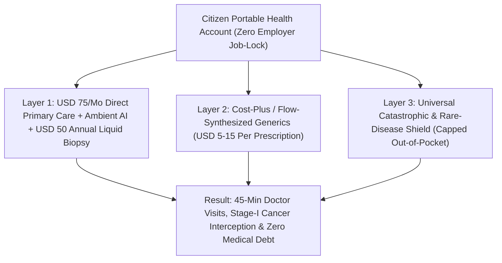

# Skipping the \$1.2 Trillion Billing Maze: Continuous AI Diagnostics & Universal Direct Care
**Pillar 3: Bioscience, Medicine & Planetary Regeneration — Carbon Edition**

> **The Cynic's Reflex:** *"Healthcare is permanently rigged by insurance monopolies, hospital billing cartels, and pharmaceutical middlemen. Even if medical technology improves, ordinary families will still drown in deductibles, prior-authorization denials, rushed eight-minute appointments, and surprise bankruptcy bills."*
>
> **The 2026 Breakthrough Reality:** Developing nations never fixed telecommunications by untangling copper-wire monopolies—they leapfrogged straight to cellular towers. Today in the U.S., nearly 30 cents of every healthcare dollar (~\$1.2 trillion a year) vanishes into billing clerks, ICD-10 coding armies, prior-authorization fax machines, and Pharmacy Benefit Managers (PBMs). By combining **Singapore's 4.5%-of-GDP Medisave + Universal Catastrophic Shield**, **\$75/month zero-insurance Direct Primary Care clinics**, **ambient AI clinical scribes**, **transparent 15%-markup Cost Plus generics**, and **\$50 multi-cancer liquid biopsies**, communities bypass the billingindustrial complex entirely—restoring eye contact to medicine while catching disease three years before tragedy strikes.

---

## Act I: Forty-Five Unhurried Minutes — A Human Story from 2030

October sunlight warms the brick storefront of the Olentangy Direct Care Cooperative in Columbus, Ohio, in 2030. Forty-nine-year-old self-employed finish carpenter David Miller walks in at 9:00 AM without an insurance card in his wallet. There is no sliding frosted-glass window, no clipboard asking for group policy numbers, and zero billing coders in the back room—just two family physicians, two nurse practitioners, an automated micro-lab, and calm acoustic oak exam rooms.

Five years earlier, in 2025, leaving a corporate factory job to start his own woodworking shop nearly ruined David's family: ACA/COBRA plans quoted \$1,950 a month with a \$7,500 deductible, his blood-pressure and asthma inhalers were randomly denied by a Pharmacy Benefit Manager, and when he finally waited four weeks to see an exhausted doctor, she spent eleven of their twelve minutes staring at an Electronic Health Record screen clicking billing-compliance boxes so the hospital could code a Level-4 visit.

Today, David's family pays a flat **\$75/month Direct Primary Care (DPC) membership** (covered pre-tax through his portable Citizen Health Account, paired with an automatic **Universal Catastrophic Shield** modeled on Singapore's *MediShield Life* that caps any major hospital surgery or trauma event).

When Dr. Priya Nair walks into the room, there is no laptop wedged between them. She pulls her chair knee-to-knee with David, listens to his lungs, checks a shoulder strain with a handheld solid-state pocket ultrasound right at the chairside, and spends **forty-two unhurried minutes** talking through his sleep, diet, and family stress while an open, HIPAA-local **ambient AI clinical scribe** quietly drafts the structured chart note and follow-up summary in the background. Before David heads out, a painless capillary blood draw runs his annual **\$50 cell-free DNA (cfDNA) multi-cancer and metabolic panel**. Two years ago, that exact test caught a silent, four-millimeter Stage Ia colon lesion three years before symptoms—removed in a twenty-minute transparent-price outpatient endoscopy for \$680 instead of a \$320,000 Stage IV chemotherapy nightmare. At the lobby counter, David picks up two 90-day generic prescriptions dispensed at wholesale cost plus 15% (**\$11.40 total**). Zero claims filed. Zero prior authorizations. Dr. Nair goes home at 5:00 PM loving medicine again.

---

## Act II: The 2024–2026 Clinical & Economic Bypass Breakout

Why did U.S. healthcare hit **\$4.9 trillion (~17.5% of GDP)** by 2025–2026 while delivering *shorter* life expectancy than nations spending a third as much? Because third-party fee-for-service insurance was gradually twisted to pay for routine, predictable primary care—the equivalent of filing a 14-page car-insurance claim with three adjusters every time you buy windshield wipers or a \$40 oil change. By 2026, U.S. hospitals employed **more billing and administrative staff than hospital beds**, doctors spent **2 hours on EHR clerical typing for every 1 hour of direct patient care**, and three giant PBMs extracted tens of billions in opaque "spread pricing" markups on pennies-per-pill generics.

Between 2024 and late 2026, four converging breakthroughs proved we can starve the billing maze rather than beg it to reform:

### 1. Ambient AI Clinical Scribes & Multimodal Point-of-Care Diagnostics
* **Returning Eye Contact to Medicine:** Deployed across Kaiser Permanente, Mayo Clinic, Sutter Health, and thousands of independent practices in 2024–2026, ambient clinical voice-to-note AI (*Abridge*, *Nuance DAX Copilot*, *Suki*, and open-weights medical LLMs) slashed after-hours physician "pajama time" charting by **50–70%** while generating instant plain-language patient takeaways.
* **Specialist-Grade Pocket Hardware:** Solid-state handheld ultrasound probes (*Butterfly iQ3*, *GE Vscan*), AI retinal OCT cameras (detecting diabetic retinopathy, cardiovascular risk, and early neurodegenerative markers in 30 seconds), and AI dermatoscopes let neighborhood primary-care doctors resolve **85% of specialist referrals** in one visit without \$2,500 hospital facility fees.

### 2. Multi-Cancer Early Detection (MCED) Liquid Biopsies Heading Toward \$50
* **Catching Stage I Three Years Early:** Over 60% of cancer deaths occur in cancers that previously had zero routine screening tests (pancreatic, ovarian, esophageal, liver). Validated across massive 2024–2026 studies—including the **140,000-patient UK NHS-Galleri trial (*GRAIL*)**, **Exact Sciences (*Cancerguard*)**, and high-throughput Ultima/Oxford Nanopore cfDNA methylation platforms—a single blood tube reads tissue-of-origin methylation signatures across **50+ cancer types** years before symptoms appear.
* **Sequencing Cost Collapse:** As raw whole-genome sequencing plunged below **\$100** on high-throughput wafer sequencers by 2025–2026, multiplex annual cfDNA screening is rapidly tracking toward a **\$50 routine primary-care lab**—shifting oncology from \$300,000 Stage IV ICU tragedy to \$1,500 Stage I outpatient removal.

### 3. Transparent "Cost Plus" Drugs & Zero-Billing Direct Primary Care
* **Mark Cuban Cost Plus Drug Company & Civica Rx:** By publishing exact manufacturer cost + a flat **15% markup** + \$5 pharmacy fee and refusing to deal with PBMs, Cost Plus Drugs exposed grotesque industry markups overnight—selling generic imatinib (leukemia therapy) for **\$14–\$35/month instead of \$2,500+**, while **Civica Rx** (a non-profit consortium of 1,500+ hospitals) manufactures sterile hospital generics and \$35 insulin directly at cost.
* **The Direct Primary Care (DPC) & Cash-Bundle Surge:** Over **2,500+ U.S. DPC clinics** and transparent surgical centers (pioneered by the *Surgery Center of Oklahoma*, posting exact all-inclusive web prices like \$4,600 for a hernia or knee repair vs. \$38,000 hospital charges) proved that firing the billing department cuts overhead by **40–60%** while tripling appointment length to 30–60 minutes.

> *"The greatest gift of medical AI isn't faster machines—it's giving doctors and nurses back the time to listen, touch, and care for human beings while catching disease years before tragedy strikes."*
> — **Dr. Eric Topol**, Founder & Director, Scripps Research Translational Institute

### Frontier Pioneers & Verified 2024–2026 Benchmarks

| Pioneer / Model | Core Structural Bypass | Verified 2024–2026 Cost & Clinical Performance |
| :--- | :--- | :--- |
| **Singapore 3M Health System** (*Medisave + MediShield Life + MediFund*) | Direct citizen health savings + universal catastrophic pool + safety net | **~4.5% to 5.5% of GDP** total health spend (vs. 17.5% US) with **84+ year life expectancy** and near-zero medical bankruptcy. |
| **Mark Cuban Cost Plus Drugs & Civica Rx** | Open wholesale cost + 15% flat markup; non-profit hospital manufacturing | **70%–98% price drops** across 2,500+ generics & sterile hospital drugs by cutting out PBM rebate middlemen completely. |
| **Ambient Clinical AI** (*Abridge, DAX, Open Medical Models*) | Real-time voice-to-structured-EHR & clinical evidence copilot | **50–70% reduction** in physician clerical documentation load across Kaiser Permanente & major health systems (2024–2026). |
| **Direct Primary Care (DPC) Movement** (2,500+ US Clinics) | Flat \$65–\$85/mo membership; zero insurance billing or ICD-10 coding | **35–55% fewer ER visits and hospitalizations** among enrolled employer/union cohorts; 40-minute average visits. |
| **cfDNA Multi-Cancer Liquid Biopsies** (*GRAIL, Exact, Ultima*) | Cell-free DNA methylation tissue-of-origin cancer interception | Detects **50+ cancer types** from one blood draw; sequencing wafer economics driving annual assay cost toward **\$50**. |
| **Transparent Bundled Surgery** (*Surgery Center of Oklahoma* / *Carrum*) | Upfront all-inclusive surgical & anesthesia web pricing | **50–80% lower surgical cost** than opaque hospital Chargemaster billing with top-decile infection safety. |

---

## Act III: Reimagining Social Conventions & Global Proof

When routine healthcare costs less than a family cell-phone plan and every hospital posts honest, binding prices upfront, three deeply liberating social shifts happen at once:

1. **Ending "Employer Job-Lock" Forever:**
   Millions of talented workers stay trapped in soul-crushing corporate jobs solely because quitting means losing health coverage for a spouse's diabetes or child's asthma. Decoupling health security from W-2 employers via **Portable Citizen Health Accounts (\$75/mo DPC + Universal Catastrophic Pool)** unleashes entrepreneurship, freelance craft, parenting sabbaticals, and small-business hiring overnight.
2. **Restoring Insurance to Its True Mathematical Purpose:**
   Homeowners insurance covers house fires—not mowing your lawn or changing lightbulbs. By paying directly for predictable primary care, labs, imaging, and generic medications at transparent cost, **Universal Catastrophic Insurance** only covers genuine high-cost tail emergencies (trauma ICUs, complex oncology, rare genetic infusions, major surgeries)—slashing catastrophic pool premiums by over 55% while guaranteeing **zero lifetime medical bankruptcies**.
3. **Transitioning Billing Clerks into High-Touch Community Health Navigators:**
   The 1.5 million Americans currently trapped fighting over faxed prior-authorization denials aren't villains—they are workers stuck in a broken bureaucracy. Retraining half of administrative coding staff into salaried **Neighborhood Care & Longevity Navigators** (checking on homebound elders, coordinating post-surgical meals, and running mobile rural screening vans) converts pure friction into human warmth.

### Global Proof & Policy Precedents
* **Singapore's *Medisave + MediShield Life + MediFund* Triad:** Proves at five-million-citizen national scale for forty years that combining personal preventative skin-in-the-game accounts, mandatory public-vs-private hospital price transparency, bulk generic tendering, and universal non-excludable catastrophic pooling achieves world-leading health outcomes at **one-third of U.S. per-capita cost**.
* **Switzerland's Universal Portable Coverage & Regulated Benefit Tiers:** Every resident owns an individual, portable policy independent of their employer, eliminating job-lock completely across career transitions.
* **2025–2026 U.S. HSA-for-DPC Statutory Expansion & CMS Prior-Authorization API Mandates:** Federal and state laws clearing pre-tax Health Savings Accounts and Medicaid managed-care pilots to pay Direct Primary Care memberships directly without middleman claims.

### Quantitative Anatomy: The \$1.2 Trillion Bypass Ledger

| Healthcare Dimension | 2025 US Fee-for-Service Status Quo | Late 2026 Bypass Frontier | 2030 Direct + Catastrophic Standard | 2034 Post-Billing Equilibrium |
| :--- | :--- | :--- | :--- | :--- |
| **Administrative Overhead Share** | **~28% – 31%** of total spend (~\$1.2T/yr waste) | 24% as AI scribes & Cost Plus scale | **11%** across DPC + bundled hospital networks | **<6%** (matching Singapore / Nordic efficiency) |
| **Average Primary Care Visit** | **12 minutes** (8 mins typing into EHR; 26-day wait) | 25–40 mins in 2,500+ DPC clinics | **45 minutes eye-to-eye**; same/next-day access | Universal unhurried relationship medicine |
| **Generic Prescription Cost** | \$80–\$800/mo PBM spread-priced tiers | \$10–\$25 via Cost Plus Drugs & Civica Rx | **\$4–\$12 / 90-day fill** dispensed in clinic | Essential medicines priced like clean tap water |
| **Multi-Cancer Screening** | Catch 60% of cancers late at Stage III/IV (\$250k+) | \$700–\$949 early MCED tests (*Galleri*) | **\$50 annual cfDNA blood panel** in primary care | **80%+ caught at Stage I** (>95% outpatient cure) |
| **Annual Household Health Burden** | **\$24,000+/yr** employer + worker family premium | \$9,500/yr in early DPC + catastrophic employers | **\$4,200/yr all-in** portable universal architecture | **Zero medical bankruptcies**; W-2 job-lock extinct |

---

## Act IV: Answering the Cynic & The Synergy Cascade

### Hard Questions from Skeptics — Answered Empirically
* **"Wait—if insurance lobbies and PBMs make hundreds of billions from the current maze, won't they block this in Congress?"**
  * That is the genius of a **structural bypass**: you don't need PBM permission to stop using PBMs!
  * Self-insured employers (who actually pay the medical bills for >65% of privately insured Americans), labor unions, municipal worker funds, and state employee plans are *already* bleeding dry from \$25,000 family premiums. When unions and mid-sized employers switch directly to **\$75/month DPC + Cost Plus Drugs + transparent surgical bundles + stop-loss catastrophic reinsurance**, they cut their own health spend by **30–45% overnight** while giving workers zero-deductible care—starving middlemen through market defection rather than waiting on lobbyists.
* **"If every DPC doctor spends 45 minutes per visit, won't we run out of doctors immediately?"**
  * Today's "doctor shortage" is largely a **typing and faxing shortage**: physicians currently lose >50% of their working week to ICD-10 billing documentation, prior-authorization phone trees, and defensive inbox bloat.
  * Liberating doctors and nurse practitioners with ambient AI scribes and zero insurance coding **doubles effective clinical face-time instantly** using the exact workforce we already have—while ending the burnout wave driving doctors into early retirement.
* **"Won't \$50 multi-cancer liquid biopsies cause terrifying false-positive wild-goose chases?"**
  * Early first-generation tests worried clinicians for exactly that reason, which is why 2025–2026 methylation + fragmentomics assays calibrate specificity at **>99.5%** (fewer than 0.5% false positives) and automatically pinpoint the **exact tissue of origin** (e.g., colon vs. lung vs. pancreas with ~90% accuracy), pairing any positive signal with a single targeted low-dose scan rather than whole-body guesswork.
* **"What happens to low-income or chronically ill citizens who can't afford \$75/month?"**
  * Exactly like Singapore's *MediFund* and Medicaid DPC vouchers, public funding automatically covers 100% of the \$75/month membership and catastrophic shield for low-income households—giving Medicaid patients the exact same 45-minute neighborhood doctor as a tech executive instead of second-class ER waiting rooms.

### Anatomy of a Family's Annual Healthcare Budget: 2025 Maze vs. 2030 Direct Architecture
Where does a typical working family of four's \$26,500 combined employer-and-worker health outlay actually go in 2025—and how does the Singapore-inspired Direct + Catastrophic bypass return **\$21,000+ per year** straight into household paychecks?

| Household Care Layer (Family of 4) | 2025 Legacy Employer PPO + PBM Maze | 2030 Direct Care + Catastrophic Bypass | What Changed Structurally |
| :--- | :--- | :--- | :--- |
| **Primary, Urgent & Pediatric Care** | \$6,800/yr premium slice + \$150 copays + 3-wk waits | **\$1,800 / yr** (\$150/mo family DPC membership; \$0 copays) | Fired billing coders; 45-min visits + unlimited messaging |
| **Annual Labs, Imaging & Cancer Screen** | \$2,400/yr out-of-pocket toward \$6,000 deductible | **\$240 / yr** (wholesale labs + two \$50 adult cfDNA panels) | Point-of-care microfluidic chips & wafer sequencing |
| **Routine & Chronic Prescriptions** | \$4,100/yr PBM formulary tiers & prior-auth delays | **\$180 / yr** (Cost Plus 15%-markup & Civica flow generics) | Eliminated PBM rebates and spread-pricing middlemen |
| **True Catastrophic Hospital Backstop** | \$13,200/yr bloated hospital/insurer admin overhead | **\$2,200 / yr** (Universal Catastrophic Pool + transparent bundles) | Insurance reserved strictly for rare trauma/ICU/oncology |
| **Total Annual Family + Employer Spend** | **~\$26,500 / yr** (+ risk of surprise bankruptcy) | **\$4,420 / yr all-in** (**+\$22,080/yr wage dividend**) | **83% cost reduction; 100% portable across any job** |

### Step-by-Step: How Unions, Cities & Citizens Trigger the Bypass Without Waiting on Congress
1. **Step 1 — Self-Insured Municipal & Union Defection:**
   * City governments (following pioneers like Rosen Hotels in Florida, saving >\$500M cumulatively by running its own zero-PBM direct clinic for 4,000+ hospitality workers!) and union health trusts redirect wasted PBM/carrier fees into neighborhood DPC memberships and transparent bundled surgical centers.
2. **Step 2 — Portable Citizen Health Accounts (`HSA-for-All` + Medicaid DPC Parity):**
   * Federal and state safe-harbor rules let every worker, gig freelancer, and Medicaid enrollee route pre-tax or public health dollars straight into a \$75/month DPC clinic of their choice.
3. **Step 3 — Municipal Continuous-Flow Generic Micro-Foundries:**
   * Regional hospital cooperatives (scaling **Civica Rx** and DARPA continuous-flow synthesis cartridges) brew sterile insulin, antibiotics, inhalers, and off-patent peptides locally for dollars per month—ending drug shortages forever.
4. **Step 4 — Universal Automatic Catastrophic Shield:**
   * Reallocating existing public tax subsidies funds an automatic, non-excludable national stop-loss shield capping any household's catastrophic hospital exposure, making medical bankruptcy legally and mathematically extinct.

### Real-World Employer Proof: The Rosen Hotels Precedent Scaled Nationwide
* **Thirty Years of Zero-PBM Proof in Orlando:**
  * Independent hotelier Harris Rosen replaced traditional insurance middlemen for his 4,000+ hospitality staff with an on-site, zero-copay Direct Primary Care medical center, physical therapy, and direct wholesale drug dispensing—spending **roughly half the national employer average per worker** while accumulating over **\$500 million in net savings** that funded free college scholarships for entire underserved Orlando neighborhoods.
* **2026–2030 Cooperative Pooling for Small Shops:**
  * Neighborhood carpentry guilds, restaurants, farms, and tech startups band together into regional **Direct Care Purchasing Cooperatives**, unlocking that exact Rosen Hotels cost curve with five minutes of online onboarding.

### Cross-Atlas Synergy Links
* **100 Vibrant Years ([`epigenetic-healthspan`](../epigenetic-healthspan/REPORT.md)):** Combining \$50 multi-cancer cfDNA assays with 11-organ epigenetic aging clocks turns every neighborhood DPC clinic into a preventative healthspan sanctuary.
* **One-Dose Genetic Cures ([`invivo-crispr-cures`](../invivo-crispr-cures/REPORT.md)):** Universal Catastrophic & Sovereign Cure Pools finance one-time \$400 *in vivo* CRISPR infusions seamlessly without insurance-switching games.
* **Silencing the Hijacked Brain ([`craving-reset-mental-health`](../craving-reset-mental-health/REPORT.md)):** Abolishing prior-authorization delays ensures patients in acute addiction or suicidal crisis receive GLP-1/LIFU/SAINT care in minutes rather than fatal weeks.

---

## References & Verified Sources

* **Featured Researcher / Leader:** [Dr. Eric Topol — Founder & Director, Scripps Research Translational Institute](https://www.scripps.edu/science-and-medicine/translational-institute/)
* **Companies, Labs & Consortia:** [Mark Cuban Cost Plus Drug Company & Civica Rx](https://www.costplusdrugs.com/) · [Abridge, Nuance DAX & Open Clinical AI Scribes](https://www.abridge.com/) · [Direct Primary Care Coalition (2,500+ Clinics)](https://www.dpcare.org/) · [GRAIL (Galleri), Exact Sciences & Ultima Genomics](https://grail.com/) · [Butterfly Network (Solid-State Pocket Ultrasound)](https://www.butterflynetwork.com/) · [Surgery Center of Oklahoma & RosenCare](https://surgerycenterok.com/)
* **Global & Regulatory Precedents:** [Singapore 3M System (Medisave + MediShield Life + MediFund)](https://www.moh.gov.sg/) · [UK NHS 140,000-Patient Multi-Cancer Liquid Biopsy Trial](https://www.nhs-galleri.org/) · [Rosen Hotels Zero-PBM Direct Care (\$500M+ Saved)](https://en.wikipedia.org/wiki/Harris_Rosen) · [Switzerland Universal Portable Non-Employer Coverage](https://en.wikipedia.org/wiki/Healthcare_in_Switzerland)
* **Connected Carbon Pathways:** [100 Vibrant Years: Epigenetic Rejuvenation & Preventative Healthspan](../epigenetic-healthspan/REPORT.md) · [Silencing the Hijacked Brain: GLP-1 Craving Reset, Focused Ultrasound & Restorative Psychiatry](../craving-reset-mental-health/REPORT.md) · [The Household Abundance Dividend: How Energy × Robotics × Bio Slashes Family Costs 70%](../../06-synergy-horizons/cost-of-living-collapse/REPORT.md) · [Never Punished for Working: Dignified Zero-Cliff Universal Floors](../../04-social-norms/zero-cliff-safety-nets/REPORT.md)
